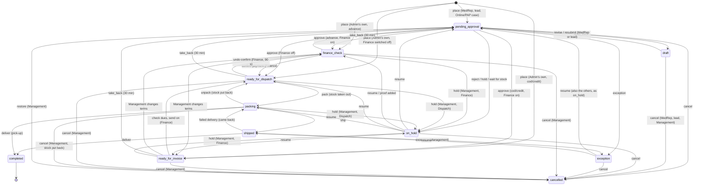
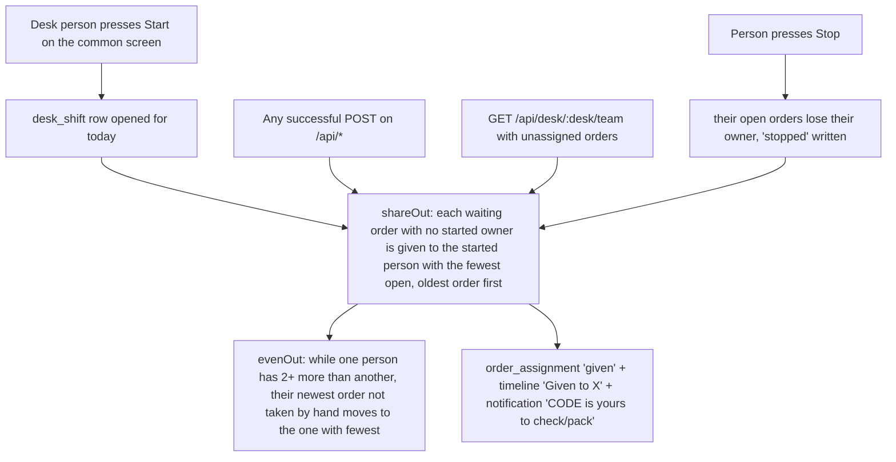

# 01 · The order line (orders, approval desks, decisions, checks, audit)

Read-only audit of the code as it stands on 22 Nov 2026 (commit `fa3a9c9d`). Every statement
comes from a file that was read; `path:line` is given for anything that is not obvious. Paths are
relative to the repository root. API paths are under `apps/api/src/`, web paths under
`apps/web/src/`, migrations under `apps/api/migrations/`.

Words used here: **Implemented** = the code does it. **Partly** = part is in code, part only in
the screen or only in a comment. **Planned** = written in a comment or `docs/PLAN.md` but no code.
**CONFIRMED** = I can point at the lines. **SUSPECTED** = follows from the code but needs a run
to prove.

---

## 1. What this area is for

The order line is how a sale travels through the company:

**MedRep (or Online / PAP case, or Admin) places → Management approves → Finance checks the
money → Dispatch packs, ships, delivers → the invoice is paid.**

It replaces the old "hub" (`hub.getmeds.ph`) state machine (`orders/rules.ts:1-2`). The
departments involved are the field sales channels (who place), Management (approval desk),
Finance (payment / dues desk), Dispatch (warehouse desk), and the CEO / Admin (figures, audit,
data checks).

The slice also holds four side systems that sit on top of the order line:

| Part | Folder | What it is |
|---|---|---|
| Desk sharing | `desks/` | One common screen per desk (Management, Finance, Dispatch); the people press Start, waiting orders are shared out among them, actions are written in the order's person's name |
| To decide | `decisions/` | One list of every decision waiting on the signed-in person (orders, leave, forms, returns…), read from the other areas |
| Data checks | `checks/` | 18 SQL checks of the data against itself (Admin / CEO), plus the Admin's one-off import addresses |
| Audit | `audit/` | One read-only list of "who did what, when" across all logs (CEO / Admin) |
| Automations | `automations/` | A 15-minute timer that only sends notifications (stuck orders, licences, late customers, expiring stock, samples, the CEO's morning line) |

---

## 2. Who uses it

### 2.1 Role lists checked in code

| Constant | Roles | Where |
|---|---|---|
| `ORDER_PLACE_ROLES` | `medrep`, `team_lead`, `manager`, `online`, `admin` | `orders/rules.ts:65` |
| `ORDER_MANAGE_ROLES` | `management`, `admin` | `orders/rules.ts:69` |
| `ORDER_ALL_ROLES` (see every order) | `management`, `finance`, `dispatch`, `inventory`, `ceo`, `admin` | `orders/rules.ts:71-78` |
| `CASE_AGENT_ROLES` | `online`, `admin` | `orders/rules.ts:68` |
| `FINANCE_ROLES` | `finance`, `admin` | `finance/rules.ts:8` |
| `DISPATCH_ROLES` | `dispatch`, `admin` | `dispatch/rules.ts:7` |
| Desk duty desks | `management`, `finance`, `dispatch` | `desks/service.ts:18` |
| Data checks | `admin`, `ceo` | `checks/integrity.ts:163` |
| Audit | `ceo`, `admin` | `audit/trail.ts:75` |

Two special cases:

- **The Online channel's MedRep** counts as `online` wherever `allow()` lists `online`
  (`http.ts:84-89`).
- **The PAP head**: an order whose channel code is `PAP` is decided by that channel's `head_id`,
  not Management (`orders/service.ts:814`; `orders/rules.ts:163-165`). Admin can still decide it.
- **Approval scope**: a Management person may be limited to some Divisions through
  `person.approves` (migration 0094). An order with no Division is only for people with
  `approves = null` (`orders/service.ts:121-124`). Approve / send back / reject outside the scope
  is refused with 403 (`orders/service.ts:2173-2178`).

### 2.2 Who sees which orders (`seen()`, `orders/service.ts:128-142`)

| Who | Sees |
|---|---|
| A lead with a box picked on the team switch (`?unit=`) | Orders sold from the seats under that box (or, with no seat, by the people under it) |
| `management`, `finance`, `dispatch`, `inventory`, `ceo`, `admin` | Every order |
| `team_lead`, `manager` | Orders whose MedRep or raiser is under them at any depth, or sold from a seat whose boss is under them |
| `online` | Own orders, plus every order that came from a case (`lead_id is not null`) |
| `medrep` (and anyone else) | Own orders (as MedRep or raiser), plus orders sold from a seat they hold or cover today |

### 2.3 What each may do on one order (`orderActions`, `orders/rules.ts:142-204`)

"Decides" = Management/Admin, or the PAP head (and Admin) for a PAP order. "Mine" = the order's
raiser or MedRep, or the lead of its MedRep (`team`, `orders/service.ts:113-117`).

| Action | Who | When |
|---|---|---|
| `approve`, `send_back`, `reject` | Decides | status `pending_approval` |
| `hold` | Management/Admin | `pending_approval`, `finance_check`, `ready_for_invoice`, `ready_for_dispatch`, `packing` |
| `hold` | Finance | `finance_check`, `ready_for_invoice` |
| `hold` | Dispatch | `ready_for_dispatch`, `packing` |
| `exception` | Management/Admin | the five above, or `shipped` |
| `resume` | Management/Admin (any hold); Finance (holds whose holder is Finance); Dispatch (its own) | `on_hold` / `exception` |
| `cancel` | Management/Admin | anything except `shipped`, `completed`, `cancelled` |
| `cancel` | Mine | `draft`; or held and `held_from` is empty or `pending_approval` |
| `answer` (words on a hold) | Mine | `on_hold` / `exception` |
| `resubmit` | Mine | `draft` |
| `take_back` | Management/Admin | while the server says the approval can still be taken back |
| `restore` | Management/Admin | `cancelled` and restorable |
| `confirm_payment` | Finance | `finance_check` |
| `make_invoice` | Finance | `ready_for_invoice` |
| `pack` | Dispatch | `ready_for_dispatch` |
| `unpack`, `ship` | Dispatch | `packing` |
| `deliver` | Dispatch | `shipped` or `packing` (pick-up) |
| `failed` | Dispatch | `shipped` |

A team lead "approves nothing" (`orders/rules.ts:157-158`; test `orders/team-ask.test.ts:87`).

---

## 3. Features

Each feature: what / why / who / in / out / tables / touches / next / trigger.

### 3.1 Place an order — Implemented

- **What**: creates one `sales_order` with its lines, first version and first timeline line, in
  one transaction (`orders/service.ts:1932-2113`).
- **Who**: `ORDER_PLACE_ROLES` (`orders/routes.ts:227`). Management cannot place (Aryan, 19 Nov;
  `orders/rules.ts:63-65`).
- **Sources of an order** (every caller of `placeOrder`):

| Source | Caller | Notes |
|---|---|---|
| Field order form `/orders/new` | `POST /api/orders` (`orders/routes.ts:226`) | MedRep, team lead / manager (for one of their MedReps), Online desk, Admin |
| A field visit ("Add order" on a call) | same address with `visitId`; joins the visit inside the same transaction (`orders/routes.ts:233-239`) | |
| An Online or PAP case turned into an order | `online/service.ts:1766` | passes `leadId`, the case's terms, relief from the case's papers, the case's quote lines; a GL case's letter number and amount |
| Demo seeds | `orders/seed.ts:81`, `orders/seed-team.ts:189` | only with `SEED_DEMO=1` (`server.ts:58`) |

  Zoho's old sales orders are imported as history only (`past_order`, `checks/routes.ts:73-80`),
  never into `sales_order`.

- **What goes in** (`orderInput`, `orders/routes.ts:56-121`): customer, optional MedRep, 1–60
  lines (medicine, whole quantity up to 1,000,000, price kind, optional unit price, reason, free
  flag), delivery address / receiver / phone, note, date needed, customer PO, billing company
  (`2mg` or `getmeds`), doctor, tender, the checks switch, Division / Sub-division / Headquarter,
  Payment Term label, no-proof reason, Source (13 fixed values, `orders/divisions.ts:222-236`),
  stock reason, patient order + patient name, order type, no-prescription reason, GL number and
  amount, SC/PWD relief.
- **Rules applied by the API**:

| Rule | Where |
|---|---|
| Delivery date not in the past | `service.ts:1940` |
| Doctor must be a customer of kind `doctor` | `service.ts:1942-1949` |
| A medicine may appear once paid and once free; at least one paid line | `service.ts:1643-1655` |
| A price of the kind picked must exist (list, promo, or running offer) | `service.ts:1722-1728` |
| Any price other than the list price needs a reason (below or above) | `service.ts:1784-1790` |
| A free line is priced 0, reason defaults to "Free" | `service.ts:1702-1710` |
| A cold-chain box line takes whatever price is typed | `service.ts:1712-1720` |
| SC/PWD relief: each paid line gets the lowest of (patient price less VAT and 20%), (promo less VAT), (a lower quoted price less VAT, cases only), (the price it already had on a changed order); never typed | `service.ts:1730-1771` |
| Offers: Buy X Take Y free pieces are computed, never typed; not combined with relief | `orders/offers.ts:70-94`, `service.ts:1806` |
| Order type: a patient customer needs a patient type; `po` needs a PO number; `senior_pwd` needs relief; relief needs type `senior_pwd` (unless from a case) | `service.ts:1971-1979` |
| SC/PWD ID number required when not from a case | `service.ts:1814-1829` |
| Division must be one of the eight tracker channels (hub words are translated) | `service.ts:1843-1849`, `divisions.ts:9-36` |
| A tender can be linked only if it is this customer's, has no order yet, and is `won` / `contract` | `service.ts:2088-2102` |

- **Derived values**: whose order (`medrep_id`) = the picked MedRep, else the placer (MedRep /
  Online), else the active MedRep of the customer's area, else the placer
  (`service.ts:1986-1996, 2048`); `channel_id` = that person's channel; payment terms = the
  case's, else parsed from the Payment Term label (`termsOfLabel`, `divisions.ts:193-220`), else
  the customer's own (`service.ts:2009-2014`); Division = picked, else the person's seat's, else
  their channel's (`service.ts:2026-2027`); Sub-division / Headquarter by the hub's rule
  (`divisions.ts:158-170`); total = Σ qty × unit price + delivery fee (`service.ts:1964`);
  delivery address defaults to the customer's address + city (`service.ts:2050, 2117-2121`);
  `seat_id` is set by a database trigger (migration 0030); order number `2MG-5xxxxx` from a
  gapless counter (`service.ts:2063-2066`, migration 0011).
- **What comes out**: `{ id }`. Status `pending_approval` for everyone except an Admin's own
  non-patient order, which starts already approved at `finance_check` / `ready_for_invoice`
  (`service.ts:1983, 2038`).
- **Tables written**: `sales_order`, `order_item`, `order_version` (n = 1, "placed"),
  `order_event` ("created", and "approved" for the Admin), `counter`, optionally `tender`,
  `tender_event`; through triggers `order_step` (migration 0023).
- **What happens next**: `routeOrder` (section 4.3); then, outside the transaction, the customer
  is told "confirmed" (`tellCustomer`, `routes.ts:240`, not awaited). Papers are uploaded by the
  browser afterwards, one request per file (`web orders/order-new.tsx:999-1005`).

### 3.2 Routing after placing (`routeOrder`) — Implemented, with dead branches

`orders/service.ts:660-739`. See section 4.3 for the exact logic and finding F2.

### 3.3 What the system finds on an order (`findingsOf`) — Implemented

Pure function, `orders/service.ts:435-595`. It is worked out live every time an order, a card or
the queue is read; nothing is stored.

| Finding kind | Condition | Line |
|---|---|---|
| `note` | The MedRep wrote a note (not shown for case orders: their note is the case's label) | 451-458, 636-637 |
| `rx` No prescription | Patient customer or patient order, and no `prescription` paper | 465-472 |
| `rx` No patient ID | Same, and neither `valid_id` nor `senior_id` paper | 473-479 |
| `rx` No SC/PWD ID | Any relief line and no `senior_id` paper | 482-488 |
| `price` Free goods | A free line that is not an offer's | 492-498 |
| `price` Below list | Paid line under its floor (list price; for relief the legal price) | 500-509 |
| `price` Above list | Paid, non-relief line over its list price | 511-517 |
| `price` Other buyer's price | Priced as another buyer kind and cheaper than the customer's own kind's price | 520-535 |
| `stock` Stock short | Quantity (paid + free of the same medicine) more than what is free | 536-545 |
| `stock` No cold box | A cold-chain medicine and no cold-box line | 548-555 |
| `customer` New customer | `customer.review = 'to_review'` | 556-562 |
| `licence` Licence expired | `licence_expires` before today (Manila) | 563-569 |
| `papers` No payment proof | Terms `advance` and no `payment_proof` paper | 570-576 |
| `owes` Overdue | The customer has overdue money | 577-584 |
| `credit` Over credit limit | owed + this order's total > credit limit | 585-593 |

Finance sees only the money kinds (`owes`, `credit`, `papers`) on its cards
(`service.ts:598, 976-979`). The order's own invoice is left out of "owed"
(`service.ts:938-944, 1407`). Findings are shown while the order is before Dispatch
(`service.ts:953-973, 1477-1479`).

**"Free on the shelf"** for a line = unexpired stock in all warehouses, less what orders with a
smaller id still promise (first placed, first served); zero deduction once this order is packed,
shipped, completed, cancelled or draft (`service.ts:383-388`).

### 3.4 Management's approval — Implemented

- **Approve** (`service.ts:2215-2278`): refused for a patient's order with no prescription on
  file (409 `no_prescription`); warehouse = the one sent or the default active one; Management
  may switch Finance's check on or off (`finance`); with Finance on, status becomes
  `finance_check` (advance) or `ready_for_invoice` (cod / days) and the invoice is made at once
  (`invoiceOnApproval`); with Finance off, the order goes straight to `ready_for_dispatch` with
  its invoice (`clearCaseOrder`). Sets `approved_at`, `approved_by`, `warehouse_id`.
- **Approve check by check** (`approveCheck`, `service.ts:2911-2943`, migration 0116): four keys
  `papers`, `price`, `stock`, `customer`, each stored in `order_check` with who and when.
  `papers` also stamps `papers_checked_by/at`. Cleared on send back, take back, any revise /
  change (`clearChecks`). **The API's Approve does not require them** (finding F1).
- **Papers checked by hand** (`checkPapers`, `service.ts:2988-3008`, migration 0111): Management
  (or the PAP head) says the papers are right; `ok:false` takes it back. A new paper (not a
  payment proof, not a delivery receipt) resets it (`service.ts:3048-3051`).
- **Send back** → `draft` with reason, counter, who and when; MedRep's earlier reply cleared
  (`service.ts:2279-2291`).
- **Reject** → `on_hold` held from `pending_approval` by Management (`service.ts:2292-2296`).
  It is a hold, not an end; to end an order, cancel it (the screen says so,
  `web orders/parts.tsx:96-100`).
- **Change before approving** (`POST /api/orders/:id/change` → `reviseOrder(..., "management")`,
  `service.ts:2478-2734`): Management edits lines and details with a reason; the order stays
  `pending_approval`; a version "changed" is saved; the MedRep and raiser are notified with the
  list of changes.
- **Complete the details** (`saveOrderDetails`, `service.ts:2742-2847`): Management / Admin only;
  Division, Sub-division, Payment Term, receiver, phone, address, date, PO, billing company,
  note. Allowed until the invoice has money on it or the order left Finance; new terms at
  Finance move the order between `finance_check` and `ready_for_invoice`; the unpaid invoice
  follows the new details (`refreshInvoice`).
- **Warehouse fill** (`warehouseFill`, `service.ts:1267-1310`): for the approver only, each
  active warehouse with what it cannot fill of this order.
- **"I'll handle it" / take over / let go** (`handleOrder`, `service.ts:3118-3177`): sets
  `manage_by`; written to `order_assignment` and the timeline.
- **Ask up** (`orders/asks.ts`): Management asks the MedRep's Team Lead or Business Mentor
  (top lead above the MedRep) a question on the order; only the one asked answers Yes / No (a No
  needs a word); both are notified and written on the timeline. One open question per person per
  order. The answer does not change the order; Management still decides.
- **Take back an approval** (`take_back`): within 30 minutes (`TAKE_BACK_MINUTES`,
  `service.ts:196`), approved by a person, status still `finance_check` / `ready_for_invoice` /
  `ready_for_dispatch`, and nothing done by the next desk and no real money on the invoice
  (`takeBackSql`, `service.ts:200-207`). Invoice cancelled, checks cleared, back to
  `pending_approval` (`service.ts:2442-2457`).

### 3.5 The MedRep's side — Implemented

- **Fix and send again** (`POST /api/orders/:id/revise` → `reviseOrder`): only on a `draft`
  that is "mine"; an answer to Management is required; the customer cannot change; every
  difference (lines added / removed / quantity / price / price kind, relief, terms, date,
  address, receiver, PO, note, Division, Sub-division) is written on the timeline; version
  "fixed" saved; status back to `pending_approval` (`service.ts:2585-2733`).
- **Send again unchanged** (`resubmit`): needs the answer as reason (`service.ts:2429-2441`).
- **Answer a hold** (`answer`): words only; the hold stays (`service.ts:2395-2397`).
- **Cancel own order**: while draft, or held before Finance acted (`rules.ts:185-188`).
- **Write the guarantee letter's number and amount** (`setOrderGl`, `service.ts:2948-2982`):
  the order's MedRep / raiser, Management or Finance, on a `gl`-type order not cancelled.
- **My orders, my KPIs** (section 8).

### 3.6 Papers on an order — Implemented

`addPaper` / `readPaper` / `removePaper` (`service.ts:3010-3114`). Kinds: `po`, `hospital_doc`,
`payment_proof`, `prescription`, `valid_id`, `senior_id`, `med_cert`, `gl`, `dr`, `other`
(`rules.ts:292-303`, migration 0049). JPEG / PNG / WebP / HEIC / HEIF / PDF, up to 10 MB. Bytes
go through `keepFile("orders", …)` (`service.ts:3027`), as the project rule requires. A removed
paper is only marked `active = false`.

Who may add (`mayAddPaper`, `rules.ts:428-451`): never on a cancelled order; Finance a
`payment_proof` at any time; Dispatch a `dr` at any time; Management, the raiser, the MedRep or
the lead until the order is completed.

**Automatic trigger**: a `payment_proof` added to an order that is `on_hold` with
`held_from = 'finance_check'` puts it back to `finance_check` by itself (`service.ts:3053-3068`;
see finding F6).

`paperList` (`rules.ts:313-423`) tells the screen which papers the order is expected to carry
by customer kind, terms, order type, Division; only shown, never enforced except the
prescription at approval and the delivery receipt at delivery.

### 3.7 Holds, exceptions, waiting for stock — Implemented

- **Hold** (`service.ts:2297-2331`): status `on_hold`, remembers `held_from` and `held_role`
  (`finance` / `dispatch` by the actor's role, otherwise `management`), reason required.
- **Waiting for stock** (`stock: true`): refused if nothing is short; the reason is generated
  ("Waiting for stock: X (needs n, m free)"); `waiting_stock_at/by` set. When stock comes in
  (`afterStockIn`, called from `purchases/routes.ts:153`, `books/routes.ts:186`,
  `inventory/routes.ts:225, 261`) or an order is cancelled (`orders/routes.ts:408-411`), the
  holder and the MedRep are notified once per wait (`orders/stock-wait.ts:44-82`). The order is
  **not** resumed automatically; the holder takes it off hold.
- **Exception** (`service.ts:2332-2336`): Management only; like a hold but labelled Exception;
  also possible while `shipped`.
- **Resume** (`service.ts:2337-2373`): Finance and Dispatch lift their own holds with one press;
  Management must say why and may pick where it goes on from (`resumeChoices`,
  `rules.ts:113-128`): where it stopped, or an earlier desk — Finance's step (only when it
  stopped at `ready_for_dispatch` and Finance's check is on) or `pending_approval`. Never an
  earlier desk once real money is on the invoice or it stopped at `packing` / `shipped`. Going
  back before Finance wipes Finance's check; going back to Management cancels the invoice and
  the approval (the invoice is re-issued with the same number when approved again).

### 3.8 Cancel and restore — Implemented

- **Cancel** (`service.ts:2398-2428`): status `cancelled`; packed pieces go back on the shelf
  (`putBack`, `dispatch/service.ts:320-355`: stock +, a `stock_move` of kind `return`, picks
  marked inactive); the invoice is cancelled (money received becomes "refund owed", customer
  credit released, `finance/service.ts:704-735`); points used go back. After the transaction,
  waiting-for-stock orders are re-checked.
- **Restore** (`service.ts:2374-2394`): Management brings a cancelled order back to
  `pending_approval`. Allowed only when (`restorableSql`, `service.ts:211-215`): not from a case,
  no points used, nothing refunded on its invoice, no return, not a PAP channel order.

### 3.9 Versions — Implemented

`order_version` (migration 0083): n = 1 "placed", then "fixed" (MedRep) or "changed"
(Management), each with who, when, why, the lines as JSON and the total
(`service.ts:1913-1930`). `order_item` always holds the newest lines (deleted and re-inserted on
each revise, `service.ts:2671-2676`). Cards and lists carry a `changed` flag
(`service.ts:184`). Screen: `web orders/versions.tsx`.

### 3.10 Returns (cross-area, summarised) — Implemented in `returns/`

Asked on the order by who sold it or Management (`returns/service.ts:138`). Statuses:
`requested` → `approved` → `checked` → `received` (credited), or `rejected`, `cancelled`
(`returns/service.ts:42-48`). For an order not shipped yet, approving the return cancels the
order through `actOnOrder(..., "cancel")` (`returns/service.ts:341`). The return screens live in
this slice's web folder (`orders/returns.tsx`, `orders/all-returns.tsx`); the API belongs to the
returns area.

### 3.11 Send to customer — Implemented (API in `online/tell`)

`GET /api/orders/:id/update` gives the newest step's message; `POST …/update/email` re-sends the
email (409 if nothing to send, no email on file, or no mailbox connected);
`POST …/update/sent` notes that it was sent by WhatsApp / Viber / SMS / Messenger / copy
(`orders/routes.ts:246-282`). Every order action also calls `tellCustomer` once, not awaited
(`routes.ts:416`).

### 3.12 Sales Order paper and the customer's PO paper — Implemented

`GET /api/orders/:id/sales-order` (`orders/sales-order.ts`): the order laid out like Zoho's
Sales Order; anyone who may open the order may print it. Ribbon: Draft / Void / Closed /
On Hold / Pending Approval / Confirmed (`sales-order.ts:27-35`). The same data is turned round
as a purchase order for the customer to sign (`web orders/purchase-order.tsx`).

### 3.13 Desk sharing — Implemented (section 4.6)

### 3.14 To decide, Data checks, Audit, Automations — Implemented (sections 8 and 9)

---

## 4. Workflows and statuses

### 4.1 Statuses

| Status (database) | Label on screen (`rules.ts:22-36`) | Meaning | Whose move |
|---|---|---|---|
| `draft` | Draft | Sent back to the MedRep (the only way an order becomes a draft) | MedRep |
| `pending_approval` | Pending Management Approval | Waiting for Management (or the PAP head) | Management |
| `finance_check` | With Finance | Paid in advance: Finance checks the money | Finance |
| `ready_for_invoice` | Finance Check | Credit / COD: Finance checks what the customer owes | Finance |
| `ready_for_dispatch` | Ready For Dispatch | Waiting to be packed | Dispatch |
| `packing` | Packed | Packed, waiting to be shipped (or came back) | Dispatch |
| `shipped` | In Transit | With a courier or our rider | Dispatch |
| `completed` | Delivered ("Completed" once the invoice is paid, `service.ts:1485-1487`) | Delivered | — |
| `on_hold` | On Hold | Stopped with a reason; `held_from` and `held_role` say where and by whom | the holder |
| `exception` | Exception | Stopped by Management for a problem it cannot settle alone | Management |
| `cancelled` | Cancelled | Ended; kept | — |

The database constraint lists exactly these eleven (migration 0012; the first design had an
`invoiced` status, removed there).

Timeline **stages** (a separate, cumulative list on `order_event.stage`, `rules.ts:51-61`):
`created`, `approved`, `finance_verified`, `invoiced`, `paid`, `packed`, `shipped`, `delivered`,
`completed`. "Paid" and "Completed" count only while the invoice is paid (`service.ts:1531-1537`).

### 4.2 The full state diagram

### 4.3 How `routeOrder` decides (`service.ts:660-739`)

What the code does today, in order:

1. Reads the findings and the order. `manager` = role is Management / Admin. `fromCase` = the
   order has a `lead_id`.
2. `manages` = `manager` **and** the order is not `pending_approval` (line 680). In practice:
   only an Admin's own, non-patient order.
3. `finance_check` is written: for a manager's non-case order, the switch sent
   (`checks.finance`); otherwise what the row already has (default `true`) (lines 687-690).
4. **If not `manages` → return "management"** (line 693). The order stays `pending_approval`.
   This is every MedRep's, lead's, Online's and PAP's order, and any resubmit / revise.
5. If `manages` and Finance is on → the invoice is made, return "finance" (lines 716-730).
6. If `manages` and Finance is off → `clearCaseOrder`: `ready_for_dispatch` with its invoice,
   return "dispatch" (lines 732-738).

A MedRep cannot switch Management or Finance off through the API (test
`orders/order-line.test.ts:109`). See finding F2 for the branches that can never run.

### 4.4 Every transition

| # | From → To | Action / endpoint | Who | Conditions | Side effects |
|---|---|---|---|---|---|
| 1 | (new) → `pending_approval` | `POST /api/orders` | place roles | section 3.1 rules | version 1, event "created", routeOrder, customer told |
| 2 | (new) → `finance_check` / `ready_for_invoice` / `ready_for_dispatch` | same | Admin, non-patient order | `checks.finance` decides | approved_at/by = Admin, default warehouse, invoice made |
| 3 | `pending_approval` → `finance_check` / `ready_for_invoice` | `POST /api/orders/:id/approve` | decides, in scope | prescription on file for a patient; a warehouse exists | approved_at/by, warehouse, invoice made, MedRep + lead notified, Finance notified by trigger |
| 4 | `pending_approval` → `ready_for_dispatch` | approve with `finance:false` | same | same | invoice made, Dispatch notified by trigger |
| 5 | `pending_approval` → `draft` | `…/send_back` | decides, in scope | reason | checks cleared, sent_back_* set, MedRep notified ("team_stop" to lead) |
| 6 | `pending_approval` → `on_hold` | `…/reject` | decides, in scope | reason | held_from pending_approval, held_role management |
| 7 | `draft` → `pending_approval` | `POST …/revise` or `…/resubmit` | mine | answer required; same customer | version "fixed" (revise), reply stored, checks cleared (revise), the sender-back (or all Management) notified |
| 8 | any open* → `on_hold` | `…/hold` (`stock:true` for waiting) | Management; Finance / Dispatch at own steps | reason, or something short for stock | held_from, held_role, flag_reason; MedRep, lead (and Management when held by another desk) notified |
| 9 | open* or `shipped` → `exception` | `…/exception` | Management | reason | held_role management |
| 10 | `on_hold` / `exception` → held_from (or earlier) | `…/resume` (`to`) | Management (reason), Finance / Dispatch own holds | `to` within `resumeChoices` | earlier desk: Finance's check wiped; back to Management: invoice cancelled, approval cleared; MedRep and the receiving desk notified |
| 11 | `on_hold` (from finance_check) → `finance_check` | `POST …/papers` kind `payment_proof` | whoever may add it | — | automatic |
| 12 | approved, ≤ 30 min → `pending_approval` | `…/take_back` | Management | `takeBackSql` | checks cleared, invoice cancelled, the desk it had reached and the MedRep notified |
| 13 | `finance_check` ↔ `ready_for_invoice` | `POST …/details` with new Payment Term | Management | invoice unpaid, order still with Finance | invoice refreshed |
| 14 | `finance_check` → `ready_for_dispatch` | `POST /api/finance/orders/:id/confirm-payment` | Finance | "checked" ticked; proof on file or bank reference when money is typed; amount ≤ due | payment recorded, finance_checked_at/by, stage `finance_verified` (+ `paid` when in full) (`finance/service.ts:512-582`) |
| 15 | `ready_for_invoice` → `ready_for_dispatch` | `POST /api/finance/orders/:id/invoice` | Finance | — | finance_checked_at/by, stage `finance_verified` (`finance/service.ts:644-673`) |
| 16 | `ready_for_dispatch` → `finance_check` | `POST /api/finance/orders/:id/undo-confirm` | the same Finance person | within 90 s, no points used | payments on the invoice deactivated, stages removed (`finance/service.ts:1538-1600`) |
| 17 | `ready_for_dispatch` → `packing` | `POST /api/dispatch/orders/:id/pack` | Dispatch | every line fully picked from unexpired batches of the order's warehouse (first-expiry-first by default) | **stock deducted**, `stock_move` kind `deliver`, `order_pick`, packed_at/by, stage `packed` (`dispatch/service.ts:185-316`) |
| 18 | `packing` → `ready_for_dispatch` | `…/unpack` | Dispatch | — | stock put back, picks inactive |
| 19 | `packing` → `shipped` | `…/ship` | Dispatch | all lines picked; courier + tracking (or why not yet), or rider; address slip checked | shipped_at/by, stage `shipped`, MedRep notified by trigger |
| 20 | `shipped` → `packing` | `…/failed` | Dispatch | reason | came_back_count + 1, courier cleared; MedRep, lead, Management notified |
| 21 | `shipped` / `packing` → `completed` | `…/deliver` | Dispatch | receiver's name, date not in the future, a `dr` photo on file | delivered_*; COD invoice due that day, credit invoice due delivery + days (or `pay_by`); optional COD cash note; stage `delivered` (+ `completed` when paid); points settled; MedRep notified by trigger |
| 22 | not shipped / completed / cancelled → `cancelled` | `…/cancel` | Management; mine in the cases of 2.3 | reason | packed pieces back on shelf, invoice cancelled, points back, waiting orders re-checked |
| 23 | `cancelled` → `pending_approval` | `…/restore` | Management | restorable | approval, Finance check, packing marks wiped |

\* open = `pending_approval`, `finance_check`, `ready_for_invoice`, `ready_for_dispatch`,
`packing` (`rules.ts:93-99`).

Actions that need a reason: answer, send_back, reject, hold (unless waiting for stock),
exception, cancel, take_back, restore; resume when Management does it; resubmit
(`service.ts:2187-2210`). A stale button gets 409 "… is X now, so that can't be done. Reload it."
(`service.ts:2179-2186`); every action locks the order row first (`for update`, line 2168).

### 4.5 Step-by-step table (the normal road)

| Step | Who | Endpoint | Tables changed | What the next person sees |
|---|---|---|---|---|
| 1. Place | MedRep / lead / Online / Admin | `POST /api/orders` | `sales_order`, `order_item`, `order_version`, `order_event`, `order_step`, `counter` | Management: a card under "Needs you" on `/orders/check` (oldest wait first), with the findings; given to a started Management person by `shareOut` ("X is yours to check") |
| 2. Attach papers | placer | `POST /api/orders/:id/papers` (per file) | `order_file`, `order_event` | Documents check turns "to check"; findings for missing prescription / ID / proof disappear |
| 3. Check | Management | `POST /api/orders/:id/checks/:key`, `…/papers-check`, optionally `…/details`, `…/change`, `…/ask`, `…/handle` | `order_check`, `sales_order`, `order_event`, `order_ask`, `order_assignment`, `order_version` | MedRep: notification if changed; lead / mentor: question to answer |
| 4. Approve | Management (PAP head for PAP) | `POST /api/orders/:id/approve` `{warehouseId, finance}` | `sales_order`, `order_event`, `invoice` (+ `counter`), `order_step`, `notification` | Finance: "Payment to check" (advance) or "Invoice to make" (cod / credit) on `/finance`; MedRep: "Approved" |
| 5a. Confirm payment (advance) | Finance | `POST /api/finance/orders/:id/confirm-payment` | `sales_order`, `payment`, `invoice`, `order_event` | Dispatch: "New order to pack" on `/dispatch` |
| 5b. Check dues (cod / credit) | Finance | `POST /api/finance/orders/:id/invoice` | `sales_order`, `order_event` | same |
| 6. Pack | Dispatch | `POST /api/dispatch/orders/:id/pack` | `stock`, `stock_move`, `order_pick`, `sales_order`, `order_event` | the order under "To ship" |
| 7. Ship | Dispatch | `POST /api/dispatch/orders/:id/ship` | `sales_order`, `order_event`, `order_step.how` | MedRep: "On the way" with courier / tracking; customer told |
| 8. Deliver | Dispatch | `POST /api/orders/:id/papers` (kind `dr`) then `POST /api/dispatch/orders/:id/deliver` | `order_file`, `sales_order`, `invoice.due_on`, `order_event` | MedRep: "Delivered"; Finance: the invoice falls due (COD today, credit after its days) |
| 9. Paid | Finance | `POST /api/invoices/:id/payments` | `payment`, `invoice`, `order_event` | the order's label becomes "Completed" |

### 4.6 How desk work is shared out (`desks/service.ts`)

- **What counts as waiting at a desk** (`AT_DESK`, lines 31-36): Management —
  `pending_approval` and not a PAP channel order; Finance — `finance_check`,
  `ready_for_invoice`; Dispatch — `ready_for_dispatch`, `packing`.
- **Owner columns**: `manage_by`, `finance_by`, `dispatch_by` (+ `_at`).
- **Start** (`startPerson`, lines 149-186): pressed by anyone with the desk's role or Admin, for
  any active person of that role. A shift left open on an earlier day is closed with "The day
  ended". "Started" means a `desk_shift` opened today (Manila) and not ended (line 45).
- **Sharing** (`shareOut`, lines 63-102): only among people started today; an order already
  owned by a started person is kept; a Management person with a Division list only gets orders
  of those Divisions (an order with no Division only goes to people who approve everything).
  Runs after every successful POST anywhere in the API (`app.ts:144-150`), when the desk team is
  read and something is unassigned (`app.ts:150-160`, not while "viewing as"), and after
  Start / Stop.
- **Stand-in** (`deskStandIn`, lines 244-256; wired in `app.ts:126-130`, `http.ts:74`): when an
  account with a desk role sends a POST to `/api/orders/:id/<word>`,
  `/api/finance/orders/:id/<word>` or `/api/dispatch/orders/:id/<word>` (except `handle`,
  `take`, `release`) and the order is at that desk and owned by **another** person of that role
  who is started today, the request runs **as that owner**: the timeline, `approved_by`,
  `finance_checked_by`, `packed_by` carry the owner's name.
- **Common screen login** (`POST /api/auth/desk`, `app.ts:245-262`): the desk opens with the
  company password alone, as the first seat holder of that desk; the session is marked with the
  desk (migration 0110).
- **Take over by hand**: Management `POST /api/orders/:id/handle`; Finance
  `POST /api/finance/orders/:id/take`; Dispatch `POST /api/dispatch/orders/:id/take`. Management
  and Finance write `order_assignment` rows (`took` / `released`); an order taken by hand is
  never moved by `evenOut` (lines 201-203, 212).

### 4.7 Stock: checked, promised, deducted

| Moment | What happens | Where |
|---|---|---|
| Placing | Nothing is reserved in a table. The form shows stock; the MedRep may type why they go on short (`stock_reason`) | `service.ts:2057` |
| While waiting (placed, not packed) | The order's pieces count as **promised**: status `pending_approval`, `finance_check`, `ready_for_invoice`, `ready_for_dispatch`, or held from one of those | `PROMISED_ORDER`, `inventory/service.ts:36-37` |
| Management's check | "Stock short" finding = unexpired stock − earlier orders' promises < needed; warehouse fill per warehouse | `service.ts:383-388, 1267-1310` |
| Hold for stock | Management or Dispatch (or Finance) holds it "waiting for stock" | `service.ts:2300-2320` |
| Pack | **Stock is deducted here**, batch by batch, from the order's warehouse; refused when short | `dispatch/service.ts:185-316` |
| Unpack / cancel | Pieces go back on the same batch and warehouse | `dispatch/service.ts:320-380` |
| Return received | Handled by the returns area | `returns/service.ts:406-520` |

### 4.8 Payment and invoice on the order

- The invoice is made **when Management approves** (`invoiceOnApproval`,
  `finance/service.ts:589-609`): one per order; a cancelled one is re-issued with the same
  number.
- Advance: Finance records the payment as it confirms (`confirm-payment`). COD / credit:
  Finance lets it go; money is recorded later on the invoice.
- `recordPayment` on the order page is offered to Finance when the invoice is open and the order
  is not waiting for the payment check (`service.ts:1586-1590`).
- A COD invoice falls due on delivery; a credit invoice counts its days from delivery, or uses
  the agreed "Pays by" date (`dispatch/service.ts:534-545`, migration 0108).
- The order's page shows `dues` for the customer excluding this order: owed, overdue, oldest
  days late, the Zoho part, credit limit, unused credit (`service.ts:1562-1575`).

---

## 5. Data

### 5.1 Tables

| Table | Purpose | Key columns | Migration |
|---|---|---|---|
| `sales_order` | One order | see 5.2 | 0008 + many |
| `order_item` | Its lines (newest version) | `order_id`, `medicine_id`, `qty`, `price_kind`, `list_price`, `unit_price`, `price_reason`, `free` (0020), `relief` (0014), `offer_id` (0086), `name_then` / `strength_then` / `form_then` / `vat_then` (0095, frozen at invoicing) | 0008 |
| `order_event` | The timeline: every change, who, when, optional stage | `order_id`, `kind` (`status`, `note`, `paper`, `check`, `invoice`, `payment`, `dispatch`), `stage`, `message`, `by_person`, `at` | 0008 |
| `order_file` | Papers | `kind` (10 kinds, 0049), `name`, `mime`, `size`, `data` or `store_key` (0051), `active`, `hold_event_id` (0047, Finance's hold proofs) | 0011 |
| `order_step` | Every status the order stood at, with entered / left times; `how` = courier / rider / pick-up for shipped and completed (0025) | `order_id`, `status`, `entered_at`, `left_at` | 0023 |
| `order_version` | Each version of the lines | `n`, `kind` (`placed` / `fixed` / `changed`), `by_person`, `why`, `lines` jsonb, `total` | 0083 |
| `order_check` | Check-by-check approvals | PK (`order_id`, `check_key`); keys `papers`, `price`, `stock`, `customer`, `finance_papers`, `finance_dues`, `finance_credit` | 0116, 0117 |
| `order_ask` | Questions asked up | `asked_by`, `asked_to`, `as_who`, `question`, `answer` (bool), `answer_note`, `answered_at`, `withdrawn_at` | 0093 |
| `order_assignment` | Each time an order was given, taken, released or put back at a desk | `desk`, `person_id`, `how` (`given` / `took` / `released` / `stopped`), `by_person`, `at` | 0107, 0110 |
| `desk_shift` | Each Start / Stop on a desk | `person_id`, `desk`, `started_at`, `ended_at`, `started_by`, `ended_by`, `end_reason` | 0106, 0110 |
| `order_pick` | Pieces taken from a batch for an order (cross-area) | `order_item_id`, `batch_id`, `warehouse_id`, `qty`, `unit_cost`, `active`, `returned_at` | 0013 |
| `counter` | Gapless numbers (`order`, `invoice:<company>`) | `name`, `value` | 0011 |
| `notification` | The bell (cross-area) | unique (`person_id`, `key`) so an event is told once | 0024 |
| `person.approves` | Divisions a Management person approves (null = all) | text[] | 0094 |
| `session.desk` | Marks a common-screen session | | 0110 |

### 5.2 `sales_order` columns by purpose

| Group | Columns | Migration |
|---|---|---|
| Identity | `id`, `code`, `customer_id`, `medrep_id`, `raised_by`, `channel_id`, `seat_id` (0026 / 0030 trigger), `lead_id` (0014) | 0008… |
| Status | `status`, `status_since` (0023, trigger), `held_from`, `held_role` (0013), `flag_reason`, `waiting_stock_at/by` (0045) | |
| Money terms | `payment_terms` (`advance` / `cod` / `days`), `payment_days`, `payment_term` label (0020), `pay_by` (0108), `total`, `delivery_fee` (0016), `points_used` (0017), `invoice_from` (0011), `finance_check` switch (0019, reset for cases in 0104) | |
| Delivery | `delivery_address`, `receiver`, `receiver_phone`, `expected_on`, `warehouse_id` | 0008 |
| What it is | `order_type` (0118), `division`, `sub_division` (0020), `headquarter`, `no_rx_reason` (0122), `source`, `stock_reason` (0084), `customer_po` (0010), `doctor_id` (0011), `patient_order`, `patient_name` (0049), `relief_kind`, `relief_id_no`, `relief_name` (0083), `gl_number`, `gl_amount`, `gl_set_by/at` (0123), `no_proof_reason`, `no_proof_note` (0047), `note` | |
| Management | `submitted_at`, `approved_at`, `approved_by`, `sent_back_count/reason/at/by`, `reply` (0022), `manage_by`, `manage_by_at` (0046), `papers_checked_by/at` (0111) | |
| Finance | `finance_checked_at/by` (0012), `finance_by`, `finance_by_at` (0105) | |
| Dispatch | `packed_at/by`, `delivery_method`, `courier`, `tracking`, `rider`, `shipped_at/by`, `delivered_on`, `delivered_at/by`, `received_by` (0013), `dispatch_by(_at)`, `came_back_count/reason/at` (0024), `tracking_wait`, `address_checked_at/by` (0089), `cod_collected`, `cod_collected_by`, `cod_noted_by/at` (0115) | |
| Stamps | `created_at`, `updated_at` | 0008 |

### 5.3 Database triggers on orders

| Trigger | When | Does | Migration |
|---|---|---|---|
| `order_seat` | before insert | sets `seat_id` (MedRep's area seat → customer's area seat → any seat the MedRep holds) | 0026, 0030 |
| `order_status_since` | before update of `status` | `status_since = now()` when the status changes | 0023 |
| `order_step_moved` | after insert / update of `status` | closes the open `order_step`, opens a new one; notifies Finance (`finance_check`, `ready_for_invoice`), Dispatch (`ready_for_dispatch`), the MedRep and raiser (`shipped`, `completed`) | 0023, 0024 |
| `order_step_how` | before insert on `order_step` | copies the delivery method onto shipped / completed steps | 0025 |
| `work_minutes(a, b)` | function | minutes inside working hours (default Mon–Sat 07:00–16:00, holidays out) | 0034 / 0035 |

### 5.4 How history is kept

- Nothing is deleted except `order_item` rows on a revise (the previous lines are in
  `order_version`) and `order_check` rows when checks are cleared (the approvals stay on the
  timeline as "X: approved by Y").
- `order_event` is append-only, with three exceptions that blank a `stage`: resume to an earlier
  desk, restore, undo confirm (`service.ts:2352-2354, 2384-2386`; `finance/service.ts:1582-1584`).
- Papers are soft-removed (`active = false`).
- Who had an order when: `order_assignment`. Who was on the desk when: `desk_shift`. How long at
  each step: `order_step`.

---

## 6. API endpoints

All need a signed-in session. "Seen" = the order must pass `seen()` (404 otherwise).

### 6.1 Orders (`orders/routes.ts`)

| Method | Path | Who may | What it does | Line |
|---|---|---|---|---|
| GET | `/api/orders` | anyone (scoped by `seen`) | List, 25 a page; filters `status`, `group`, `q`, `medrep`, `from`, `to`, `stuck`, `page` | 154 |
| GET | `/api/orders/dashboard` | anyone (scoped) | Counts for the menu badges and tiles | 173 |
| GET | `/api/orders/board` | desk readers (falls back to the Management board) | A desk's board: tab counts, cards, channel and MedRep strips | 174 |
| GET | `/api/orders/company-kpis` | `ORDER_ALL_ROLES` | Company figures for Management's Home | 189 |
| GET | `/api/orders/kpis` | anyone (own orders) | A seller's own figures | 197 |
| GET | `/api/orders/mine` | anyone (scoped) | My / team orders with stage counts and month's sales | 202 |
| GET | `/api/orders/for` | anyone | Whom this person may place an order for | 212 |
| GET | `/api/orders/queue` | anyone (scoped, approval scope) | The approval queue with findings (max 100) | 215 |
| GET | `/api/orders/:id` | seen | The whole order | 219 |
| GET | `/api/orders/:id/prices` | (customers area) | Past prices for this customer per line | 221 |
| GET | `/api/orders/:id/sales-order` | seen | The Sales Order paper | `sales-order.ts:208` |
| POST | `/api/orders` | `ORDER_PLACE_ROLES` | Place | 226 |
| GET | `/api/orders/:id/update` | seen | The message for the customer | 246 |
| POST | `/api/orders/:id/update/email` | seen | Send it by email again | 250 |
| POST | `/api/orders/:id/update/sent` | seen | Note that it was sent by another app | 274 |
| POST | `/api/orders/:id/revise` | mine, order is draft | Fix and send again | 285 |
| POST | `/api/orders/:id/handle` | Management / Admin | "I'll handle it" / let go | 293 |
| POST | `/api/orders/:id/change` | decides, pending | Management changes the order | 300 |
| POST | `/api/orders/:id/ask` | Management / Admin | Ask the Team Lead / Business Mentor | 307 |
| POST | `/api/order-asks/:id/answer` | the person asked | Answer Yes / No | 317 |
| POST | `/api/orders/:id/details` | Management / Admin | Complete the details | 326 |
| POST | `/api/orders/:id/papers` | `mayAddPaper` | Attach a paper (multipart `file`, `kind`) | 333 |
| GET | `/api/papers/:id` | seen (the paper's order) | The paper's bytes | 350 |
| POST | `/api/papers/:id/remove` | `mayAddPaper` | Soft-remove | 360 |
| POST | `/api/orders/:id/checks/:key` | Management / PAP head (4 keys, pending); Finance (3 keys, at Finance) | Approve one check | 367 |
| POST | `/api/orders/:id/gl` | MedRep / raiser, Management, Finance | Guarantee letter number and amount | 373 |
| POST | `/api/orders/:id/papers-check` | Management / PAP head | Papers read by hand (or taken back) | 384 |
| POST | `/api/orders/:id/:action` | per `orderActions` | `approve`, `send_back`, `reject`, `hold`, `exception`, `resume`, `cancel`, `resubmit`, `take_back`, `restore`, `answer` | 389 |

### 6.2 Desks (`app.ts`)

| Method | Path | Who may | What it does | Line |
|---|---|---|---|---|
| GET | `/api/desk/:desk/team` | the desk's role, Admin, CEO | The desk's people (started since, open, done today), waiting / unassigned; shares out if needed | 150 |
| GET | `/api/desk/:desk/report` | same | Each person's figures over days | 161 |
| GET | `/api/desk/:desk/people/:id` | same | One person's figures, open orders, orders moved on | 169 |
| POST | `/api/desk/:desk/people/:id/start` | the desk's role, Admin | Start / Stop a person | 177 |
| POST | `/api/finance/orders/:id/take` | Finance, Admin | Finance takes / lets go | 183 |
| POST | `/api/auth/desk` | anyone with the password | Sign in as a desk's common screen | 245 |

### 6.3 Decisions, audit, checks

| Method | Path | Who may | What it does | File:line |
|---|---|---|---|---|
| GET | `/api/decisions` | anyone | What waits on me / what I asked for | `decisions/routes.ts:12` |
| GET | `/api/audit` | CEO, Admin | The audit list (`kind`, `who`, `q`, `from`, `to`, `page`) | `decisions/routes.ts:18` |
| GET | `/api/trace` | (inventory area) | Batch trace; mounted here | `decisions/routes.ts:15` |
| GET | `/api/admin/data-checks` | Admin, CEO | Runs the 18 checks | `checks/routes.ts:16` |
| POST | `/api/admin/import/old-leads`, `/old-files`, `/zoho-customers`, `/zoho-orders` | Admin | One-off imports (dry run unless `apply`) | `checks/routes.ts:20-80` |
| POST | `/api/admin/import/chart` | Admin, CEO | The 2026 chart's teams and seats | `checks/routes.ts:58` |
| GET / POST | `/api/admin/zoho-sellers` | (checked inside `zoho/sellers`) | Tie Zoho salespeople to seats | `checks/routes.ts:52-56` |

### 6.4 Cross-area endpoints the order line depends on (not in this slice)

`POST /api/finance/orders/:id/confirm-payment | undo-confirm | hold-proof | invoice`
(`finance/routes.ts:71-114`); `GET|POST /api/dispatch/orders/:id/pack`, `POST …/unpack | ship |
tracking | deliver | cod | failed | take` (`dispatch/routes.ts:48-134`);
`GET|POST /api/orders/:id/returns`, `POST /api/returns/:id/decide | receive | credit | cancel`
(`returns/routes.ts:28-89`); `GET /api/speed` (`speed/routes.ts:10`).

---

## 7. Screens

| URL (`main.tsx`) | File | Who gets it | What is on it | Buttons → endpoint |
|---|---|---|---|---|
| `/` (Management) | `desk/management-home.tsx` | role `management` (`home/home.tsx:55`) | Four figures (waiting + oldest, on hold, customers to check, orders today) and the approval queue embedded | reads `GET /api/orders/company-kpis`; queue = board below |
| `/` (Finance) | `orders/board.tsx` with `desk="finance"` | role `finance` (`home/home.tsx:58`) | Finance's board | see board |
| `/orders/check` | `orders/board.tsx` | Management, Admin, CEO menu ("Orders to check", badge `awaiting`) | Tabs, search, channel / MedRep filters, cards by day placed, Cards / Table / Board views, "Medicine check" pop-up | `GET /api/orders/board`; Approve → opens `/orders/:id?…&approve=1`; Send back / Reject / Hold / Resume → `POST /api/orders/:id/<action>`; I'll handle → `POST …/handle` |
| `/on-hold` | same, `defaultTab="hold"` | Management menu (badge `flagged`) | Held and exception orders | Resume (with reason and "from"), Cancel |
| `/orders/sent-back` | same, `defaultTab="sent"` | Management menu; sellers through "To decide" | Drafts sent back | — |
| `/finance`, `/finance/prepaid` | same, `desk="finance"` (`terms="advance"`) | Finance | Finance's cards / lanes | Confirm payment (dialog) → `POST /api/finance/orders/:id/confirm-payment`; Invoice → `…/invoice`; "Invoice the N with nothing found" (bulk, `board.tsx:387-396, 502-511`); Hold; take → `POST /api/finance/orders/:id/take` |
| `/dispatch`, `/dispatch/hold` | same, `desk="dispatch"` | Dispatch | Warehouse piles | Pack / Ship / Deliver / Failed / Unpack dialogs → dispatch endpoints; take → `POST /api/dispatch/orders/:id/take` |
| `/orders` | `orders/orders.tsx` | everyone | Sellers and leads: `MyOrdersPage` (`sellers/medrep-home.tsx`, `GET /api/orders/mine`); `?stuck=1` for desks: stuck table (`GET /api/orders?stuck=1`); others: the board with `all` | New order link for place roles |
| `/orders/new` | `orders/order-new.tsx` | `placesOrders` guard (`main.tsx:221`, `auth.ts:72`) | The order form: type, customer, MedRep (for leads / Admin), medicines with prices and stock, relief, papers, terms, Division, address, Source, note, date; a confirm window; a local draft kept in the browser (`localStorage`, lines 290-293, 644) | Place → `POST /api/orders` then one `POST …/papers` per file |
| `/orders/:id/fix` | same, `fix` | the MedRep / lead of a draft | Same form filled from the order, with "Your answer to Management" | `POST /api/orders/:id/revise` |
| `/orders/:id/change` | same, `change` | Management | Same form, with why | `POST /api/orders/:id/change` |
| `/orders/:id` | `orders/order.tsx` + `orders/steps/*` | anyone who may see the order | Head, journey (Placed → Management → Finance → Packed & shipped → Delivered → Paid), the desk's own step on the right, money and activity on the left, versions, asks, returns, send to customer | Management: per-check Approve (`POST …/checks/:key`; the last one also approves the order, `order.tsx:244-254`), Approve window, Undo for 60 s (`take_back`), Send back, Reject, Hold, Exception, Cancel, Restore, Take off hold, details (`…/details`), papers check (`…/papers-check`), inline line editor (`…/change`), Ask (`…/ask`). Finance: per-check Approve (`…/checks/finance_*`), Confirm payment, Approve (invoice), Undo confirm. Dispatch: pack / ship / deliver / failed. Seller: Fix, Send again (`resubmit`), Answer hold, Cancel, GL amount (`…/gl`), add / remove papers |
| `/orders/:id/sales-order` | `orders/sales-order.tsx` | anyone who may see the order | Zoho-style Sales Order, printable | `GET /api/orders/:id/sales-order` |
| `/orders/:id/purchase-order` | `orders/purchase-order.tsx` | same | The customer's PO to print and sign | same read |
| `/returns`, `/books/finance/returns` | `orders/all-returns.tsx` + `orders/returns.tsx` | each desk; a MedRep sees own | Returns by status; each desk's part on the card | `POST /api/returns/:id/decide | receive | credit | cancel`; on the order: `POST /api/orders/:id/returns` |
| left menu block | `desk/people.tsx` (in `shell.tsx:176`) | Management, Finance, Dispatch on their own desk space | "On the desk today": each person, Start / Stop, open count | `GET /api/desk/:desk/team`; `POST /api/desk/:desk/people/:id/start` |
| `/desk/team` | `desk/report.tsx` | the desk; CEO / Admin with `?desk=` | Per person: hours, given, took, done, sent back, held, rejected, median time, late, open; Today / This week / This month | `GET /api/desk/:desk/report` |
| `/desk/person/:id` | `desk/person.tsx` | same | One person's figures, open orders, each order moved on with outcome and minutes | `GET /api/desk/:desk/people/:id` |
| `/speed` | `desk/speed.tsx` | `ceo`, `management`, `finance`, `dispatch`, `team_lead`, `manager` (`menus.ts:544`) | Time per step against its limit, who is slow, couriers | `GET /api/speed` (speed area) |
| `/decisions` | `messages/decisions.tsx` (not in slice) | everyone | To decide | `GET /api/decisions` |
| `/audit` | `admin/audit.tsx` (not in slice) | CEO, Admin menus | Audit | `GET /api/audit` |
| `/admin/data-checks` | `admin/data-checks.tsx` (not in slice) | Admin menu | Data checks | `GET /api/admin/data-checks` |

Shared web parts: `orders/parts.tsx` (status pill, `useOrderAction`, the "say why" dialog,
orders table with filters), `orders/checks.tsx` (the four check dots on a card),
`orders/approve-dialog.tsx` (warehouse pick + Finance switch), `orders/lines-editor.tsx`
(Management's inline line editor), `orders/medicine-finder.tsx` (medicine picker, also used by
the Online desk), `orders/send-update.tsx`, `orders/versions.tsx`, `orders/asks.tsx`.

**Required on the form but not by the API** (`order-new.tsx:880-913`): delivery address, Source,
customer remarks, date needed, patient's name, prescription for a patient, prescription or a
reason for an RX Division, proof of payment or a reason, GL programme and letter. A PAP MedRep
picking a patient is sent to `/pap?new=1` instead (line 920-923); the API does not stop them.

---

## 8. Reports and figures

All are worked out live from the tables; nothing is stored. None has an export in this slice.

| Name | Who | Source | Filters | Calculation | Where |
|---|---|---|---|---|---|
| **Orders dashboard** (menu badges, tiles) | anyone, scoped by `seen` | `sales_order`, `customer`, `medicine_request`, Finance and Dispatch counts | — | Count per status. `awaiting` = pending_approval; `flagged` = on_hold + exception; `stuck` = not draft / completed / cancelled and `work_minutes(status_since, now) > 1080` (two 9-hour days); `sentBack` = drafts; `customers` = active customers `to_review` (Management only); `requests` = open medicine requests (inventory, admin, ceo). Tiles: today (created today, Manila), week (last 7 × 24 h), pendingPayment = finance_check + ready_for_invoice, readyForDispatch = ready_for_dispatch + packing, inTransit = shipped, exceptions = on_hold + exception + cancelled, processingMinutes = median of (`updated_at − submitted_at`) for shipped / completed | `service.ts:298-363` |
| **Orders list** | anyone, scoped | `sales_order` | status, group, text (code / customer / MedRep, up to 5 words), MedRep, from / to (created day, Manila), stuck, page | 25 rows, newest first; total count and Σ `total` | `service.ts:242-296` |
| **Board** | desk readers | `sales_order` + joins | desk, tab, channel, MedRep, text (also address, tracking, medicine name), status, terms, `shown` (60 + shown, max 600) | Count per tab (`DESK_TABS`, `rules.ts:207-253`; special tabs: `passed` = approved today / Finance-verified today, `done` = delivered today, `sent` = draft with `sent_back_at`, `to_ship` / `came_back` by `came_back_at`, holds per desk); per-MedRep strip (orders, Σ total, oldest); own work sorted oldest-waiting first | `service.ts:1009-1157` |
| **Approval queue** | scoped | `sales_order` pending, in approval scope, not another's PAP order | — | 100 longest-waiting with findings | `service.ts:742-798` |
| **My orders** | scoped (optional `seat`, `division`) | `sales_order`, `invoice`, `sales_target` | stage, page (20) | Stage counts; held + sent-back top 5; month's orders = placed this month and not draft / cancelled; **sales value = Σ `invoice.total` not cancelled, issued this month** (today's likewise); target = my `sales_target` for the month; split by Division (Σ `total` of orders placed this month) | `service.ts:1159-1263` |
| **My KPIs** | anyone, own orders (`medrep_id` or `raised_by` = me, not draft) | `sales_order`, `customer`, scorecard engine | period today / yesterday / month / day | By status in the period: submitted (count incl. cancelled; value excl. cancelled), pending = pending_approval + finance statuses + on_hold + exception, fulfilment = ready_for_dispatch + packing + shipped, completed, cancelled; customers I added; today's and month's count and value (excl. cancelled); last 50 orders; this month's scorecard | `orders/my-kpis.ts` |
| **Company KPIs** | `ORDER_ALL_ROLES` | `sales_order`, `invoice`, `sales_target`, `seat_target`, `customer` | same periods | Same shape for every order; plus waiting now and oldest wait, on hold, to pack, on the way; month's invoiced sales (Σ `invoice.total` not cancelled, issued this month); target = Σ `sales_target` + Σ `seat_target` of seats with no holder in the month; top 12 MedReps (credited person) and by channel; new customers and customers to review | `orders/company-kpis.ts` |
| **Desk report** | the desk, Admin, CEO | `order_step`, `order_event`, `order_assignment`, `desk_shift` | from / to (default today) | Per person: hours started (shift overlap with the range); given (still theirs afterwards); took; for each time an order left the desk in the range, the person = whoever wrote the nearest timeline line within ±15 s; done = next status is finance_check / ready_for_invoice / ready_for_dispatch / packing / shipped; sentBack = draft; held = on_hold / exception; "rejected" = cancelled; minutes = working minutes from when it became theirs (or reached the desk) to when it left; median; late = minutes over the limit (Management 240, Finance 540, Dispatch 540); open now | `desks/service.ts:294-350` |
| **Desk person** | same | same | from / to | The same figures for one person, their open orders, up to 300 orders they moved on with outcome and minutes | `desks/service.ts:357-417` |
| **Desk team** | same | `person`, `desk_shift`, `sales_order` | — | Started since, open, done today (approved_by / finance_checked_by / packed_by today), waiting, unassigned | `desks/service.ts:111-145` |
| **Order page clocks** | whoever sees the order | `order_step` | — | Minutes at each step (plain clock, `service.ts:1416-1420`); "late" limits from `orders/late.ts` (Management 4 working hours, Finance / Dispatch / fix 1 working day, road 3 days) | `orders/late.ts`, `orders/clock.ts` |
| **To decide** | everyone | the other areas' own lists | — | One line per kind with a count and a link; total = Σ counts | `decisions/service.ts:48-167` |
| **Data checks** | Admin, CEO | many | — | 18 SQL checks, each: ok, count, first 20 problems (list below) | `checks/integrity.ts` |
| **Audit** | CEO, Admin | union of `order_event`, `lead_event`, `tender_event`, `reg_event`, `stock_move`, `payment` (+ removed), `refund`, `seat_holder` (start and end), `complaint_event`, `book_activity` | kind, who (contains), text, from, to, page | 50 a page, newest first | `audit/trail.ts` |
| **Sales Order paper** | whoever sees the order | `sales_order`, `order_item`, `invoice`, company settings | — | VAT split by line (`vatSplit`), delivery fee taxed at 12% | `orders/sales-order.ts` |

**The 18 data checks** (`checks/integrity.ts:16-159`): order total = lines + delivery fee;
invoice total + credited = order total; invoice paid = its active payments; invoice refunded =
its refunds; invoice "paid" exactly when paid ≥ total; no overpayment; no negative stock; stock =
sum of its moves; every placed order has MedRep and channel; every delivered order has an
invoice; packed / shipped lines fully picked; a received return credited exactly what came back;
nothing returned beyond delivered; points balance = entries; no reporting loop; every MedRep
reports to someone; everyone reports to the lead the chart gives them; no one reports to someone
who left. The 130-person test (`checks/scale.test.ts`) asserts the data comes out clean and who
sees what.

---

## 9. Automations

| What | Trigger | Who is told | Where |
|---|---|---|---|
| Share out waiting orders | after every successful POST to `/api/*`; on reading the desk team; on Start / Stop | the person given ("CODE is yours to check / check for Finance / pack") | `app.ts:144-160`, `desks/service.ts:63-102` |
| Order arrived at Finance / Dispatch | database trigger on status change | every active Finance / Dispatch person | migration 0024 |
| Shipped / Delivered | same trigger | the MedRep and the raiser | migration 0024 |
| Approve, send back, reject, hold, exception, resume, restore, cancel, take back, resubmit / revise, answer, failed delivery | after the action is saved (`tellSafely`: a failure never undoes the work) | the seller; the team lead ("team_stop" for stops, "team_news" otherwise); the desk concerned | `notify/service.ts:64-229`, `orders/routes.ts:288, 412-414` |
| Management changed an order | inside the change | MedRep and raiser | `orders/service.ts:2712-2720` |
| Ask up / answered | inside | the one asked / the asker | `orders/asks.ts:100-108, 149-157` |
| Stock is in for a waiting order | after a receipt, a count up, a Books stock-in, an order cancelled | the holder and the MedRep, once per wait | `orders/stock-wait.ts` |
| Proof of payment added on a Finance hold | on upload | order returns to Finance by itself | `orders/service.ts:3053-3068` |
| Customer hears the newest step | after placing and after every order action (not awaited) | the customer (email; websites) | `orders/routes.ts:240, 416` (`online/tell`) |
| **Timer, every 15 minutes and at start** (`server.ts:98-116`) | | | `automations/daily.ts` |
| · Order stuck two working days | each run; once per order and step date | the MedRep's nearest team lead / manager (nobody if none) | lines 40-65 |
| · Licence expiring within 30 days or expired up to 30 days ago (hospital, drugstore, distributor) | each run; once per customer and date | the holder of the customer's area seat, else all Management | lines 67-85 |
| · Customers over 60 days late | Mondays; once per holder and week | the area's seat holder | lines 87-105 |
| · Batches expiring within 90 days | Mondays; once a week | all Inventory | lines 107-123 |
| · Samples to count | from the 25th; once per person and month | reps holding samples not counted this month | lines 125-144 |
| · CEO's morning line | from 08:00 Manila; once a day | all CEOs | lines 146-168 |
| · Recurring expenses and bills | each run | (Books area) | line 181 |

The automations only write notifications (and the Books recurring entries); they never change an
order (`automations/daily.ts:1-5`). The same timer also re-projects the org tree and locks last
month's scorecards (`server.ts:106-114`).

---

## 10. Findings

### Confirmed

| # | Finding | Evidence | Effect |
|---|---|---|---|
| F1 | **The four Management checks are not enforced by the API.** `approve` only checks the prescription for a patient; it never reads `order_check`. The board's Approve button opens the order with `?approve=1`, which shows the Approve window whatever the checks say. | `orders/service.ts:2215-2278`; `web orders/order.tsx:203, 1434-1447`; `web orders/board.tsx:424`; test `orders/order-line.test.ts:100-107` approves with no check | Migration 0116 says "the order is approved when all four are"; in practice an order can be approved with none. Same for Finance's three checks: `confirmPayment` / `makeInvoice` do not read them (the page only disables its own button, `order.tsx:546`) |
| F2 | **`routeOrder` has branches that can never run, and its comment promises more than it does.** After `if (!manages) return "management"` (line 693), `checks` is always `[]` (694-700), `if (!manages && allowed?.management)` (711) and `if (!manages) {…}` (719-729) are dead. So: the Admin's "send to Management" switch does nothing; an Admin's own order with a price below list, an over-limit customer or an expired licence is **not** sent to Management although the comment (650-658) says it is; `toManagement` from an Online case is ignored (harmless: every case order goes to Management anyway). | `orders/service.ts:660-739`, `1983, 2038` | Admin-placed orders skip every Management check |
| F3 | **A parcel on the road can be cancelled through an exception.** Management may mark `exception` while `shipped`; `cancel` only looks at the current status (`exception`), so it is allowed; `putBack` then returns the picked pieces to the shelf although they are with the courier. | `orders/rules.ts:181, 185-186`; `orders/service.ts:2398-2416`; the rule's own comment says "a parcel on the road can't be cancelled" (`rules.ts:140-141`) | Stock overstated; invoice cancelled while goods are out |
| F4 | **Changing or fixing an order that was ever packed will fail.** `reviseOrder` runs `delete from order_item`; `order_pick.order_item_id` references `order_item` and picks are kept (inactive) after unpack / cancel. Paths: packed → cancelled → restored → Management change or send back + MedRep fix; packed → unpacked → held → resumed to Management → change. | `orders/service.ts:2671`; migration `0013_dispatch.sql:11`; `dispatch/service.ts:351-354` | A foreign-key error (HTTP 500) on those orders. Read from code and schema; not run |
| F5 | **Stand-in applies to personal logins, not only the common screen.** `deskStandIn` checks only the role and that the order's owner is another started person; it does not look at `session.desk`. Any Management / Finance / Dispatch person acting from their own login on a colleague's order is recorded as the colleague (timeline, `approved_by`, `finance_checked_by`, `packed_by`). | `desks/service.ts:244-256`; `http.ts:74`; `app.ts:126-130` | The audit trail names the order's owner, not who actually pressed. By design for the shared screen; a risk for personal logins |
| F6 | **A payment proof lifts any hold placed at `finance_check`, whoever placed it.** The auto-return checks `held_from = 'finance_check'` only, not `held_role`. Management may hold at `finance_check` for another reason; the MedRep (who may add a `payment_proof`) releases it by uploading a file. It also leaves `held_role` set. | `orders/service.ts:3053-3060`; `orders/rules.ts:177-178, 428-451` | A Management hold can be bypassed |
| F7 | **Desk report: "Rejected" counts cancellations, not rejections.** `rejected` = the order went to `cancelled`; a real Reject puts the order `on_hold`, so it is counted under "Held". Unpack (`packing` → `ready_for_dispatch`) counts as "done" for Dispatch; a pick-up delivery (`packing` → `completed`) is not counted in any column. | `desks/service.ts:340-343, 397-399`; `orders/service.ts:2292-2296` | Per-person figures mislabelled |
| F8 | **Checks are not cleared when an order returns to Management by resume or restore.** `clearChecks` runs on send back, take back and revise only. | `orders/service.ts:2280, 2445, 2539` vs `2337-2394` | Old "approved" ticks show on an order that is to be looked at afresh |
| F9 | **Stock put back by an unpack or a received return does not wake waiting orders.** `afterStockIn` / `tellStockBack` are called from purchases, Books, inventory and order cancel only; `dispatch/` and `returns/` never call them, although the file's header lists "put back". | `orders/stock-wait.ts:1-5`; callers: `purchases/routes.ts:153`, `books/routes.ts:186`, `inventory/routes.ts:225, 261`, `orders/routes.ts:410` | The holder is not told until some other stock-in happens |
| F10 | **Nobody is notified that a new order waits for Management unless someone has pressed Start.** Placing writes no notification; the status trigger skips inserts ("its desk hears of it on its next move") and has no branch for `pending_approval`; only `shareOut` tells the person it gives the order to, and it gives to started people only. PAP orders are never shared out, so the PAP head gets none. | migration `0024:44-48`; `desks/service.ts:31-33, 65-66` | New orders are silent on a desk where nobody started; PAP head must look |
| F11 | **`GET /api/orders/queue` has no screen.** No web file calls it; the board replaced it. | `orders/routes.ts:215`; grep of `apps/web/src` | Unused endpoint (still maintained: `approvalQueue`, 57 lines) |
| F12 | **`order_ask.withdrawn_at` is never written.** Every read filters on it; no code sets it and there is no withdraw endpoint. | `orders/asks.ts:48, 90`; `decisions/service.ts:119, 145`; grep | A question cannot be withdrawn; an unanswered one blocks a second question to the same person for ever (`asks.ts:88-93`) |
| F13 | **Late limits exist twice.** `desks/service.ts:27` hard-codes 240 / 540 / 540; `orders/late.ts` says it is the "one table" for them. | both files | They agree today; they can drift |
| F14 | **Share-out runs on every successful POST of the whole API.** Three transactions, each locking every waiting order of a desk `for update`, after any POST by any signed-in user (a chat message, an attendance mark). | `app.ts:144-150`; `desks/service.ts:63-73, 105-107` | Extra load and lock contention as volume grows |
| F15 | **Reading the desk team can write.** `GET /api/desk/:desk/team` calls `shareOut` when something is unassigned. | `app.ts:150-160` | A GET with side effects (also for the CEO, who cannot start people) |
| F16 | **Many form rules live only in the browser.** Address, Source, remarks, date needed, patient name, proof-or-reason, RX Division prescription-or-reason, GL programme: required by the form, optional in the API. Papers are uploaded after the order exists, each in its own request; a failed upload leaves the order placed without it. | `web orders/order-new.tsx:880-913, 999-1005`; `orders/routes.ts:56-121` | Orders placed by another client (or after a failed upload) arrive incomplete; only the prescription is caught, at approval |
| F17 | **Status labels do not match their meaning.** `ready_for_invoice` is labelled "Finance Check", `finance_check` "With Finance", `packing` "Packed". The automation's stuck message prints the raw status with underscores removed ("ready for invoice"). | `orders/rules.ts:22-36`; `automations/daily.ts:57` | Confusing in lists, filters and messages |
| F18 | **"Processing minutes" tile uses `updated_at`.** Median of `updated_at − submitted_at` for shipped / completed orders; `updated_at` moves on any later touch (tracking set, COD cash noted, details). | `orders/service.ts:310-311` | The figure drifts upward and is not placed-to-shipped |
| F19 | **Dispatch's take / release writes no `order_assignment`.** Management's and Finance's do; `evenOut` relies on `how = 'took'` to leave hand-taken orders alone, and the desk report's "took" column reads it. | `dispatch/service.ts:725-768`; `desks/service.ts:201-203, 339` | An order a packer took by hand can be moved by `evenOut`; Dispatch's "took" is always 0 |
| F20 | **Any desk member can Start or Stop any colleague**, and Stop gives away that colleague's open orders. | `desks/service.ts:149-186` | By design for the common screen; no record of consent beyond `started_by` / `ended_by` |
| F21 | **Dead fallback text.** `flag_reason = reason ?? "Cancelled by the MedRep"` can never use the fallback (cancel requires a reason). `signInAs` has a duplicated `return c.json({ me })`. | `orders/service.ts:2197-2198, 2399`; `app.ts:240-241` | Cosmetic |
| F22 | **Dashboard "Sent back" counts every draft the person sees**, while the board's "Sent back" tab requires `sent_back_at`. | `orders/service.ts:339` vs `1088-1089` | The two numbers can differ for old rows; today a draft only arises from a send-back |
| F23 | **The audit list sorts a union of every log on each page.** No stored table, no index over the union; `who` and `q` are `ilike '%…%'`. | `audit/trail.ts:24-68, 86-90` | Slow as the logs grow (Zoho's activity log is in it) |

### Suspected (needs a run or the neighbouring area to confirm)

| # | Finding | Evidence |
|---|---|---|
| S1 | **Finance's undo may send a credit / COD order to the wrong step.** `undoConfirm` always sets `finance_check` and deactivates every active payment on the invoice; `makeInvoice` also stamps `finance_checked_by`, and the order page's `undoable` flag does not look at the terms. A credit order "undone" within 90 s would land at `finance_check` (payment check) instead of `ready_for_invoice`, and payments recorded earlier on a restored order would be removed. | `finance/service.ts:1538-1600`, `644-673`; `orders/service.ts:1342-1343` |
| S2 | **Desk report attributes a move by a 15-second guess.** The mover is whoever wrote the nearest `order_event` within ±15 s of the step ending; with the stand-in (F5) it is the order's owner; a "Given to X" line written in the same seconds could be picked instead. | `desks/service.ts:316-318` |
| S3 | **Take-back and resume to Management leave the customer already told "confirmed".** `tellCustomer` runs after every action; nothing in this slice un-tells. | `orders/routes.ts:416` (behaviour inside `online/tell`, not read) |
| S4 | **An Admin's own order placed with terms the customer does not have** (the Payment Term label) is approved in the Admin's name with no second pair of eyes (follows from F2). | `orders/service.ts:1983, 2008-2014` |
| S5 | **A held order counts as "stuck" after two working days** (only draft, completed, cancelled are excluded), so team leads get a "has not moved" notification for orders deliberately on hold or waiting for stock. | `orders/rules.ts:49`; `automations/daily.ts:48` |
| S6 | **The CEO's morning "sold" reads `sale_invoice`**, while My orders and Company KPIs read `invoice` for sales. If the two tables are not the same set, the figures differ. | `automations/daily.ts:152` vs `orders/company-kpis.ts:86` |
| S7 | **`listOrders`' MedRep filter list and the board's `choices` query read every order the person sees** (no limit) on each call. | `orders/service.ts:280-284, 1123-1127` |

### Planned, not built (from comments)

- "someone on leave skipped" in the share-out (`desks/service.ts:3`): there is no leave check;
  it works only because a person on leave has not pressed Start.
- Live updates by server-sent events "added with the order line" (`docs/PLAN.md:926`): the
  screens in this slice poll every 60 s (`board.tsx`, `people.tsx`, `management-home.tsx`).

---

## 11. Inspection record

### API

| File | Read |
|---|---|
| `orders/routes.ts` | fully |
| `orders/rules.ts` | fully |
| `orders/service.ts` (3,177 lines) | fully |
| `orders/asks.ts`, `clock.ts`, `events.ts`, `late.ts`, `stock-wait.ts`, `offers.ts` | fully |
| `orders/divisions.ts`, `sales-order.ts`, `company-kpis.ts`, `my-kpis.ts` | fully |
| `orders/seed.ts`, `seed-team.ts`, `seed-times.ts` | partly (headers; they call `placeOrder` / `actOnOrder`, demo only) |
| `orders/*.test.ts` (9 files) | partly: every test title; bodies of `orders.test.ts:304-347` and `order-line.test.ts:99-145` |
| `desks/service.ts` | fully |
| `desks/*.test.ts` (3) | titles only |
| `decisions/routes.ts`, `decisions/service.ts` | fully; test titles only |
| `checks/integrity.ts`, `checks/routes.ts` | fully; `scale.test.ts`, `review-fixes.test.ts` titles only |
| `audit/trail.ts` | fully; `audit-fixes.test.ts`, `whole-flow.test.ts` titles only |
| `automations/daily.ts` | fully; test titles only |
| `app.ts` | partly (lines 100-300, the mounts 415-454) |
| `server.ts` | lines 1-120 |
| `http.ts` | lines 40-100 |
| Outside the slice, read for the lifecycle: `finance/service.ts` (505-735, 1530-1600), `dispatch/service.ts` (185-650, 720-770), `notify/service.ts` (64-260), `inventory/service.ts` (28-42), `online/service.ts` (1750-1850), `returns/service.ts` (grep of transitions only), route lists of `finance/`, `dispatch/`, `returns/` | partly |
| `types.ts`, `db/schema.ts` | not read (types taken from use) |

### Migrations

Read fully: 0008, 0009, 0010, 0011, 0012 (head), 0013 (head), 0019, 0020, 0022, 0023, 0024,
0025, 0030, 0045, 0046, 0049, 0083, 0084, 0093, 0094, 0095, 0104, 0105, 0106, 0107, 0108, 0110,
0111, 0113, 0116, 0117, 0118, 0122, 0123. By grep only (column lines): 0014, 0016, 0017, 0026,
0034 / 0035 (`work_minutes`), 0047, 0051, 0086, 0089, 0115. Not read: 0124 (Divisions tracker).

### Web

| File | Read |
|---|---|
| `orders/orders.tsx`, `desk/people.tsx`, `desk/management-home.tsx` | fully |
| `orders/order.tsx` | partly (150-480, approve / check wiring, action list; rest by grep of API calls and buttons) |
| `orders/board.tsx` | partly (1-60, 225-445, 495-515, 955-1010; component list; API calls) |
| `orders/order-new.tsx` | partly (300-346, 880-1010; API calls; draft and switch lines) |
| `orders/parts.tsx` | partly (40-130; API calls) |
| `orders/approve-dialog.tsx`, `orders/checks.tsx` | partly (first 40-60 lines) |
| `orders/asks.tsx`, `lines-editor.tsx`, `medicine-finder.tsx`, `purchase-order.tsx`, `returns.tsx`, `all-returns.tsx`, `sales-order.tsx`, `send-update.tsx`, `versions.tsx` | header comment and API calls only |
| `orders/steps/*.tsx` (9 files) | header comment and API calls only |
| `desk/report.tsx`, `desk/person.tsx`, `desk/speed.tsx` | partly (first 30-60 lines; API calls) |
| `main.tsx`, `menus.ts`, `shell.tsx`, `home/home.tsx`, `auth.ts` | by grep for this area's routes, links and guards |

### Could not verify without running

- F4 (the foreign-key failure) and S1 (undo on a credit order) are read from code, not
  reproduced.
- What `tellCustomer` sends and to whom (in `online/tell`, outside the slice).
- Whether the notification trigger's wording and the per-desk counts (`financeCounts`,
  `dispatchCounts`) match the badges on screen.
- The exact pixels of each screen: buttons were found by reading handlers and API calls, not by
  opening the app (servers were not started, as instructed).
- No test, script or migration was run.
