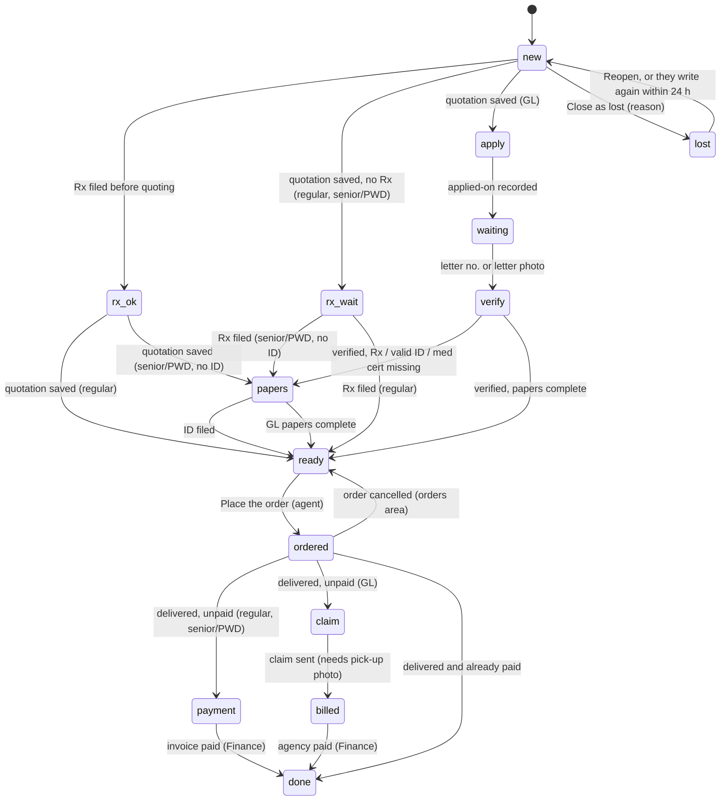
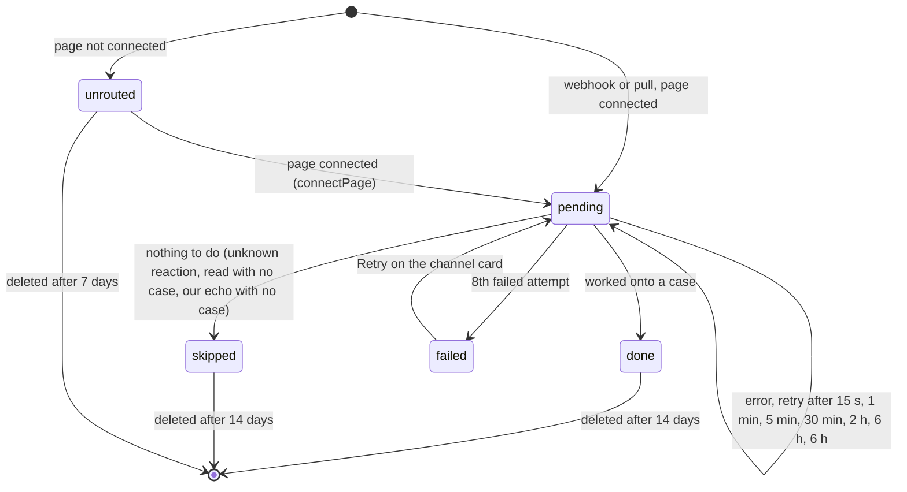
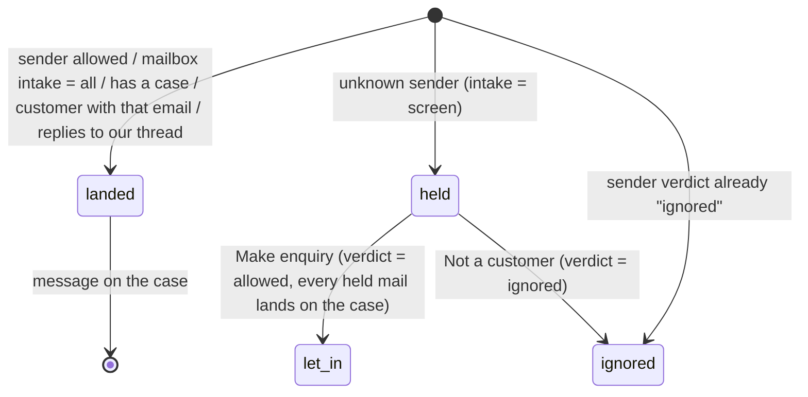
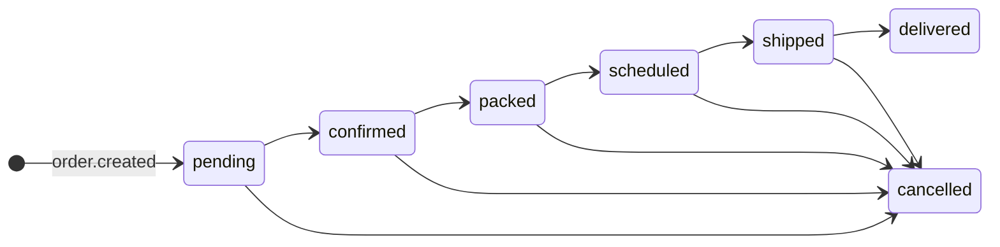
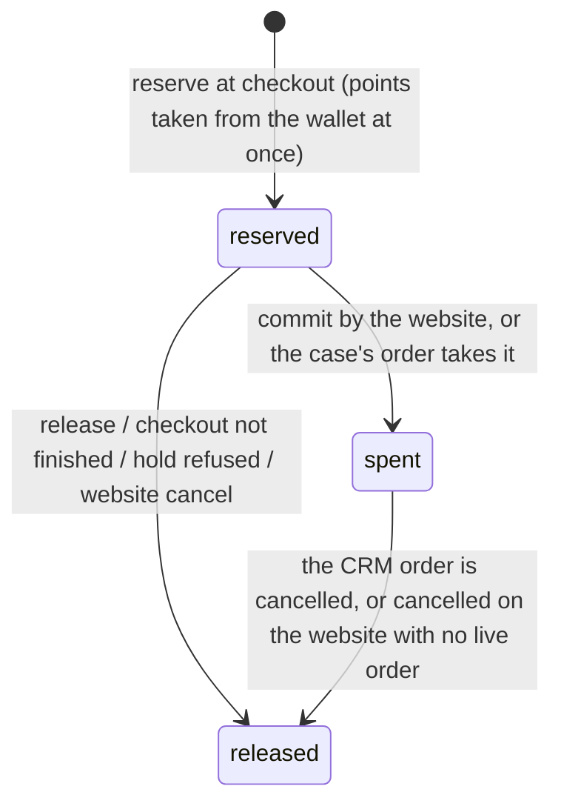

# 02 · The Online desk, external channels and the customer website

Read-only audit of the code as it stands on 22 Nov 2026 (branch `main`, commit `fa3a9c9d`).
Every statement comes from a file that was read; `path:line` is given for anything that is not
obvious. "Planned" means `docs/PLAN.md` says so and the code does not do it.

Paths are relative to the repository root. `api/` stands for `apps/api/src/`, `web/` for
`apps/web/src/`, `mig/` for `apps/api/migrations/`.

---

## 1. What this area is for

| Part | Plain words | Department |
|---|---|---|
| **Leads & enquiries (the Online desk)** | Every patient who writes, calls or orders on a website becomes one **case** (`lead`, code `ENQ-00001`). The agent records who they are and how they pay, makes the quotation, collects the papers, and places the order. The order then joins the same order line as every MedRep's (Management → Finance → Dispatch). | Online channel (B2C). The agents are the "B2C CHC" of the playbook (`api/b2c/service.ts:1-7`). |
| **PAP cases** | The same case machinery on a second desk (`lead.desk = 'pap'`) for patient-assistance (guarantee-letter) cases worked by a PAP-channel MedRep, who sees only their own (`api/online/rules.ts:21-24`, `mig/0048_pap_cases.sql`). | PAP channel |
| **Inbox and Channels** | Facebook Messenger pages and email mailboxes are connected once; their messages land on cases and the agent answers from the CRM. | Online desk (work), Admin / CEO (set-up) |
| **Websites** | The company's own shops (2MG, Caps & Pills) send orders, prescriptions and enquiries in by signed webhook; the CRM sends order status, stock and prices back; the website's points wallet and customer sign-in are answered by the CRM. | Online desk + Admin |
| **Points (loyalty)** | 1 point = ₱1. A patient earns a share of what they actually paid for medicines; may spend points on a later order or at the website's checkout. | Online desk reads; Admin / CEO adjust |
| **Quotation** | The case's quotation as a PDF on letterhead, opened, emailed, or sent as a 30-day public link. | Online desk |
| **Customer updates ("tell")** | One email per step of any order (confirmed, on the way, delivered, payment received), plus short text for WhatsApp / Viber / SMS / Messenger to paste. Used by every channel's orders, lives in this folder. | All desks |
| **Rx CHC tools** (`api/rx`) | Not prescription files. This is the *Prescription-business field MedRep's* doctor list in tiers, the "prescriptions and letters" report, and Patient Care Groups (Viber groups handed to MD Telesales). | Prescription (RX) business |
| **B2C day** (`api/b2c`) | The Online agent's Home: the morning pulse, enquiries waiting with a 15-minute clock, refills, day-3 check-ins; the coach's view of each agent. | Online channel |
| **Telesales team** (`api/telesales`) | One report: each telesales seat's calls, callbacks, orders, conversion, sales, receivables. | Telesales teams and their leads |
| **Calls** (`api/calls`) | The sales-call log every seller writes and everyone above them reads. | All selling roles |

Prescriptions as *papers* (the photo of an Rx) are handled inside the case as a `lead_file` of kind
`rx`, not in `api/rx`.

---

## 2. Who uses it

### 2.1 Role strings and helper checks

| Check | Definition | Where |
|---|---|---|
| `LEAD_WORK_ROLES` | `["online", "admin"]` | `api/online/rules.ts:20` |
| `LEAD_READ_ROLES` | `["online", "admin", "ceo", "management"]` | `rules.ts:26` |
| `LEAD_DESK_ROLES` | `["online", "admin", "ceo"]` (Management reads one case from its order, never the desk) | `rules.ts:30` |
| `CHANNEL_ROLES` | `["admin", "ceo"]` | `api/online/messenger.ts:18` |
| `SETTING_ROLES` | `["admin", "ceo"]` | `api/settings/service.ts:10` |
| `POINTS_READ_ROLES` | `["online", "admin", "ceo", "management", "finance"]` | `api/points/service.ts:26` |
| `isPapRep(me)` | `role === "medrep"` and `channel.code === "PAP"` | `rules.ts:23-24` |
| `officeMedrep(me)` | `role === "medrep"` and `channel.code === "ONLINE"` | `api/http.ts:86` |
| `onlineDesk(me)` | `role === "online"` or `officeMedrep` | `http.ts:88` |
| `may(me, roles)` / `allow(...)` | role is listed, **or** the list has `"online"` and the person is an `officeMedrep` | `http.ts:89-97` |
| `isRxChc` | `role === "medrep"` and `channel.code === "RX"` | `api/rx/groups.ts:18`, `api/rx/service.ts:30` |
| `rxTelesales` | `role === "medrep"`, `channel.code === "TS"`, `business === "RX"` | `api/org/boxes.ts:11` |
| `CALLERS` | `["medrep", "team_lead", "manager", "online"]` | `api/calls/service.ts:20` |
| `WHOLE` (calls) | `["ceo", "admin", "management"]` | `calls/service.ts:22` |
| "Looking as someone" | Any non-GET request is refused for a view-as session (`http.ts:65-73`) | all routes |

### 2.2 What each may do

| Who | Cases (Online desk) | PAP cases | Inbox / chat | Channels | Points | Notes |
|---|---|---|---|---|---|---|
| `online` (and the Online channel's MedRep through `may`) | see desk, create, edit, quote, file papers, GL fields, claim, close as lost, reopen, place the order | cannot read (`service.ts:923-926`) | list, read, reply, note, mark seen, let a held sender in or set aside | no | read list and account | Cannot approve anything: the order goes to Management (`api/orders/service.ts:693`). |
| `admin` | everything the desk can, on either desk (`service.ts:922`) | everything | everything | connect, disconnect, read now, retry, intake, website secret, stock link | read, adjust, add, open account, program on/off | Also the old-CRM imports (`api/checks/routes.ts:20-49`). |
| `ceo` | see desk, read any case | read all PAP cases (`service.ts:363`, `925`) | list and read (no reply: `inbox.ts:135`) | same as admin | read, adjust, add, program | |
| `management` | read one case by id (from its order); not the desk (`rules.ts:27-30`) | read by id | read a thread by lead id (`inbox.ts:110`) | no | read | Approves the case's order in the orders area. |
| `finance` | none | none | none | no | read | |
| PAP MedRep (`isPapRep`) | none | create (road must be GL), work and read **only cases assigned to them** (`service.ts:924`, `1117-1125`) | no chat (the thread endpoint requires `LEAD_READ_ROLES`) | no | no | |
| Rx CHC | — | — | — | — | — | Doctor list, care-group enrol, own prescriptions report. |
| MD Telesales (RX) | — | — | — | — | — | First contact on care groups. |
| `team_lead`, `manager` | — | — | — | — | — | B2C team, telesales team, Rx field, Rx business, care groups (if `business === "RX"`), calls of their people. |

There is **no approve / reject step inside this area**. A case is only *worked*, *closed as lost*
or *reopened*; approval, hold, send-back and cancel all happen on the order (orders area) and the
case only reads them back (`service.ts:586-726`).

---

## 3. Features

### 3.1 The case (enquiry) and its desk

| Item | Detail |
|---|---|
| What | A case holds: source, who writes, relation, patient, phone (+ `phone_key`, the last ten digits), email, city, address, owner (`assigned_to`), payment **road** (`regular`, `senior`, `pwd`, `gl`), agency for GL (`dswd`, `pcso`, `ovp`, `op`), the free-text request, the quotation, GL fields, claim fields, canvass, buyer kind, state (`open` / `lost`), the order it became. |
| Why | One place from first message to paid order. Where it stands is **computed on every read** from the quotation, papers, letter and order, never typed (`service.ts:1-5`, `rules.ts:152-174`). |
| Who | See 2.2. Gate for every write: `leadGate(db, me, id, "work", …)` (`service.ts:931-949`). |
| Goes in | `POST /api/leads` body validated by `leadInput` (`routes.ts:43-62`). |
| Comes out | Case id; the code `ENQ-` + 5-digit counter (`service.ts:1148-1151`). |
| Tables | writes `lead`, `lead_event`, `counter`; reads `person`, `customer`, `sales_order`, `invoice`, `order_file`, `channel_account`, `lead_file`. |
| Touches | customers (find/create patient), orders (place), finance (invoice state), points, websites, dispatch (trail). |
| Next | The agent quotes (3.2). |
| Automatic | A Messenger message, a let-in email, a website order / prescription / enquiry open a case with no person (`created_by` null). The first time someone who may work it opens the case, `opened_at` is set (`service.ts:734-735`). |

Rules when creating / saving:

- A PAP MedRep's new case must be on the GL road and is assigned to them (`service.ts:1117-1132`).
- GL road needs an agency (`service.ts:1128`, `1177`).
- An `online` person creating without naming an owner becomes the owner; anyone else leaves it unassigned (`service.ts:1131-1137`).
- Relation empty or "self" → patient name = the writer's name (`service.ts:1138`).
- The road cannot change once a live order exists (`service.ts:1175`); a business buyer must be on the regular road (`service.ts:1186-1193`); a PAP case stays GL (`service.ts:1184`).
- Leaving the regular road clears `points_to_use` (`service.ts:1201`).
- A closed (lost) case refuses edits until reopened (`service.ts:1172`).

### 3.2 Quotation

| Item | Detail |
|---|---|
| What | Lines of catalogue medicines: pieces and price per piece. Stored as JSON in `lead.quote_lines` with the road, agency and buyer it was priced for. |
| Price list | Patient price for a patient; a business buyer's own list (`drugstore`, `hospital`, `doctor`, `distributor`; government → `bidding`) (`service.ts:188-197`). |
| Rules | At least one line, max 40 (`routes.ts:96-110`); a medicine only once (`service.ts:1232-1239`); the medicine must be active and have a price in that list (`1265-1278`); a price **below** the list needs a reason (`1283-1289`); a price above the list is accepted silently; GL needs the agency first (`1313-1319`); refused when lost or ordered (`1304-1307`). |
| Side effects | Saving resets `quote_sent_via/at` (`service.ts:1321-1323`) and writes a timeline line of kind `quote`. |
| "Stale" | The quotation counts only if `quote_road = road`, `quote_buyer = buyer` and (GL) `quote_agency = agency` (`service.ts:180-184`). Changing any of them makes the case "not quoted" until saved again. |
| Senior / PWD relief | Per piece: VAT taken out of a 12 % medicine (`price / 1.12`), then × 0.8, rounded (`rules.ts:100-101`). Totals in 8.2. |
| "Sent by" | `POST /api/leads/:id/quote-sent` notes the way: `messenger`, `sms`, `viber`, `whatsapp`, `email`, `printed` (`service.ts:1336-1358`). Nothing is actually sent by this call. |
| PCSO canvass | Up to two other vendors' totals (`service.ts:1460-1496`); printed as extra pages when road = GL and agency = PCSO (`quotation.ts:107`, `384-418`). |

### 3.3 Quotation PDF, link and sending

| Action | Endpoint | What happens |
|---|---|---|
| Open PDF | `GET /api/leads/:id/quotation.pdf` | `leadGate` read; drawn with pdf-lib on A4 from the live case (`quotation.ts:449-457`). Amounts print as "PHP 1,234.00" because the standard fonts have no ₱ (`quotation.ts:1-4`). Validity 30 days is fixed in code (`quotation.ts:105`). |
| Make link | `POST /api/leads/:id/quotation-link` | Stores a **frozen snapshot** in `quotation_link` with the SHA-256 of a 24-byte random token, expiring in 30 days; answers `/api/public/quotation/<token>` (`quotation.ts:462-475`). |
| Customer opens | `GET /api/public/quotation/:token` | **No sign-in**. Finds by token hash, refuses when expired, stamps `opened_at` once, redraws the PDF from the snapshot (`quotation.ts:478-493`). |
| Send on Messenger | `POST /api/leads/:id/quotation-send {via:"messenger", link}` | The link must belong to this case and start with http(s) (`quotation.ts:511-523`); the text goes through `replyOnMessenger` (24-hour rule applies); then marks sent. |
| Send by email | same, `via:"email"` | PDF attached. A case with no conversation gets one started on the first connected mailbox using `lead.email` (`quotation.ts:531-546`); a Messenger case is refused ("send the link there"). |

### 3.4 Papers

- Kinds: `rx`, `osca_id`, `pwd_id`, `pwd_booklet`, `valid_id`, `med_cert`, `gl_letter`, `pickup_photo`, `other`, `unsorted` (`rules.ts:47-58`; DB check in `mig/0048`).
- Upload: `POST /api/leads/:id/files` (multipart). JPEG, PNG, WebP, HEIC, HEIF or PDF, non-empty, ≤ 10 MB (`service.ts:67-75`, `1507-1513`). Bytes go through `keepFile("cases", …)` before the transaction (`service.ts:1514-1518`), as the project rule asks.
- `pickup_photo` only after the order is completed (`service.ts:1524`).
- Remove = `active = false`, refused once a live order exists (`service.ts:1556-1570`).
- Photos that arrive in a chat or from a website are `unsorted`; the agent files one as a paper with `POST /api/lead-files/:id/kind` (`inbox.ts:186-214`).
- Which papers a road needs (`rules.ts:90-97`):

| Road | Needed before the order |
|---|---|
| Regular, patient | prescription, patient's valid ID (asked for, **does not block**: `rules.ts:171-173`) |
| Regular, business buyer | none (`service.ts:219-222`) |
| Senior / PWD | prescription + one ID (senior or PWD card fills the same slot: `rules.ts:84-85`) |
| GL | prescription, valid ID, medical certificate, guarantee letter |

"A prescription is asked for whenever a patient buys", over the counter or not (`service.ts:219-222`).

### 3.5 Guarantee letter (GL) and claim

- `POST /api/leads/:id/gl`: applied-on day, letter number, amount (centavos), letter day, expiry, `verify`. Dates may not be in the future (`service.ts:1364-1369`). To verify: letter number typed, a `gl_letter` file on the case, an amount, not expired (`1379-1398`). Sending `verify: false` un-verifies.
- A verified letter cannot carry the order when it has expired or the quotation total exceeds its amount (`service.ts:203-211`); the step falls back to `verify` with that sentence as the next action.
- `POST /api/leads/:id/claim` after delivery: needs the order `completed` and, to set a sent day, a `pickup_photo` on file (`service.ts:1418-1457`).
- A GL order is placed with terms "days, 60": billed to the agency (`service.ts:1790-1792`).

### 3.6 Who buys (business buyers)

`POST /api/leads/:id/buyer` sets the patient or a business kind. Picking a business on file takes its kind; setting a business forces `road = regular`, clears the agency and `points_to_use` (`service.ts:1022-1025`). Not allowed on a PAP case, a lost case, or after the order. `GET /api/leads/:id/buyers?q=` searches active non-patient customers by name, code prefix or phone, 12 rows (`service.ts:1038-1067`).

### 3.7 Points on a case

`POST /api/leads/:id/points`: only on the regular road, with a phone number, a positive balance, not more than the balance, and not more than the quotation's medicines total / 100 (`service.ts:530-584`). The number is only *noted* on the case (`lead.points_to_use`); the points are taken when the order is placed (3.9).

### 3.8 Close, reopen, notes, refill

| Action | Endpoint | Rule |
|---|---|---|
| Close as lost | `POST /api/leads/:id/lost` | Reason required; refused while a live order exists (`service.ts:1589-1610`). |
| Reopen | `POST /api/leads/:id/reopen` | Clears the reason (`1612-1620`). Also automatic when the person writes again within 24 h (`conversation.ts:153-160`). |
| Note | `POST /api/leads/:id/note` | Timeline line of kind `note` (also shown in the chat thread). |
| Next refill | `POST /api/leads/:id/refill` | Needs a customer on the case (i.e. after the order); stored on the customer by `setRefill` (`service.ts:1071-1095`). |

### 3.9 Enquiry → order (how a case joins the order line)

`POST /api/leads/:id/order` → `orderFromLead` (`service.ts:1712-1847`):

1. Gate: may work the case; not lost; no live order; computed step must be **`ready`** (`1723-1732`).
2. How they pay: body `pay` (`cod`, `advance`, `terms`), else the website order's method (`websiteTerms`, `websites.ts:1586-1600`). `terms` only for a business already on file (`1737`). Non-GL must name one (`1739-1745`).
3. Customer: `patientOf` (`1639-1708`) uses the linked customer; else for a patient finds an active patient with the same `phone_key` (same name preferred) or inserts one (`payment_terms 'advance'`, `review 'to_review'`); a business not on file is inserted as that kind with `review 'to_review'`.
4. Relief: on the senior/PWD road the kind is `pwd` only when a PWD ID is on file and no senior ID; else `senior` (`1753-1765`).
5. Calls `placeOrder` (orders area) with: items from the quotation at the quoted unit price, price kind of the buyer's list, a reason "As quoted on ENQ-…" where the price differs, delivery address, receiver, a note naming the case, order type (`gl`, `senior_pwd`, `patient`, or none for a business), GL number and amount, the website's delivery fee, `leadId` (not set for PAP: `1798`), `reliefFromCase: true`.
6. Inside the same transaction (`1800-1844`): a website checkout's reserved points are taken over (`useWebsiteReservation`), else the agent's chosen points are spent (`spendOnOrder`); **every active, sorted paper is copied to `order_file`** with the mapping rx→prescription, gl_letter→gl, osca/pwd/booklet→senior_id, valid_id→valid_id, med_cert→med_cert, others→other (`1624-1635`, `1806-1814`); `lead.order_id` is set; a line is written on the order and on the case.
7. `routeOrder` (`api/orders/service.ts:660-720`): a placer whose role is not in the orders area's `ORDER_MANAGE_ROLES` goes to Management first, so the order is created `pending_approval` (`orders/service.ts:2038`, `693`); Finance check is always on for a case's order (`687`). (The content of `ORDER_MANAGE_ROLES` belongs to the orders slice and was not read here.)
8. The route then calls `tellCustomer(…, "confirmed")` without waiting (`routes.ts:255`); nothing is emailed at this point because an order in `pending_approval` has no step to tell (`tell.ts:38-45`).

From here the case shows the order's trail read-only: Management's check, Finance, packed (with batches), shipped, delivered, invoice and payments (`service.ts:586-726`). `can.deliver` and `can.pay` are hard-coded `false` (`service.ts:906-907`).

### 3.10 Inbox and chat

- List: cases that have a conversation on an **active** channel; filters `all`, `needs` (awaiting reply and open), `mine`; search on name, patient, last message, code, chat key; optional channel; 60–600 rows (`inbox.ts:37-95`).
- Thread: every message of that conversation across all its cases plus the desk's notes, sorted by time (`inbox.ts:109-156`).
- Reply: Messenger through the page, email from the mailbox (`inbox.ts:165-183`). Whoever on the desk answers an unassigned case takes it (`messenger.ts:543-546`, `email.ts:681-684`).
- "Seen": `POST /api/leads/:id/seen` sets `seen_at` (`inbox.ts:159-162`).
- Sidebar badge: `GET /api/inbox/count` (`inbox.ts:98-106`), polled by `web/shell.tsx:86`.

### 3.11 Channels

Connect a Facebook page, a mailbox or a website; read now; retry failed events; disconnect (`active = false`, nothing deleted); mailbox intake (`screen` / `all`); website secret (new one); website stock link. Details in section 9 (integrations).

### 3.12 Websites

A website order opens a case with its quotation pre-filled; website prescriptions and enquiries land on the person's open case; the CRM pushes order status and the catalogue back; the website's admin reads progress. Details in 4.4–4.5 and section 9.

### 3.13 Points (loyalty)

| Item | Rule | Where |
|---|---|---|
| Unit | 1 point = ₱1 = 100 centavos | `points/service.ts:36` |
| Program | `setting` key `points`: `{enabled, rateBps}`; seeded **off**, 1000 bps (10 %) | `mig/0017_points_quotation.sql` |
| Who earns | Patients only, with a phone number; business buyers never | `points/service.ts:131-133` |
| When | Only when the order is `completed`; recomputed on delivery, every receipt, refund, credit note and return (`settleOrderPoints` is called from dispatch, finance, returns: `dispatch/service.ts:561`, `finance/service.ts:869, 939, 1598`, `finance/credit.ts:124`, `returns/service.ts:299`) | |
| On what | Money received for the medicines (formula in 8.9) | `points/service.ts:144-161` |
| Spending in the CRM | Taken at order placing, `points_entry` kind `spend`, origin `spend:<order>`; sets `sales_order.points_used` | `points/service.ts:190-247` |
| Cancel | Points come back once (`release:<order>`), from `orders/service.ts:2418` | `points/service.ts:250-268`, `points/website.ts:729-749` |
| Never combined | with senior / PWD, GL (case: `service.ts:530-536`); on the website also never with a coupon or a business order (`points/website.ts:707-713`) | |
| By hand | Adjust (± with reason, never below zero), Add by phone (opens the account), Open account for a patient | `points/service.ts:349-443` |
| Idempotency | Every `points_entry` has a unique `origin`; a duplicate insert does nothing (`points/service.ts:87-94`) | |
| Expiry | None in code. | |

### 3.14 Customer updates ("tell")

`api/online/tell.ts`. For any order: the newest step reached (`confirmed` once past Management, `shipped`, `delivered`, `paid`) is turned into an email (subject, long text) and a short text. Automatic email **once per step** (deduplicated by the order event text `Emailed the customer: <label>`, `tell.ts:318-321`, `352`); "paid" carries amount, date and reference so each payment is its own step (`tell.ts:314-317`). Sent on the case's email conversation when there is one (or started from `lead.email`), else from the first connected mailbox (`tell.ts:355-363`). A failure never stops the order step: it is written on the order as "Email to the customer not sent: …" (`tell.ts:371-380`). The confirmed text says how to pay, the credit terms, and the points the order will earn with a link to the website's sign-in (`tell.ts:178-193`).

Called from: order placing and every order action (`orders/routes.ts:240, 416`), Finance approval / payment (`finance/routes.ts:84-85, 117, 158`), Dispatch ship / deliver (`dispatch/routes.ts:89, 114`), the case's order (`online/routes.ts:255`). Manual: `GET /api/orders/:id/update`, `POST …/update/email`, `POST …/update/sent` (`orders/routes.ts:246-282`).

### 3.15 Rx CHC: doctor list, field team, prescriptions report, care groups

- **Doctor list** (`rx/service.ts:29-120`): doctors in the CHC's pool (added by them, in their seat's area, or on the seat's list) with a tier 1–3. Visits due per month: tier 1 = 4, tier 2 = 2, tier 3 = 1 (`:18`). `POST /api/rx/doctors` ends the open line and inserts a new one; history kept (`mig/0059`).
- **Care groups** (`rx/groups.ts`): the Rx CHC enrols a doctor's group (consent must be true; one open group per doctor), MD Telesales makes first contact (target 15 minutes; first to contact owns it), either logs activity, the enroller or a head closes it with a reason.
- **Field team**, **Prescriptions and letters**: reports, section 8.

### 3.16 B2C day, telesales team, calls

Reports and one write each: day-3 check-in (`POST /api/b2c/day3/:orderId`, writes an `order_event` of kind `day3_checkin`), log a call (`POST /api/calls`, writes `account_call` and, when a next day is given for a customer on file, `b2b_account.next_call_on`: `calls/service.ts:71`). Section 8.

### 3.17 Old-CRM imports (one-off)

- `importOldLeads` / `importOldFiles` (`online/legacy-import.ts`): Admin-only endpoints `POST /api/admin/import/old-leads` and `/old-files` (`checks/routes.ts:20-49`) and `scripts/import-old-crm.ts`. Cases keep `legacy_id`; rerun adds only what is missing; dry run unless `apply`.
- `importOldWebsite` (`online/legacy-website.ts`): script only (`scripts/import-old-website.ts`). Brings medicine web ids, wallets and their history, points sign-ins (old scrypt hashes converted, `:129-133`), open sessions, website-account ties, checkout holds and open website orders, in one transaction that is rolled back on a dry run (`:390-394`).

---

## 4. Workflows and statuses

### 4.1 Case state (stored) and road step (computed)

Stored: `lead.state` ∈ `open`, `lost` (`mig/0014`). Everything else is computed by `roadStepOf` (`rules.ts:152-174`).

| Road step | Meaning | Condition |
|---|---|---|
| `lost` | closed | `state = 'lost'` |
| `new` | answer and quote | no valid quotation, no Rx on file |
| `rx_ok` | Rx on file, quote next | no valid quotation, Rx on file |
| `rx_wait` | Rx missing | quoted, patient buys, no Rx (regular and senior/PWD) |
| `papers` | papers missing | senior/PWD without an ID; GL (verified letter) without Rx, valid ID or med cert |
| `apply` | GL: record the application | GL, quoted, `gl_applied_on` empty |
| `waiting` | GL: at the agency | applied, no letter number and no letter file |
| `verify` | GL: letter in, check it | letter in but not verified, or verified with a problem (expired / less than the quotation) |
| `ready` | place the order | everything above satisfied |
| `ordered` | order live, not completed | order exists, status not `cancelled`, not `completed` |
| `payment` | delivered, unpaid | order `completed`, invoice not `paid`, road not GL |
| `claim` | GL delivered, claim not sent | completed, unpaid, GL, `claim_sent_on` empty |
| `billed` | GL claim sent | completed, unpaid, GL, claim sent |
| `done` | delivered and paid | order `completed` and invoice status `paid` |

`journey.ts` also names `rx_check`, `quoted`, `invoice`, `replied`, `docs` (old-CRM steps kept for labels and chart positions, `journey.ts:23-79`, `119-141`); `roadStepOf` never returns them.



Changing the road, the agency or the buyer makes the saved quotation stale, which sends the case back to `new` (or `rx_ok`) until it is saved again.

"Lost" can be entered from any step that has no live order; reopening returns the case to whatever its facts compute.

Desk groupings (`rules.ts:270-291`, `service.ts:323-331`):

| Desk step chip | Road steps |
|---|---|
| `new` | new |
| `rx` | rx_wait, rx_check, rx_ok |
| `quote` | quoted (never produced) |
| `papers` | papers, apply, waiting, verify |
| `ready` | ready |
| `ordered` | ordered |
| `unpaid` | invoice, payment, claim, billed |
| `done` | done |
| `lost` | lost |

| Queue | Cases |
|---|---|
| `all` | every case |
| `active` (default) | not lost, not done |
| `attention` | active **and** (awaiting reply, or next action starts with "Order on hold" / "Order sent back") |
| `deliver` | ordered |
| `payment` | invoice, payment, claim, billed |
| `done` | done |
| `lost` | lost |

Order statuses as the case words them (`rules.ts:176-233`): `pending_approval` → "With Management for a check"; `finance_check`, `ready_for_invoice` → with Finance (advance payment wording when unpaid); `ready_for_dispatch` → "Dispatch packs it"; `packing` → "Packed: Dispatch ships it"; `shipped` → courier/rider line; `on_hold`, `exception` → "Order on hold: reason"; `draft` → "Order sent back: reason".

### 4.2 Enquiry → order → paid (sequence)

```mermaid
sequenceDiagram
  participant C as Customer
  participant CH as Channel (Messenger / mail / website)
  participant A as Online agent
  participant CRM as Case (lead)
  participant O as Order line
  C->>CH: first message / website order
  CH->>CRM: case opened (ENQ-…), unsorted photos kept
  A->>CRM: details, road, quotation, papers (GL: application, letter, verify)
  A->>C: quotation (PDF link / email / noted as sent)
  A->>CRM: Place the order (pay: cod / advance / terms)
  CRM->>O: placeOrder: patient found or made, papers copied, points spent, lead.order_id set
  O->>O: Management approves → Finance checks → Dispatch packs, ships, delivers
  O-->>C: email per step (confirmed, on the way, delivered, payment received)
  O-->>CH: website told confirmed / shipped / delivered / cancelled
  O->>CRM: case reads order trail; done when delivered and paid
  A->>CRM: GL only: pick-up photo, claim sent; next refill
```

### 4.3 Messenger event (`inbox_event.state`)

Values: `pending`, `done`, `failed`, `skipped`, `unrouted` (`mig/0015`).



Source: `messenger.ts:84-172`, `inbox.ts:280-287`, `341-343`. A conversation whose earlier event failed blocks its later events in the same drain run (`messenger.ts:147-152`, `161`). Events of a disconnected page are not picked (`messenger.ts:144`).

### 4.4 Email held sender (`email_held.state`, `email_sender.verdict`)



Never a case: automatic or list mail, mail from the mailbox's own address, mail with no sender (`email.ts:552`, `363-371`). No screen undoes "ignored" (see findings).

### 4.5 Website order (`web_order.status`, `push_status`, `letter`)

`web_order.status` is the website's own status: `pending`, `confirmed`, `packed`, `scheduled`, `shipped`, `delivered`, `cancelled` (`websites.ts:85-96`). It moves **forward only**; `cancelled` from anything but `delivered` (`movesOn`, `websites.ts:99-104`); an older snapshot (`changedAt` earlier than the stored `source_at`) is ignored (`:661`).



(Any forward jump is allowed, e.g. pending → shipped.)

Does a case open? (`websites.ts:621-637`)

| First call | Result |
|---|---|
| status `pending` or `confirmed`, placed ≤ 72 h ago | case opened (`case_type = 'website_order'`, source `website`), quotation pre-filled |
| status `cancelled` | no case, `card_note` = "Cancelled on the website before the CRM opened its case."; points hold released |
| anything else, or older than 72 h | no case, `card_note` = "Arrived late or already moved on the website…"; listed under Channels → "Orders with no case" → **Open a case** (`openWebsiteCase`, `websites.ts:936-972`) |

Later website changes on a case (`websiteMoved`, `websites.ts:696-726`): a note "Website: <status>"; a `cancelled` closes the case as lost when it has no live order, else writes "cancel <order> here if it isn't going out"; points released when no live CRM order holds them.

What the CRM tells the website (`push_status`; `wantedFor`, `websites.ts:1084-1096`):

| Order / case | Told |
|---|---|
| order `finance_check`, `ready_for_invoice`, `ready_for_dispatch`, `packing` | `confirmed` |
| order `shipped` | `shipped` (+ tracking number or tracking URL); sent again when a tracking number is typed after shipping (`:1121-1133`) |
| order `completed` | `delivered` |
| order `cancelled`, or case lost with no order | `cancelled` (+ reason: the order's flag reason or the case's lost reason) |
| website said the GL letter is `needed`, and the quotation was sent or the application recorded | `quotation_sent` once; `letter` becomes `quoted` (`:1135-1149`, `1221-1232`) |

Push outcome (`pushOne`, `websites.ts:1170-1266`): 2xx → status stored, note on the case; 4xx → stop (attempts = 30), error shown on the case and under Channels, "Try again" resets; other → retry with wait `min(6 h, 30 s × 2^attempts)`, up to 30 attempts.

### 4.6 Points reservation (`points_reservation.state`)



`finish` refuses release of a spent one and commit of a released one (`points/website.ts:586-592`); `releaseHold` (order refused or moved to a non-regular road) releases even a spent one (`:661-678`).

### 4.7 Care group

No status column. State is derived (`rx/groups.ts:64-75`): `waiting` (no first contact, ≤ 15 min), `late` (> 15 min), `active`, `quiet14` (≥ 14 days without activity), `quiet30`, and closed (`closed_at` set, hidden from the list).

### 4.8 Edit / cancel / send-back paths (summary)

| Path | Where it lives |
|---|---|
| Edit case details | any time while open; road locked by a live order |
| Edit quotation, papers, GL, canvass, buyer, points | until a live order exists |
| Cancel the order | orders area; the case returns to `ready` and may place a new one (`service.ts:977`, `1725`; web `lead.tsx:2470-2474`) |
| Order sent back (`draft`) or held | orders area; the case shows it in "Waiting on you" |
| Reject | none in this area |
| Return | returns area; points re-settled (`returns/service.ts:299`) |

---

## 5. Data

### 5.1 Tables

| Table | Purpose | Key columns | Relations | Migration |
|---|---|---|---|---|
| `lead` | the case | `code`, `source`, `name`, `patient_name`, `phone`, `phone_key`, `email`, `road`, `agency`, `quote_lines` (jsonb), `quote_road/agency/buyer`, `quote_sent_via/at`, `gl_*`, `claim_*`, `canvass`, `state`, `lost_reason`, `opened_at`, `first_contact_at`, `last_activity_at` | `customer_id`, `assigned_to`→person, `order_id`→sales_order, `chat_account_id`, `site_account_id`→channel_account | 0014; chat columns 0015; `site_account_id`, `case_type` 0016; `points_to_use` 0017; `desk`, `gl_expires_on`, `claim_*`, `canvass` 0048; `legacy_id` 0052; `buyer_kind`, `quote_buyer` 0113; index 0021 |
| `lead_file` | papers and chat photos | `kind`, `name`, `mime`, `size`, `data` or `store_key`, `active`, `legacy_id` | `lead_id`, `by_person` | 0014; `unsorted` 0015; `pickup_photo` 0048; `store_key` 0051; `legacy_id` 0053 |
| `lead_event` | timeline | `kind` (`status`, `quote`, `gl`, `paper`, `note`, `email`), `message`, `at` | `lead_id`, `by_person` (null = system) | 0014, 0015 |
| `lead_message` | chat lines | `channel`, `direction`, `external_id`, `subject`, `text`, `files` (jsonb), `reaction`, `at` | `lead_id`, `account_id`, `by_person`; unique (`account_id`, `external_id`) | 0015 |
| `channel_account` | a page, mailbox or website | `kind`, `key`, `name`, `secret` (sealed), `intake`, `cursor`, `synced_at`, `sync_error`, `active`, `config` (jsonb: label, catalogUrl, catalog timestamps) | unique (`kind`, `key`) | 0015; website + `config` 0016 |
| `inbox_event` | Messenger events kept first | `page_key`, `event_key`, `payload`, `state`, `attempts`, `next_at`, `error` | `account_id`; unique (`page_key`, `event_key`) | 0015 |
| `email_held` | first emails of unknown senders | `address`, `subject`, `snippet`, `files`, `message_id`, **`source` (raw email bytes)**, `state` | `account_id`, `decided_by`; unique (`account_id`, `message_id`) | 0015 |
| `email_sender` | verdict per sender | `verdict` (`allowed`, `ignored`) | PK (`account_id`, `address`) | 0015 |
| `web_order` | order as the website sent it | `ref`, `status`, `placed_at`, `source_at`, `customer`, `items`, `money` (centavos), `payment_method`, `benefit`, `assistance`, `is_b2b`, `account_ref/phone`, `admin_url`, `status_url`, `files`, `card_note`, `push_*`, `pushed_tracking`, `letter`, `points_reservation`, `points_redeemed` | `account_id`, `lead_id`; unique (`account_id`, `ref`) | 0016; points 0018; tracking 0119; letter 0121 |
| `web_request` | prescription / enquiry from a website | `kind`, `ref`, `customer`, `message`, `file` | `account_id`, `lead_id`; unique (`account_id`, `kind`, `ref`) | 0016 |
| `web_call` | log of every website call | `site`, `event`, `ref`, `outcome`, `error`, `at` | `account_id` | 0016 |
| `web_catalog_sent` | hash of what each website last took per medicine | `hash`, `sent_at` | PK (`account_id`, `medicine_id`) | 0120 |
| `web_retired_product` | old-CRM medicines with no match | `web_id`, `sent_to[]` | — | 0120 |
| `medicine.web_id` | the id a website knows a medicine by | uuid unique | — | 0120 |
| `quotation_link` | frozen quotation for a public link | `token_hash`, `snapshot`, `expires_at`, `opened_at` | `lead_id`, `created_by` | 0017 |
| `setting` | company details, points program | `key`, `value` | — | 0017 |
| `points_account` | one wallet per phone | `phone_key` unique, `balance`, `earned`, `spent` | `customer_id` | 0017 |
| `points_entry` | every change, never edited | `kind` (`earn`, `spend`, `release`, `adjust`), `points`, `reference`, `note`, **`origin` unique** | `account_id`, `order_id`, `by_person` | 0017 |
| `points_settlement` | what an order has earned | `rate_bps`, `paid`, `credited`, `revision` | PK `order_id`, `account_id` | 0017 |
| `points_login` | customer's own sign-in | `phone_key`, `password_hash`, `failures`, `blocked_until`, `quiet_*` | `account_id` | 0018 |
| `points_session` | customer session | `token_hash`, `expires_at`, `active` | `login_id` | 0018 |
| `points_web_account` | website member proved to own a wallet | PK (`site`, `account_ref`), `phone_key`, `order_ref` | `account_id` | 0018 |
| `points_reservation` | points held at checkout | `site`, `request_key`, `reference`, `points`, `state` | `account_id`, `order_id` | 0018 |
| `doctor_list` | Rx CHC's tiers | `tier`, `set_at`, `ended_at` | `seat_id`, `customer_id` | 0059 |
| `care_group` | patient care groups | `name`, `consent`, `patients`, `enrolled_at`, `first_contact_at`, `last_activity_at`, `closed_*` | `doctor_id`, `enrolled_by`, `seat_id`, `telesales_id` | 0060 |
| `account_call` | sales calls | `outcome`, `note`, `next_on`, `customer_text` | `customer_id`, `by_person`, `seat_id` | 0061, 0103 |

Columns added to other areas' tables by this slice: `sales_order.lead_id`, `order_item.relief` (0014), `sales_order.delivery_fee` (0016), `sales_order.points_used`, `payment.payer`, payment method `points` (0017).

Migrations named in the brief that do **not** touch this slice's tables (grep found nothing): 0028, 0086, 0087, 0112. 0057 mentions "lead" only as "team lead".

### 5.2 How history is kept

- Nothing is deleted: a removed paper is `active = false`; a closed case is `state = 'lost'`; a disconnected channel is `active = false`; doctor-list changes end the old line; care groups close.
- `lead_event` is the case's audit trail (who, when, what, in words). System lines have `by_person` null.
- `points_entry` is append-only with a unique `origin`; balances on `points_account` are re-summed from entries after each insert (`points/service.ts:64-72`).
- `web_call` logs every website call and its outcome.
- The only real deletes in this slice are housekeeping of `inbox_event` (`inbox.ts:341-343`) and, in the importer, `web_catalog_sent` / `web_retired_product` rows that are superseded (`legacy-website.ts:195-197`).

---

## 6. API endpoints

"Signed in" = session cookie checked by the `signedIn` middleware. Role checks are inside the services.

### 6.1 Unauthenticated routes (no sign-in) and how each is protected

| Method, path | Purpose | Protection | Not protected by | file:line |
|---|---|---|---|---|
| `GET /webhooks/messenger` | Meta's subscription check | `hub.verify_token` must be one of `MESSENGER_VERIFY_TOKEN` (comma list); empty list → always 403 | plain string compare | `channel-routes.ts:63-69` |
| `POST /webhooks/messenger` | Meta's events | HMAC-SHA256 of the exact body with `MESSENGER_APP_SECRET` / `MESSENGER_APP_SECRETS`, header `x-hub-signature-256`, constant-time compare; 503 when no secret is set; event kept before it is worked; duplicate events ignored by key | no rate limit, no timestamp | `channel-routes.ts:70-94`, `messenger.ts:49-66` |
| `POST /webhooks/store/:company` | website: `order.created`, `order.status_updated`, `order.letter_uploaded`, `prescription.uploaded`, `enquiry.created` | site named **in the body**; HMAC-SHA256 with that website's own secret in `x-crm-signature` (or `x-make-signature`), constant-time; body ≤ 512 000 chars; idempotent by order ref (advisory lock + unique) and forward-only status | no timestamp check; `:company` is ignored; no rate limit | `channel-routes.ts:97-104`, `websites.ts:355-425` |
| `POST /webhooks/store/:company/points/manage` | website wallet operations | same signature; `sentAt` within ± 5 minutes; body ≤ 8 000 chars; spending also needs the customer's points session; per-login lockouts | no nonce (a captured request replays for 5 minutes; reserve / adjust are idempotent by request key) | `channel-routes.ts:105-109`, `points/website-calls.ts:35-194` |
| `POST /webhooks/store/:company/order-progress` | website admin reads an order's progress | same signature; `sentAt` ± 5 minutes; body ≤ 4 000 chars; read only | — | `channel-routes.ts:110-113`, `websites.ts:1286-1514` |
| `GET /api/public/quotation/:token` | customer opens the quotation PDF | 24 random bytes (base64url) in the path, stored only as SHA-256; expires after 30 days; frozen snapshot; `cache-control: private, no-store` | no rate limit; no revoke | `routes.ts:230-232`, `quotation.ts:478-493` |
| `POST /dev/website-status` | developer stand-in website | answers 404 unless `MESSENGER_SINK=1` or `MAIL_SINK=1` **and** `NODE_ENV` is not `production` | — | `channel-routes.ts:54-55`, `284-293` |

The whole API has no rate-limiting middleware (`api/app.ts:89-96` adds only timing and CORS).

### 6.2 Cases

| Method | Path | Who may | What | file:line |
|---|---|---|---|---|
| GET | `/api/leads` | `online`, `admin`, `ceo` (desk=online); PAP rep (own), `admin`, `ceo` (desk=pap) | desk: cards, counts, steps | `routes.ts:67-83`, `service.ts:342-443` |
| POST | `/api/leads` | `online`, `admin`; PAP rep (GL only) | new case | `routes.ts:84-86`, `service.ts:1115` |
| GET | `/api/leads/:id` | read gate (`online`, `admin`, `ceo`, `management`; PAP rep own) | whole case | `routes.ts:87`, `service.ts:728` |
| POST | `/api/leads/:id` | work gate | save details | `routes.ts:88-91` |
| POST | `/api/leads/:id/quote` | work | save quotation | `routes.ts:92-115` |
| POST | `/api/leads/:id/quote-sent` | work | note how it was sent | `routes.ts:116-120` |
| POST | `/api/leads/:id/gl` | work | GL application / letter / verify | `routes.ts:121-139` |
| POST | `/api/leads/:id/claim` | work | claim sent day and ref | `routes.ts:140-144` |
| POST | `/api/leads/:id/canvass` | work | PCSO canvass | `routes.ts:145-161` |
| POST | `/api/leads/:id/buyer` | work | who buys | `routes.ts:163-173` |
| GET | `/api/leads/:id/buyers` | work | search businesses | `routes.ts:174-176` |
| POST | `/api/leads/:id/refill` | work | next refill day | `routes.ts:178-188` |
| POST | `/api/leads/:id/note` | work | note | `routes.ts:189-193` |
| POST | `/api/leads/:id/lost` | work | close as lost | `routes.ts:194-198` |
| POST | `/api/leads/:id/reopen` | work | reopen | `routes.ts:199-202` |
| GET | `/api/leads/:id/quotation.pdf` | read | PDF | `routes.ts:212-214` |
| POST | `/api/leads/:id/quotation-link` | work | 30-day link | `routes.ts:215-217` |
| POST | `/api/leads/:id/quotation-send` | work (+ reply rules) | send by Messenger / email | `routes.ts:218-228` |
| POST | `/api/leads/:id/points` | work | points to use | `routes.ts:233-242` |
| POST | `/api/leads/:id/order` | work | place the order | `routes.ts:243-257` |
| POST | `/api/leads/:id/files` | work | upload a paper | `routes.ts:259-274` |
| GET | `/api/lead-files/:id` | read gate of its case | file bytes (cached 7 days, private) | `routes.ts:275-283` |
| POST | `/api/lead-files/:id/remove` | work | take a paper off | `routes.ts:284-287` |
| POST | `/api/lead-files/:id/kind` | `online`, `admin` (role only) | file a chat photo as a paper | `channel-routes.ts:170-174` |

### 6.3 Inbox, held senders, channels, websites

| Method | Path | Who may | What | file:line |
|---|---|---|---|---|
| GET | `/api/inbox` | `online`, `admin`, `ceo` | chat list and counts | `channel-routes.ts:139-149` |
| GET | `/api/inbox/count` | anyone signed in (zeros unless desk role) | badge | `:150` |
| GET | `/api/leads/:id/thread` | `online`, `admin`, `ceo`, `management` | conversation | `:151-153` |
| POST | `/api/leads/:id/reply` | `online`, `admin` | reply on the channel | `:154-165` |
| POST | `/api/leads/:id/seen` | `online`, `admin` | mark seen | `:166-169` |
| GET | `/api/email-held` | `online`, `admin` | new senders | `:177` |
| POST | `/api/email-held/:id/let-in` | `online`, `admin` | Make enquiry | `:178-180` |
| POST | `/api/email-held/:id/ignore` | `online`, `admin` | Not a customer | `:181-184` |
| GET | `/api/channels` | `admin`, `ceo` | every channel and its health | `:187` |
| POST | `/api/channels/messenger` | `admin`, `ceo` | connect a page by token | `:188-194` |
| POST | `/api/channels/email` | `admin`, `ceo` | connect a mailbox | `:201-225` |
| POST | `/api/channels/website` | `admin`, `ceo` | connect a website (secret shown once, or kept) | `:226-252` |
| POST | `/api/channels/:id/catalog` | `admin`, `ceo` | set the stock-link address | `:254-258` |
| POST | `/api/channels/:id/secret` | `admin`, `ceo` | new website secret | `:263-265` |
| POST | `/api/channels/:id/pull` | `admin`, `ceo` | read now / send updates now | `:266-268` |
| POST | `/api/channels/:id/retry` | `admin`, `ceo` | retry failed events | `:269-272` |
| POST | `/api/channels/:id/disconnect` | `admin`, `ceo` | disconnect | `:273-276` |
| POST | `/api/channels/:id/intake` | `admin`, `ceo` | mailbox screening | `:277-281` |
| GET | `/api/website-order?site=&ref=` | **any signed-in person** (answers only the case id and order id) | "Open in the CRM" link | `:260-262`, `websites.ts:309-327` |
| POST | `/api/web-orders/:id/open-case` | `online`, `admin`, `ceo` | open a case for a late order | `:130-132` |
| POST | `/api/web-orders/:id/push` | `online`, `admin`, `ceo` | send the status again | `:133-136` |
| POST | `/api/dev/messenger` | sink on, not production; `online`, `admin`, `ceo` | fake incoming message | `:296-338` |
| POST | `/api/dev/email` | sink on, not production; same roles | fake incoming email | `:339-373` |

### 6.4 Points and settings

| Method | Path | Who may | What | file:line |
|---|---|---|---|---|
| GET | `/api/points` | `online`, `admin`, `ceo`, `management`, `finance` | accounts (phone masked to last 4), totals | `points/routes.ts:17-19` |
| POST | `/api/points/add` | `admin`, `ceo` | add by phone | `:21-32` |
| GET | `/api/points/:id` | read roles | one account, last 200 entries | `:33` |
| POST | `/api/points/:id/adjust` | `admin`, `ceo` | ± with reason | `:34-44` |
| POST | `/api/points/open/:id` | `admin`, `ceo` | open an account for a patient | `:45-47` |
| GET | `/api/settings` | `admin`, `ceo` | company + points program | `:49` |
| POST | `/api/settings/company` | `admin`, `ceo` | letterhead details | `:50-68` |
| POST | `/api/settings/points` | `admin`, `ceo` | program on/off, rate | `:69-73` |

### 6.5 Rx, B2C, telesales, calls

| Method | Path | Who may | What | file:line |
|---|---|---|---|---|
| GET | `/api/rx/day` | Rx CHC | doctor list with lights | `rx/routes.ts:45` |
| POST | `/api/rx/doctors` | Rx CHC with a seat | set / move / remove a tier | `rx/routes.ts:47-54` |
| GET | `/api/rx/field` | `manager`, `team_lead`, `ceo`, `admin` | each Rx CHC this month | `rx/routes.ts:46` |
| GET | `/api/rx/business` | `medrep` (own seats), leads, `ceo`, `admin` | prescriptions and letters | `rx/routes.ts:18` |
| GET | `/api/care-groups` | Rx CHC, RX telesales, RX heads, `ceo`, `admin` | groups in scope | `rx/routes.ts:16` |
| POST | `/api/care-groups` | Rx CHC | enrol | `rx/routes.ts:19-30` |
| POST | `/api/care-groups/:id/contact` | RX telesales | first contact | `rx/routes.ts:31-34` |
| POST | `/api/care-groups/:id/activity` | the enroller or the group's telesales | log activity | `rx/routes.ts:35-39` |
| POST | `/api/care-groups/:id/close` | the enroller, RX heads, `ceo`, `admin` | close with reason | `rx/routes.ts:40-44` |
| GET | `/api/b2c/day` | Online desk | morning pulse | `b2c/routes.ts:11` |
| GET | `/api/b2c/team` | `team_lead`, `manager`, `ceo`, `admin` | each agent now | `b2c/routes.ts:12` |
| POST | `/api/b2c/day3/:orderId` | Online desk, own delivered order | day-3 check-in note | `b2c/routes.ts:13-17` |
| GET | `/api/telesales/team` | `medrep`, `online` (own seat), leads, `ceo`, `admin` | telesales figures | `telesales/routes.ts:10` |
| POST | `/api/calls` | `medrep`, `team_lead`, `manager`, `online` (not view-as) | log a call | `sales/routes.ts:27-44` |
| GET | `/api/calls` | callers + `ceo`, `admin`, `management` | calls in a date range | `sales/routes.ts:45` |

---

## 7. Screens

`web/main.tsx` routes; menus from `web/menus.ts`.

| URL | File | Who gets it | What is on it | Buttons → endpoint |
|---|---|---|---|---|
| `/leads` | `web/online/leads.tsx` (+ `desk-table.tsx`, `desk-board.tsx`, `parts.tsx`) | Guard `readsOnlineDesk` (Online desk, Admin, CEO) (`main.tsx:216`, `auth.ts:68`). Menu: `online` role desk (`menus.ts:1311`), Online-channel MedRep (`:683`), CEO/Admin "Online" app (`:433`) | Title with active count; queue tabs with counts; step line; search; filters Type, Source, Payment road, Assigned to; views Cards / Table / Board; cards by day; "Show more" (300 at a time) | New lead → dialog → `POST /api/leads` (`parts.tsx:493`; phone check `GET /api/customers/check`); everything else `GET /api/leads?…` refetched every 60 s |
| `/pap` | same component, `desk="pap"` | No client guard (`main.tsx:217`); API refuses others. Menu: PAP MedRep (`menus.ts:898`) | Same desk, filters hidden | New PAP case → `POST /api/leads` |
| `/leads/:id` | `web/online/lead.tsx` (+ `case-head.tsx`, `journey.tsx`, `chat.tsx`, `website.tsx`) | No client guard; API `leadGate` | Head (who, road picker, customer's orders bar), next action, journey chart, step rail: 1 Enquiry & quotation (1.1 Agency application, 1.2 Guarantee letter on GL), 2 Rx & documents, 3 Order & delivery, 4 Payment & follow-up / Claim & payment; website order card; money card; activity with notes; chat drawer | see table below |
| `/inbox` | `web/online/inbox.tsx` + `chat.tsx` | Guard `readsOnlineDesk` (`main.tsx:211`); menu badge "inbox" | Three panes: chats (All / Needs reply / Mine, search, channel), conversation, case facts; "New email senders" dialog | Reply → `POST /api/leads/:id/reply`; Note → `POST /api/leads/:id/note`; open chat → `POST /api/leads/:id/seen`; Make enquiry / Not a customer → `POST /api/email-held/:id/let-in` / `ignore` |
| `/channels` | `web/online/channels.tsx` | No client guard; API `admin`, `ceo`. Menu: CEO/Admin Online app (`menus.ts:438`), Admin panel "Online pages & mail" (`:1557`) | One card per page, mailbox, website (health, last read, waiting / failed / held counts); Connect a Facebook page / mailbox (provider presets, optional Google script) / website; website details: last call, orders with no case, updates not taken, refusals, stock link | Read now / Send updates now → `/pull`; New secret → `/secret`; Retry → `/retry`; Disconnect → `/disconnect`; intake → `/intake`; stock link → `/catalog`; Open a case → `/api/web-orders/:id/open-case`; Try again → `/api/web-orders/:id/push` |
| `/website-order?site=&ref=` | `web/online/website-order.tsx` | any signed-in person | Redirects to the case (or its order) | `GET /api/website-order` |
| `/` (Home) for the Online desk | `web/online/b2c-home.tsx` (`B2cHome`, used by `web/home/home.tsx:78`) | Online desk | Morning pulse tiles, enquiries waiting, refills, "My orders now", day-3 check-ins | Day-3 dialog → `POST /api/b2c/day3/:orderId` |
| coach card | `B2cDeskCard` in `web/team/mentor.tsx` | leads | "Online desk now" table | `GET /api/b2c/team` |
| `/points`, `/points/:id` | `web/customers/points.tsx` (outside this slice's web folder) | no client guard; API read roles | accounts, totals, program switch, adjust, add | `/api/points…`, `/api/settings/points` |
| `/rx/doctors`, `/rx/field`, `/rx/business`, `/care-groups`, `/calls` | `web/sellers/*.tsx` (outside this slice's web folder) | per menus | not audited here beyond their endpoint calls | `/api/rx/*`, `/api/care-groups*`, `/api/calls` |

Case page actions (`web/online/lead.tsx`):

| Action | Endpoint | line |
|---|---|---|
| Save details / change road (road picker, Edit dialog) | `POST /api/leads/:id` | `case-head.tsx:42`, `lead.tsx:2906` |
| Buyer picker | `GET …/buyers`, `POST …/buyer` | `lead.tsx:1349`, `1357` |
| Save quotation (medicine list from `GET /api/inventory/medicines`) | `POST …/quote` | `lead.tsx:1465`, `1529` |
| Mark sent by (Messenger, Viber, WhatsApp, SMS, Email, Printed) | `POST …/quote-sent` | `lead.tsx:1809` |
| Open the PDF / Copy link / Send on Messenger / Email the PDF | `GET …/quotation.pdf`, `POST …/quotation-link`, `POST …/quotation-send` | `lead.tsx:1171-1197` |
| PCSO canvass | `POST …/canvass` | `lead.tsx:1280` |
| GL application, letter, verify | `POST …/gl` | `lead.tsx:1859` |
| Upload a paper | `POST …/files` | `parts.tsx:91` |
| File a chat photo / change kind / remove | `POST /api/lead-files/:id/kind`, `/remove` | `lead.tsx:858`, `871`, `1079`, `1092` |
| Use points / take them off | `POST …/points` | `lead.tsx:1010`, `1023` |
| Place the order (How they pay: on their terms / COD / in advance) | `POST …/order` | `lead.tsx:2506-2512` |
| Claim sent | `POST …/claim` | `lead.tsx:2592` |
| Next refill | `POST …/refill` | `lead.tsx:2637` |
| Add note | `POST …/note` | `lead.tsx:2803` |
| Close as lost / Reopen | `POST …/lost`, `…/reopen` | `lead.tsx:2937`, `616` |
| Website order "Try again" | `POST /api/web-orders/:id/push` | `website.tsx:42` |
| Send to customer (order update) | orders area component `web/orders/send-update.tsx` | `lead.tsx:58` |

The link copied for the customer is built as `window.location.origin + path` (`lead.tsx:1174`), so the web host must pass `/api/*` to the API (as `docs/DEPLOY-COOLIFY.md:12` describes).

---

## 8. Reports and figures

None of the figures below is stored; all are computed live on each request. None has an export in the files read.

### 8.1 Desk counts (`GET /api/leads`, `service.ts:342-443`)

| Figure | Calculation |
|---|---|
| Source rows | every case of the desk matching `source`, `who=mine`, and search words (each word must match name, patient, code, request, quotation JSON, city, last message, email, or ≥ 4 digits of the phone). **All rows are loaded**, then cards are built in memory. |
| `counts[queue]` | cards matching Type and Road filters, counted into every queue they belong to |
| `types` | cards matching Road + current queue, by `enquiry` / `website_order` |
| `roads` | cards matching Type + current queue, by regular / senior_pwd / gl |
| `months` | cards in the queue by month of first contact, newest 6 (returned, **not used by the screen**) |
| `steps[deskStep]` | cards in the queue (and month) per desk step |
| `cards` | filtered by step, first `max(300, shown)` |
| `papers` on a card | needed papers on file / needed |

### 8.2 Quotation totals (`rules.ts:104-120`)

- `subtotal = Σ qty × unitPrice`.
- Regular and GL: `total = subtotal`.
- Senior / PWD: `net = Σ qty × (vat12 ? round(unitPrice / 1.12) : unitPrice)`; `total = Σ qty × round((vat12 ? unitPrice / 1.12 : unitPrice) × 0.8)`; `vatRemoved = subtotal − net`; `discount = net − total`.
- PDF: `total = quote.total + website delivery fee`; `toPay = max(0, total − points × 100)` (`quotation.ts:79-104`).

The same sums are repeated in the browser for the lines being typed (`web/online/lead.tsx:102-120`).

### 8.3 Inbox counts (`inbox.ts:60-106`)

`all` = cases with a chat on an active channel matching search and channel; `needs` = of those, `awaiting_reply` and open; `mine` = assigned to me; `held` = distinct (mailbox, address) with state `held`.

### 8.4 Customer history on a case (`case-history.ts`)

Orders (not `draft`) and other cases of the same person: same `phone_key` on any case, or the same linked customer. Up to 50 each, with totals and each order's open invoice balance.

### 8.5 B2C day (`b2c/service.ts:68-172`)

| Tile | Calculation | Green when |
|---|---|---|
| Enquiries waiting | online-desk cases, open, `awaiting_reply`, assigned to me or nobody (max 50, oldest first) | 0 |
| New prospects not answered | of those, `customer_id` is null | 0 |
| Refill-due list | `reorders(state "soon")` + `reorders(state "due")` (customers area) | always |
| An invoice on the last working day | invoices (not cancelled) issued that day on orders where I am `medrep_id` or `raised_by`; last working day skips holidays and non-work days of the default schedule | ≥ 1 |
| Cancellations without a reason | my orders `cancelled`, updated since that day, `flag_reason` null or "Cancelled by the MedRep" | 0 |
| Replies past 15 minutes today | see below | 0 |
| My orders now | quoted = my open cases with a quotation and no live order; at Finance = `pending_approval`, `finance_check`, `ready_for_invoice`; to ship = `ready_for_dispatch`, `packing`, `shipped`; day-3 = completed orders delivered 1–3 days ago with no `day3_checkin` event | |

Late reply (`b2c/service.ts:40-64`): for cases assigned to the person, an inbound message that starts a turn (previous message none or outbound), today, between the default schedule's start and end, whose first later outbound message came more than 15 minutes after it (or none yet and 15 minutes have passed).

### 8.6 B2C team (`b2c/service.ts:189-239`)

People in seats of module `online` under the lead (or the picked `?unit=` box), except the lead: waiting (assigned, open, awaiting reply), late today, alarm (late ≥ 3), invoices today, invoiced last working day, `noInvoiceYet` (after 14:30 Manila with no invoice today). Sorted alarm first, then waiting.

### 8.7 Telesales team (`telesales/team.ts`)

Seats: own seats for `medrep` / `online`; the team's seats for leads. Per seat-holder, this month to date:

| Figure | Calculation |
|---|---|
| Calls today / month | `account_call` of the seat (or of the person when the call has no seat) |
| Reached | calls with outcome other than `no_answer` |
| Ordered | calls with outcome `ordered` or `won_back` |
| Callbacks due | calls with `next_on ≤ today` and no later call to the same customer (by anyone) |
| Orders | CRM orders (not draft / cancelled) + Zoho past orders (not void) of the seat, this month |
| Customers / new | distinct customers ordered this month; new = no CRM order, Zoho order or sale invoice before the 1st |
| Sold | `sale_invoice.total` of the seat this month, not cancelled |
| Owed | open `sale_invoice` balance of the seat |
| Stopped | seat's orders `on_hold` or `exception` |
| Conversion (summary) | `round(ordered ÷ calls this month × 100)`; null when no calls |
| Repeat customers (summary) | customers − new customers |

### 8.8 Rx reports

- **Rx day** (`rx/service.ts:29-101`): per doctor visits done this month by me, last visit, next planned visit, last order day (invoices + Zoho past orders), usual gap = median of the last gaps (min 7, default 28 days), `refillOn = last + usual`. Light: **red** when `refillOn ≤ today + 2`; **yellow** when bought last month and not this month; else green. Tier totals: doctors, visits due (count × 4 / 2 / 1), visits done (capped per doctor at the tier's number). PAP block: open GL cases assigned to me with no letter day or a letter day this month.
- **Rx field** (`rx/service.ts:125-175`): per Rx CHC under the lead: listed doctors, visits due and done, coverage / new doctors / retention / PAP approved from the scorecard recipe `RECIPES.rx` (scores area), care groups enrolled this month and quiet > 14 days. Worst coverage first.
- **Prescriptions and letters** (`rx/business.ts`): "prescription" = an order with a prescribing doctor: CRM orders with `doctor_id` (not draft / cancelled) plus Zoho past orders with a doctor name whose seller maps to a seat. Per person this month: prescriptions, distinct prescribers (by lower-cased name), new prescribers (first ever this month), value, letters (GL orders + Zoho orders whose source is DSWD, PCSO, Office of the President, IAPF, Malasakit, Other), today's visits planned / done, last check-in. Top 20 doctors of the last 90 days by value. Letters by programme over 12 months: `received` (pending approval / hold / exception), `serving`, `billed` (completed with an open invoice balance), `paid`, `zoho`; amount = GL amount else order total.
- **Care groups** (`rx/groups.ts:47-103`): counts by state; this month: enrolled, enrolled today, contacted, contacted within 15 minutes.

### 8.9 Points earned on an order (`points/service.ts:101-187`)

```
fee      = GL ? 0 : order.delivery_fee
goods    = max(0, order.total − fee − points_used × 100)
received = Σ active payments, method ≠ 'points', payer = (GL ? 'agency' : 'customer')
paid     = min(goods, max(0, min(invoice.total, received − refunds) − fee))     (0 for a business, or no invoice)
target   = floor(paid × rateBps / 1 000 000)        rate fixed at the order's first settlement
delta    = target − already credited                → one 'earn' entry (may be negative)
```

Program off: nothing new is earned, corrections may still take back (`:163`).

Points list totals (`points/service.ts:277-306`): accounts, Σ balance, Σ earned; top 200 by balance.

### 8.10 Calls (`calls/service.ts:77-101`)

Date range (default today), up to 1 000 rows newest first, plus calls per person per day. Visibility: own and everyone reporting up to me; all for `ceo`, `admin`, `management`; a picked box narrows it.

### 8.11 Channels health (`inbox.ts:218-252`, `websites.ts:1603-1643`)

Per channel: waiting and failed events, held senders, last sync and error; unrouted events per unknown page; per website: last call, order count, 20 newest orders with no case, 20 failing pushes, 10 newest refused calls, stock-link state.

### 8.12 Website progress answer (`websites.ts:1286-1514`)

For the website's admin: road and label, step, next action, journey stops on the road, delivery (status, outcome, method, tracking, expected, delivered, issue), payment (method words, invoiced, total, received = paid − refunded, balance; pesos), GL letter state and amount.

---

## 9. Automations and integrations

### 9.1 Timers (`startChannelJobs`, `inbox.ts:309-357`; started by `server.ts:119` unless `CHANNEL_JOBS=off`)

| When | What |
|---|---|
| 15 s after start | one full run |
| every 30 s | `drainInbox` (work due Messenger events) + `pushWebsites` (set and send website statuses) |
| every 4th tick (2 min) | full run: additionally read every active page (`pullPage`) and mailbox (`pullMailbox`), then delete old `inbox_event` rows |
| every 5th full run, starting with the first (≈ 10 min) | `pushCatalogs` (stock link) |

A `busy` flag skips a tick while the previous one runs. One process only: nothing coordinates two API servers (PLAN 7.2 lists this as not yet).

### 9.2 Facebook Messenger

| Piece | Detail |
|---|---|
| Graph base | `https://graph.facebook.com[/vN]` with `MESSENGER_GRAPH_VERSION` when it looks like `v20.0` (`graph.ts:36-39`); bearer token; 15 s timeout; calls spaced 120 ms |
| Connect | token → `/me` (or `/debug_token`, then the page, then a conversation participant) → `POST /<page>/subscribed_apps` with fields `messages, messaging_postbacks, message_reactions, message_echoes, message_reads` → upsert `channel_account`, token sealed; unrouted events of that page become pending (`messenger.ts:316-374`) |
| Incoming | message (text, photos, PDFs), our echo, postback, reaction, read receipt (`messenger.ts:193-256`). Attachments fetched from Meta's links; kept only JPEG, PNG, WebP, GIF, HEIC, HEIF, PDF ≤ 10 MB; others counted as missing; stickers skipped |
| Name | profile first + last name, else conversation participant, else "Facebook user" (`messenger.ts:259-279`) |
| History pull | conversations updated since the cursor (first time 7 days back), 5 pages × 25, 50 messages each, fed through the same `inbox_event` (`messenger.ts:397-476`) |
| Reply | `POST /me/messages`, `messaging_type: RESPONSE`, text ≤ 2 000 chars, only within 24 h of their last message (`messenger.ts:481-547`) |
| Sink | `MESSENGER_SINK=1` and not production: Graph answered locally, replies logged (`graph.ts:102-154`) |

### 9.3 Email

| Piece | Detail |
|---|---|
| Read | `imapflow`, INBOX only, by UID from the stored cursor, 50 per read; first read or a changed UID validity starts "from now" (`email.ts:194-224`) |
| Send | `nodemailer` SMTP (465 secure, 587 STARTTLS), threaded with our own Message-ID, In-Reply-To, References; or a Google Apps Script relay when a relay address is set (`email.ts:225-255`, `mail-relay.ts`) |
| Relay | address must match `https://script.google.com/macros/s/<id>/exec`; paired once (the script hands over a secret ≥ 32 chars); each later request is JSON `{payload, sig}` with HMAC-SHA256 over the payload, which carries `ts` and a `nonce`; message ≤ 15 MB (`mail-relay.ts:13-18`, `68-74`, `125-133`) |
| Connect checks | ports IMAP 993 / 143, SMTP 465 / 587 only; host must resolve to public addresses only; IMAP login and SMTP verify (or relay ping) must pass (`email.ts:62-99`, `155-193`) |
| Parsing | `mailparser`; quoted earlier mail dropped (`newPart`); attachments as for Messenger, max 10 files |
| Screening | section 4.4 |
| Sink | `MAIL_SINK=1` and not production: nothing leaves; "sent" mail is written under `.data/mail-sink` (`email.ts:258-302`) |
| Other senders | `sendFromMailbox` for orders with no case (first connected mailbox) (`email.ts:780-798`) |

### 9.4 Websites

- Incoming events: section 6.1. Documents are fetched from the links the website gives (https, public address, no redirects, ≤ 10 MB, 20 s), kept as `unsorted` papers; up to 6 tries per document, answering 503 "documents_pending" so the website retries with fresh links (`websites.ts:194-215`, `882-933`).
- Matching website items to medicines: by exact name, then name + strength or brand, then SKU; doses named in the text must agree; only a single match counts (`websites.ts:740-787`). Website packs become pieces (`packUnits` or the medicine's pack size); a coupon is shared across lines by weight to the centavo (`websites.ts:110-126`, `800-830`). Unmatched items leave the quotation unsaved for the agent.
- Outgoing: order status (4.5) to the `statusUrl` the website gave; catalogue to `config.catalogUrl`; both signed `x-crm-signature: sha256=<hmac>` with headers `x-crm-event`, `x-crm-delivery` (`websites.ts:243-252`).
- Catalogue push (`catalog.ts`): every medicine with SRP, patient price, "GL price" (= patient price), pack prices, pieces on hand in all warehouses excluding expired batches, 200 per request, only those whose hash changed; retired old-CRM products sent once as inactive.

### 9.5 Secrets

- Page tokens, mailbox settings (including the app password and relay secret, as one JSON) and website secrets are stored in `channel_account.secret` sealed with AES-256-GCM; the key is the SHA-256 of env `SECRETS_KEY`; format `v1.<iv>.<tag>.<data>` (`secrets.ts`).
- In production a missing `SECRETS_KEY` throws; outside production a fixed development key in the source is used (`secrets.ts:6-16`). `apps/api/Dockerfile:17` sets `NODE_ENV=production`.
- Secrets are never returned to a screen, except a website's new secret once (`websites.ts:303`, `330-343`).
- Other env names used: `MESSENGER_APP_SECRET`, `MESSENGER_APP_SECRETS`, `MESSENGER_VERIFY_TOKEN`, `MESSENGER_GRAPH_VERSION`, `MESSENGER_SINK`, `MAIL_SINK`, `CHANNEL_JOBS`, `NODE_ENV`.
- Customer points passwords are hashed with the app's password hasher (`points/website.ts:14`, `117`); session and quotation tokens are stored as SHA-256 hashes.

### 9.6 Triggers and notifications

| Trigger | Effect |
|---|---|
| Inbound chat message | case `awaiting_reply` (if < 24 h old), last message preview, lost case reopened (`conversation.ts:137-165`) |
| Our reply | `awaiting_reply = false`; unassigned case taken by the replier |
| Order step changes | customer email once per step (3.14); website status push (4.5) |
| Delivery / payment / refund / return | points re-settled (3.13) |
| Order cancelled | points and reservations released |
| Sidebar | inbox badge polls `GET /api/inbox/count` |

No message, email or in-app notification is sent to staff by this slice: a new enquiry is seen only through the badge and the desk. The "three late replies: your coach is told" line is text on the tile; the coach sees an `alarm` flag on the desk card, nothing is sent (`b2c/service.ts:163`, `230`; `api/automations/` has no reference to this area).

---

## 10. Findings

### 10.1 Confirmed (the code shows it)

| # | Finding | Evidence | Kind |
|---|---|---|---|
| C1 | No rate limiting on any route, including the unauthenticated ones (public quotation link, three website webhooks, Meta webhook). Points sign-in has per-number lockouts only (5 wrong → 15 min; relayed sign-in 5 wrong → 24 h). | `app.ts:89-96`; `points/website.ts:122-130`, `183-189` | security |
| C2 | Website order webhook has no timestamp or nonce (the progress and points endpoints do). Safe today only because it is idempotent by order ref and status is forward-only. | `websites.ts:355-425` vs `1302-1304`, `points/website-calls.ts:54-56` | security |
| C3 | The `:company` part of `/webhooks/store/:company…` is ignored; the site comes from the body. The path shown under Channels is hard-coded `/webhooks/store/2mg`. | `channel-routes.ts:97-113`; `inbox.ts:242` | consistency |
| C4 | Customer points passwords may be 4 characters; a points session lasts 3 650 days. | `points/website.ts:23-25` | security (owner's choice per the comment) |
| C5 | Three chat endpoints check only the role, not the case's desk or owner: mark seen, file a chat photo, read a thread. An Online agent can re-file a paper of a PAP case by its file id; `markSeen` updates any lead id. | `inbox.ts:109-111`, `159-162`, `186-214` vs `service.ts:931-949` | inconsistent role check |
| C6 | `GET /api/website-order` has no role check; any signed-in person learns whether a website order ref exists and its case and order ids. | `channel-routes.ts:260-262`; `websites.ts:309-327` | role check (low) |
| C7 | The Online channel's MedRep may work the desk (`may()`), but the owner list and the owner check accept only roles `online` and `admin`; a lead they create is left unassigned, and they cannot be picked as owner. | `http.ts:86-90`; `service.ts:300-304`, `1104-1112`, `1131-1137` | inconsistent role check |
| C8 | The desk loads every case of the desk and builds all cards in memory on every call; the screen refetches every 60 s. Each row runs several sub-selects. Cost grows with history. | `service.ts:391-398`; `web/online/leads.tsx:116-121` | performance |
| C9 | Unused API pieces: desk `month` filter and `months` output (screen never sends `month`); `toManagement` on the order call (screen never sends it and every non-Management order goes to Management anyway); `can.deliver` / `can.pay` always false. | `service.ts:376`, `418-425`, `906-907`; `leads.tsx:105-115`; `lead.tsx:2506-2512`; `orders/service.ts:693` | dead code |
| C10 | Endpoints with no screen calling them: `POST /api/points/open/:id`, `POST /api/care-groups/:id/close` (no match in `web/src`). `/api/dev/*` are developer-only by design. | grep of `apps/web/src` | incomplete |
| C11 | `docs/PLAN.md` 7.6 still says the agent marks the order delivered and records the money; the code does neither (changed 19 Nov). | `service.ts:903-907`; PLAN lines ~513-516 | docs out of date |
| C12 | Rx and B2C routes read ids with `Number(c.req.param(...))` instead of `idParam`; a non-numeric id is not turned into a clean 404. | `rx/routes.ts:32, 37, 42`; `b2c/routes.ts:15` | robustness |
| C13 | `email_held` keeps the whole raw email (bytes) in the database with no clean-up; `web_call` and `quotation_link` are never trimmed either. Only `inbox_event` is purged. | `email.ts:555-560`; `inbox.ts:341-343` | data growth |
| C14 | A website prescription or enquiry is attached to the person's newest open case by phone on **any desk**; it can land on a PAP case that the Online desk cannot open. | `websites.ts:1004-1008`; `service.ts:923-926` | data routing |
| C15 | "Not a customer" cannot be undone from any screen or endpoint (let-in only works on rows still `held`). | `email.ts:619-668`; PLAN 7.2 "Not yet" | incomplete |
| C16 | The regular road lists the patient's valid ID as needed but does not block the order; the comment leaves the rule to the owner. | `rules.ts:94-96`, `171-173` | open business rule |
| C17 | The GL price sent to the website is the patient price (placeholder until a GL price list exists). | `catalog.ts:38`, `112`, `115`; PLAN 7.3 | planned |
| C18 | GL agencies a case can pick are four (`dswd`, `pcso`, `ovp`, `op`: DB check), while the label table lists eleven and the Rx report counts other programmes (IAPF, Malasakit). | `mig/0014`; `journey.ts:148-160`; `rx/business.ts:58` | inconsistent lists |
| C19 | Duplicate code to keep in step: senior/PWD arithmetic in API and browser; `privateAddress` in two files; the kept-file-type pattern in four places; peso formatters. | `rules.ts:100-120` & `lead.tsx:102-120`; `email.ts:67-90` & `websites.ts:141-164`; `messenger.ts:281`, `email.ts:328`, `websites.ts:904`, `1050` | duplication |
| C20 | Messenger verify-token check is a plain `includes` (not constant time). | `channel-routes.ts:66` | security (low) |
| C21 | If a website's stored secret cannot be opened (changed `SECRETS_KEY`), `siteByKey` throws outside the handler's try block, so every call from that website answers a generic 500 with no `web_call` row. | `websites.ts:268-274`, `367-368`, `383` | error handling |
| C22 | `tellCustomer` runs unawaited after order placing; at that moment it can never send (order is `pending_approval`). Harmless, but a wasted call on every case order. | `routes.ts:255`; `tell.ts:38-45` | dead call |
| C23 | Client routes `/pap`, `/channels`, `/points`, `/leads/:id` have no client-side guard; the API refuses, so a wrong role sees an error page rather than nothing. | `main.tsx:212-218` | UX |
| C24 | No staff notification for a new or waiting enquiry, and none for the "three late replies" rule. | section 9.6 | missing automation |
| C25 | Only Messenger and email are real integrations. Instagram, Facebook comments, WhatsApp, Viber and SMS exist only as labels ("source", "sent by"). | `rules.ts:32-44`; `service.ts:1336`; `tell.ts:384-395` | planned / not built |
| C26 | Not built, as PLAN 7.2 lists: sending our own photos or files in a chat, auto-reply, saved replies, renaming a "Facebook user" later, re-fetching an expired Meta photo, several servers sharing the reading. | PLAN lines 377-381; `messenger.ts:515-525` (text only) | planned |
| C27 | Each "Copy link" / "Send on Messenger" makes a new 30-day public link; links cannot be revoked. | `quotation.ts:462-475` | security (low) |

### 10.2 Suspected (needs a run or a decision to confirm)

| # | Suspicion | Why |
|---|---|---|
| S1 | A deployment that does not set `NODE_ENV=production` would seal channel secrets with the development key that is in the source, and could have the sinks and `/dev/website-status` switched on by env. The Dockerfile sets it; any other way of starting the API was not checked. | `secrets.ts:6-16`; `channel-routes.ts:54-55`; `Dockerfile:17` |
| S2 | The Rx CHC's "PAP applications" block is normally empty: it reads GL cases assigned to the Rx MedRep, but the app only assigns cases to `online` / `admin` people or to a PAP-channel MedRep. | `rx/service.ts:73-80`; `service.ts:1104-1137` |
| S3 | The public-address check for mail servers and websites resolves the name, then connects separately (a name that changes between the two would pass). | `email.ts:92-99`; `websites.ts:186-192` |
| S4 | Two API processes would both poll pages and mailboxes. Duplicates are prevented by unique keys and advisory locks, but the load doubles and mailbox cursors could race. | `inbox.ts:309-357`; `conversation.ts:36-40` |
| S5 | A replayed, captured points request is accepted for five minutes (no nonce). Reserve and adjust are idempotent; a replayed sign-in would open another session. Requires breaking TLS or the website. | `points/website-calls.ts:54-56` |
| S6 | Performance of the Rx field and telesales reports with many seats (one scorecard `measure` per person; correlated sub-selects per seat). | `rx/service.ts:142-171`; `telesales/team.ts:51-81` |
| S7 | Whether the live websites actually send `sentAt`, `statusUrl` and `documents` as the code expects was not verified (the website code is not in this repository). | — |
| S8 | `GET /api/leads/:id` writes `opened_at` on a read. Intended, but a prefetch by the browser would mark a case opened. | `service.ts:734-735` |

---

## 11. Inspection record

### 11.1 API

| File | Read |
|---|---|
| `online/routes.ts`, `channel-routes.ts`, `rules.ts`, `journey.ts`, `service.ts` | fully |
| `online/inbox.ts`, `messenger.ts`, `graph.ts`, `secrets.ts`, `conversation.ts`, `email.ts`, `mail-relay.ts` | fully |
| `online/websites.ts`, `catalog.ts`, `quotation.ts`, `tell.ts`, `case-history.ts` | fully |
| `online/legacy-import.ts`, `legacy-website.ts`, `seed.ts` | fully |
| `online/*.test.ts` (10 files) | test names only (used to confirm intent, not line by line) |
| `points/routes.ts`, `service.ts`, `website.ts`, `website-calls.ts` | fully |
| `points/*.test.ts` (3 files) | test names only |
| `rx/routes.ts`, `service.ts`, `business.ts`, `groups.ts` | fully |
| `rx/seed.ts`, `rx/*.test.ts` | not read (test names only) |
| `b2c/routes.ts`, `service.ts` | fully |
| `b2c/seed.ts`, `b2c/b2c.test.ts` | not read (test names only) |
| `telesales/routes.ts`, `team.ts` | fully; test names only |
| `calls/service.ts` | fully |
| Outside the slice, read in part to follow calls: `app.ts` (mounting, middleware), `http.ts` (fully), `server.ts` (fully), `orders/service.ts` (`placeOrder` options, `routeOrder`), `orders/routes.ts` (update routes), `sales/routes.ts` (calls routes), `checks/routes.ts` (import routes), `org/boxes.ts`, `people/roles.ts`, `settings/service.ts` (role constant) | partly |
| `types.ts` | not read (types inferred from the services) |

### 11.2 Migrations

Read fully: 0014, 0015, 0016, 0017, 0018, 0048, 0052, 0053, 0059, 0060, 0113, 0119, 0120, 0121. Read in part (matching lines): 0021, 0051, 0061, 0083, 0103. Checked and found unrelated: 0028, 0057, 0086, 0087, 0112.

### 11.3 Web

| File | Read |
|---|---|
| `online/leads.tsx` | lines 1-450 (the card item not read) |
| `online/lead.tsx` | lines 60-260 and 2398-2527; the rest by its component list, API calls and labels |
| `online/website-order.tsx` | fully |
| `online/case-head.tsx` | lines 15-32; API calls |
| `online/inbox.tsx`, `channels.tsx`, `chat.tsx`, `website.tsx`, `b2c-home.tsx`, `parts.tsx` | API calls, component list and visible labels only |
| `online/journey.tsx`, `desk-board.tsx`, `desk-table.tsx` | component list only |
| `main.tsx`, `menus.ts`, `auth.ts`, `shell.tsx` | matching lines |

### 11.4 Not verifiable without running

- Real behaviour of Meta's Graph API, IMAP / SMTP servers, the Google relay script and the websites (all external; only this side's code was read).
- Which env values are set on the live server (names only were read).
- Layout and wording of the screens beyond the labels grepped; phone layouts.
- Whether the tests pass (not run, per the rules).
- Row counts and timing of the desk and report queries on live data.
