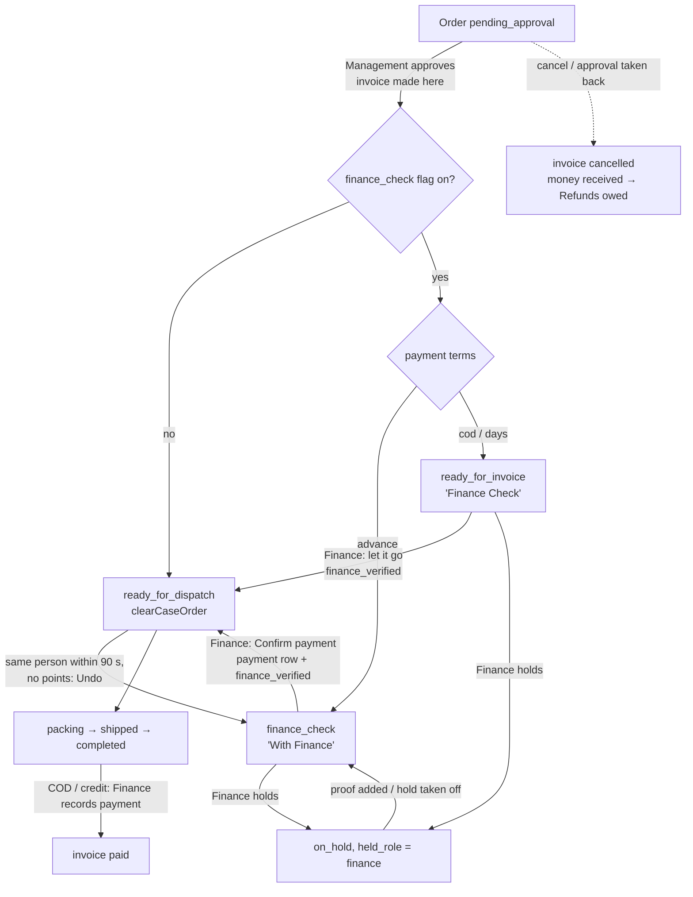
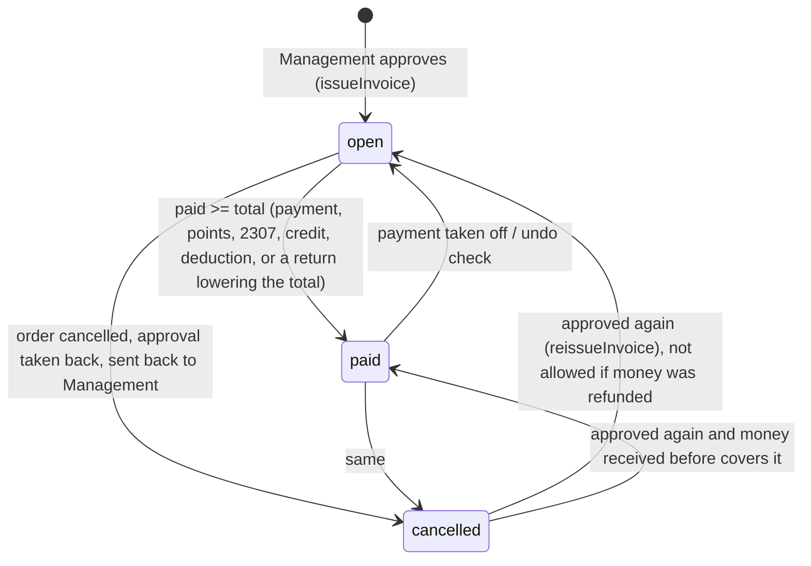
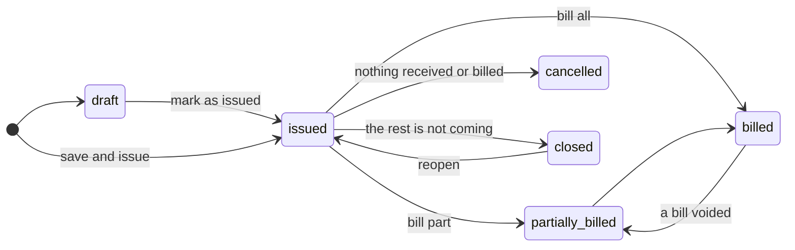
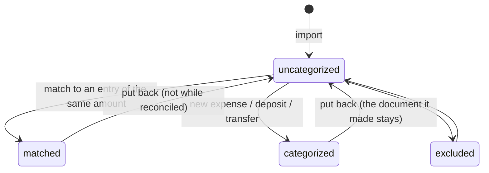

# 03 — Finance, the Books (accounting) and the Zoho history

Read-only audit of the slice, written 22 Nov 2026 from the code at commit `fa3a9c9d`.
Every statement comes from a file that was read; `path:line` is given for anything that is not obvious.
Paths are relative to the repo root; `api/` means `apps/api/src/`, `web/` means `apps/web/src/`, `mig/` means `apps/api/migrations/`.

Words used here:

- **CRM invoice / payment / refund**: rows of the tables `invoice`, `payment`, `refund`, made on the order line (native).
- **Book document**: a row of `book_doc` (Zoho's documents brought over, and the documents made in the Books screens).
- **Ledger**: the view `book_entry` — every debit and credit. Nothing is typed into it; it is worked out.
- **Confirmed** = the code line can be pointed at. **Suspected** = follows from the code but needs data or a run to prove.

---

## 1. What this area is for

| Part | Business purpose | Department |
|---|---|---|
| **Finance desk** (`api/finance`, `web/finance`) | The money step of every sales order: check an advance payment, look at what a credit / cash-on-delivery customer already owes, let the order go to Dispatch, record money that comes later, give money back, chase what is owed. | Finance |
| **The Books** (`api/books`, `web/books`) | The company's accounting, modelled on Zoho Books + Zoho Inventory: chart of accounts, ledger, banks and reconciliation, supplier purchase orders → receives → bills → payments, expenses, manual journals, credit notes, period locks, and all financial reports. | Finance (writes), CEO, Admin; Inventory and Management read the purchase/sales side |
| **Zoho history** (`api/zoho`, `api/books/zoho.ts`, `api/books/ledger.ts`, scripts) | Everything sold, billed, paid and posted in Zoho before this CRM, brought over so that customers' dues, prices paid before, sales history and the accounts continue without a break. | Admin (imports), everyone reads |
| **"Before this CRM" report names** (`web/zoho-reports.ts`) | A list of the old Zoho CRM's report **names** for the CEO. Names only — nothing is computed (see 8.6). | CEO |

Two companies bill: `2mg` (2MG Inc.) and `getmeds` (GetMeds Philippines Inc.), each with its own invoice number series (`api/finance/rules.ts:41-43`). Both are kept in **one set of books** (one chart, one ledger) — `docs/ERP-PLAN.md:129-130`.

---

## 2. Who uses it

Role strings are the `person.role` values (`api/people/roles.ts:3-19`). The guard is `allow(me, roles, what)` (`api/http.ts:93-97`); it is called inside each service function, not in the route.
A person "looking as" someone else can only read: every non-GET call is refused (`api/http.ts:66-72`).

### 2.1 Role sets defined in this slice

| Constant | Roles | Where |
|---|---|---|
| `FINANCE_ROLES` | `finance`, `admin` | `api/finance/rules.ts:8` |
| `FINANCE_READ_ROLES` | `finance`, `admin`, `ceo`, `management` | `api/finance/rules.ts:10` |
| `LEDGER_ROLES` | `finance`, `ceo`, `admin` | `api/books/accounts.ts:12` |
| `COST_ROLES` | `inventory`, `management`, `finance`, `ceo`, `admin` | `api/inventory/rules.ts:25` |
| `PO_ROLES` | `inventory`, `admin` | `api/books/actions.ts:24` |
| `BILL_ROLES` | `inventory`, `finance`, `admin` | `api/books/actions.ts:25` |
| `PAY_ROLES` | `finance`, `admin` | `api/books/actions.ts:26` |
| `READ_ROLES` (books choices) | `inventory`, `management`, `finance`, `ceo`, `admin` | `api/books/actions.ts:27` |
| `ORG_CHANGE_ROLES` (Zoho salespeople → seats) | `ceo`, `admin` | `api/org/service.ts:37` |

### 2.2 What each role may do

| Role | Finance desk | Books — purchases | Books — ledger (banks, expenses, journals, chart, locks) | Reports |
|---|---|---|---|---|
| `finance` | Confirm payment, let a credit/COD order go, record payment (with 2307 and deductions), use customer credit, take a payment off, refund, change a payment's bank account, add hold screenshots, undo own check (90 s) | Bills, vendor payments, vendor credits, apply credits, void them, add/edit vendors, attach files; **cannot** make purchase orders or receive | Everything: create, publish, void, lock/unlock, reconcile | All |
| `admin` | Same as Finance | Everything (PO, receive, bill, pay) | Everything | All |
| `ceo` | Read only (board, invoices, payments, owed, refunds, credit) | Read only | **Writes** like Finance (expense, journal, transfer, deposit, credit note, refund, chart, locks, bank) but **cannot** pay vendors or receive customer payments (`PAY_ROLES` excludes `ceo`) | All |
| `management` | Read only | Read only | None (403) | Sales/stock insights, gross profit, money summary, Sales by Customer |
| `inventory` | None | PO, receive, bill, vendors, files; read all book lists incl. sales invoices and customer payments (see finding F-14) | None | Stock aging, stock turnover, purchases |
| `online` | `GET /api/finance/money-accounts` only (`api/finance/service.ts:419`) | — | — | Online cases report |
| MedRep / team lead / others | May open **one invoice** if they may read its order (`api/finance/service.ts:1065-1072`); may open a customer's statement if they may see the customer (`:1347`) | — | — | — |

The web hides what the role cannot do, but every check above is on the API.

---

## 3. Features

### 3.1 The invoice is made when Management approves (native)

- **What**: one invoice per order (`invoice.order_id` is unique, `mig/0012:27`). Made by `invoiceOnApproval` (`api/finance/service.ts:589-608`) the moment Management approves (`api/orders/service.ts:2276`), or — for an order approved before that rule, or whose Finance check Management switched off — when Finance or the system lets it go (`:670`, `:699`).
- **Why**: "the invoice is made when Management approves" (rule of 17 Nov, comment at `:586`).
- **In**: the order (terms, days, pay-by date, company, expected day, total, lines, delivery fee).
- **Out**: `invoice` row: code from the company's counter (`counter` row `invoice:2mg` / `invoice:getmeds`, `:281-287`), `issued_on` = today (Manila), `due_on`, `total` = order total, VAT split; an `order_event` of kind `invoice`, stage `invoiced`.
- **Also**: points the customer used are paid on the invoice at once as a `payment` with method `points` (`payPoints`, `:294-324`; 1 point = 100 centavos, `api/points/service.ts:36`).
- **Lines frozen**: `invoiceFigures` copies each line's name, strength, form and VAT class into `order_item.name_then / strength_then / form_then / vat_then` (`:259-264`), so a later rename or VAT change does not alter an issued invoice (test `advance-invoice.test.ts:196`).
- **Tables written**: `invoice`, `counter`, `order_item`, `payment` (points), `order_event`.

### 3.2 Finance's two checks on an order

| Order terms | Status it waits in | Finance's action | Endpoint | Function |
|---|---|---|---|---|
| `advance` | `finance_check` ("With Finance") | **Confirm payment**: tick "I checked the proof and the money is in", amount, how, reference, day, bank account | `POST /api/finance/orders/:id/confirm-payment` | `confirmPayment` `api/finance/service.ts:512-584` |
| `cod`, `days` | `ready_for_invoice` ("Finance Check") | **Let it go**: look at what the customer owes; optional note | `POST /api/finance/orders/:id/invoice` | `makeInvoice` `:644-673` |

Which status an approved order takes: `afterApproval(terms)` (`api/orders/rules.ts:103-104`). Management can switch the Finance check off per order (`sales_order.finance_check`); then the order goes straight to Dispatch with its invoice (`api/orders/service.ts:2247-2262`, `clearCaseOrder` `api/finance/service.ts:680-701`).

**Confirm payment — rules** (`:518-583`):

1. Role `finance`/`admin`, and `orderActions(me, order).confirm_payment` (order is `finance_check`, `api/orders/rules.ts:194`).
2. `checked` must be true (`:519-525`).
3. What is due = invoice total − already paid (points, or money received before a cancel) (`:538`). Amount may be less than due (the rest stays owed) but never more (`:540-548`). Amount `0` is allowed only when nothing is due.
4. A proof of payment file on the order **or** a typed bank reference is required when amount > 0 (`:549-559`).
5. Day cannot be in the future (`payable`, `:249-254`).
6. Order → `ready_for_dispatch`, `finance_checked_at/by` set, any hold cleared (`:560-563`); event stage `finance_verified`; payment row added; if fully paid, event stage `paid`.
7. After the response: the customer is told "Order confirmed" and, if money was taken, "Payment received" (`api/finance/routes.ts:83-86`, `api/online/tell.ts`).

**Let it go (credit / COD)**: no money is taken. Order → `ready_for_dispatch`, event stage `finance_verified` saying how the customer pays (`:659-668`).

**What Finance is shown before deciding** (cards on the board, `api/finance/board.ts:34-42`): order total, what is due after points, terms, credit limit, what the customer **owed before this order** and how much of it is overdue (CRM invoices + Zoho's unpaid invoices + Zoho opening balance, the order's own invoice left out — `api/finance/dues.ts:22-37`, `board.ts:30-33`), the proof of payment, the MedRep's reason when there is no proof (`no_proof_reason`: `payment_to_follow`, `paid_no_slip`, `other`, `mig/0047`).

**Finance's own check ticks** (19 Nov): `finance_papers`, `finance_dues`, `finance_credit` in `order_check` (`mig/0117`), approved one by one through the orders module (`api/orders/service.ts:2886-2937`). They are **not** required by `confirmPayment` / `makeInvoice` (finding F-6).

### 3.3 Credit limit and pay-by date

- `customer.credit_limit` (centavos, nullable; `mig/0006:26`), `customer.payment_terms` (`advance` / `cod` / `days`) and `payment_days` (1–365).
- The system **flags** "Over credit limit" when `owed before + this order's total > credit limit` (`api/orders/service.ts:585-593`). It is a finding shown to Management and Finance, not a block.
- `sales_order.pay_by` (`mig/0108`): an order agreed to be paid by a date keeps that date as the due day whenever it is invoiced or delivered (`api/finance/service.ts:335`, `api/dispatch/service.ts:536-541`).
- Due day rule (`dueOn`, `api/finance/rules.ts:73-82`): `days` → issue day + days; `cod` → expected delivery day if later than issue day, else issue day; `advance` → issue day. On delivery the due day is reset: COD → delivery day; credit → `pay_by`, else delivery day + days (`api/dispatch/service.ts:533-542`).

### 3.4 Record a payment later

`POST /api/invoices/:id/payments` → `recordPayment` (`api/finance/service.ts:759-871`). Finance and Admin only.

| Input | Rule |
|---|---|
| `amount` (centavos, > 0), `method` (`bank`, `cash`, `check`, `ewallet`, `other`), `paidOn`, `reference`, `note`, `proofId`, `moneyAccount` | Day not in the future; proof must be an active `payment_proof` file of that order (`:811-818`) |
| `withheld` + `form2307` | Tax the customer withheld (EWT). Needs the BIR Form 2307 number (`:807-808`). Stored as a second payment, method `withholding`, reference = the 2307 number (`:821-830`) |
| `deducted` + `deductionKind` + `deductionRef` | What the customer deducted (`near_expiry`, `listing_fee`, `promo`, `penalty`, `other`). Needs the kind (`:809-810`). Stored as a third payment, method `deduction`, with `deduction_kind` (`:833-845`) |

Refused when: invoice cancelled; nothing owed; COD and goods not delivered ("record the money once the goods are delivered", `:785-790`); advance pay not yet checked ("confirm the money on the order's payment check", `:792-797`); `amount + withheld + deducted` more than owed (`:800-806`).
After: `invoice.paid` up, status `paid` when `paid >= total` (`addPayment`, `:485-489`); timeline event; if the order is already `completed`, a "Completed: delivered and paid" event; points settled (`settleOrderPoints`); customer told "Payment received" (`routes.ts:157-159`).
On a guarantee-letter case the payer is recorded as `agency` (`:475-479`).

### 3.5 Cash on delivery

- The invoice exists from approval but is "Collect on delivery": not owed, not late, and cannot take a payment until the order is `completed` (`api/finance/dues.ts:11`, `rules.ts:100-101`, `service.ts:785-790`).
- Dispatch, on delivering, notes the cash the rider or courier collected and who holds it: `sales_order.cod_collected`, `cod_collected_by`, `cod_noted_by`, `cod_noted_at` (`mig/0115`, `api/dispatch/service.ts:578-596`). This is a **note**, not a payment.
- Finance sees the note on the Due payments page (`codCash`, `api/finance/service.ts:1468-1469`) and records the payment once the money is in the bank.

### 3.6 Take a payment off, undo a check

- **Take off** (`POST /api/payments/:id/remove`, `removePayment` `:892-941`): needs a reason; the row stays with `active = false`, `removed_reason/by/at`; invoice `paid` down and status `open`. Not for points payments, not on a cancelled invoice.
- **Undo own payment check** (`POST /api/finance/orders/:id/undo-confirm`, `undoConfirm` `:1538-1600`): only the same person, within `UNDO_SECONDS = 90` (`:1533`), order still `ready_for_dispatch`, and no points used. All active payments of the invoice are switched off, `paid = 0`, order back to `finance_check`, the `finance_verified` / `paid` stage marks are cleared from the timeline.

### 3.7 Refunds and money kept as credit

`POST /api/invoices/:id/refunds` → `recordRefund` (`:944-994`).

- **Cancelled order**: owed back = cash received − already refunded (points, 2307, credit and deductions are never given back as money; `notCashPaid` `:875-881`).
- **Not cancelled** (a return lowered the bill, or the order changed after payment): owed back = the smaller of cash received and what was paid beyond the bill (`:956-960`).
- Method `credit` = **kept as the customer's credit** for their next invoice instead of money out (`routes.ts:174-177`); no bank account.
- "Refunds owed" list: `refundsOwed` (`:1273-1326`) — cancelled orders with cash received, overpaid bills, and the last 50 refunds done.

### 3.8 A customer's credit

`api/finance/credit.ts`. Sources (`sourcesSql`, `:20-31`):

1. Book documents of kind `credit_note` or `customer_payment` with `balance > 0`, not void/draft (Zoho's open credit notes, credit notes made in Books, and unused customer payments = advances). Left = balance × fx − what CRM payments already used (`payment.credit_doc_id`).
2. Refunds with method `credit` ("kept"). Left = amount − what CRM payments used (`payment.credit_refund_id`).

`POST /api/invoices/:id/credit` → `useCredit` (`:55-126`): Finance picks a source and an amount; a `payment` with method `credit` is added. Source row is locked so it cannot be used twice at once (`:80-83`). If that invoice is later cancelled the credit goes back by itself (`releaseCredit`, `:129-140`, called from `cancelInvoiceOf`).
`customer.opening_credits` (Zoho's unexplained credits) is **not** a usable source.

### 3.9 Which bank account

Every cash payment and refund may name one of the books' money accounts (`book_account.type` in `bank`, `cash`, `credit_card`, `payment_clearing`; `api/books/accounts.ts:23`). Validated by name (`moneyAccountOf`, `api/finance/service.ts:405-415`). Not named → the ledger uses "Undeposited Funds" (payments) or "Petty Cash" (refunds) (`mig/0099:42,56`). Finance can move it later: `POST /api/payments/:id/account`, `POST /api/refunds/:id/account` (`setMoneyAccount`, `:429-457`). The web form remembers the last account per method in the browser (`web/finance/parts.tsx:96-124`).

### 3.10 Invoice cancelled / made good again / follows edits

- `cancelInvoiceOf` (`:704-735`): called when the order is cancelled, Management's approval is taken back, or a held order goes back to Management (`api/orders/service.ts:2359, 2416, 2446`). Status `cancelled`, credit released, timeline says how much is owed back.
- `reissueInvoice` (`:363-399`): approving again re-opens the same invoice (same number unless the company changed), with today's date and the order's current lines and total. Money received before counts again. Refused if money was already refunded ("place a new order instead").
- `refreshInvoice` (`:612-640`): an edit before Finance's check changes the invoice's terms, due day and — if the company changed — its number in the other series.
- Returns: a credited return lowers `invoice.total`, raises `invoice.credited`, lowers the VAT parts (`api/returns/service.ts:279-284`).

### 3.11 Books — purchases (supplier payables)

All in `api/books/actions.ts`. Web: `web/books/forms.tsx`, and a second set of screens under `web/buying/*` (outside this slice) that call the same endpoints.

| Feature | Who | Function | What it writes |
|---|---|---|---|
| Vendor add/edit | Inventory, Finance, Admin | `saveVendor` `:212-237` | `supplier` (name must be unique, currency 3 letters) |
| Purchase order (draft or issued) | Inventory, Admin | `createPurchaseOrder` `:255-291` | `book_doc` kind `purchase_order`, `book_line`; foreign currency needs an fx rate |
| Issue / cancel / close / reopen | Inventory, Admin | `setOrderStatus` `:312-337` | status only |
| Receive goods | Inventory, Admin | `receiveOrder` `:342-451` | `book_doc` `purchase_receive`; stock in (`batch`, `stock`, `stock_move` kind `receive`); batch cost = PO rate × fx, averaged with what is on the shelf (`:381-394`); expired batches refused; then order-waiting-for-stock logic (`afterStockIn`, `routes.ts:186`) |
| Bill from a PO ("Convert to Bill") | Inventory, Finance, Admin | `billOrder` `:478-548` | `book_doc` `bill` (status `open`, balance = total), PO status `billed` / `partially_billed` |
| Bill on its own (rent, utility, freight) | same | `createBill` `:551-592` | bill; optional **landed cost** on a PO: the bill's lines go to "Inventory Asset" and its amount is spread over that PO's batches still on the shelf (`landOn` `:627-661`, `landWaiting` `:665-695`) |
| Pay a vendor | Finance, Admin | `payVendor` `:747-779` | `vendor_payment`; amounts put on bills reduce their balance (`paid` / `partially_paid`); the rest stays as the payment's unused balance |
| Vendor credit | Finance, Admin | `createVendorCredit` `:783-799` | `vendor_credit`, status `open` |
| Put a credit / unused payment on bills (or a credit note / customer payment on Zoho invoices) | Finance, Admin | `applyCredit` `:802-829` | balances, `book_link` |
| Receive money on a **Zoho** invoice | Finance, Admin | `receivePayment` `:908-937` | `customer_payment`; Zoho invoice balance down |
| Void | by kind (below) | `voidDoc` `:833-901` | status `void`, `voided_by/at`, `void_reason`; effects reversed |
| Attach a file (photo / PDF ≤ 10 MB) to a purchase document | Inventory, Finance, Admin | `addBookFile` `:705-720` | `book_file` through `keepFile` |

Void rules (`voidDoc`): bill → only if nothing was paid on it (and landed cost comes back off the batches); payment / vendor credit / customer payment → the money goes back onto the bills or invoices; credit note / customer payment → refused if used on a CRM invoice or refunded; refund → the credit gets its money back; journal → its reversal is voided too. Every void checks the period lock and the bank reconciliation (`:846-847`).

### 3.12 Books — writing the ledger

All in `api/books/write.ts`; role `LEDGER_ROLES`; every write calls `assertOpen` (period lock).

| Feature | Function | Notes |
|---|---|---|
| Record expense | `createExpense` `:189-253` | One or more lines (account, amount, optional tax); tax inclusive or exclusive (`:225`); paid through a bank/cash/card account, or "Employee Reimbursements" / "Undeposited Funds"; required Zoho custom fields: Cost Centre, Type, Department, PIC; number `EXP-n` |
| Manual journal | `createJournal` `:259-315` | ≥ 2 lines; debits = credits (checked before and after tax, `:277`, `:293`); Department and Company required; notes required; draft or published; optional reverse date → an opposite journal `<number>-R` on that day (`reverseJournal` `:318-341`) |
| Publish a draft journal | `publishJournal` `:344-357` | |
| Transfer between money accounts | `createTransfer` `:362-385` | number `TRF-nnnn` |
| Deposit (other income, interest, owner's money) | `createDeposit` `:389-413` | from any chart account into a money account; `DEP-nnnn` |
| Credit note for a customer | `createCreditNote` `:420-457` | lines default to account "Sales"; status `open`, balance = total; becomes the customer's credit (3.8) |
| Refund a credit note / unused payment from a bank | `refundCredit` `:460-502` | cannot exceed balance − what CRM invoices used of it |
| Add / change an account | `createAccount` `:512-533`, `updateAccount` `:537-558` | sub-account must have its parent's type; rename only while no entry is on it; inactive hides it from forms |
| Lock / unlock a period | `setLock` `:579-591`, `unlock` `:593-602` | modules `all`, `sales`, `purchases`, `banking`, `accountant`; unlock needs a reason; `book_lock_event` keeps the history |

### 3.13 Books — banking

`api/books/bank.ts`, role `LEDGER_ROLES`.

- **Import a statement** (`importStatement` `:91-94`): the browser parses a CSV (Date + Amount, or Date + Deposits/Withdrawals columns; `web/books/bank.tsx:57-81`) and posts rows. A line with the same account, day, amount, words and reference is kept once (SHA-1 fingerprint, `:106-108`).
- **Match** a line to what the books already hold on that account, same amount (`matchLine` `:133-145`). Suggestions: same amount within 10 days, not already taken (`:57-73`).
- **Categorize** a line into a new expense (money out), deposit (money in) or transfer (`categorizeLine` `:154-183`).
- **Exclude** / put back (`setLineStatus` `:186-199`).
- **Reconcile** (`reconcileView` `:213-232`, `finishReconciliation` `:235-265`): opening (last reconciliation's closing, else 0) + ticked entries must equal the statement's closing; else refused with the difference. End day must be after the last reconciled day and not after today.
- **Undo** the latest reconciliation only (`undoReconciliation` `:268-277`).
- A book document in a standing reconciliation cannot be voided (`guardReconciled` `:281-287`).

### 3.14 Books — recurring expenses and bills

`api/books/recurring.ts`. Profiles come from Zoho (`book_doc` kinds `recurring_expense`, `recurring_bill`). Nothing is made here until Finance **takes a profile over from a day** (`takeOverRecurring` `:129-137`, stored as field `CRM From`); from that day the daily automation makes each due document once (`makeDueRecurring` `:104-125`, linked to the profile by `book_link.on_date`). A locked period is skipped silently (`:118-121`). Stop / start: `setRecurringStatus` `:140-145`.
Recurring **journals** are in the plan (`docs/BOOKS-PLAN.md:67`) — **not built**.

### 3.15 Books — read screens over both worlds

- `bookList` / `bookDoc` (`api/books/service.ts:96-227`): each kind's list holds Zoho's documents **and** the CRM's own of the same kind with **negative ids** (`api/books/crm.ts:19-48`): CRM orders, invoices, payments (`CRM-00012`), returns, stock counts (as adjustments), transfers, packages, shipments. Opening a CRM one shows it as a document with a link to its CRM page.
- Customers in Books (`api/books/customers.ts`), items (`items.ts`), vendors (`service.ts:231-290`), price lists.
- Chart of accounts with balances, an account's entries, Banking overview (`api/books/accounts.ts`).
- Books Home dashboard (`api/books/dashboard.ts`).

### 3.16 Zoho import (history)

See section 5.4 for the tables and 8.7 for what is imported versus native.

---

## 4. Workflows and statuses

### 4.1 How an order reaches Finance and leaves it

Sources: `api/orders/rules.ts:103-104,194-195`; `api/orders/service.ts:2241-2277`; `api/finance/service.ts:512-701,1538-1600`. Holding and resuming are in the orders module (other slice); Finance may only hold at its own step and take off its own holds (test `finance.test.ts:240`).

### 4.2 Order statuses that belong to Finance

| Status | Label | Who acts |
|---|---|---|
| `finance_check` | "With Finance" — Finance checks the payment | `finance`, `admin` → Confirm payment |
| `ready_for_invoice` | "Finance Check" — Finance checks what they owe | `finance`, `admin` → let it go |

(`api/orders/rules.ts:25-26, 88, 281-282`). The old status `invoiced` was removed in `mig/0012:5`; "paid" is a fact of the invoice, not an order step.

### 4.3 Invoice

Stored status: `open`, `paid`, `cancelled` (`mig/0012:44`).

Words shown (not stored), `invoiceState` `api/finance/rules.ts:86-115`: Cancelled · Paid · Collect on delivery · Overdue by N days · Due today · Due in N days, each with "Partly paid · " in front when `paid > 0`.

"Not due yet" (`api/finance/dues.ts:7-11`): COD and credit invoices until the order is `completed`; advance invoices until Finance has checked the money.

### 4.4 Payment

| Method | Entered by | Cash? | Notes |
|---|---|---|---|
| `bank`, `cash`, `check`, `ewallet`, `other` | Finance by hand (`STAFF_METHODS`) | yes | may name a bank account |
| `points` | system, at invoice time | no | only comes back when the order is cancelled |
| `withholding` | with a payment, needs 2307 | no | |
| `credit` | Use customer's credit | no | points at the source document or refund |
| `deduction` | with a payment, needs a kind | no | `deduction_kind` |

(`api/finance/rules.ts:12-38`; DB check in `mig/0099:9-10`.) Lifecycle: `active = true` → `active = false` (taken off, undo, or credit released on cancel). Never deleted.

### 4.5 Refund

No status. Methods: `cash`, `bank`, `check`, `ewallet`, `other`, `credit` (`mig/0092:14-15`). A refund cannot be undone in code (no endpoint).

### 4.6 Book documents

Statuses are free text (Zoho's words). Values the **native** code sets:

| Kind | Statuses set here | Transitions |
|---|---|---|
| `purchase_order` | `draft`, `issued`, `partially_billed`, `billed`, `closed`, `cancelled` | draft → issued; issued → cancelled (only if nothing received/billed); any open → closed; closed → reopen (`issued` or `partially_billed`); billing sets `partially_billed` / `billed`. Receiving does **not** change the status (the "received" dot is worked out from line quantities) |
| `purchase_receive` | `received` | — |
| `bill` | `open`, `partially_paid`, `paid`, `void` | shown as `overdue` when balance > 0 and past due (`api/books/service.ts:28-31`) |
| `vendor_payment`, `customer_payment` | `paid`, `void` | |
| `vendor_credit`, `credit_note` | `open`, `closed` (balance 0), `void` | |
| `expense` | `nonbillable`, `void` | |
| `journal` | `draft`, `published`, `void` | draft → published |
| `transfer_fund`, `deposit`, `refund` | `posted`, `void` | |
| `recurring_expense`, `recurring_bill` | `Active`, `Stopped` (Zoho's own words also) | |
| `invoice`, `sales_order`, `sales_return`, `package`, `shipment`, `transfer_order`, `adjustment`, `fixed_asset` | Zoho's only | cannot be made or voided in Books |

### 4.7 Bank statement line and reconciliation

Reconciliation: `done` → `undone` (latest only). (`mig/0102`.)

### 4.8 Period lock

`book_lock` one row per module. A write or void dated on or before the lock day of its module (or of `all`) is refused with 409 `locked` (`api/books/write.ts:44-58`). Module of a kind: `moduleOf` (`:36-41`).

---

## 5. Data

### 5.1 Finance tables (native)

| Table | Purpose | Key columns | Migration |
|---|---|---|---|
| `invoice` | One sales invoice per order | `code` (unique), `order_id` (unique), `customer_id`, `invoice_from` (`2mg`/`getmeds`), `terms`, `issued_on`, `due_on`, `total`, `vatable`, `vat`, `exempt`, `zero_rated`, `paid`, `refunded`, `credited` (0050), `status`, `cancelled_reason/at`, `by_person` | 0012, 0050 |
| `payment` | Money (or non-cash settlement) on an invoice | `invoice_id`, `customer_id`, `amount`, `method`, `reference`, `paid_on`, `proof_id` → `order_file`, `payer` (`customer`/`agency`, 0017), `money_account` (0096), `credit_doc_id` → `book_doc`, `credit_refund_id` → `refund` (0092), `deduction_kind` (0099), `active`, `removed_reason/by/at` | 0012, 0017, 0088, 0092, 0096, 0099 |
| `refund` | Money given back, or kept as credit | `invoice_id`, `amount`, `method`, `reference`, `refunded_on`, `money_account` | 0012, 0092, 0096 |
| `counter` rows `invoice:2mg`, `invoice:getmeds` | Gap-free invoice numbers per company | | 0012 |
| `sales_order` columns | `finance_checked_at/by` (0012), `no_proof_reason/note` (0047), `pay_by` (0108), `cod_collected`, `cod_collected_by`, `cod_noted_by/at` (0115), `gl_number`, `gl_amount`, `gl_set_by/at` (0123), `finance_check` (flag) | | |
| `order_file.hold_event_id` | Finance's screenshots with a hold (max 5, images ≤ 10 MB; `api/finance/service.ts:1602-1649`) | | 0047 |
| `order_check` keys `finance_papers`, `finance_dues`, `finance_credit` | Finance's check ticks | | 0117 |
| `customer` columns | `payment_terms`, `payment_days`, `credit_limit` (0006); `opening_receivables`, `opening_credits`, `zoho_fields` (0073) | | |
| view `sale_invoice` | CRM invoices + Zoho invoices in one shape, with seat / channel (Zoho's through `zoho_seller`) | `source` (`crm`/`zoho`), `issued_on`, `total`, `paid`, `status`, `customer_id`, `seat_id`, `channel_id` | 0076 |

Money is whole centavos. `invoice.total`, `payment.amount`, `refund.amount` are 32-bit `integer` (finding F-9).

### 5.2 Books tables

| Table | Purpose | Migration |
|---|---|---|
| `book_doc` | Every document: `kind` (22 kinds, list in `mig/0077:25-31`), `zoho_id` (null = made here), `number`, `reference`, `doc_date`, `due_date`, `status`, `supplier_id` / `customer_id`, `party_name`, `currency`, `fx_rate`, `sub_total`, `total`, `balance` (centavos of the document's currency), `payment_terms`, `notes`, `fields` (jsonb: every Zoho field without a column), `warehouse_id`, `voided_by/at`, `void_reason` (0072), `money_account`, `from_account`, `party_account` (0078, filled by trigger `book_doc_accounts` from `fields`), `bank_charges` (0080), `withheld`, `tax_account` (0082), `reverse_on`, `reversal_of` (0101), `created_by` | 0069, 0072, 0077–0082, 0101 |
| `book_line` | Lines: `medicine_id`, `item_name`, `sku`, `account`, `warehouse`, `qty`, `rate`, `tax_name/pct/amount`, `amount`, `qty_done` (received / billed / cancelled…), `batches`, `fields`, `from_line`, `batch_id` | 0069, 0072 |
| `book_link` | How documents hang together, with amount and day (payment → bill, receive → PO, refund → credit, made-document → recurring profile) | 0069 |
| `book_file` | Files on documents (bytes through `files/store.ts`) | 0075 |
| `book_account` | Chart of accounts: `name` (unique, case-insensitive), `code`, `type` (Zoho's type keys), `parent_id`, `active`, `zoho_id`, `created_by/at` | 0077, 0101 |
| `book_ledger` | **Stored** debits/credits of Zoho's documents, rewritten by `refresh_book_ledger()` after each import | 0079 |
| view `book_entry_calc` | Posting rules for every book document (see 5.3) | 0079 → 0080 → 0082 (latest) |
| view `crm_entry` | Posting rules for the CRM's own work (see 5.3) | 0096 → 0098 → 0099 (latest) |
| view `book_entry` | `book_ledger` ∪ `book_entry_calc where not zoho` ∪ `crm_entry`; columns `doc_id, kind, on_date, account, debit, credit, source ('books'/'crm'), number, customer_id, link` | 0096 |
| `book_option` | Choices of Zoho's custom fields (Cost Centre, Type, Company, Department) | 0101 |
| `book_tax` | Taxes by name: Vat 12, No Tax 0, EWT 1, Withholding Tax 2, RENT 5, WITHHOLDING TAX RENT 5, VAT - EWT 11 | 0101 |
| `book_lock`, `book_lock_event` | Period locks and their history | 0101 |
| `bank_import`, `bank_line`, `bank_reconciliation`, `bank_cleared` | Statements and reconciliations | 0102 |
| `book_activity` | Zoho's activity log (who did what in Zoho) | 0077 |
| `book_item`, `book_price_list` | Zoho's items and price lists | 0074 |
| `supplier` columns, `supplier_person` | Vendors as Zoho kept them; `opening_credits` (0070), `opening_payables` (0071) | 0069–0071 |
| `customer_person` | Customers' contact people from Zoho | 0073 |

### 5.3 Posting rules — which event posts which lines

Account names are **hard-coded strings** matched to `book_account.name` case-insensitively. There is no migration that creates the chart: it comes from the Zoho import or is added by hand (finding F-3).

**CRM's own work** (`crm_entry`, `mig/0099:12-101`) — live view, nothing stored:

| Event | Date | Debit | Credit |
|---|---|---|---|
| Invoice not cancelled (as first billed: `total + credited`) | `issued_on` | Accounts Receivable: total | Sales: total − VAT − net delivery fee · Shipping Charge: delivery fee less its 12/112 · Tax Payable: VAT |
| Payment, cash methods | `paid_on` | the named money account, else **Undeposited Funds** | Accounts Receivable |
| Payment `withholding` | `paid_on` | **Advance Tax** | Accounts Receivable |
| Payment `points` | `paid_on` | **Discount** | Accounts Receivable |
| Payment `deduction` | `paid_on` | **Discount** | Accounts Receivable |
| Payment `credit` | — | nothing (the credit already came off receivables) | |
| Refund (not `credit`) | `refunded_on` | Accounts Receivable | the named money account, else **Petty Cash** |
| Refund kept as credit | — | nothing | |
| Return credited | day credited (Manila) | Sales: credit − VAT · Tax Payable: VAT of the 12% lines | Accounts Receivable: credit |
| Stock delivered (`stock_move` `deliver`) | move day | Cost of Goods Sold: qty × batch `unit_cost` | Inventory Asset |
| Stock back from a return (`return`) / stock count (`count`) | move day | the other way / difference on Cost of Goods Sold | |
| Samples / gifts sent to a rep (`sample_out`) | move day | "Product Samples to clients" / "Promotional Materials" | Inventory Asset |

Left out: moves with ref `GO-LIVE`, batches with no cost.

**Book documents** (`book_entry_calc`, `mig/0082:36-140`); a void, draft or `pending_approval` document posts nothing:

| Kind | Debit | Credit |
|---|---|---|
| `customer_payment` | money account (else Undeposited Funds): total − bank charges · Advance Tax (or the named tax account): withheld · Bank Fees and Charges: charges | Accounts Receivable (or named): total + withheld |
| `vendor_payment` | Accounts Payable (or named): total + withheld · Bank Fees and Charges | money account (else Petty Cash): total + charges · Withholding Tax Payable (or named): withheld |
| `expense` | each line's account (net of tax when inclusive) · Tax Payable: tax | paid-through account (else Petty Cash): total |
| `journal` | each line by its sign; a line's tax on Tax Payable on the same side | |
| `transfer_fund`, `deposit` | `To Account` | `From Account` |
| `refund` | Accounts Receivable | refund-from account (else Petty Cash) |
| `bill` | each line's account, **default "Cost of Goods Sold"** · what the lines don't hold (tax, discount) on Tax Payable | Accounts Payable |
| `vendor_credit` | the reverse of a bill | |
| `invoice` (Zoho's) | Accounts Receivable | each line's account (default Sales) · the rest on Tax Payable |
| `credit_note` | the reverse of an invoice | |
| `purchase_order`, `purchase_receive`, `sales_order`, packages, shipments, adjustments, transfer orders, fixed assets, recurring profiles | nothing | |

Zoho's documents' lines are computed once by this same view and stored in `book_ledger`; documents made here are computed live every time.
What Zoho posted by itself but did not export (cost of goods sold, stock, its own tax split, unearned revenue, rounding) is held in one journal per month, `ZOHO-TIE-YYYY-MM`, written by `apps/api/scripts/tie-to-zoho.ts` (script, not in the running app). Zoho's opening balances are one journal `Opening Balance` balanced on "Opening Balance Adjustments" (`api/books/ledger.ts:409-442`).

Account heads (`api/books/accounts.ts:16-22`): asset, liability, equity, income, expense — each a list of Zoho account types.

### 5.4 Zoho history tables

| Table | Holds | Written by | Read by |
|---|---|---|---|
| `zoho_contact` | Every Zoho contact → the customer it is here (twins joined), with its last salesperson, division, headquarter | `api/zoho/import.ts` | sellers, books imports |
| `zoho_seller` | Zoho salesperson name → seat | `api/zoho/sellers.ts` (CEO/Admin) | `sale_invoice` view |
| `past_order`, `past_order_item` | Zoho sales orders as price history | `importZohoOrders` | "what this customer paid before", top-medicines / ABC / stock-turnover reports |
| `past_invoice`, `past_payment` | Zoho invoices and payments (first import, 16 Nov) | `importZohoInvoices`, `importZohoPayments` (script only) | **nothing reads them** (finding F-15) |
| `book_doc` (with `zoho_id`) | Zoho Inventory + Zoho Books documents (second import, the Books) | `api/books/zoho.ts`, `api/books/ledger.ts` through scripts | everything in Books, dues, `sale_invoice` |
| `medicine_sku`, medicine prices, opening batches | `api/zoho/medicines.ts` | scripts | inventory |

### 5.5 How history is kept

- Order timeline: every finance action writes `order_event` (kinds `status`, `invoice`, `payment`, `check`) with the person (`logEvent`).
- Payments: soft-removed with reason, person and time. Invoices: cancelled with reason and time; **re-issue overwrites** `issued_on`, `total`, VAT parts, `by_person` in place (no version rows in this slice).
- Book documents: void keeps the row with who/when/why. No edit endpoints exist for book documents (they are made or voided).
- Locks: `book_lock_event`. Reconciliations: `bank_reconciliation` (done/undone, who, when). Statement lines: `done_by/at`.
- `setMoneyAccount`, recurring take-over and `updateAccount` write no history row other than (for payments) an order timeline line.

---

## 6. API endpoints

All need a signed-in session (`signedIn` on `/api/finance/*`, `/api/invoices/*`, `/api/payments/*`, `/api/refunds/*`, `/api/books/*`, `/api/books-*`).

### 6.1 Finance (`api/finance/routes.ts`)

| Method | Path | Who | What | Line |
|---|---|---|---|---|
| POST | `/api/finance/orders/:id/confirm-payment` | finance, admin | Check an advance payment, record it, send to Dispatch | 71 |
| POST | `/api/finance/orders/:id/undo-confirm` | finance, admin (own, 90 s) | Take the check back | 89 |
| POST | `/api/finance/orders/:id/hold-proof` | finance, admin | Screenshot with Finance's hold (multipart `file`) | 94 |
| GET | `/api/finance/my-confirmations?from&to` | finance, admin | Orders this person checked | 109 |
| POST | `/api/finance/orders/:id/invoice` | finance, admin | Let a credit / COD order go to Dispatch | 114 |
| GET | `/api/finance/board` | finance, admin, ceo, management | Three lanes + money tiles | 121 |
| GET | `/api/finance/owed?q` | read roles | Per-customer ageing | 123 |
| GET | `/api/finance/refunds` | read roles | Refunds owed and done | 126 |
| GET | `/api/finance/owed/invoices` | read roles | Every unpaid invoice (CRM + Zoho) | 127 |
| GET | `/api/finance/collected?days` | read roles | COD / credit invoices paid in full lately | 128 |
| GET | `/api/finance/statement/:id?from&to` | whoever may see the customer | Statement of account | 131 |
| GET | `/api/invoices?tab&q&customer&page` | read roles | Invoice list (25 a page) | 140 |
| GET | `/api/invoices/:id` | read roles, or anyone who may read the order | One invoice with lines, payments, refunds, proofs | 151 |
| POST | `/api/invoices/:id/payments` | finance, admin | Record a payment (+2307, +deduction) | 154 |
| GET | `/api/finance/money-accounts` | finance, admin, online, ceo | Bank / cash / e-wallet accounts | 162 |
| POST | `/api/payments/:id/account`, `/api/refunds/:id/account` | finance, admin | Change the bank account | 163-168 |
| POST | `/api/invoices/:id/refunds` | finance, admin | Give money back or keep it as credit | 169 |
| GET | `/api/customers/:id/credit` | read roles | A customer's credit, source by source | 188 |
| POST | `/api/invoices/:id/credit` | finance, admin | Use credit on an invoice | 191 |
| GET | `/api/payments?month&method&q&page` | read roles | Payments of a month | 204 |
| POST | `/api/payments/:id/remove` | finance, admin | Take a payment off, with reason | 215 |

### 6.2 Books (`api/books/routes.ts`)

| Method | Path | Who | What | Line |
|---|---|---|---|---|
| GET | `/api/books/dashboard?year` | ledger | Books Home | 67 |
| GET | `/api/books/items`, `/items/:id`, `/pricelists` | cost roles | Items, price lists | 68-70 |
| GET | `/api/books/customers`, `/customers/:id` | cost roles | Customers with receivables | 71-72 |
| GET | `/api/books/vendors`, `/vendors/:id` | cost roles | Vendors with payables | 73-74 |
| GET | `/api/books/files/:id` | cost roles | A document's file | 75 |
| GET | `/api/books/bill/payables` | cost roles | Payables band (total, due today, 30 days, overdue) | 84 |
| GET | `/api/books/accounts?view&q&asOf`, `/accounts/:id` | ledger | Chart with balances; an account's entries | 85-94 |
| GET | `/api/books/banking` | ledger | Money accounts and totals | 95 |
| GET | `/api/books/reports/trial-balance`, `profit-and-loss`, `balance-sheet`, `cash-flow`, `vat`, `payables-aging` | ledger | Statements | 98-103 |
| GET | `/api/books/reports/gross-profit`, `money-summary` | finance, ceo, admin, management | | 104-105 |
| GET | `/api/books/insights/:key?from&to&by` | per report (8.4, 8.5) | Insight reports | 107 |
| GET | `/api/books/:kind`, `/:kind/:id` | ledger for ledger kinds, else cost roles | Lists and documents | 110-119 |
| GET | `/api/books-choices` | inventory, management, finance, ceo, admin | Choices for purchase forms | 139 |
| POST | `/api/books/vendors`, `/vendors/:id` | inventory, finance, admin | Add / change a vendor | 140-141 |
| POST | `/api/books/purchase_order/new` | inventory, admin | | 142 |
| POST | `/api/books/purchase_order/:id/status` (`issued`, `cancelled`, `closed`, `reopen`) | inventory, admin | | 166 |
| POST | `/api/books/purchase_order/:id/receive` | inventory, admin | Goods in | 171 |
| POST | `/api/books/purchase_order/:id/bill`, `/api/books/bill/new` | inventory, finance, admin | | 203-204 |
| POST | `/api/books/vendor_payment/new` | finance, admin | | 205 |
| POST | `/api/books/customer_payment/new` | finance, admin | On Zoho invoices | 217 |
| POST | `/api/books/vendor_credit/new` | finance, admin | | 229 |
| POST | `/api/books/:kind/:id/apply` | finance, admin | Put credit on bills / invoices | 238 |
| POST | `/api/books/:kind/:id/files` | inventory, finance, admin | Attach | 242 |
| POST | `/api/books/:kind/:id/void` | by kind | Void with reason | 252 |
| GET | `/api/books-ledger-choices` | ledger | Accounts, taxes, options, next numbers, locks | 262 |
| POST | `/api/books/expense/new`, `journal/new`, `journal/:id/publish`, `transfer_fund/new`, `deposit/new`, `credit_note/new`, `/:kind/:id/refund` | ledger | | 263-364 |
| POST | `/api/books/accounts`, `/accounts/:id` | ledger | Add / change account | 366-370 |
| POST | `/api/books/:kind/:id/take-over`, `/:kind/:id/recurring`; GET `/api/books-recurring/:id/made` | ledger | Recurring profiles | 371-378 |
| GET/POST | `/api/books-bank/:account/statement`, `/import`, `/reconcile`; POST `/api/books-bank/line/:id/match`, `/categorize`, `/status`; POST `/api/books-bank/reconciliation/:id/undo` | ledger | Banking | 381-447 |
| GET/POST | `/api/books-locks`, `/api/books-locks/:module`, `/:module/unlock` | ledger | Period locks | 448-456 |

The `:kind` in `apply`, `files`, `void`, `refund`, `take-over`, `recurring` is not checked; the document's own kind is read from its id.

### 6.3 Zoho (`api/checks/routes.ts`, outside the folder but calls it)

| Method | Path | Who | What | Line |
|---|---|---|---|---|
| GET/POST | `/api/admin/zoho-sellers` | ceo, admin | List / tie a Zoho salesperson to a seat | 52-55 |
| POST | `/api/admin/import/zoho-customers` | admin | Batch import (dry run unless `apply`) | 65 |
| POST | `/api/admin/import/zoho-orders` | admin | Batch import | 73 |

Invoices, payments, book documents, chart, bank lines and files are imported **only by scripts** in `apps/api/scripts/` (no endpoint).

---

## 7. Screens

### 7.1 Finance (CRM frame)

| URL (`web/main.tsx`) | File | Who gets it (menu) | What is on it | Actions → endpoint |
|---|---|---|---|---|
| `/` and `/finance` (Finance's Home) | `web/orders/board.tsx` (other slice) with `web/finance/lanes.tsx` as the Board view | Finance (`web/menus.ts:1337`) | Orders to check. Board view: tiles (money in today / this month, customers owe, overdue…) and three lanes: Check payment, Check dues, Collect | Confirm payment dialog → `confirm-payment`; "let it go" → `POST /api/finance/orders/:id/invoice` (`lanes.tsx:136`); data `GET /api/finance/board` |
| `/finance/prepaid` | same board, `terms="advance"` | Finance | Advance orders only | same |
| `/collect` | `web/finance/collect.tsx` | Finance (badge = late payments) | "Due payments": one tab per terms (30 days, COD, "From before" = Zoho…) + Collected (30 days); search; Mark paid | `GET /api/finance/owed/invoices`, `GET /api/finance/collected?days=30`; Mark paid → Record payment dialog |
| `/owed` | `web/finance/owed.tsx` | Finance, also in Books | "Customers owe us": every unpaid invoice, grouped by customer / MedRep / team, ageing bars, COD not delivered kept apart | `GET /api/finance/owed/invoices` (read only) |
| `/invoices` | `web/finance/invoices.tsx` | Finance | Tabs All / Unpaid / Overdue / Paid / Cancelled, search, totals | `GET /api/invoices` |
| `/invoices/:id` | same file, `Invoice` | Finance; others by link from an order | The invoice as a document (lines, VAT, payments, proofs) | Record payment, Refund, Take payment off |
| `/payments` | `web/finance/money.tsx` `Payments` | Finance | Month picker, "Collected in <month>", day bars, by method, list | `GET /api/payments` |
| `/refunds` | `money.tsx` `Refunds` | Finance (badge) | Owed back, and given back | `GET /api/finance/refunds`; Give back → `POST /api/invoices/:id/refunds` |
| `/finance/mine` | `web/finance/my-confirmations.tsx` | Finance ("Confirmations by this login") | Orders this person checked, with total | `GET /api/finance/my-confirmations` |
| `/customers/:id/statement` | `web/finance/statement.tsx` | from the customer page | Statement of account, printable | `GET /api/finance/statement/:id`; Print = browser print |
| (every page, bottom bar) | `web/finance/undo.tsx`, mounted in `web/shell.tsx:34` | the person who just confirmed | "Undo" for 90 s | `POST /api/finance/orders/:id/undo-confirm` |
| dialogs | `web/finance/parts.tsx` | used by orders, order steps, dispatch, online lead | Confirm payment, Record payment (2307, deduction, proof, account), Refund (or keep as credit), Use credit, Take off | as above |

`web/finance/money.tsx` also exports `CustomersOwe` — not routed anywhere (finding F-16).

### 7.2 Books (`/books`, its own frame `web/books/shell.tsx`)

Who enters: `inventory`, `management`, `finance`, `ceo`, `admin` (`shell.tsx:124,136`); others are sent to `/`. Ledger items show only for `finance`, `ceo`, `admin`. `/books` redirects to `/books/home` (ledger roles) or `/books/purchaseorders`.

| URL | File | What | Actions → endpoint |
|---|---|---|---|
| `/books/home` | `home.tsx` | Receivables, Payables (current / overdue), cash flow by month, income vs expense, top expenses, banks with lines to do; year switch | `GET /api/books/dashboard` |
| `/books/finance/checks`, `/owed`, `/invoices`, `/payments`, `/refunds`, `/returns` | Finance's own pages inside the Books frame (`InBooks`, ledger roles only) | same as 7.1 | same |
| `/books/:list`, `/books/:list/:id` | `list.tsx`, `doc.tsx` | Any kind's list (views by status, search, sort, pager) and one document beside it with its linked documents, files, journal entries (ledger roles) | "+ New" by role (`list.tsx:369-376`); document toolbar: Mark as issued / Cancel (PO), Receive, Convert to Bill, Record Payment, Apply to bills, Refund, Publish, Void, recurring take-over / stop |
| `/books/vendors`, `/vendors/:id`, `/vendors/new` | `vendors.tsx`, `forms.tsx` | Vendors with payables | `POST /api/books/vendors` |
| `/books/purchaseorders/new`, `/:id/receive`, `/:id/bill`, `/books/bills/new`, `/paymentsmade/new`, `/vendorcredits/new`, `/paymentsreceived/new` | `forms.tsx` | Zoho-style forms | the matching `…/new` endpoints |
| `/books/expenses/new`, `/journals/new`, `/transfers/new`, `/deposits/new`, `/creditnotes/new` | `ledger.tsx` | Ledger forms | the matching endpoints |
| `/books/locking` | `ledger.tsx` `LockingPage` | Locks per module and their log | `/api/books-locks…` |
| `/books/accounts`, `/accounts/:id` | `accounts.tsx` | Chart with balances; an account's entries; New account; active on/off | `POST /api/books/accounts`, `/accounts/:id` (only `active` is sent, `ledger.tsx:925`) |
| `/books/banking` | `accounts.tsx` `BankingPage` | Money accounts and totals | `GET /api/books/banking` |
| `/books/bankstatement?account=`, `/books/reconcile?account=` | `bank.tsx` | Import CSV, match / categorize / exclude; reconcile; history with Undo | `/api/books-bank/…` |
| `/books/items`, `/items/:id`, `/pricelists`, `/customers`, `/customers/:id` | `items.tsx`, `customers.tsx` | Zoho-style lists | read only |
| `/books/reports`, `/reports/:report` | `reports.tsx` | Report index by role and each report with dates, grouping, **Print** and **Export CSV** | `GET /api/books/reports/:key` or `/api/books/insights/:key` |

Outside this slice but on the same APIs: `web/buying/*` (purchases in the CRM frame, `/purchases/…`), `web/company/key-report.tsx` (`/key-reports/:report` → insights), `web/company/ceo-home.tsx` (money summary).

### 7.3 "Before this CRM"

`/zoho-reports`, `/zoho-reports/:group` — `web/company/zoho-reports.tsx`, CEO menu "History → Before this CRM" (`web/menus.ts:1497-1503`). A list of names from `web/zoho-reports.ts`. No button does anything.

---

## 8. Reports and figures

All reports are **live** (computed on each request); nothing is stored except Zoho's ledger lines in `book_ledger`. Export: Print and CSV on every Books report (`web/books/reports.tsx:157-170, 289-300`); the finance pages have Print only on the statement.

### 8.1 Finance desk figures

| Name | Who | Source | Calculation | Where |
|---|---|---|---|---|
| Money in today / this month | read roles | `payment` | active payments, methods **not** in points / withholding / credit / deduction, by `paid_on` | `api/finance/board.ts:68-70` |
| Invoiced this month | read roles | `invoice` | non-cancelled totals by `issued_on` | `:71-72` |
| Customers owe / Overdue (board tiles) | read roles | `duesSql` | CRM open invoices + Zoho unpaid invoices + Zoho opening balance, leaving out "not due yet"; overdue = late > 0. Opening balances count as 366 days late | `:73-74`, `dues.ts:22-37` |
| On delivery | | `invoice` | open COD/credit invoices of orders not completed | `:75-76` |
| Refunds count, held, coming, to collect | | | | `:79-86` |
| Menu badges | | | to confirm, to invoice, late payments, refunds | `api/finance/service.ts:193-209` |
| Customers owe us (page) | read roles | `invoice`, `book_doc` | every open CRM invoice (max 2,000 rows) + every Zoho unpaid invoice; state `on_delivery` only for COD not delivered; totals from the rows | `:1448-1530` |
| Per-customer ageing (`/api/finance/owed`) | read roles | `duesSql` | buckets: not due, 1–30, 31–60, 61–90, over 90, on delivery | `:1199-1270` |
| Payments of a month | read roles | `payment` | **all** active payments of the month (every method) : total, by method, by day | `:1139-1196` |
| Statement of account | whoever sees the customer | `invoice`, `payment`, `refund` | CRM only; running balance = invoices − payments + refunds; cancelled invoices left out; ageing: current, ≤30, 31–60, >60 | `:1341-1417` |
| Collected later | read roles | `invoice`, `payment` | COD/credit invoices with `paid >= total`, last payment within N days (max 500) | `:1422-1446` |
| My confirmations | finance | `sales_order` | orders with `finance_checked_by = me` in the days | `:1652-1673` |

### 8.2 Statements from the ledger (`api/books/statements.ts`)

| Report | Parameters | Exact logic |
|---|---|---|
| **Trial Balance** | `asOf` (default today) | Per account: sum(debit) − sum(credit) of `book_entry` up to the day; positive → debit column, negative → credit column; totals and their difference (`:62-75`) |
| **Profit and Loss** | `from`, `to` (default this month to date) | By account type: income (`income`), cost of sales (`cost_of_goods_sold`), expenses (`expense`), other income, other expenses. Gross profit = income − cost of sales; operating = gross − expenses; net = operating + other income − other expenses. Also the same number of days just before. Adds a note when Zoho invoices fall in the period (their cost of goods is not in the documents) (`:77-139`) |
| **Balance Sheet** | `asOf` | Assets (debit − credit), liabilities and equity (credit − debit) by head; "profit to date" = all income − all expense entries since the beginning, added to equity; accounts named by entries but missing from the chart are listed apart as `notInChart`; difference = assets + notInChart − liabilities − equity (`:143-179`) |
| **Cash Flow** | `from`, `to` | Per money account: opening, in (debits), out (credits), closing; and by what moved it (document kind → From customers / Given back / Paid to suppliers / Expenses / Between our own accounts / Other money in / Journals / Other) (`:182-232`) |
| **VAT Summary** | `from`, `to` | By month, entries on "Tax Payable": output = credits − debits from kinds `invoice`, `credit_note`, `crm_invoice`, `crm_return`; input = debits − credits from `bill`, `vendor_credit`, `expense`; other = everything else; withheld = "Advance Tax" debits − credits; net = output − input (`:234-259`) |
| **Payables Aging** | none (today) | Open bills by supplier: not due, 1–30, 31–60, 61–90, over 90 (`:261-291`) |
| **Gross Profit** | `from`, `to`, `by` (medicine, channel, customer, order, branch) | **CRM orders only**, invoiced in the days **and** already delivered: revenue = qty × unit price, less VAT (÷1.12 per 12% line), less credited returns; cost = pieces out (less pieces back) × the batch's current `unit_cost`; margin %. Reports apart the invoices billed but not yet out (`:307-374`) |
| **Money summary** (CEO Home) | none | This month's gross profit by channel; owed = open balances in `sale_invoice`; billed in last 90 days; DSO = owed ÷ billed90 × 90 (`:381-399`) |

### 8.3 Books Home (`api/books/dashboard.ts`)

Receivables current / overdue from `duesSql` (not-due-yet counted as current); payables from open bills; cash at year start; money in / out by month on `bank` and `cash` accounts leaving out transfers; income vs expense by month by account type; this month's top 5 expense accounts + "Others"; each money account's balance and uncategorized statement lines.

### 8.4 Ledger reports (`api/books/ledger-reports.ts`, roles finance / ceo / admin unless said)

| Key | Logic |
|---|---|
| `general-ledger` | Per account: opening before `from`, debits, credits, closing |
| `journal-report` | Every entry line in the days (first 5,000) |
| `account-transactions` | Same for one account (`by` = account name). **No screen links to it** |
| `ar-aging` | `duesSql` by customer: current, 1–15, 16–30, 31–45, > 45 days |
| `ar-aging-details` | Every open CRM invoice + every unpaid book invoice, with age (first 5,000) |
| `customer-balances` | Owed (`duesSql`) vs credit held (open credit notes and unused payments less what CRM invoices used) |
| `vendor-balances` | Open bills vs vendor credits and unused payments |
| `expenses` | Details, or by account / department / PIC / cost centre / paid-through; net of tax and with it |
| `payments-received` | CRM payments (not `credit`) + book customer payments |
| `payments-made` | Vendor payments with their bills and unused amount |
| `credit-notes` | Credit notes with total and balance |
| `sales-by-customer` (+ management) | CRM invoices + book invoices in the days, with tax |

### 8.5 Insight reports (`api/books/insights.ts`)

| Key | Who | Logic |
|---|---|---|
| `sales-trend` | ceo, admin, management, finance | `sale_invoice` totals by channel, six months to the day picked |
| `sales-by-branch` | same | CRM invoice totals by the order's warehouse + Zoho invoice **line amounts** by the line's warehouse |
| `customers` | same | Every customer who ever bought: channel, who looks after it, bought in the days / this year / all time, owes now, last bought (from `sale_invoice`) |
| `channels` | same | Each channel: head, leads, teams, MedReps, people, customers, buyers, invoices, sales, owed; plus "Not tied to a channel yet" |
| `top-medicines` | same | Lines sold in the days vs the same number of days before: CRM order lines of non-cancelled invoices + `past_order_item` of Zoho orders invoiced/closed, free pieces left out (Zoho side) |
| `abc` | same | Last 12 months by medicine: A first 80 %, B next 15 %, C rest |
| `senior-pwd` | same | Lines with the relief on non-cancelled invoices: list value, billed, relief given, ID on file |
| `stock-aging`, `stock-turnover` | + inventory | Stock by batch with value at cost; days of stock = on hand ÷ (sold in 90 days ÷ 90) |
| `purchases` | ceo, admin, finance, inventory | Bills in the days by supplier or by item |
| `cases` | + online | Online cases by source or person, conversion |

### 8.6 `web/zoho-reports.ts` — real or only a name?

**Only names.** The file's own header says "none is built" (`web/zoho-reports.ts:1-4`). 10 groups, 112 names:

| Group | Names | Computed here? |
|---|---|---|
| Leads | 16 | No |
| Customers | 9 | No (the Books "Customers" report is a different, native report) |
| Orders & deals | 30 | No |
| Products | 6 | No |
| Calls & tasks | 7 | No |
| Meetings & check-ins | 6 | No |
| Emails | 9 | No |
| Sales metrics | 9 | No |
| Website, campaigns & cases | 16 | No |
| Vendors & purchases | 4 | No |

The page shows each name, a one-line description where the file has one, and a "Made by the company" pill. No API is called.

### 8.7 Imported from Zoho versus native

| Thing | From Zoho | Native |
|---|---|---|
| Customers | `zoho_contact`, `customer.zoho_id`, `zoho_fields`, opening receivables / credits | customers added here |
| Sales orders | `past_order(+item)` and `book_doc` kind `sales_order` (two copies) | `sales_order` |
| Sales invoices | `past_invoice` (unused) and `book_doc` kind `invoice` | `invoice` |
| Customer payments | `past_payment` (unused) and `book_doc` `customer_payment` | `payment`; and `customer_payment` made in Books on Zoho invoices |
| Credit notes, refunds | `book_doc` | credit notes and refunds made in Books; `refund` on the order line |
| Purchases (PO, receive, bill, vendor payment, vendor credit) | `book_doc` | same kinds made in Books (no `zoho_id`) |
| Expenses, journals, transfers, deposits, recurring profiles, fixed assets | `book_doc` | expenses, journals, transfers, deposits made here; fixed assets are Zoho's only (no depreciation, `docs/BOOKS-PLAN.md:101-102`) |
| Chart of accounts | `book_account` with `zoho_id` | accounts added here |
| Ledger lines | `book_ledger` (written once per import) + monthly `ZOHO-TIE` journals + `Opening Balance` journal | computed live |
| Bank statement lines | Zoho's uncategorized lines (`bank_line.zoho_id`) | imported CSVs |
| Files | files on Zoho's open invoices and bills (`book_file.zoho_id`) | attached here |
| Activity log | `book_activity` | — |

### 8.8 Where two reports can disagree

| Question | Figures that answer it | Why they differ |
|---|---|---|
| **"How much did we sell?"** | (a) `sale_invoice` (sales-trend, customers, channels, CEO home, team pages): invoice totals **with VAT and delivery fee**, by issue day. (b) P&L "Sales": **net of VAT**, delivery fee on "Shipping Charge", return credits taken off on the day credited, Zoho part by line account. (c) Gross Profit revenue: CRM only, delivered only, net of VAT per line, no delivery fee. (d) top-medicines / ABC: order lines with VAT; Zoho side from `past_order` (orders), not from invoices. (e) Sales by Branch: CRM with VAT + Zoho lines before VAT. (f) Sales by Customer: with tax, both. | Different bases (with / without VAT, with / without delivery fee, orders vs invoices vs ledger, delivered or not, two different Zoho copies). |
| **"How much do customers owe?"** | (a) Board tile / CEO morning message: `duesSql`, leaving out not-due-yet, **including** Zoho opening balances. (b) "Customers owe us" page: no opening balances; undelivered **credit** invoices counted as owed (`api/finance/service.ts:1463-1465`). (c) Books Home "Total Receivables": `duesSql` including not-due-yet as current. (d) Money summary / customers report: `sale_invoice` open balances, no opening balances, including not-due-yet. (e) Ledger "Accounts Receivable": invoices from issue day, including advance invoices not yet checked; negative for money owed back. (f) Statement of account: CRM invoices only. | Each uses its own definition of "owed". |
| **"How much came in this month?"** | (a) Board "Money in this month": cash methods only. (b) Payments page "Collected in <month>": every method (points, 2307, credit, deductions included) (`web/finance/money.tsx:123-125`). (c) Cash Flow / bank accounts: by the bank account's entries. (d) `payments-received` report: everything except `credit`. | Non-cash settlements are in some and not in others. |
| **Ageing** | Statement: current / ≤30 / 31–60 / >60. Owed list: 1–30 / 31–60 / 61–90 / >90. AR Aging: 1–15 / 16–30 / 31–45 / >45. | Three bucket schemes. |
| **Cost of goods** | Ledger COGS and Gross Profit both multiply by the batch's **current** cost. | A later receipt into the same batch (averaging) or a landed-cost bill changes past periods (F-2). |

---

## 9. Automations

| Trigger | What happens | Where |
|---|---|---|
| Management approves an order | Invoice made; points paid on it | `api/orders/service.ts:2276` → `api/finance/service.ts:589` |
| Order cancelled / approval taken back / sent back | Invoice cancelled; credit released; "Refunds owed" line appears | `cancelInvoiceOf` |
| Order edited before Finance's check | Invoice follows new terms / company | `refreshInvoice` |
| Order delivered | Invoice due day reset (COD: delivery day; credit: delivery + days or pay-by) | `api/dispatch/service.ts:533-542` |
| Return credited | Invoice total lowered; may become `paid`; overpayment shows in Refunds owed | `api/returns/service.ts:279-284` |
| Confirm payment / record payment / let go | Customer told by email "Order confirmed" / "Payment received" (once per step; a failure is written on the order) | `api/finance/routes.ts:83-86,117,157-159`, `api/online/tell.ts` |
| Any payment change | Points re-settled | `settleOrderPoints` |
| Every 15 minutes with the other timers (and at API start) — `runAutomations` | **Recurring** expenses and bills of taken-over profiles are made for each due day once | `api/automations/daily.ts:181`, `api/books/recurring.ts:104` |
| Each morning from 8 (Manila) | CEO's message: sold yesterday (`sale_invoice`), collected yesterday (cash methods), owed and past due (`duesSql`), stuck orders | `daily.ts:146-168` |
| Mondays | Whoever holds the customer's area is told how many of their customers are more than 60 days late and how much (from `duesSql`, not-due-yet left out; Zoho opening balances count as 366 days, so they are always in) — an in-app message linking to `/collections`, once a week | `daily.ts:87-105` |
| Book document saved | Trigger `book_doc_accounts` fills `money_account`, `from_account`, `party_account`, `bank_charges`, `withheld`, `tax_account` from `fields` | `mig/0082:9-28` |
| After a Zoho import | `refresh_book_ledger()` rewrites `book_ledger` | `mig/0079:119-131`, scripts |

No email or SMS is sent for overdue invoices; reminders are in-app messages only (`docs/ERP-PLAN.md:186`).

---

## 10. Findings

### Confirmed (the code line can be pointed at)

| # | Finding | Evidence | Effect |
|---|---|---|---|
| F-1 | **Stock bought through a purchase order is expensed at the bill, not put into stock value.** A bill line with no account posts to "Cost of Goods Sold"; a medicine line on a PO has no account unless someone types one; receiving posts nothing; delivery later posts Cost of Goods Sold / Inventory Asset again. | `mig/0082:113-116` (default account), `api/books/actions.ts:117-131, 505-518` (line account only if typed), `web/books/forms.tsx:109,118,181` (optional free text), `mig/0099:76-93` (delivery posting). No non-test code names "Inventory Asset" except landed cost (`actions.ts:571`). | For goods bought natively: cost counted twice in the P&L and Inventory Asset driven negative, unless the user types "Inventory Asset" on every line. Zoho's own bills carried that account. |
| F-2 | **Past cost of goods is not frozen.** `stock_move` holds no cost; the ledger and Gross Profit multiply by `batch.unit_cost` as it is today, which receiving averages and landed-cost bills raise. | `mig/0002:99-110`, `mig/0099:79-93`, `api/books/statements.ts:336`, `api/books/actions.ts:393-394, 616` | Closed months' COGS, P&L and gross profit can change after the fact, also inside a locked period. |
| F-3 | **The chart of accounts is not created by any migration**; posting rules name accounts by hard-coded text ("Accounts Receivable", "Sales", "Shipping Charge", "Tax Payable", "Undeposited Funds", "Petty Cash", "Advance Tax", "Discount", "Cost of Goods Sold", "Inventory Asset", …). | No `insert into book_account` in `mig/`; only `api/books/ledger.ts:243` (Zoho import) and `write.ts:527` (by hand). `statements.ts:37-38,162-165` | On a database without Zoho's chart (the new own server is described as empty), P&L shows nothing for CRM sales and the balance sheet lists everything under "not in chart". Also: the web payment dialogs **require** a money account (`web/finance/parts.tsx:305, 483`) and the list comes only from the chart, so with no bank accounts in the chart Finance cannot record a payment from the screen. |
| F-4 | **Period locks do not cover the CRM's own invoices, payments, refunds, returns or stock**, nor `billOrder`, purchase orders and receives. | `assertOpen` is called only in `books/write.ts`, `books/actions.ts:560,752,788,812,846,914`, `books/recurring.ts:72`; none in `api/finance/*`; `billOrder` (`actions.ts:478-548`) has no call | A locked month can still change through the order line (record a back-dated payment, take one off, re-issue an invoice) and through a PO bill. |
| F-5 | **Reconciled CRM payments are not protected.** `guardReconciled` only checks `books:<doc>` keys; a CRM payment (`crm:crm_payment:<id>`) ticked in a reconciliation can still be taken off or moved to another account. | `api/books/bank.ts:281-287`; `removePayment` and `setMoneyAccount` in `api/finance/service.ts` have no such check | A finished reconciliation can silently stop adding up. |
| F-6 | **Credit limit and Finance's check ticks are advisory.** `confirmPayment` and `makeInvoice` never read `order_check` or the credit limit. | `api/finance/service.ts:512-673` (no reference to `order_check`); flag only at `api/orders/service.ts:585-593` | An order over the limit goes to Dispatch if Finance presses the button; nothing records an explicit override in this slice. |
| F-7 | **A customer's credit can be used twice.** `applyCredit` (credit note / unused payment onto Zoho invoices) checks only the document's `balance`; it does not subtract what CRM invoices already used through `payment.credit_doc_id` (which never lowers `balance`). `refundCredit` does subtract it. | `api/books/actions.ts:802-829` vs `api/books/write.ts:472-475` and `api/finance/credit.ts:23` | Use ₱X on a CRM invoice, then apply the same ₱X to a Zoho invoice in Books: both succeed. |
| F-8 | **Free-text accounts on purchase money.** `payVendor` "Paid Through" and `receivePayment` "Deposit To" and bill / PO line accounts are stored as typed, not checked against the chart (the ledger forms do check). | `api/books/actions.ts:769, 921, 124`; compare `api/books/write.ts:61-73` | A typo posts to an account that does not exist; it then shows only under "not in chart". |
| F-9 | **32-bit money columns.** `invoice.total/paid`, `payment.amount`, `refund.amount` are `integer` (max ₱21,474,836.47), while the API accepts up to ₱100,000,000; and the board casts monthly sums to `int`. | `mig/0012:35-42,62,83`; `api/finance/routes.ts:42`; `api/finance/board.ts:70,72,76` (`::int` on `inMonth`, `invoicedMonth`, `onDelivery`) | A single invoice or payment above ₱21.47M fails at the database; the Finance board fails ("integer out of range") in any month where cash collected, or invoiced, passes ₱21.47M. |
| F-10 | **"Customers owe" has several definitions** (see 8.8): the page leaves out Zoho opening balances and counts undelivered credit invoices as owed; the board does the opposite on both. | `api/finance/service.ts:1448-1530` vs `api/finance/dues.ts:11,24,35-36` | Finance's tile and Finance's report will not match. |
| F-11 | **"Collected in <month>" on the Payments page includes non-cash** (points, 2307, customer credit, deductions); the board's "Money in this month" excludes them. | `api/finance/service.ts:1149,1164-1166`; `web/finance/money.tsx:123-125`; `api/finance/board.ts:69` | Two different "collected" numbers for the same month. |
| F-12 | **Statement of account covers CRM invoices only** — no Zoho invoices, no opening balance. | `api/finance/service.ts:1363-1375` | A customer with unpaid Zoho invoices gets a statement that shows less than Finance says they owe. |
| F-13 | **AR Aging "as of" is not a true as-of.** The date only moves the lateness; balances are today's. Trial balance / balance sheet as-of are real, but only as far as F-2 and live CRM postings allow (a re-issued invoice moves to its new `issued_on`). | `api/books/ledger-reports.ts:83-110`; `api/finance/service.ts:381` (re-issue rewrites `issued_on`) | Past dates cannot be reproduced exactly. |
| F-14 | **Role mismatch between Finance lists and Books lists.** `GET /api/invoices` and `/api/payments` are for finance, admin, ceo, management; the same CRM invoices and payments appear in `GET /api/books/invoice` and `/api/books/customer_payment` for `COST_ROLES`, which adds `inventory`. Books customers (receivables, credit limit) too. | `api/finance/rules.ts:10` vs `api/books/service.ts:24`, `api/books/crm.ts:23-29`, `api/books/customers.ts:33,85` | Inventory can read every customer's invoices, payments and balances through Books. |
| F-15 | **Two copies of Zoho's sales history; one is never read.** `past_invoice` and `past_payment` are written by the import and moved by the contact splitter, but no API or screen reads them; dues and reports use `book_doc`. `past_order` is still read (price history, top-medicines), while sales reports use `book_doc` invoices. | grep: only `api/zoho/import.ts`, `api/zoho/split.ts` touch `past_invoice` / `past_payment` | Dead data; and medicine reports (from `past_order`) can disagree with sales reports (from `book_doc`). |
| F-16 | **Unused code / endpoints with no screen.** `CustomersOwe` component (`web/finance/money.tsx:283`) is not routed, so `GET /api/finance/owed` has no caller. `POST /api/payments/:id/account` and `/api/refunds/:id/account` have no caller in the web. Insight `account-transactions` and the `asOf` parameter of `GET /api/books/accounts` have no screen. `updateAccount` can change name, code, parent, description but the screen only sends `active`. | grep of `web/` for those paths returned nothing; `web/books/accounts.tsx:59`; `web/books/ledger.tsx:925` | Built on the API, not reachable by Finance. |
| F-17 | **`categorizeLine` is not one transaction.** It reads the line, makes the document, then marks the line in three separate steps. | `api/books/bank.ts:156-182` | A failure after the document is made leaves an expense / deposit / transfer with the statement line still "uncategorized"; pressing again makes a second document. |
| F-18 | **Taking a payment off always sets the invoice to `open`**, even when what remains still covers the total (possible after a return lowered the bill). | `api/finance/service.ts:929-931` | The integrity check "A bill is paid exactly when its money is in" (`api/checks/integrity.ts:45-51`) would flag it. |
| F-19 | **Undo wipes every payment of the invoice**, not only the one just taken (sets `paid = 0`). Guarded for points, not for money received in an earlier life of the order (re-issued invoice) or credit used. | `api/finance/service.ts:1576-1582` | Edge case: an order brought back after a cancel, confirmed with 0, then undone, loses its earlier payments from the invoice. |
| F-20 | **Receiving does not change a purchase order's status**; only billing does. The "received" state is a dot worked out from the lines. | `api/books/actions.ts:342-451` (no status update) | A fully received, unbilled PO still reads "issued". |
| F-21 | **Zoho report list is names only** (112 names, 0 built) — by design, but the menu presents them under "History". | `web/zoho-reports.ts:1-4` | The CEO may expect data behind them. |
| F-22 | **Planned, not built** (from `docs/BOOKS-PLAN.md`): recurring journals (B8); a receipt file on an expense (`addBookFile` allows purchase kinds only, `actions.ts:701`); categorizing a statement line into a journal (C9); fixed-asset depreciation, budgets, bank feeds/rules (section 5). Editing a book document (only make / void exists). | as cited | |
| F-23 | **Performance: everything financial is a live view over all history.** `book_entry` unions `book_ledger`, `book_entry_calc` and `crm_entry`; `accountList`, every statement, Books Home (seven queries, one with a per-account sub-query) and bank screens aggregate it on each request, joining accounts by `lower(name)`. `owedInvoices` returns up to 2,000 + all Zoho rows to the browser, which groups them. | `api/books/accounts.ts:27-33`, `statements.ts:43-53`, `dashboard.ts:25-75`, `finance/service.ts:1477,1497` | Slower as the CRM's own history grows; totals on the owed page understate past 2,000 open CRM invoices. |

### Suspected (follows from the code; needs data or a run)

| # | Finding | Evidence | Why not confirmed |
|---|---|---|---|
| S-1 | Non-cash payments left on a **cancelled** invoice still post. The ledger drops a cancelled invoice (`inv` excludes it) but keeps its active payments; `cancelInvoiceOf` only switches off `credit` payments. A points, 2307 or deduction payment would stay as Discount / Advance Tax against Accounts Receivable with no sale behind it. | `mig/0099:14-22,39-47`; `api/finance/credit.ts:129-140`; `api/finance/service.ts:704-735` | `releaseOrderPoints` (points module, other slice) was not read in full; it may deactivate the points payment. |
| S-2 | The account type of "Discount" decides whether points and customer deductions reduce income or sit elsewhere in the P&L. | `mig/0099:42` | The chart is data, not code. |
| S-3 | Zoho invoices' "rest on Tax Payable" (total − lines) also carries discounts, shipping and rounding, so Output VAT for Zoho months is approximate; the monthly `ZOHO-TIE` journals correct balances but land in the VAT report's "other" column. | `mig/0082:129-140`; `api/books/statements.ts:246` | Needs Zoho data to measure. |
| S-4 | Invoice total = order total, while the VAT split is rebuilt from lines + delivery fee. If an order total ever holds something else (an order-level discount), VAT parts would not add up to the total. | `api/finance/service.ts:259-278, 339-340` | Order totals are computed in the orders slice. |
| S-5 | Online agents may still see a "record payment" button that the API now refuses (the dialog is imported in `web/online/lead.tsx:50`, `GET /api/finance/money-accounts` still allows `online`, but `recordPayment` is Finance-only since 19 Nov). | `api/finance/service.ts:419, 765-767` | `can.pay` is computed in the online slice. |
| S-6 | Invoice numbers are "without gaps" per company, but a company change on an unpaid invoice takes a new number in the other series and abandons the old one. | `api/finance/service.ts:377-378, 622-628` | Whether BIR numbering rules matter here is a business question. |
| S-7 | `DSO` uses every open balance, including COD and advance invoices not yet due. | `api/books/statements.ts:385-397` | A definition choice. |

### Security notes

- Every write checks the role on the API. Viewing-as is read-only. No secrets are in the slice's code.
- File uploads: images only for hold proofs (10 MB, max 5), photo/PDF for book files (10 MB); bytes go through `keepFile`; files are served with `nosniff` and `private` caching (`api/books/routes.ts:75-83`).
- Search inputs are escaped for `like` in the finance lists (`service.ts:1018`); the Books lists pass `q` as a bound parameter inside `ilike '%…%'` without escaping `%`/`_` (harmless wildcard behaviour, not injection).

---

## 11. Inspection record

### API

| File | Read |
|---|---|
| `apps/api/src/finance/routes.ts`, `rules.ts`, `credit.ts`, `board.ts`, `dues.ts`, `service.ts`, `seed.ts` | fully |
| `apps/api/src/finance/finance.test.ts`, `advance-invoice.test.ts`, `credit.test.ts` | test names only |
| `apps/api/src/books/routes.ts`, `accounts.ts`, `crm.ts`, `ledger.ts`, `statements.ts`, `write.ts`, `bank.ts`, `actions.ts`, `service.ts`, `ledger-reports.ts`, `insights.ts`, `customers.ts`, `dashboard.ts`, `recurring.ts`, `items.ts` | fully |
| `apps/api/src/books/zoho.ts` | partly: outline, CSV kind list, lines 644-660 and 736-1050 (saving, linking, refresh, openings); CSV column specs and JSON readers not read |
| `apps/api/src/books/*.test.ts` (8 files) | test names only; `one-road.test.ts:60-110` read |
| `apps/api/src/zoho/import.ts` | partly: header, schemas' start, role notes, invoices and payments import (715-848); customer/order matching logic not read |
| `apps/api/src/zoho/sellers.ts` | partly (header, guards) |
| `apps/api/src/zoho/hub-sheet.ts`, `seed.ts`, `medicines.ts`, `split.ts` | headers and exports only |
| `apps/api/src/zoho/*.test.ts` | test names only |
| Outside the slice, read for the joins: `api/http.ts:60-97`, `api/people/roles.ts`, `api/orders/rules.ts:98-125,186-198`, `api/orders/service.ts:560-600,2236-2280,2884-2960` and grep, `api/returns/service.ts:262-292`, `api/dispatch/service.ts:525-545`, `api/automations/daily.ts:1-60,125-190`, `api/checks/integrity.ts:28-62`, `api/checks/routes.ts` (grep), `api/online/tell.ts:1-30` | partly |

### Migrations

| Read fully | 0012, 0047, 0054, 0069, 0070, 0071, 0072, 0073, 0075, 0076, 0081, 0082, 0088, 0092, 0096, 0099, 0101, 0102, 0108, 0115, 0117, 0123 |
|---|---|
| Read partly | 0055 (lines 36-122), 0077 (1-60), 0078 (1-45), 0079 (100-138) |
| Outline only | 0074, 0080, 0098 (superseded by 0082 / 0099, which were read) |
| Grep only | 0006, 0008, 0011, 0017, 0020, 0021, 0050, 0002 (columns touching this area) |

### Web

| File | Read |
|---|---|
| `apps/web/src/zoho-reports.ts`, `company/zoho-reports.tsx` | fully |
| `apps/web/src/main.tsx`, `menus.ts` | the finance / books / reports parts |
| `apps/web/src/finance/*.tsx`, `no-proof.ts` | header comments, every API call, exports; `parts.tsx:96-200, 296-322, 476-500`, `money.tsx:118-194`, `collect.tsx:50-75`, `owed.tsx:53-75` read |
| `apps/web/src/books/reports.tsx` | lines 1-330 |
| `apps/web/src/books/shell.tsx`, `kinds.ts`, `bank.tsx` (1-103), `forms.tsx` (15-32 and grep) | partly |
| `apps/web/src/books/accounts.tsx`, `customers.tsx`, `doc.tsx`, `home.tsx`, `items.tsx`, `ledger.tsx`, `list.tsx`, `vendors.tsx` | header comments, API calls and role guards only |

### Docs

`docs/BOOKS-PLAN.md` lines 35-141, `docs/ERP-PLAN.md` lines 122-201, headings of `docs/NEXT-SESSION-ZOHO.md`; `docs/PLAN.md` not opened. Scripts' header comments: `import-zoho.ts`, `import-zoho-books.ts`, `import-zoho-ledger.ts`, `import-zoho-bank-lines.ts`, `import-zoho-files.ts`, `tie-to-zoho.ts`, `books-check.ts`.

### Could not be verified without running the app or seeing the data

- Whether the live / own-server database holds Zoho's chart of accounts (decides F-3) and which account type "Discount" has (S-2).
- That Hono's `app.use("/api/invoices/*")` also guards the bare `/api/invoices` and `/api/payments` paths (Hono 4.13; the tests in `finance.test.ts:460` suggest it does).
- Real sizes: whether any invoice, payment or month's collection is near ₱21.47M (F-9), and how slow the live ledger is on real history (F-23).
- Whether the trial balance still differs by only 3 centavos, as `docs/ERP-PLAN.md:139` says.
- The exact look of each screen; nothing was opened in a browser, no server was started, no test or script was run.
