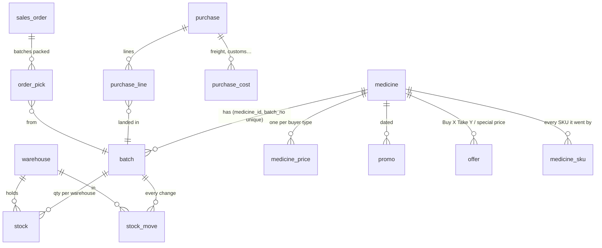
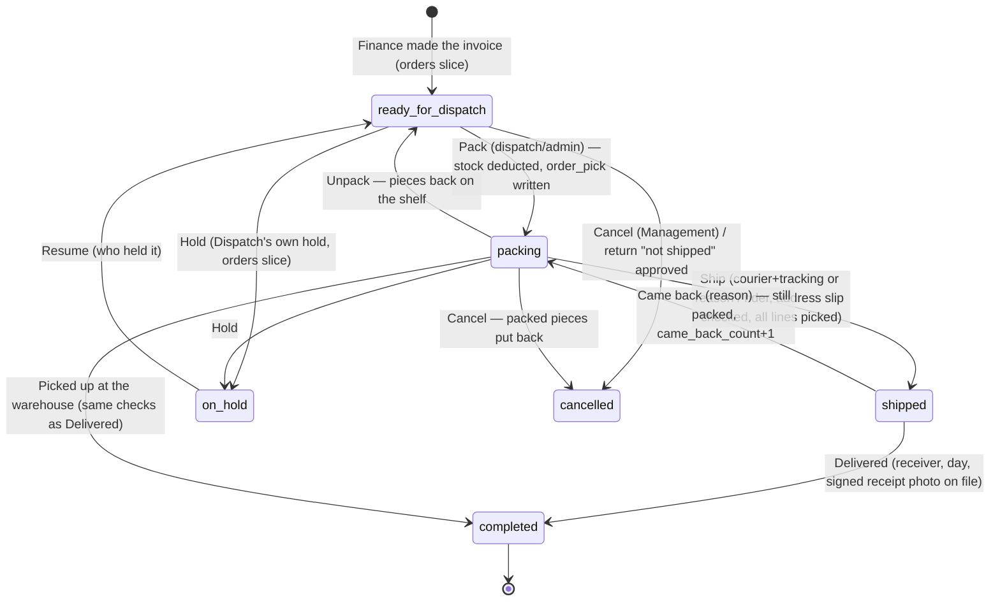
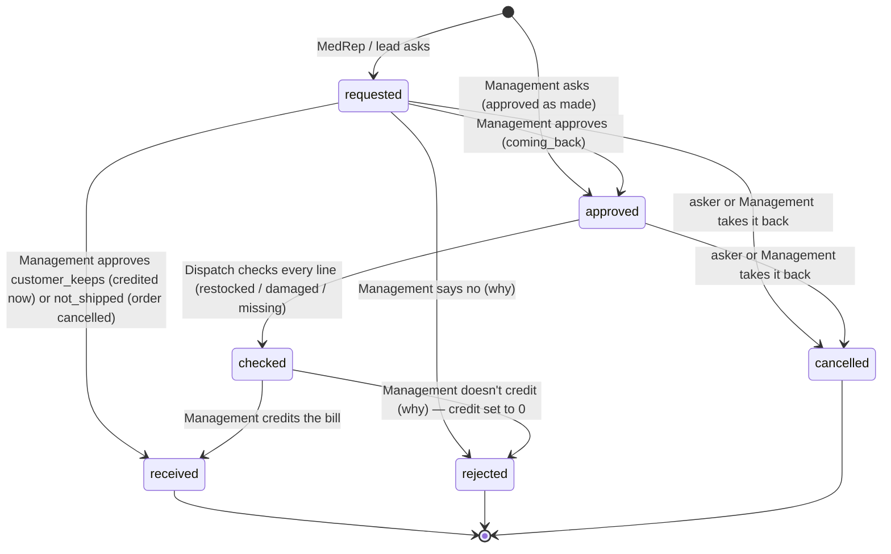
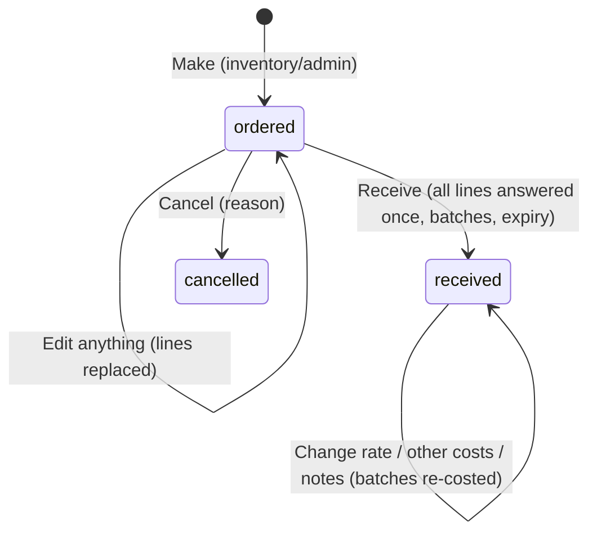
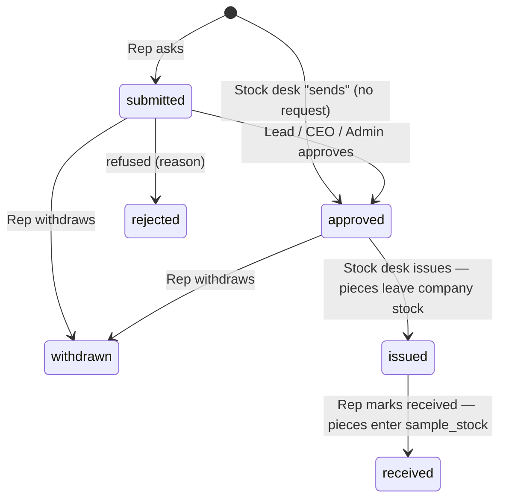
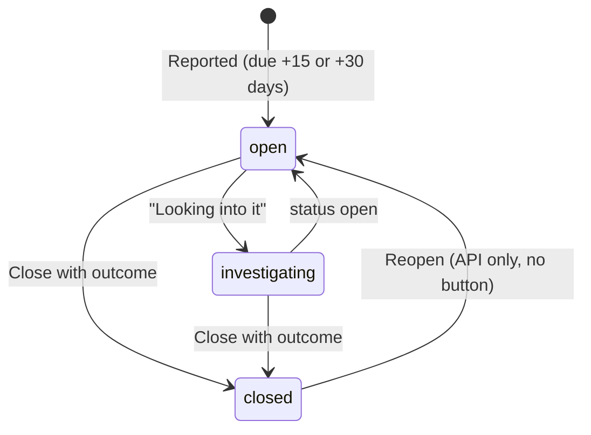
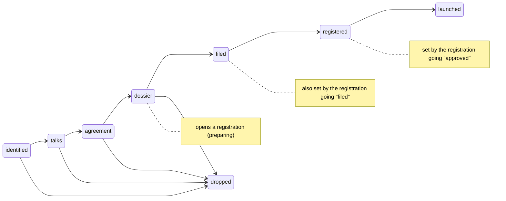

# 04 · Stock, buying, dispatch, returns, samples, complaints, regulatory, files

Read-only audit of one slice of crmnew, written from the code as it stood on 22 Nov 2026
(commit `fa3a9c9d`). Every statement cites the file it came from. Nothing was run: no server, no
tests, no migrations. Where the plan (`docs/PLAN.md`, `docs/ERP-PLAN.md`) says something the code
does not do, it is marked **planned only**.

Words used here: **piece** = one tablet / capsule / vial (the unit everything is counted in);
**shelf** = the `stock` table; **ledger** = the `stock_move` table; **desk** = a role's work screen.

---

## 1. What this area is for

| Part | Business purpose | Department |
|---|---|---|
| Inventory (`inventory/`) | The medicine list, prices / promos / offers, stock by warehouse and batch with expiry, stock counts, transfers, stock news to sellers, "medicine not available" requests, the stock report, batch trace for a recall | Inventory desk; Dispatch helps with stock; Management / CEO set prices |
| Buying (`purchases/` + web `buying/`) | Ordering from suppliers abroad, receiving by batch, working out what one piece cost to land (goods × rate + share of freight, customs…), vendors, bills, payments made | Inventory (orders, receives), Finance (bills, payments) |
| Dispatch (`dispatch/`) | Packing an approved, invoiced order batch by batch (nearest expiry first), shipping by courier / own rider / pick-up, proof of delivery, cash-on-delivery note, parcels that came back | Dispatch (warehouse) |
| Returns (`returns/`) | Goods coming back or kept by the customer after delivery, or an order to cancel before it ships; credit on the bill | MedRep / team lead asks, Management decides and credits, Dispatch checks the goods |
| Samples (`samples/`) | Samples and gifts issued from the warehouse to field reps, given to doctors at a visit with a signed acknowledgement, counted monthly | Field reps, their leads, the stock desk |
| Complaints (`complaints/`) | Customer complaints and side-effect (adverse event) reports with a due day (15 days for a serious side-effect, else 30) | Anyone reports; Regulatory handles |
| Regulatory (`regulatory/`) | The in-licensing product pipeline and FDA registrations (CPRs) with renewal flags | In-licensing & Regulatory department |
| Overview (`overview/`) | Home figures for stock, the stock ledger as three lists, the top-bar search, the channels report, the CEO's company glance | Everyone (each sees their own part) |
| File store (`files/`) | Where every uploaded photo / PDF's bytes live (database row or S3 bucket) and how photos are shrunk | Shared plumbing |

State of build: all of the above is **implemented** in code with tests beside it. Gaps are listed in
section 10.

---

## 2. Who uses it

Role strings are the `person.role` / seat module values checked by `allow(me, [...])` and `may()`
in `apps/api/src/http.ts:89-97`. A person "looking as" someone else (`me.viewedBy`) can only read:
every non-GET is refused in the sign-in middleware (`http.ts:65-73`).

### 2.1 Role lists defined in this slice

| Constant | Roles | File:line | Used for |
|---|---|---|---|
| `STOCK_ROLES` | inventory, dispatch, admin | `inventory/rules.ts:19` | Add stock without a purchase, move, count, post / close stock news |
| `CATALOGUE_ROLES` | inventory, admin | `inventory/rules.ts:21` | Add / change a medicine |
| `PURCHASE_ROLES` | inventory, admin | `inventory/rules.ts:23` | Make / change / receive / cancel a (first-pages) purchase, add / change a supplier |
| `COST_ROLES` | inventory, management, finance, ceo, admin | `inventory/rules.ts:25` | See landed cost, purchases, suppliers, the buying board; record a cost when adding stock |
| `PRICE_ROLES` | management, ceo, admin | `inventory/rules.ts:27` | Prices, promos, offers |
| `REQUEST_ANSWER_ROLES` | inventory, admin, ceo | `inventory/requests.ts:16` | Answer "medicine not available" requests; see everyone's |
| `TRACE_ROLES` | inventory, dispatch, management, regulatory, ceo, admin | `inventory/trace.ts:11` | Batch trace |
| `DISPATCH_ROLES` | dispatch, admin | `dispatch/rules.ts:7` | Pack, unpack, ship, tracking, deliver, COD note, came back, take an order; check returned goods |
| `DISPATCH_READ_ROLES` | dispatch, admin, ceo, management, finance, inventory | `dispatch/rules.ts:9-16` | Dispatch board, KPIs, shipments list |
| `ORDER_MANAGE_ROLES` (orders slice) | management, admin | `orders/rules.ts:69` | Approve / reject / credit a return |
| `READ_ALL` (returns) | management, admin, ceo, finance, dispatch | `returns/service.ts:59` | See every return |
| `ISSUE_ROLES` | inventory, dispatch, admin | `samples/service.ts:26` | Issue / send samples |
| `BACKUP_ROLES` (samples) | ceo, admin | `samples/service.ts:28` | Decide a sample request when no lead does; mark received for a rep |
| `ALL_ROLES` (samples) | ceo, admin, management, inventory, dispatch | `samples/service.ts:30` | See every rep's samples |
| `FIELD_ROLES`, `LEAD_ROLES` (field slice) | imported from `field/visits` | `samples/service.ts:21` | Who may ask / give / count samples; who sees a team |
| `COMPLAINT_ROLES` | regulatory, management, ceo, admin | `complaints/service.ts:13` | Handle complaints, see all |
| `REPORT_ROLES` | ceo, admin | `overview/service.ts:161` | Channels report, the apps tiles on Home |
| Books `PO_ROLES` / `BILL_ROLES` / `PAY_ROLES` / `READ_ROLES` (books slice, called by web `buying/`) | inventory, admin / inventory, finance, admin / finance, admin / inventory, management, finance, ceo, admin | `books/actions.ts:24-27` | New-look purchase orders, receives, bills, payments |

Regulatory has no role list: it derives the team from the job title text
(`regulatory/service.ts:27-30`): role `regulatory` with a title matching `/in-?licens/i` is the
In-licensing team, any other `regulatory` person is Regulatory Affairs ("ra"); `ceo` and `admin`
read; a person whose channel code is `BID` or whose title matches `/bidding/i` reads approved CPRs only.

### 2.2 What each role may do

| Role | Create | Approve / decide | Edit | Cancel / reverse | View |
|---|---|---|---|---|---|
| **inventory** | medicine, supplier, purchase, add stock, transfer, count, stock news, issue / send samples | answer medicine requests | medicine details, purchase (lines while ordered; costs after), supplier | cancel a purchase on order; close stock news | everything in stock incl. costs; purchases; batch trace; all reps' samples; Dispatch board (read) |
| **dispatch** | add stock (no cost), transfer, count, stock news, pack, ship, deliver, COD note, issue / send samples | check returned goods (good / damaged / missing) | tracking number | unpack; came back; own holds (orders slice) | stock (no costs), shipments, batch trace, all returns, all reps' samples |
| **management** | return (auto-approved), complaint | approve / reject a return; credit or not after the check; prices, promos, offers | prices; complaints (handle) | cancel a return; end promo / offer | costs, purchases (read), Dispatch board, batch trace, all returns, all complaints |
| **finance** | bills, payments made (books) | — | — | — | costs, purchases, Dispatch board, shipments, all returns |
| **ceo** | prices, promos, offers | answer medicine requests; decide samples (backup); handle complaints | — | — | everything, channels report, company glance |
| **admin** | everything above | everything above | everything above | everything above | everything |
| **medrep / team_lead / manager** (field roles) | return request on own / team orders; sample request; give samples at own visit; own sample count; medicine request; complaint | a lead decides their reports' sample requests | — | withdraw own sample request; cancel own return request | stock and prices (no costs); own returns; own / team samples; own complaints |
| **regulatory** | pipeline product (In-licensing), registration (RA), complaint | — | own team's list; complaints (handle) | — (mark Dropped / Withdrawn) | both lists; batch trace; all complaints |
| **online, hr, staff** | medicine request, complaint | — | — | — | stock list, own requests / complaints |

---

## 3. Features

### 3.1 How stock is modelled

- **Medicine** — one row per name + strength (unique index `medicine_once`, migration 0002).
  Carries `pack_size` (pieces in a pack, default 1), `unit` (what one piece is called), `pack`
  (the pack's name), `rx`, `vat` (`exempt` / `vat12` / `zero`), `reorder_level` (pieces; 0 = never
  flag), `cold_chain`, `cold_box` (the styro box as a stock item), `no_samples`, `sku`, `code`
  (`MED-00001`, written after insert, `inventory/service.ts:490-492`).
- **Pieces vs boxes** — stock, costs and prices are all for ONE piece (migration 0005 comment).
  `medicine_price.amount` is the piece price per buyer type; `pack_amount` is an optional
  whole-pack price. A pack price typed alone sets the piece price as `round(pack / pack_size)`
  (`inventory/service.ts:561`). Screens show packs beside pieces with the `inPacks` helper.
- **Batch** — `(medicine_id, batch_no)` unique, `expires_on` (not null), `unit_cost` (landed cost
  of one piece in centavos, nullable), `purchase_line_id` (the line that first made it). Batch
  numbers are upper-cased on entry (`inventory/service.ts:704`, `purchases/service.ts:343`). A
  batch number already on file with a different expiry is refused: "Check the box"
  (`inventory/service.ts:722-728`, `purchases/service.ts:390-396`).
- **Shelf (`stock`)** — one row per batch per warehouse, `qty >= 0` enforced by the database
  (migration 0002). `putIn` upserts and adds; `takeOut` subtracts only `where qty >= n` and
  refuses with 409 `short` otherwise, so two people cannot take the same pieces
  (`inventory/service.ts:628-660`).
- **Ledger (`stock_move`)** — one signed line per change, kind in `receive`, `move_out`,
  `move_in`, `count`, `deliver`, `return`, `sample_out` (migrations 0002, 0097). Never updated or
  deleted. The integrity check compares the shelf with the sum of its moves (`checks/integrity.ts:67-73`).
- **Warehouse** — `code`, `name`, `is_default` (at most one), `active`. There is **no screen or
  endpoint to add, rename or close a warehouse**: rows come from the seeds and the Zoho import
  (`zoho/medicines.ts:257`).
- **Expiry** — a batch is `expired` when `expires_on < today (Manila)`, `soon` when within
  `EXPIRING_DAYS = 90` days, else `ok` (`inventory/rules.ts:40,60-63`). Sellable stock is always
  `expires_on >= today`.
- **Stock status of a medicine** — `out` at 0 sellable pieces; `low` when `reorder_level > 0` and
  sellable ≤ it; else `ok` (`inventory/rules.ts:54-58`).

**Not kept (planned only, PLAN 5.0):** the manufacturer's batch number and manufactured date; a
per-rep "home stock" warehouse model and an "expired stock" warehouse as first-class concepts
(Zoho's warehouses of those names exist only as imported warehouse rows).

### 3.2 Reserved vs deducted: when an order touches stock

There is **no reservation table**. Two separate things happen:

| Moment | What happens to stock | Code |
|---|---|---|
| Order placed (any status from `pending_approval` to `ready_for_dispatch`, or held from one of those) | Nothing is written. Its pieces count as **promised**: computed on every read as `sum(order_item.qty)` over orders matching `PROMISED_ORDER` | `inventory/service.ts:36-37` |
| Screens show | `free = max(0, sellable − promised)` per medicine, company-wide | `inventory/service.ts:171-173`, `stock-report.ts:271` |
| Order checked by the system | A finding "Stock short" when free (after earlier orders) < ordered; never blocks, and is routed to Dispatch not Management | `orders/service.ts:535-545`, comment `orders/service.ts:657-658` |
| Hold "waiting for stock" | Management / Finance / Dispatch hold the order with `waiting_stock_at/by`; refused if nothing is short | `orders/service.ts:2296-2319`, `orders/stock-wait.ts:16-34` |
| **Pack** | Pieces are **deducted** from the shelf batch by batch (`takeOut` + `stock_move` kind `deliver`, qty negative, ref = order code) and `order_pick` rows record batch, warehouse, qty and the batch's `unit_cost` at that moment | `dispatch/service.ts:283-299` |
| Unpack / order cancelled after packing | Active picks go back to the same batch and warehouse (`stock_move` kind `return`), picks marked `active = false, returned_at` | `dispatch/service.ts:320-355`; cancel: `orders/service.ts:2398-2414` |
| Ship / deliver / came back | No stock change (the pieces are already off the shelf) | `dispatch/service.ts:403-645` |

So: **promised at placing (soft, computed), deducted at packing (hard)**. An order sitting in
`packing`, `shipped` or `completed` is no longer "promised" because its pieces already left.

### 3.3 Every event that moves stock

| Event | Who | Ledger kind(s) | Sign | Ref | Code |
|---|---|---|---|---|---|
| Add stock without a purchase (opening stock, correction) | STOCK_ROLES | `receive` | + | free text | `inventory/service.ts:698-752` |
| Receive a first-pages purchase | PURCHASE_ROLES | `receive` | + | `PO-…` | `purchases/service.ts:306-437` |
| Receive a books purchase order (new-look Purchases) | books `PO_ROLES` | `receive` | + | `PR-… · PO number` | `books/actions.ts:342-405` (books slice) |
| Zoho opening-stock import | script | `receive` | + | — | `zoho/medicines.ts:292` (zoho slice) |
| Transfer between warehouses | STOCK_ROLES | `move_out` then `move_in` | −, + | `MOVE-xxxxxxxx` (random) | `inventory/service.ts:764-804` |
| Stock count / adjustment / write-off | STOCK_ROLES | `count` | ± (difference) | — ; reason in `note` | `inventory/service.ts:807-837` |
| Pack an order | DISPATCH_ROLES | `deliver` | − | order code | `dispatch/service.ts:185-317` |
| Unpack, or cancel a packed order | DISPATCH_ROLES / whoever may cancel | `return` | + | order code | `dispatch/service.ts:320-381` |
| Customer return found good | DISPATCH_ROLES | `return` | + | `RET-…` | `returns/service.ts:453-489` |
| Customer return found damaged / missing | DISPATCH_ROLES | **none** | — | — | `returns/service.ts:490-496` |
| Samples / gifts issued to a rep | ISSUE_ROLES | `sample_out` | − | `SRQ-…` | `samples/service.ts:159-188` |

There is no separate "write-off" or "expired stock disposal" action: stock is written off by a
stock count with its reason. Expired batches stay on the shelf (counted as "expired", never
sellable) until someone counts them down.

### 3.4 Inventory features

| Feature | What / why | Who | In | Out | Tables | Next / trigger |
|---|---|---|---|---|---|---|
| Stock by warehouse | Every active medicine with sellable pieces per warehouse, promised, free, expired, coming, nearest expiry, status; summary counts out / low / expiring | any signed-in | — | `InventoryList` | reads `medicine`, `stock`, `batch`, `purchase(_line)`, `book_doc/line`, `order_item`, `sales_order`, `stock_news` | — |
| Medicines & prices (catalogue) | Every medicine with details, every buyer price, running promo and offers, stock, average cost (cost roles only) | any signed-in | — | `Catalogue` | + `medicine_price`, `promo`, `offer` | read by the order form |
| One medicine | Batches by warehouse, cost range, prices, promos (last 30 days), offers (last 90 days), coming purchases, last 20 moves, last 20 price changes (price roles only), its stock news | any signed-in | id | `MedicineDetail` | same | — |
| Add / change a medicine | Name + strength unique; SKU unique across `medicine.sku` and `medicine_sku`; old SKUs kept | CATALOGUE_ROLES | name, sku, generic, strength, form, pack, unit, packSize, category, manufacturer, brand, rx, coldChain, coldBox, noSamples, vat, reorderLevel | id | `medicine`, `medicine_sku` | no history row is written for a details change |
| Set prices | Piece price and pack price per buyer type (`patient`, `hospital`, `doctor`, `distributor`, `drugstore`, `bidding`); null removes; each change logged | PRICE_ROLES | prices, packPrices | ok | `medicine_price` (upsert / delete), `price_change` | the order form reads the new price |
| Promo | A dated price any buyer may get; ended as of yesterday | PRICE_ROLES | name, amount, startsOn, endsOn | ok | `promo`, `price_change` | — |
| Offer (Buy X Take Y / special price) | Per buyer kind or every buyer; open-ended allowed; one running offer per medicine + buyer kind (overlap refused 409) | PRICE_ROLES | buyerKind, buy, take, price, name, note, startsOn, endsOn | id | `offer`, `price_change` | orders apply it by themselves (`orders/offers.ts`) |
| Add stock without a purchase | Opening stock or correction; expired batch refused; cost stored only for COST_ROLES and only when the batch is new | STOCK_ROLES | medicineId, warehouseId, batchNo, expiresOn, qty, ref, note, unitCost | batchId | `batch`, `stock`, `stock_move` | `afterStockIn` tells waiting orders |
| Transfer | Same batch, other warehouse, both lines share one ref | STOCK_ROLES | batchId, from, to, qty, note | ok | `stock`, `stock_move` ×2 | — |
| Stock count | Shelf set to the counted number; a difference needs a reason | STOCK_ROLES | batchId, warehouseId, counted, reason | difference | `stock`, `stock_move` | `afterStockIn` when it went up |
| Stock news | One open notice per medicine (`out`, `low`, `back`, `note`); a new one closes the old | STOCK_ROLES post / close; everyone reads | medicineId, kind, message | — | `stock_news` | shown on Home and medicine pages |
| Medicine not available | Anyone asks for a medicine not in stock / not listed; one open request per name + strength gathers every ask (`times`, summed qty) | any signed-in asks; REQUEST_ANSWER_ROLES answer `ordered` / `added` / `declined` (declined needs words) | name, strength, qty, customerId, note | id | `medicine_request`, `medicine_request_ask`, `notification` | Inventory people notified on each ask; every asker notified on the answer |
| Stock report | Section 8 | any signed-in; costs for COST_ROLES | filters | rows + Excel | reads only | — |
| Batch trace | Section 8 | TRACE_ROLES | batch text | batches, places, moves, customers | reads only | — |

### 3.5 Buying features

Two generations of buying exist side by side.

**A. First purchase pages (`purchases/`, tables `purchase*`)** — the original, still reachable at
`/purchases/old` and `/purchases/:id` but out of the menu (PLAN 17: "stay reachable but are no
longer in the menu").

| Feature | Detail | Who | Code |
|---|---|---|---|
| Supplier | name (unique, case-insensitive), country, 3-letter currency, contact, active | PURCHASE_ROLES write; COST_ROLES read | `purchases/service.ts:33-75` |
| Make / change a purchase | supplier, warehouse, ordered / expected dates, currency, `fxRate` (pesos per unit), supplier ref, note, 1–60 lines (a medicine once), 0–20 other costs. While `ordered` everything can change (lines are deleted and re-inserted). Once `received` only the rate, other costs, ref and note change, and every batch it landed in is re-costed | PURCHASE_ROLES | `purchases/service.ts:173-293` |
| Receive | Every line must say how many came (0 allowed), with batch number and expiry when > 0; expired refused; nothing arrived → "cancel instead"; other costs re-shared over what actually came; batch created or topped up; state → `received` | PURCHASE_ROLES | `purchases/service.ts:306-437` |
| Cancel | Only while `ordered`; reason required; appended to the note | PURCHASE_ROLES | `purchases/service.ts:478-493` |

**Landed cost** (`purchases/landed.ts:29-59`, shared with the web form):

1. `goods[i] = round(qty × unitCost × fxRate × 100)` centavos.
2. Weights = goods values; if every goods value is 0, weights = quantities.
3. `share[i] = floor(extras × weight[i] / total)`; the centavos lost to rounding go one each to
   the lines with the largest remainders (ties: earlier line first), so shares add up exactly to `extras`.
4. `landedUnit[i] = round((goods[i] + share[i]) / qty)` (0 when qty is 0).

**Batch cost when a purchase lands in a batch that already has stock** (`recostBatch`,
`purchases/service.ts:447-476`, migration 0033): each received line keeps `shelf_before` and
`cost_before`. The batch cost is replayed over every received line in landing order:
`cost = round((before × cost + qty × landedUnit) / (before + qty))`, or just `landedUnit` when
there was nothing before or no cost. Replayed whenever a received purchase's rate or costs change.

**B. New-look Purchases (web `buying/`, API `books/` + `purchases/board.ts`)** — since 18 Nov the
menu's Purchases. The documents are `book_doc` rows (Zoho's history and those made here):
purchase orders, receives, bills, payments made, vendor credits. The writes belong to the books
slice (`books/actions.ts`); this slice owns four read endpoints (`purchases/board.ts`):

| Read | What | Code |
|---|---|---|
| Buying board | To receive (orders, pieces, late, value), received not billed, bills (open, owed, overdue, due this week), unused credits, "buy again" list (≤ 60), latest 12 documents | `purchases/board.ts:23-105` |
| Order extra | Batches that came in on a purchase order (order cost vs cost now) and the landed-cost bills on it | `purchases/board.ts:109-137` |
| Vendor items | What a vendor sells us: orders, qty, last rate / currency / date | `purchases/board.ts:140-155` |
| Last rates | Last buying price per medicine (from one vendor or anyone) for the new order form | `purchases/board.ts:159-171` |

All four require COST_ROLES (`allow` inside each function).

### 3.6 Dispatch features

| Feature | Detail | Code |
|---|---|---|
| Pack plan | For each order line: unexpired batches in the ship-from warehouse and a first-expiry-first suggestion; a later line of the same medicine (a promo's free line) is planned from what earlier lines left | `dispatch/service.ts:128-181` |
| Pack | With no picks sent: FEFO auto-pick, refused (409 `short`) if the warehouse hasn't enough unexpired. With picks: every line must be picked in full, each batch must be on that warehouse's shelf, unexpired, and not over-picked. Sets status `packing`, `packed_at/by`, the warehouse, and takes the order in hand | `dispatch/service.ts:185-317` |
| FEFO rule | Sort unexpired batches with stock by `expires_on` ascending, take from each until the line is covered; never an expired batch | `dispatch/rules.ts:34-50` |
| Ship-from warehouse | The order's `warehouse_id` (Management's pick) else the default warehouse | `dispatch/service.ts:77-89` |
| Unpack | Pieces back on the shelf, status back to `ready_for_dispatch` | `dispatch/service.ts:358-381` |
| Ship | Courier (name required; tracking number **or** a reason it isn't ready) or own rider (name required). The address-slip tick is required. Every line must be fully picked (`mustBePicked`). Emails the customer (`tellCustomer … "shipped"`) | `dispatch/service.ts:403-465`, `dispatch/routes.ts:75-91` |
| Tracking | Added or corrected later, for an order shipped or delivered by courier | `dispatch/service.ts:468-495` |
| Deliver | Receiver's name and day (not in the future) required; **a photo of the signed delivery receipt (`order_file` kind `dr`) must already be on the order**; from `shipped`, or from `packing` (= picked up at the warehouse, method `pickup`). Invoice due date reset; optional COD note; points settled; customer emailed | `dispatch/service.ts:499-563` |
| COD cash note | On a delivered COD order whose invoice is open: how much the rider / courier collected (≤ balance) and who has it. Dispatch only notes; **Finance records the payment** | `dispatch/service.ts:578-615` |
| Came back | From `shipped` back to `packing` (still packed) with a reason; courier / tracking / rider / address check cleared; `came_back_count + 1` | `dispatch/service.ts:619-645` |
| Take in hand | Who in the warehouse has the order (`dispatch_by`); take over or let go, written on the timeline | `dispatch/service.ts:725-772` |
| Board, KPIs, shipments | Section 8 | `dispatch/board.ts`, `kpis.ts`, `service.ts:671-721` |
| Cold chain | `medicine.cold_chain` shows a "Keep cold" banner in the pack and ship dialogs; `medicine.cold_box` marks the styro box as a stock item; an order with a cold medicine and no box raises the finding "No cold box" for Management, who adds the box and its price | `orders/service.ts:546-554`, web `dispatch/parts.tsx:39-43,221-228` |

### 3.7 Returns features (the hub's way, 17 Nov)

Where the goods are decides the road (`returns/service.ts:1-9`):

| `goods` | Asked when order is | Road |
|---|---|---|
| `coming_back` | `completed` | Management approves → Dispatch checks each line (`restocked` / `damaged` / `missing`) → Management credits the bill, or not (with why) |
| `customer_keeps` | `completed` | Credited the moment Management approves (lines marked `kept`) |
| `not_shipped` | `finance_check`, `ready_for_invoice`, `ready_for_dispatch`, `packing` | Management approving **cancels the order** (the orders slice's cancel: packed pieces back, invoice cancelled, what was paid on Refunds owed). Management cannot ask this itself: "cancel the order instead" |

- Who may ask: Management / Admin, the order's MedRep, who raised it, or their team lead
  (`mayAsk`, `returns/service.ts:92-99`). Management's own request is created already `approved`.
- What can still come back per line: ordered qty minus lines on returns that are `requested` /
  `approved`, or `checked` / `received` with outcome other than `missing` (`returnable`, lines 70-88).
- Credit = Σ qty × unit price of lines not `missing`. It lowers `invoice.total`, raises
  `invoice.credited`, lowers the VAT split (`vatSplit` from finance; a senior / PWD line is
  credited VAT-exempt), flips the invoice to `paid` when `paid >= new total`, and says how much was
  paid beyond the new bill (Finance gives it back) (`applyCredit`, lines 253-312).
- Good goods go back into **the batch of the largest pick of that order line**, in that pick's
  warehouse; with no pick on record, the medicine's latest-expiring batch in the order's warehouse
  (lines 453-477).

### 3.8 Samples and gifts

`samples/service.ts:1-12` states the rules; the code follows them:

| Step | Who | Rule | Code |
|---|---|---|---|
| Ask | a field role, not while viewing as someone | kind `samples` / `gifts`; 1–20 lines, 1–1,000 pieces each, a medicine once; a `no_samples` medicine refused as a sample | lines 72-100 |
| Decide | anyone the rep reports to up the line (`leads`), or ceo / admin; never the rep | reject needs a reason | lines 113-147 |
| Withdraw | the rep | while `submitted` or `approved` | lines 149-156 |
| Issue | ISSUE_ROLES | from the asked warehouse or the default; unexpired (`expires_on > today`), batches expiring first; pieces leave company stock (`sample_out`) | lines 159-222 |
| Send without a request | ISSUE_ROLES | creates an `approved` request then issues it; up to 50 lines | lines 225-247 |
| Receive | the rep (or ceo / admin) | issued batches go into the rep's `sample_stock` | lines 249-270 |
| Give at a visit | the rep, at their own visit to a customer of kind `doctor` | 1–20 lines, 1–100 pieces each; the doctor's signed acknowledgement (photo / PDF) required; taken from the rep's unexpired pieces, expiring first | lines 272-318 |
| Count | the rep | per batch; every difference needs a reason; a count with no difference is still logged (qty 0) | lines 321-361 |
| My samples / Team samples | rep; leads, stock desk, ceo, management | month view | lines 366-479 |

Books: issued pieces post `Inventory Asset` → `Product Samples to clients` (samples) or
`Promotional Materials` (gifts) at the batch's cost, through the `crm_entry` view (migration 0098).
Not copied from the old CRM: selling from the rep's bag (ERP-PLAN 7.2).

### 3.9 Complaints and side-effects

- Report (anyone, from their own login): kind `quality` / `side_effect` / `delivery` / `service`
  / `other`; description ≥ 10 characters; a side-effect needs the medicine; optional customer,
  patient name, batch number, order, day received (not in the future). Code `CMP-00001` from the
  `counter` table. Due = received + 15 days for a **serious side-effect**, else + 30
  (`complaints/service.ts:29-68`).
- Notified: every `regulatory` person (Management if there is none), plus the CEO when serious.
- Handle (COMPLAINT_ROLES): give it an owner, move the due day, note the FDA reference, mark
  `investigating`, add a note, close with an outcome (required), reopen (`status: "open"`).
  Every change is one `complaint_event` line (`complaints/service.ts:70-120`).
- Everyone else sees only the complaints they reported (line 135).

### 3.10 In-licensing & Regulatory

- **Pipeline** (`pipeline_product`): stage `identified → talks → agreement → dossier → filed →
  registered → launched`, or `dropped`; each with partner, country, handler, next step and its
  day. Only the In-licensing team writes (`mustBe`, `regulatory/service.ts:32-35`).
- **Hand-over**: saving a product at `dossier` or `filed` opens one `product_registration`
  (`preparing`) for Regulatory Affairs, once (`handOver`, lines 128-139).
- **Registrations (CPRs)** (`product_registration`): status `preparing`, `filed`, `approved`,
  `renewal_filed`, `expired`, `withdrawn`; number, filed on, valid until, handler, optional link
  to a medicine. Only RA writes. `approved` / `renewal_filed` need the number and valid-until;
  `filed` / `renewal_filed` need the filed day (lines 146-153).
- **Back-link**: a registration set to `filed` or `approved` moves its pipeline product forward to
  `filed` / `registered` (never backwards, never a dropped one) (lines 186-195).
- **Expiry warnings**: computed on read, for status `approved` or `expired` with a valid-until:
  `expired` (past), `urgent` (approved and < 90 days), `soon` (approved and < 180 days)
  (lines 44-52). Shown as colours and "N days left, no renewal filed" on the screens. **No
  notification is sent** for a CPR running out (section 9).
- The bidding desk reads only `approved` and `renewal_filed` registrations and no pipeline (lines 57-62).

### 3.11 File store

`files/store.ts` — two functions every upload goes through:

| Function | What it does |
|---|---|
| `keepFile(folder, file)` | Shrinks a photo (`compressPhoto`), then keeps it: driver `db` → returns the bytes for the row (`data`, `key = null`); driver `s3` → `PUT` to the bucket under `folder/<2 hex>/<sha256>.<ext>` and returns only the key. Content-hash keys mean the same photo sent twice is stored once. Meant to be called before the database transaction (lines 179-190) |
| `bytesOf(row)` | Returns `row.data` when present, else reads the key from an in-memory cache (max 40 MB, files over 5 MB not cached, least-recently-used dropped) or the bucket; 404 Refusal when gone (lines 209-228) |

- **Photo shrinking** (lines 25-54): only `image/jpeg|png|webp|avif|heic|heif`. Rotated by EXIF,
  resized to fit 1600 × 1600 (never enlarged), WebP quality 60. Left alone: multi-page / animated
  images, a WebP ≤ 1600 px and ≤ 350 KB without EXIF, a JPEG ≤ 1600 px and ≤ 450 KB without EXIF,
  anything sharp cannot read, and any result not smaller than the original. PDFs and GIFs pass through.
- **Drivers** (lines 138-156): env `STORAGE_DRIVER` = `db` (default) or `s3`. S3 needs
  `S3_ENDPOINT`, `S3_BUCKET`, `S3_ACCESS_KEY`, `S3_SECRET_KEY`; `S3_REGION` defaults to
  `ap-southeast-1`. Requests are signed with AWS Signature V4 by hand; 20-second timeout.
- **Access checks: none in the store.** Each route that serves a file checks who may open it:

| File | Endpoint | Who may download | Code |
|---|---|---|---|
| Order papers incl. the signed delivery receipt (`dr`) | `GET /api/papers/:id` | whoever may see the order (`visibleOrder`) | `orders/service.ts:3072-3092` (orders slice) |
| Sample acknowledgement | `GET /api/samples/given/:id/ack` | the rep, ALL_ROLES (ceo, admin, management, inventory, dispatch), or a lead of the rep | `samples/service.ts:482-491` |
| Purchase document papers | `GET /api/books/files/:id` | the books' readers (`mayRead`) | `books/service.ts:308-313` (books slice) |
| Customer papers, visit photos, expense receipts, leave papers, case files | their own slices | their own checks | `customers/service.ts:470`, `mr/visits.ts:563`, `mr/expenses.ts:275`, `field/expenses.ts:302`, `hr/leave.ts:495`, `online/service.ts:1553` |

---

## 4. Workflows and statuses

### 4.1 Order statuses Dispatch works with

Order statuses are defined in the orders slice (`orders/rules.ts:22-36`). Dispatch's part:

| From → to | Who | Condition | Side effects | Code |
|---|---|---|---|---|
| `ready_for_dispatch` → `packing` | dispatch, admin | `orderActions.pack`; enough unexpired stock in the ship-from warehouse; picks complete | shelf −, `stock_move deliver`, `order_pick`, `packed_at/by`, timeline "Packed from …" (stage `packed`) | `dispatch/service.ts:185-317` |
| `packing` → `ready_for_dispatch` | dispatch, admin | `orderActions.unpack` | shelf +, `stock_move return`, picks inactive, `packed_*` and `came_back_at` cleared | `dispatch/service.ts:358-381` |
| `packing` → `shipped` | dispatch, admin | courier or rider named; tracking or wait reason; `addressChecked`; every line picked | `shipped_at/by`, `address_checked_at/by`, method / courier / tracking / rider set; DB trigger notifies the MedRep (migration 0024); customer emailed | `dispatch/service.ts:403-465` |
| `shipped` → `packing` | dispatch, admin | reason | courier fields cleared, `came_back_*` set; `tellAboutOrder … "failed"` | `dispatch/service.ts:619-645`, `dispatch/routes.ts:124-131` |
| `shipped` / `packing` → `completed` | dispatch, admin | receiver, day ≤ today, active `order_file` of kind `dr` | `delivered_on/at/by`, `received_by`; invoice `due_on`: COD → delivery day; terms `days` → order's `pay_by` or delivery day + `payment_days`; points settled; customer emailed | `dispatch/service.ts:499-563` |
| any pre-shipping → `cancelled` (orders slice) | Management etc. | — | active picks put back (`putBack`), invoice cancelled, points released, waiting orders told | `orders/service.ts:2398-2414`, `orders/routes.ts:407-411` |

`delivery_method` values: `courier`, `rider`, `pickup` (migration 0013). Preset couriers: LBC, J&T
Express, Lalamove, Grab Express, 2GO, AP Cargo, Ninja Van, Flash Express; any other can be typed
(`dispatch/rules.ts:19-28`). Tracking-wait presets live only in the web
(`web dispatch/parts.tsx:14-18`).

### 4.2 Return statuses

`sales_return.status`: `requested`, `approved`, `checked`, `received` (= credited), `rejected`,
`cancelled` (migrations 0050, 0091). Line `outcome`: `restocked`, `damaged`, `missing`, `kept`.

| From → to | Who | Side effects | Code |
|---|---|---|---|
| → `requested` / `approved` | asker | `RET-…` code from `counter`; lines priced at the order's unit price; timeline; notify Management (or Dispatch when Management made a coming-back one) | `returns/service.ts:101-226` |
| `requested` → `approved` / `received` / `rejected` | management, admin | `decided_by/at/note`; `not_shipped` first calls the order cancel; `customer_keeps` credits at once; notify asker (+ Dispatch) | `returns/service.ts:322-383` |
| `requested` / `approved` → `cancelled` | asker, management, admin | timeline only | `returns/service.ts:386-402` |
| `approved` → `checked` | dispatch, admin | good lines back on the shelf (`stock_move return`, ref `RET-…`); `credit` pre-computed; notify Management | `returns/service.ts:406-519` |
| `checked` → `received` | management, admin | invoice total / VAT lowered, `credited` raised, points re-settled, notify asker (+ Finance when money is now owed back) | `returns/service.ts:522-538`, `253-312` |
| `checked` → `rejected` | management, admin | `credit = 0`; stock stays as Dispatch checked it | `returns/service.ts:539-559` |

### 4.3 First-pages purchase

`purchase.state`: `ordered`, `received`, `cancelled` (migration 0003).

There is no partial receive: one receive closes the purchase.

### 4.4 Sample request

`sample_request.status`: `submitted`, `approved`, `rejected`, `withdrawn`, `issued`, `received`
(migration 0097). `sample_move.what`: `received`, `given`, `counted`.

### 4.5 Complaint

`complaint.status`: `open`, `investigating`, `closed` (migration 0100).

A closed complaint refuses every change except `status: "open"` (`complaints/service.ts:83`).

### 4.6 Pipeline and registration

Any stage can be chosen in the form, except that a `registered` / `launched` product cannot go
back to `identified` / `talks` / `agreement` (`regulatory/service.ts:113-114`). Registration
statuses can be set freely subject to the required fields; there is no enforced order between them.

### 4.7 Other small status sets

| Thing | Values | Where |
|---|---|---|
| `stock_news.kind` | `out`, `low`, `back`, `note`; open until `closed_at` | migration 0002 |
| `medicine_request.status` | `open` → `ordered` / `added` / `declined` (one-way; already answered → 409) | migration 0022, `inventory/requests.ts:136-141` |
| Promo state (computed) | `later`, `now`, `ended` | `inventory/service.ts:412-415` |
| Offer state (computed) | `later`, `now`, `ended` (`ended_at` set or `ends_on` past) | `inventory/offers.ts:48-57` |
| `purchase_cost.kind` | `freight`, `packaging`, `customs`, `insurance`, `transport`, `other` | migration 0003, `purchases/landed.ts:4-11` |

---

## 5. Data

### 5.1 Tables

| Table | Purpose | Key columns / relations | Migration |
|---|---|---|---|
| `warehouse` | Where stock sits | `code` unique, `is_default` (one at most), `active` | 0002 |
| `medicine` | The item list | `code`, `name`+`strength` unique, `rx`, `vat`, `reorder_level`, `active`; + `sku`, `unit`, `manufacturer`, `brand`, `category` (0004); `pack_size` (0005); `srp`, `srp_pack`, `shelf_life_months`, `list_note`, `cold_chain` (0055); `cold_box` (0090); `no_samples` (0097); `web_id` (0120) | 0002… |
| `medicine_sku` | Every SKU a medicine has gone by | `medicine_id`, `sku` unique (lower) | 0055 |
| `medicine_price` | Piece price per buyer type | PK (`medicine_id`, `buyer_type`), `amount`, `pack_amount` (0005) | 0002 |
| `promo` | Dated promo price | `medicine_id`, `amount`, `starts_on`, `ends_on`, `created_by` | 0002 |
| `offer` | Buy X Take Y / special price | `medicine_id`, `buyer_kind` (null = every buyer), `buy`, `take`, `price`, `starts_on`, `ends_on` (nullable since 0087), `ended_at/by` | 0086, 0087 |
| `price_change` | Every price / promo / offer change | `medicine_id`, `what`, `old_amount`, `new_amount`, `by_person`, `at` | 0002 |
| `batch` | A batch of a medicine | unique (`medicine_id`, `batch_no`), `expires_on`, `unit_cost`, `purchase_line_id` (0003) | 0002 |
| `stock` | The shelf now | PK (`batch_id`, `warehouse_id`), `qty >= 0` | 0002 |
| `stock_move` | The stock ledger | `medicine_id`, `batch_id`, `warehouse_id`, `qty <> 0`, `kind`, `ref`, `note`, `by_person`, `at`; index (`medicine_id`, `at desc`) | 0002, 0097 (adds `sample_out`) |
| `stock_news` | Notices to sellers | `medicine_id`, `kind`, `message`, `closed_at` | 0002 |
| `medicine_request` / `medicine_request_ask` | "Medicine not available" | one open per lower(name)+lower(strength); `times`, `qty`, `status`, `answer`; asks: person, customer, qty, note | 0022 |
| `supplier` | Vendors | `name` unique (lower), `country`, `currency`, `contact`, `active`; + Zoho fields, `opening_credits`, `opening_payables` (0069–0071) | 0003 |
| `purchase` | A first-pages purchase | `code` (`PO-00001`), `supplier_id`, `warehouse_id`, `state`, dates, `currency`, `fx_rate`, `goods_total`, `extras_total`, `created_by`, `received_by/at` | 0003 |
| `purchase_line` | Its medicines | unique (`purchase_id`, `medicine_id`), `qty`, `unit_cost` (supplier currency), `received_qty`, `batch_id`, `goods`, `extras`, `landed_unit`; `shelf_before`, `cost_before` (0033) | 0003, 0033 |
| `purchase_cost` | Other costs in pesos | `purchase_id`, `kind`, `amount`, `note` | 0003 |
| `order_pick` | Batches packed for an order | `order_id`, `order_item_id`, `batch_id`, `warehouse_id`, `qty`, `unit_cost` (at packing), `active`, `returned_at` | 0013 |
| `sales_order` (columns owned here) | Dispatch facts | `packed_at/by`, `delivery_method`, `courier`, `tracking`, `rider`, `shipped_at/by`, `delivered_on/at/by`, `received_by`, `held_role` (0013); `dispatch_by(_at)`, `came_back_count/reason/at` (0024); `waiting_stock_at/by` (0045); `tracking_wait`, `address_checked_at/by` (0089); `cod_collected`, `cod_collected_by`, `cod_noted_by/at` (0115) | — |
| `order_file` kind `dr` | Signed delivery receipt photo | `store_key` added, `data` nullable (0051) | 0013, 0051 |
| `sales_return` | A return | `code` (`RET-00001`), `order_id`, `status`, `goods`, `reason`, `note`, `requested_by/at`, `decided_by/at/note`, `received_by/at`, `credited_by/at`, `credit` | 0050, 0091 |
| `sales_return_line` | Its lines | `order_item_id`, `medicine_id`, `qty`, `unit_price`, `outcome`, `batch_id`, `warehouse_id` | 0050, 0091 |
| `invoice.credited` | What returns took off the bill | `total + credited` = what it was made for | 0050 |
| `sample_request` | A rep's request | `code` (`SRQ-00001`), `person_id`, `kind`, `lines` jsonb, `status`, `decided_by/at`, `reject_reason`, `issued_by/at/from`, `issued_lines` jsonb, `received_at` | 0097 |
| `sample_stock` | What each rep holds | PK (`person_id`, `kind`, `batch_id`), `qty >= 0` | 0097 |
| `sample_move` | Rep-side ledger | `what` (`received`, `given`, `counted`), `qty`, `request_id`, `visit_id`, `customer_id`, `reason`, `ack_key/data/name/mime` | 0097 |
| `complaint` / `complaint_event` | Complaints and their history | `code` (`CMP-00001`), `kind`, `serious`, `customer_id`, `patient_name`, `medicine_id`, `batch_no` (text), `order_id`, `received_on`, `due_on`, `status`, `owner_id`, `fda_ref`, `outcome`, `reported_by`, `closed_by/at` | 0100 |
| `pipeline_product` | In-licensing pipeline | `stage`, `partner`, `country`, `handled_by`, `next_step`, `next_on` | 0068 |
| `product_registration` | FDA CPRs | `medicine_id`, `pipeline_id`, `product`, `number`, `status`, `filed_on`, `valid_until`, `handled_by` | 0068 |
| `reg_event` | Their history | `pipeline_id` or `registration_id`, `what`, `by_person`, `at` | 0068 |
| `counter` | Running numbers | names used here: `return`, `sample_request`, `complaint` | 0011, 0050, 0097, 0100 |
| `notification` | The bell | unique (`person_id`, `key`) so an event tells once | 0024 |
| View `crm_entry` | Ledger entries from CRM facts (stock out / back at batch cost → COGS / Inventory Asset; samples → expense) | reads `stock_move`, `batch`, `sales_return` | 0096, 0098, 0099 |

`incoming` (expected deliveries) was created in 0002 and dropped in 0003.

### 5.2 How history / audit is kept

| Area | History |
|---|---|
| Stock | `stock_move` (who, when, kind, qty, ref, note); never edited. `order_pick` rows kept when unpacked (`active = false`) |
| Prices, promos, offers | `price_change` |
| Dispatch steps, returns | Lines on the order's timeline (`logEvent` → `order_event`, orders slice) and `order_step` (step times, `how` = courier) |
| Samples | `sample_move`; request rows keep who decided / issued |
| Complaints | `complaint_event` |
| Regulatory | `reg_event` |
| Medicine requests | every ask kept; the answer overwrites nothing (one-way) |
| **Not kept** | Changes to a medicine's details; edits to a purchase (lines and costs are deleted and re-inserted, `purchases/service.ts:160,280`); who cancelled a purchase; batch cost changes; supplier changes |

---

## 6. API endpoints

All require a session (`signedIn`). "Any" = any signed-in person.

### 6.1 Inventory (`inventory/routes.ts`)

| Method | Path | Who | Does | Line |
|---|---|---|---|---|
| GET | `/api/inventory` | Any | Stock by warehouse | 81 |
| GET | `/api/inventory/medicines` | Any (cost only for COST_ROLES) | Catalogue | 83 |
| GET | `/api/inventory/stock-report` | Any (cost for COST_ROLES) | Stock report (`?warehouse=&q=&within=&empty=1`) | 87 |
| GET | `/api/inventory/stock-report.xlsx` | same | Same rows as Excel | 90 |
| GET | `/api/inventory/requests` | Any (own asks; all for answer roles) | Medicine requests (`?show=answered`) | 99 |
| POST | `/api/inventory/requests` | Any | Ask for a medicine | 102 |
| POST | `/api/inventory/requests/:id/answer` | inventory, admin, ceo | Answer | 116 |
| GET | `/api/inventory/medicines/:id` | Any | One medicine | 129 |
| POST | `/api/inventory/medicines` | inventory, admin | Add | 133 |
| POST | `/api/inventory/medicines/:id` | inventory, admin | Change | 138 |
| POST | `/api/inventory/medicines/:id/prices` | management, ceo, admin | Set prices | 143 |
| POST | `/api/inventory/medicines/:id/promos` | management, ceo, admin | Add promo | 156 |
| POST | `/api/inventory/medicines/:id/offers` | management, ceo, admin | Add offer | 172 |
| POST | `/api/inventory/offers/:id/end` | management, ceo, admin | End offer | 192 |
| POST | `/api/inventory/promos/:id/end` | management, ceo, admin | End promo | 198 |
| POST | `/api/inventory/receive` | inventory, dispatch, admin | Add stock without a purchase | 204 |
| POST | `/api/inventory/move` | inventory, dispatch, admin | Transfer | 229 |
| POST | `/api/inventory/count` | inventory, dispatch, admin | Stock count | 245 |
| GET | `/api/stock-news` | Any | Open notices (≤ 30) | 265 |
| POST | `/api/stock-news` | inventory, dispatch, admin | Post | 267 |
| POST | `/api/stock-news/:id/close` | inventory, dispatch, admin | Take down | 281 |
| GET | `/api/trace?batch=` | TRACE_ROLES | Batch trace | `decisions/routes.ts:15` |

### 6.2 Purchases (`purchases/routes.ts`)

| Method | Path | Who | Does | Line |
|---|---|---|---|---|
| GET | `/api/buying/board` | COST_ROLES | Buying board | 95 |
| GET | `/api/buying/orders/:id/extra` | COST_ROLES | Batches and landed-cost bills of a books PO | 96 |
| GET | `/api/buying/vendors/:id/items` | COST_ROLES | What a vendor sells us | 99 |
| GET | `/api/buying/rates?supplierId=` | COST_ROLES | Last buying prices | 102 |
| GET | `/api/purchases` | COST_ROLES | First-pages purchases (≤ 200) | 106 |
| GET | `/api/purchases/choices` | inventory, admin | Suppliers, warehouses, medicines for the form | 111 |
| GET | `/api/purchases/:id` | COST_ROLES | One purchase | 116 |
| POST | `/api/purchases` | inventory, admin | Make | 121 |
| POST | `/api/purchases/:id` | inventory, admin | Change | 128 |
| POST | `/api/purchases/:id/receive` | inventory, admin | Receive | 135 |
| POST | `/api/purchases/:id/cancel` | inventory, admin | Cancel | 157 |
| GET | `/api/suppliers` | COST_ROLES | List | 164 |
| POST | `/api/suppliers` | inventory, admin | Add | 169 |
| POST | `/api/suppliers/:id` | inventory, admin | Change | 174 |

Books endpoints the buying screens call (owned by the books slice): `GET /api/books/:kind`,
`GET /api/books/:kind/:id`, `POST /api/books/purchase_order/new`, `…/:id/status`, `…/:id/receive`,
`…/:id/bill`, `POST /api/books/bill/new`, `…/vendor_credit/new`, `…/vendor_payment/new`,
`POST /api/books/:kind/:id/apply`, `…/void`, `…/files`, `GET /api/books/files/:id`,
`GET|POST /api/books/vendors[/:id]`.

### 6.3 Dispatch (`dispatch/routes.ts`)

| Method | Path | Who | Does | Line |
|---|---|---|---|---|
| GET | `/api/dispatch/couriers` | Any | The preset courier names | 47 |
| GET | `/api/dispatch/orders/:id/pack` | dispatch, admin | Pack plan | 48 |
| POST | `/api/dispatch/orders/:id/pack` | dispatch, admin | Pack | 51 |
| POST | `/api/dispatch/orders/:id/unpack` | dispatch, admin | Unpack | 70 |
| POST | `/api/dispatch/orders/:id/ship` | dispatch, admin | Ship | 75 |
| POST | `/api/dispatch/orders/:id/tracking` | dispatch, admin | Tracking number | 92 |
| POST | `/api/dispatch/orders/:id/deliver` | dispatch, admin | Delivered / picked up (+ optional COD note) | 97 |
| POST | `/api/dispatch/orders/:id/cod` | dispatch, admin | Note COD cash | 119 |
| POST | `/api/dispatch/orders/:id/failed` | dispatch, admin | Came back | 124 |
| POST | `/api/dispatch/orders/:id/take` | dispatch, admin | Take in hand / let go | 134 |
| GET | `/api/dispatch/board` | DISPATCH_READ_ROLES | Work board | 140 |
| GET | `/api/dispatch/kpis?period=&day=` | DISPATCH_READ_ROLES | Dispatch figures | 142 |
| GET | `/api/shipments?tab=&q=&page=` | DISPATCH_READ_ROLES | Shipments list | 151 |

The role check is inside each service function, not the route.

### 6.4 Returns (`returns/routes.ts`)

| Method | Path | Who | Does | Line |
|---|---|---|---|---|
| GET | `/api/returns?status=` | Any (own orders'; all for READ_ALL) | List (≤ 200) + counts | 25 |
| GET | `/api/orders/:id/returns` | whoever may read the order | The order's returns, what is left, what can be asked | 28 |
| POST | `/api/orders/:id/returns` | MedRep / raiser / lead of the order, management, admin | Ask | 34 |
| POST | `/api/returns/:id/decide` | management, admin | Approve or not | 57 |
| POST | `/api/returns/:id/receive` | dispatch, admin | Check the goods | 65 |
| POST | `/api/returns/:id/credit` | management, admin | Credit or not | 81 |
| POST | `/api/returns/:id/cancel` | asker, management, admin | Take back | 89 |

### 6.5 Samples (`samples/routes.ts`)

| Method | Path | Who | Does | Line |
|---|---|---|---|---|
| GET | `/api/samples?person=&month=` | self; leads of the person; ALL_ROLES | A rep's samples | 30 |
| GET | `/api/samples/team?month=` | ALL_ROLES; LEAD_ROLES (their team) | Team samples | 33 |
| POST | `/api/samples/requests` | field roles | Ask | 34 |
| POST | `/api/samples/requests/:id/decide` | the rep's leads; ceo, admin | Approve / refuse | 38 |
| POST | `/api/samples/requests/:id/withdraw` | the rep | Withdraw | 43 |
| POST | `/api/samples/requests/:id/issue` | inventory, dispatch, admin | Issue | 47 |
| POST | `/api/samples/requests/:id/receive` | the rep; ceo, admin | Mark received | 52 |
| POST | `/api/samples/send` | inventory, dispatch, admin | Send without a request | 56 |
| POST | `/api/samples/count` | field roles (own) | Count | 63 |
| POST | `/api/samples/give` (multipart) | field roles, own visit | Give to a doctor with the acknowledgement | 71 |
| GET | `/api/samples/given/:id/ack` | rep, leads, ALL_ROLES | The acknowledgement file | 90 |

### 6.6 Complaints, Regulatory, Overview

| Method | Path | Who | Does | File:line |
|---|---|---|---|---|
| GET | `/api/complaints?view=open|closed|all` | Any (own; all for COMPLAINT_ROLES) | List (≤ 300) + counts | `complaints/routes.ts:15` |
| POST | `/api/complaints` | Any (not while viewing as) | Report | `complaints/routes.ts:16` |
| POST | `/api/complaints/:id` | regulatory, management, ceo, admin | Handle | `complaints/routes.ts:33` |
| GET | `/api/regulatory/desk` | regulatory, ceo, admin, bidding desk | Pipeline + registrations + people | `regulatory/routes.ts:28` |
| GET | `/api/regulatory/pipeline/:id/history` | regulatory, ceo, admin | Last 50 events | `regulatory/routes.ts:29` |
| GET | `/api/regulatory/registrations/:id/history` | regulatory, ceo, admin | Last 50 events | `regulatory/routes.ts:30` |
| POST | `/api/regulatory/pipeline[/:id]` | In-licensing team | Add / change | `regulatory/routes.ts:33-36` |
| POST | `/api/regulatory/registrations[/:id]` | Regulatory Affairs | Add / change | `regulatory/routes.ts:37-42` |
| GET | `/api/overview` | Any (parts by role) | Home figures | `overview/routes.ts:20` |
| GET | `/api/search?q=` | Any | Top-bar search | `overview/routes.ts:22` |
| GET | `/api/reports/channels` | ceo, admin | Channels report | `overview/routes.ts:26` |
| GET | `/api/moves?kind=adjust|transfer|receive&page=` | Any | Stock ledger lists | `overview/routes.ts:31` |
| GET | `/api/ceo/company` | ceo, admin | Company glance | `sales/routes.ts:62` → `overview/company.ts:14` |

---

## 7. Screens

Web routes are not role-guarded for this slice (all sit under `<Shell />`, `main.tsx:198-373`);
the API refuses. Menus decide who is offered the link (`menus.ts`).

### 7.1 Inventory

| URL | File | Offered to | On it | Actions → endpoint |
|---|---|---|---|---|
| `/inventory/overview` | `inventory/overview.tsx` | Inventory role's Home (`home/home.tsx:54`); Inventory app for ceo / admin | Alerts (late purchase orders, out of stock), tiles, stock news, low and out, top stocked, recent activity, "To reorder" | reads `/api/overview`, `/api/stock-news`, `/api/inventory` |
| `/inventory` | `inventory/inventory.tsx` | Inventory app → "Stock by warehouse" | Table per medicine × warehouse, tabs all / low / out / expiring, search, news panel | New purchase order → `/purchases/orders/new` (`can.purchase`); Add stock → `POST /api/inventory/receive`; Add medicine → `POST /api/inventory/medicines`; Post news → `POST /api/stock-news`; close news → `POST /api/stock-news/:id/close` |
| `/medicines` | `inventory/medicines.tsx` | Every desk ("Medicines & stock", `menus.ts:179-184`) | One row per medicine: details, every price, promo, stock, cost (cost roles); non-catalogue roles see "My requests" and "Medicine not available" | Add medicine; ask → `POST /api/inventory/requests` |
| `/medicines/:id` | `inventory/medicine.tsx` + `dialogs.tsx` | linked from lists | Batches by warehouse (cost for cost roles), prices with margin, promos, offers, coming, last moves, price history | Receive, Move → `POST /api/inventory/move`, Count → `POST /api/inventory/count`, News, Edit → `POST /api/inventory/medicines/:id`, Prices → `…/prices`, Promo → `…/promos`, Offer → `…/offers`, End → `/api/inventory/promos|offers/:id/end` |
| (pop-up) | `inventory/medicine-popup.tsx` | order form and others | A medicine at a glance | reads `/api/inventory/medicines/:id` |
| `/inventory/requests` | `inventory/requests.tsx` | Inventory app (badge `requests`) | Open / answered requests with every ask | Answer → `POST /api/inventory/requests/:id/answer` |
| `/inventory/stock-report` | `inventory/stock-report.tsx` | Inventory app | Section 8 | Download Excel → `GET /api/inventory/stock-report.xlsx` |
| `/adjustments`, `/transfers`, `/receives` | `inventory/moves.tsx` | Inventory app (`/receives` only for non-cost roles) | Read-only ledger lists, 50 a page | reads `/api/moves` |
| `/inventory/trace` | `inventory/batch-trace.tsx` | Inventory app → "Batch trace"; linked from a complaint's batch | Batch search, where it is, customers reached, every move | Print; CSV built in the browser |
| `/me/samples` | `inventory/samples.tsx` (`MySamplesPage`) | field folder "My samples & gifts" | Held by batch (amber / red), on the way, requests, month | Ask → `POST /api/samples/requests`; Mark received; Withdraw; Count → `POST /api/samples/count`; `?rep=` shows another rep |
| `/field/samples` | `inventory/samples.tsx` (`TeamSamplesPage`) | leads ("Team samples & gifts"), Inventory app ("Samples to reps") | Open requests, each rep's holdings and month, count differences, doctors given | Approve / Reject → `…/decide`; Issue it → `…/issue` (always the default warehouse) |
| (dialog) | `GiveSamplesDialog` | visit pages (`mr/visit.tsx:557`, `field/visits.tsx:401`) | Medicines + acknowledgement file | `POST /api/samples/give` |

### 7.2 Buying

| URL | File | Offered to | On it | Actions → endpoint |
|---|---|---|---|---|
| `/purchases` | `buying/board.tsx` | Inventory app → "To do & buy again" (cost roles) | Four tiles, Buy again table, latest documents | New purchase order (`can` from role) |
| `/purchases/orders` | `buying/orders.tsx` | cost roles | List by stage | — |
| `/purchases/orders/new` | `buying/orders.tsx` (`NewPurchaseOrder`) | inventory, admin | Vendor, lines with on-shelf / coming / last price | `POST /api/books/purchase_order/new`; reads `/api/inventory`, `/api/buying/rates` |
| `/purchases/orders/:id` | `buying/orders.tsx` | cost roles | Steps Ordered → Received → Billed → Paid; batches with order cost vs landed now; extra costs | Receive → `POST /api/books/purchase_order/:id/receive`; Bill → `…/bill`; Cancel / status → `…/status`; Print; Extra cost → `/purchases/bills/new?landed=:id` |
| `/purchases/vendors`, `/purchases/vendors/:id` | `buying/vendors.tsx` | cost roles | Vendors with payables and credits; what we buy from them | New / change vendor → `POST /api/books/vendors[/:id]`; reads `/api/buying/vendors/:id/items` |
| `/purchases/receives[/:id]`, `/purchases/bills[/new|/:id]`, `/purchases/payments[/new|/:id]`, `/purchases/credits[/new|/:id]` | `buying/docs.tsx`, `shared.tsx` | cost roles | Lists, document pages, forms, attached papers | `POST /api/books/:kind/new`, `…/apply`, `…/void`, `…/files`; open file → `GET /api/books/files/:id` |
| `/purchases/old` | `buying/purchases.tsx` | no menu link | First-pages purchase list | "New purchase order" links to `/purchases/new`, which redirects to the new form |
| `/purchases/:id` | `buying/purchase.tsx` | no menu link (opened from a medicine's "coming" row) | One first-pages purchase with landed cost per line | Receive → `POST /api/purchases/:id/receive`; Edit / Change costs → `POST /api/purchases/:id`; Cancel order → `POST /api/purchases/:id/cancel` (browser prompt for the reason) |
| `/suppliers/old` | `buying/suppliers.tsx` | no menu link (`/suppliers` redirects to vendors) | Supplier list and form | `POST /api/suppliers[/:id]` |

### 7.3 Dispatch

| URL | File | Offered to | On it | Actions → endpoint |
|---|---|---|---|---|
| `/` (role dispatch) | `dispatch/home.tsx` | Dispatch's Home (`home/home.tsx:59`) | Tiles (to pack, to ship, on the road, on hold); three stages; filter by how it is paid (COD / prepaid / on terms); refreshes every 60 s | Pack, Hold (orders slice), Ship / Ship again, Receipt (print), Delivered, Add tracking, Came back, Note the cash / Change cash note → section 6.3 |
| `/dispatch` (Board view) | `dispatch/lanes.tsx` (lazy from `orders/board.tsx:176`) | Dispatch, and read-only for the other read roles | Three columns Pack / Ship / On the road, delivered today; refreshes every 30 s | same + Take / Let go → `POST /api/dispatch/orders/:id/take` |
| (dialogs) | `dispatch/parts.tsx` | — | Pack (batch pickers, FEFO pre-filled, "Packed" disabled while short), Ship (courier / rider / picked up here), Delivered (receipt photo first, COD box), one-line dialogs | Receipt photo → `uploadPaper(orderId, "dr", …)` then deliver |
| order page step | `orders/steps/dispatch.tsx` | on `/orders/:id` | Same actions incl. **Unpack** (the only place it is offered, line 121) | section 6.3 |
| `/shipments` | `dispatch/shipments.tsx` | Dispatch ("Shipments" / "On the road"), ceo / admin apps | Tabs On the road / Delivered / All, search, 25 a page | Delivered, Came back, Add tracking (dispatch, admin) |
| `/orders/:id/receipt` | `dispatch/shipments.tsx` (`DeliveryReceipt`) | from Ship cards | Printable delivery receipt: company, lines batch by batch with expiry, how it goes, lines to sign | `window.print()` |
| `/orders/:id/address` | `dispatch/shipments.tsx` (`AddressSlip`) | from the order | Printable address slip | `window.print()` |
| `/dispatch/hold` | `orders/board.tsx` (orders slice) | Dispatch | Orders on hold | orders slice |

### 7.4 Returns, complaints, regulatory

| URL | File | Offered to | On it | Actions → endpoint |
|---|---|---|---|---|
| `/returns`, `/finance/returns` | `orders/all-returns.tsx`, `orders/returns.tsx` (orders folder) | Management ("Returns to approve"), Dispatch ("Returns to check"), Finance ("Returns"), sellers as a tab of their orders | Returns by status | Approve / Not approved → `…/decide`; Check goods → `…/receive`; Credit / Don't credit → `…/credit`; Cancel → `…/cancel`; ask from the order page → `POST /api/orders/:id/returns` |
| `/complaints` | `regulatory/complaints.tsx` | Everyone, under Messages (`menus.ts:554`) | Open / closed / all; counts open, late, serious; each with its history | Report → `POST /api/complaints`; Looking into it / Save / Close with this outcome → `POST /api/complaints/:id`; batch → `/inventory/trace?batch=` |
| `/` (role regulatory) | `regulatory/regulatory.tsx` (`RegulatoryHome`) | Regulatory Home | Tiles, own team's list first, registrations needing work | — |
| `/regulatory/pipeline` | same (`PipelinePage`) | regulatory | Pipeline by stage with next step | Add / change → `POST /api/regulatory/pipeline[/:id]`; history |
| `/regulatory/registrations` | same (`RegistrationsPage`) | regulatory | CPRs with flags and days left | Add / change → `POST /api/regulatory/registrations[/:id]`; history |
| `/reports/regulatory` | same (`RegulatoryReportPage`) | ceo / admin Reports → Office (`menus.ts:475`) | Both lists, read-only | — |
| tenders page | `sellers/tenders.tsx:604` | bidding desk | Approved CPRs under Documents | reads `/api/regulatory/desk` |

---

## 8. Reports and figures

All are computed live on each request; nothing is stored or cached server-side.

| # | Name | Who | Source | Filters | Calculation | Export |
|---|---|---|---|---|---|---|
| 1 | **Stock by warehouse** summary | Any | `medicine`, `stock`, `batch`, `order_item`, `sales_order`, purchases | — (search / tabs in the browser) | `sellable` = Σ qty of unexpired batches; `expired` = Σ qty of expired; `promised` = Σ order qty over `PROMISED_ORDER`; `free = max(0, total − promised)`; `coming` = open first-pages purchase lines + books PO lines (qty − cancelled − received, not draft / cancelled / closed / void, dated within the last 365 days); `expiring` = batches with stock expiring within 90 days; `out` / `low` by `stockStatus` (`inventory/service.ts:72-195`) | none |
| 2 | **Average / min / max cost** of a medicine | COST_ROLES | `stock`, `batch.unit_cost` | — | weighted by pieces on the shelf: `round(Σ qty×cost / Σ costed qty)`; **includes expired batches**; batches without a cost left out (`inventory/service.ts:226-235, 377-407`) | none |
| 3 | **Stock report** | Any; cost columns for COST_ROLES | `stock`, `stock_move`, `batch`, `medicine`, `warehouse`, `order_item`, `sales_order` | warehouse; words (name, strength, generic, SKU, code, batch); `within` N days (expired included); `empty=1` | Per batch × warehouse: `received` = Σ `receive`; `moved` = Σ `move_in`+`move_out`; `packed` = −Σ (`deliver`+`return`); `samples` = −Σ `sample_out`; `counted` = Σ `count`; `onShelf` = `stock.qty`; `value = onShelf × unit_cost`. Per medicine (all warehouses, ignoring filters): sellable, expired, promised, orders, free. Totals incl. `expiredValue` and `uncosted` pieces (`inventory/stock-report.ts:140-306`) | Excel, two sheets ("Stock report", "By medicine"), same rows as the screen (lines 330-451) |
| 4 | **Batch trace** | TRACE_ROLES | `batch`, `stock`, `stock_move`, `sales_order`, `customer`, `sales_return(_line)` | batch text: exact match first, else contains; ≤ 20 batches | Where it is now; every move (order joined by `ref = code`); customers = `deliver` moves grouped by customer with pieces, first / last day, phone, delivery address, and pieces returned and restocked (`inventory/trace.ts:13-56`) | Print; CSV built in the browser |
| 5 | **Buying board** | COST_ROLES | `book_doc`, `book_line`, `stock`, `stock_move`, `medicine`, `supplier` | — | To receive value = Σ left × rate × fx × 100; late = `due_date < today`; **Buy again**: active medicines (not cold boxes) with `reorder_level > 0` and unexpired stock ≤ it; `sold30` = pieces packed in the last 30 days; `daysLeft = floor(free × 30 / sold30)`; last vendor / rate from the newest PO or bill; ordered so those with nothing coming come first, then by stock ÷ reorder level; ≤ 60 rows (`purchases/board.ts:56-86`) | none |
| 6 | **Purchase totals** (first pages) | COST_ROLES | `purchase*` | — | `goods_total + extras_total`; per line goods, extras share, landed unit | none |
| 7 | **Dispatch board** | DISPATCH_READ_ROLES | `sales_order`, `order_item`, `order_pick`, `order_file`, `invoice` | — | Lanes of ≤ 100: to pack (late / wanted first), to ship (came back first), road, delivered today, delivered last 30 days. `collect` = open COD invoice balance. Counts incl. `held` (Dispatch's holds) and `coming` (orders at Finance) (`dispatch/board.ts`) | none |
| 8 | **Dispatch KPIs** | DISPATCH_READ_ROLES | `sales_order`, `order_step`, `order_item` | period `today` / `yesterday` / `day` / `month` | Now: to pack, to ship, came back, on the way, delivered today, due today, mine, oldest waiting. Work: packed (entries to `packing` that are not a come-back), shipped, delivered, came back, pieces out, average minutes from reaching `ready_for_dispatch` to `shipped`; orders by courier (`order_step.how`) (`dispatch/kpis.ts`) | none — **no screen calls it** |
| 9 | **Shipments** | DISPATCH_READ_ROLES | `sales_order`, `customer` | tab, words (code, customer, tracking, courier, rider), page | list, 25 a page | none |
| 10 | **Menu counts** for Dispatch | read roles | `sales_order` | — | to pack, to ship, on the way, held by Dispatch (`dispatch/service.ts:648-669`) | — |
| 11 | **Returns** list + counts | scoped | `sales_return(_line)` | status | waiting on the reader's desk first | none |
| 12 | **My samples / Team samples** | scoped | `sample_stock`, `sample_move`, `sample_request` | month | per rep: held samples / gifts, received, given, doctors, counted?, count difference; count differences with reasons; doctors with pieces and visits | none |
| 13 | **Complaints** counts | scoped | `complaint` | view | open, late (`due_on < today`), serious | none |
| 14 | **Regulatory tiles** | regulatory, ceo, admin | `product_registration`, `pipeline_product` | — | CPRs to renew = registrations with a flag | none |
| 15 | **Overview (Home figures)** | Any, parts by role | `listInventory` + purchases + `stock_move` | — | stock summary + `expired` (medicines with expired stock); `toReceive` (cost roles): open purchases / pieces / late; `toReview` (management, admin); top 5 stocked; 6 lowest; last 8 moves (`overview/service.ts:67-156`) | none |
| 16 | **Stock ledger lists** | Any | `stock_move` | kind, page | Adjustments = `count`; Transfers = `move_out` with the matching `move_in`'s warehouse; Receives = `receive`; 50 a page (`overview/service.ts:38-65`) | none |
| 17 | **Top-bar search** | Any | `medicine`, customers, orders, people | text ≥ 2 chars | 6 medicines by name / generic / SKU / code; customers the person may see; orders; people (ceo / admin anyone, a lead their team) (`overview/service.ts:251-296`) | — |
| 18 | **Channels report** | ceo, admin | `channel`, `person`, `area`, `customer` | — | each channel's head, people tree, MedRep count, areas, customers (`overview/service.ts:163-246`) | none |
| 19 | **Company glance** (CEO Home) | ceo, admin | many | — | incl. stock by warehouse: `value = Σ qty × coalesce(unit_cost, 0)`, pieces, top 6 (`overview/company.ts:92-97`) | none |
| 20 | **Books entries from stock** | books' readers | view `crm_entry` | — | `deliver` / `return` / `count` moves × batch cost → Cost of Goods Sold vs Inventory Asset (ref `GO-LIVE` left out); `sample_out` → sample / promo expense (migration 0098) | books' own |

---

## 9. Automations

| Trigger | What | Who is told | Code |
|---|---|---|---|
| Stock comes in (add stock, count up, first-pages receive, books receive) | `afterStockIn` → `tellStockBack`: every order on hold "waiting for stock" whose lines are now all covered tells its holder ("take it off hold") and its MedRep, once per wait | holder, MedRep | `orders/stock-wait.ts:44-91`; called at `inventory/routes.ts:225,261`, `purchases/routes.ts:153`, `books/routes.ts:186` |
| An order is cancelled | same check (it freed what it promised) | same | `orders/routes.ts:407-411` |
| Order status changes (database trigger `order_step_moved`) | Step times written; Dispatch people told "New order to pack" at `ready_for_dispatch`; MedRep and raiser told "On the way" at `shipped` and "Delivered" at `completed` | dispatch / MedRep | migration 0024 |
| `order_step` insert (trigger `order_step_how`) | Keeps how the parcel left (courier name / Our rider / Picked up) on the step | — | migration 0025 |
| Shipped / Delivered | Email to the customer when they have an email (`tellCustomer`) | customer | `dispatch/routes.ts:89,114`, `online/tell.ts:341-371` |
| Came back | `tellAboutOrder(… "failed")` | order's people | `dispatch/routes.ts:127-129` |
| Return asked / decided / checked / credited | Bell notifications | Management, Dispatch, the asker, Finance (when money is owed back) | `returns/service.ts:208-224, 300-310, 368-381, 508-516, 550-558` |
| Medicine request asked / answered | Bell | Inventory people / every asker | `inventory/requests.ts:56-66, 154-161` |
| Sample request asked / decided / issued | Bell | direct boss / rep + stock desk / rep | `samples/service.ts:90-97, 130-145, 213-220` |
| Complaint reported / closed | Bell | Regulatory (else Management), + CEO when serious / the reporter | `complaints/service.ts:57-65, 104-111` |
| **Timer, every 15 minutes and at start** (`server.ts:96-115`, `automations/daily.ts`) | Each Monday: one message "N batches on the shelves expire within 90 days (pieces, value at cost)" | Inventory people | `automations/daily.ts:107-123` |
| same timer | From the 25th: a rep holding samples / gifts who hasn't counted this month | the rep | `automations/daily.ts:125-144` |
| same timer | A customer's licence (LTO) expiring within 30 days or expired up to 30 days (hospital, drugstore, distributor) | area's MedRep, else Management | `automations/daily.ts:67-85` (customers slice data) |
| Browser polling | Dispatch Home re-reads every 60 s, the Board every 30 s | — | `web dispatch/home.tsx:55`, `lanes.tsx:55` |

Not automated (confirmed absent from `automations/daily.ts` and the regulatory and complaints
services): CPR renewal reminders, complaint due-day reminders, low-stock / out-of-stock alerts,
automatic "expired" status for a registration, automatic stock news.

---

## 10. Findings

**CONFIRMED** = the code read shows it. **SUSPECTED** = follows from the code but the effect was
not observed (nothing was run).

### 10.1 Stock and data consistency

| # | Finding | Status | Evidence |
|---|---|---|---|
| S1 | A return that Dispatch restocked and Management then **does not credit** becomes `rejected`, and `returnable()` stops counting its lines, so the same pieces can be asked back and restocked a second time | CONFIRMED logic, effect SUSPECTED | `returns/service.ts:83-85` (rejected not counted) + `539-542` (rejected after the goods were already put back at `478-488`) |
| S2 | Returned good pieces all go into **one batch** — the largest pick of that line — even when the line was packed from several batches; and the pick lookup ignores `active`, so an unpacked pick's batch can be chosen | CONFIRMED | `returns/service.ts:455-459` |
| S3 | Damaged returned goods are described as "written off" but **no stock or ledger line is written**: they are simply not put back. There is no write-off record | CONFIRMED | `returns/service.ts:490-496` |
| S4 | No dedicated write-off / disposal flow for expired stock; it is done by a stock count with a typed reason, with **no approval** — anyone in inventory / dispatch / admin can set any batch to any number | CONFIRMED | `inventory/service.ts:807-837`, `inventory/routes.ts:245-263` |
| S5 | "Not shipped" return: the order is cancelled in its own transaction **before** the return row is updated in a second one; a failure in between leaves a cancelled order with the return still `requested` | SUSPECTED | `returns/service.ts:340-344` then `344-382` |
| S6 | Expiry boundary differs: order packing treats a batch expiring **today** as sellable (`>= today`), sample issue and giving do not (`> today`) | CONFIRMED | `dispatch/rules.ts:42` vs `samples/service.ts:167, 296` |
| S7 | Adding stock without a purchase into a batch that already exists silently **drops the typed cost** (cost is stored only when the batch is created; no averaging) | CONFIRMED | `inventory/service.ts:729-735` |
| S8 | First-pages purchase: received quantity is **not capped** at the ordered quantity; one receive closes the purchase (no second, partial receive); one batch per line only | CONFIRMED | `purchases/service.ts:325-326, 333-363` |
| S9 | Two purchase systems cost batches differently: first pages replay every received line (`recostBatch`); books receives average on the spot at the order's rate. A batch fed by both is costed by whichever ran last | SUSPECTED | `purchases/service.ts:447-476` vs `books/actions.ts:389-394` |
| S10 | "Send samples" runs as two transactions (make an approved request, then issue); short stock leaves an `approved` request nobody asked for | CONFIRMED | `samples/service.ts:233-246` |
| S11 | Samples issued but never marked received are in neither company stock nor the rep's stock, with no time limit; and there is **no way to return samples to the warehouse** (`sample_move.what` has no such value) | CONFIRMED | `samples/service.ts:201-222, 249-270`; migration 0097 |
| S12 | A rep's count accepts any known batch id, so a count can add a batch the rep was never issued (with a reason) | CONFIRMED | `samples/service.ts:333-351` |
| S13 | Stock promised to orders is company-wide, while packing is from one warehouse: "free" on the stock list can be positive while the ship-from warehouse is short | CONFIRMED (by design; the order page has a per-warehouse fill) | `inventory/service.ts:138-145` vs `dispatch/service.ts:77-89` |
| S14 | No minimum remaining shelf-life rule at packing (only "not expired"); a customer's longer-expiry need is handled by hand in the pack dialog | CONFIRMED | `dispatch/rules.ts:34-50`, web `dispatch/parts.tsx:218-220` |
| S15 | Average cost on the medicine list and page includes expired batches | CONFIRMED | `inventory/service.ts:226-235` |
| S16 | Regulatory saves are several statements **outside a transaction** (insert / update, history line, hand-over, pipeline move) | CONFIRMED | `regulatory/service.ts:92-125, 146-197` |

### 10.2 Roles and security

| # | Finding | Status | Evidence |
|---|---|---|---|
| R1 | **Batch trace returns `unitCost`** to Dispatch and Regulatory, who are not cost roles. The screen does not show it, but the API answer carries it | CONFIRMED | `inventory/trace.ts:11, 20` vs `inventory/rules.ts:25` |
| R2 | A medicine's page gives **every signed-in role** the supplier name and purchase number of what is coming, though purchases and suppliers themselves are limited to cost roles | CONFIRMED | `inventory/service.ts:323-346` vs `purchases/routes.ts:106-108, 164-166` |
| R3 | The sample acknowledgement upload has **no file-type check**: the browser-claimed mime is stored and later served `inline` with that content type, with no content-security-policy on the API. An HTML file uploaded as an "acknowledgement" would open as a page on the app's own address for a lead / admin who opens it from the customer's Files | CONFIRMED in code; exploit SUSPECTED | `samples/routes.ts:71-98`, `samples/service.ts:280-281`; compare the order papers' allow-list `orders/service.ts:3021` |
| R4 | Regulatory write permission depends on the **wording of the job title** (`/in-?licens/i`); any other `regulatory` person is treated as Regulatory Affairs | CONFIRMED | `regulatory/service.ts:27-28` |
| R5 | `Number(c.req.param("id"))` on regulatory writes: a non-numeric id becomes `NaN`, which the service treats as "new" and inserts a row | CONFIRMED (edge) | `regulatory/routes.ts:34-41`, `regulatory/service.ts:96, 160` |
| R6 | Complaint report does not check that `customerId`, `medicineId`, `orderId` exist; a wrong id fails at the database as a server error rather than a clear refusal | SUSPECTED | `complaints/service.ts:48-53` |
| R7 | The stock ledger lists (`/api/moves`) and stock news have no role check at all (by design: "everyone signed in may read"); notes and refs typed by the stock desk are visible to all | CONFIRMED | `overview/routes.ts:31-35` |
| R8 | Web routes of this slice have no role guard; a seller who types `/purchases` sees a page that fails on its API calls | CONFIRMED | `main.tsx:198-373` |
| R9 | The file store itself has no access control and no delete; safety rests entirely on each calling route. If `STORAGE_DRIVER` is switched back to `db` while rows hold bucket keys, those files fail to open | CONFIRMED | `files/store.ts:209-228` (line 220) |

### 10.3 Incomplete, duplicate, unused

| # | Finding | Status | Evidence |
|---|---|---|---|
| U1 | `GET /api/dispatch/kpis` has **no screen** calling it | CONFIRMED | no match for `dispatch/kpis` in `apps/web/src` |
| U2 | `GET /api/dispatch/couriers` unused; the courier list is **duplicated** in the web | CONFIRMED | `dispatch/rules.ts:19-28` and `web dispatch/parts.tsx:48-57` |
| U3 | `POST /api/samples/send` (stock desk sends with no request) has **no button**; `can.send` is returned but never read | CONFIRMED | `samples/routes.ts:56`; no match in `web inventory/samples.tsx` |
| U4 | Sample "Issue it" always uses the default warehouse: the API takes `warehouseId` but the screen sends none | CONFIRMED | `web inventory/samples.tsx:321`, `samples/routes.ts:47-50` |
| U5 | The first-pages "New purchase" form is unreachable (`/purchases/new` redirects), so `POST /api/purchases` (create) and `GET /api/purchases/choices` are called only by seeds / dead UI; the old list's back-link and "New purchase order" button land on the new screens | CONFIRMED | `main.tsx:353, 370-371`, `web buying/purchase.tsx:53-63`, `buying/purchases.tsx:48-55` |
| U6 | Two parallel buying models (`purchase*` and `book_doc`) both feed "coming" and "to receive" figures by a `union all` in three places | CONFIRMED | `inventory/service.ts:111-121, 325-345`, `overview/service.ts:78-92` |
| U7 | **No way to add, rename or close a warehouse** in the app | CONFIRMED | only `inventory/seed.ts:170`, `fixture.ts:138`, `zoho/medicines.ts:257` insert into `warehouse` |
| U8 | Complaints: the API supports an **owner**, an **order link** and **reopening**, none of which has a control on the screen; no file can be attached | CONFIRMED | `complaints/routes.ts:33-43` vs `web regulatory/complaints.tsx:40-62, 123-160` |
| U9 | Complaint "Looking into it" sends the FDA reference every time, so an unchanged reference is logged again as "reported to the FDA" | CONFIRMED | `web regulatory/complaints.tsx:139`, `complaints/service.ts:96-99` |
| U10 | A registration past its valid-until with status `renewal_filed` gets **no flag**; `expired` status is set only by hand | CONFIRMED | `regulatory/service.ts:46-50` |
| U11 | No reminder is ever sent for a CPR running out or a complaint nearing its due day (only colours on the screens) | CONFIRMED | `automations/daily.ts:1-13` |
| U12 | The Monday "expiring within 90 days" message also counts batches **already expired** (no lower bound) | CONFIRMED | `automations/daily.ts:111` |
| U13 | A medicine request answered "Added to the list" does not create or link a medicine; it is only a word | CONFIRMED | `inventory/requests.ts:122-162` |
| U14 | Unpack is offered only on the order page, not on Dispatch's Home or Board | CONFIRMED | `web orders/steps/dispatch.tsx:121`; `dispatch/home.tsx`, `lanes.tsx` have no unpack |
| U15 | Planned only: manufacturer's batch number, manufactured date (PLAN 5.0; `stock-report.ts:8-9`); selling from the rep's bag; branches; Modern Trade near-expiry returns (ERP-PLAN 7.2) | CONFIRMED absent | plan text |

### 10.4 Audit trail

| # | Finding | Status | Evidence |
|---|---|---|---|
| A1 | Editing a purchase deletes and re-inserts its lines and costs; changing a received purchase's rate or freight changes batch costs with **no history** of the old values | CONFIRMED | `purchases/service.ts:160, 196-227, 280` |
| A2 | Cancelling a purchase does not record **who** cancelled (the route passes no person) | CONFIRMED | `purchases/routes.ts:157-162`, `purchases/service.ts:478-493` |
| A3 | Medicine detail changes (name, VAT, Rx, cold chain, reorder level, pack size) write no history | CONFIRMED | `inventory/service.ts:496-515` |
| A4 | Supplier changes write no history | CONFIRMED | `purchases/service.ts:66-73` |

### 10.5 Performance and UX

| # | Finding | Status | Evidence |
|---|---|---|---|
| P1 | `/api/overview` runs the whole stock list (`listInventory`: every medicine, stock, coming, promised, news) to produce a few counts; the Inventory overview page then calls `/api/inventory` again for "To reorder" | CONFIRMED | `overview/service.ts:72`, `web inventory/overview.tsx:27, 295` |
| P2 | The stock report aggregates the whole `stock_move` table per request; the table's only index is (`medicine_id`, `at`) | SUSPECTED | `inventory/stock-report.ts:163-174`; migration 0002 |
| P3 | `teamSamples` runs seven sub-selects per rep and a `mayDecide` query per open request | SUSPECTED | `samples/service.ts:433-462` |
| P4 | The sample acknowledgement bytes are stored on **every** `sample_move` row of one give (one row per batch taken) when the driver is `db` | CONFIRMED | `samples/service.ts:305-314` |
| P5 | Cancelling a first-pages purchase asks its reason with the browser's `window.prompt` | CONFIRMED | `web buying/purchase.tsx:577` |
| P6 | Lists are capped without paging: purchases 200, returns 200, complaints 300, medicine requests 200, lanes 100 | CONFIRMED | `purchases/service.ts:107`, `returns/service.ts:613`, `complaints/service.ts:137`, `inventory/requests.ts:93`, `dispatch/board.ts:14` |

---

## 11. Inspection record

### 11.1 API

| File | Read |
|---|---|
| `inventory/service.ts`, `routes.ts`, `rules.ts`, `offers.ts`, `requests.ts`, `stock-report.ts`, `trace.ts` | fully |
| `inventory/seed.ts`, `fixture.ts` | partly (headers, exports, warehouse inserts) |
| `inventory/inventory.test.ts`, `stock-report.test.ts` | test names only |
| `purchases/service.ts`, `routes.ts`, `landed.ts`, `board.ts` | fully |
| `purchases/purchases.test.ts` | test names only |
| `dispatch/service.ts`, `routes.ts`, `rules.ts`, `board.ts`, `kpis.ts`, `seed.ts` | fully |
| `dispatch/dispatch.test.ts` | test names only |
| `returns/service.ts`, `routes.ts` | fully |
| `returns/returns.test.ts` | test names only |
| `samples/service.ts`, `routes.ts` | fully |
| `samples/samples.test.ts` | test names only |
| `complaints/service.ts`, `routes.ts` | fully |
| `complaints/complaints.test.ts` | test names only |
| `regulatory/service.ts`, `routes.ts`, `seed.ts` | fully |
| `regulatory/regulatory.test.ts` | test names only |
| `overview/service.ts`, `routes.ts`, `company.ts` | fully |
| `overview/overview.test.ts` | test names only |
| `files/store.ts` | fully |
| `files/store.test.ts` | test names only |
| Outside the slice, read in part to follow calls: `http.ts`, `app.ts` (mounts), `server.ts` (timers), `orders/stock-wait.ts` (fully), `orders/rules.ts`, `orders/service.ts` (hold, resume, cancel, findings, papers), `orders/routes.ts`, `books/actions.ts` (roles, receive), `books/routes.ts`, `books/service.ts` (file), `automations/daily.ts`, `customers/files.ts`, `decisions/routes.ts`, `sales/routes.ts`, `online/tell.ts`, `checks/integrity.ts` | partly |
| `types.ts` | not read (types inferred from the services) |

### 11.2 Migrations

| Migration | Read |
|---|---|
| 0002, 0003, 0004, 0005, 0013, 0024, 0033, 0045, 0050, 0051, 0068, 0086, 0087, 0089, 0090, 0091, 0097, 0100, 0115 | fully |
| 0022 (medicine requests), 0025 (step how), 0055 (medicine list part), 0098 (ledger view) | partly |
| 0069–0071 (supplier columns), 0096, 0099, 0120 | grep only |

### 11.3 Web

| File | Read |
|---|---|
| `dispatch/parts.tsx` | fully |
| `dispatch/home.tsx`, `lanes.tsx`, `shipments.tsx` | partly (headers, data calls, every action button) |
| `inventory/*.tsx` (13 files) | partly (headers, every API call, `can.*` checks, buttons and form fields by grep); `vat.ts` fully |
| `buying/*.tsx` (8 files) | partly (same method); `purchase.tsx` lines 37-75 and 570-680 in full |
| `regulatory/regulatory.tsx`, `complaints.tsx` | partly (same method); complaint forms in full |
| `orders/all-returns.tsx`, `orders/returns.tsx`, `orders/steps/dispatch.tsx` | grep only (outside the slice's folders; they hold the returns and unpack buttons) |
| `main.tsx`, `menus.ts`, `home/home.tsx`, `api.ts` | partly (`api.ts` fully) |

### 11.4 Could not verify without running

- That React Router ranks `/purchases/new` (redirect) above `/purchases/:id` — taken from the
  router's documented ranking, not observed.
- Whether an HTML "acknowledgement" really executes in the browser (R3).
- Real row counts and timings (P1–P3).
- What the live database's warehouses, batches and costs look like; whether both purchase systems
  have ever fed the same batch (S9).
- The S3 driver against a real bucket (signature, 400-as-missing behaviour at `files/store.ts:128`).
- The exact layout of each screen; described from the code, not from a browser.
