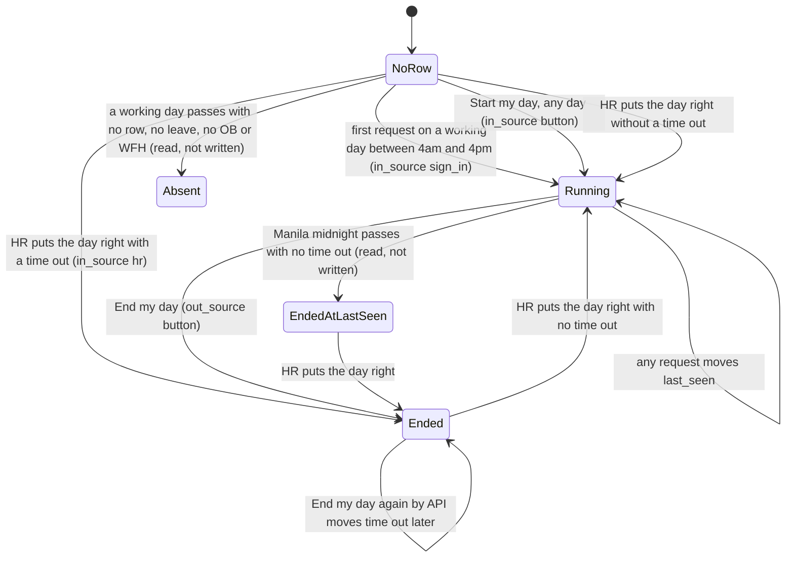
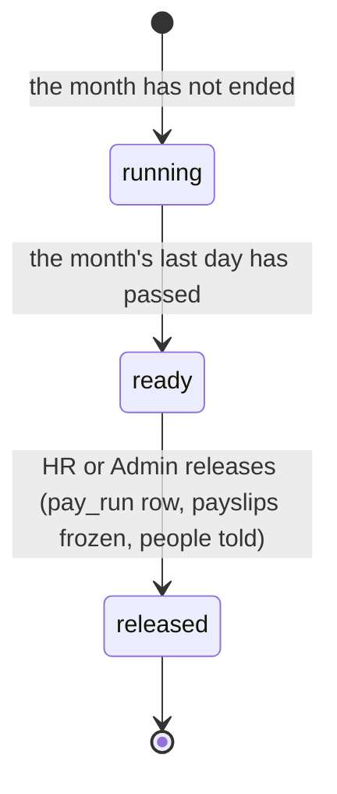

# 07 — HR and the team leads' pages

Read-only audit of one slice of the repo, written on 22 Nov 2026 from the code as it stands on
`main` (`fa3a9c9d`). Nothing was run: no server, no tests, no migrations. Every statement points at
the code it came from (`path:line`). "Confirmed" means the code shows it; "Suspected" means the code
makes it likely but the running app or the live data would have to be looked at.

Slice: `apps/api/src/hr/`, `apps/api/src/team/`, `apps/api/src/worklog/`, the migrations for
attendance, hours, holidays, leave, joining, forms, payroll, huddle, work log and desk shift,
`apps/web/src/hr/`, `apps/web/src/team/`, `apps/web/src/work-clock.ts`.

---

## 1. What this area is for

Two things live here.

**HR (the HR department, with the Admin as its backup and the CEO as a reader).** One person in the
CRM is a login (`person`) + an employee record (`employee`) + a seat on the company tree. HR:

- keeps every person's record (job, contact, pay, bank, government IDs), adds new joiners into a
  vacant seat with their login, changes logins, marks people as left or back;
- has a daily attendance record for everyone, made mostly by itself from people using the app;
- handles leave (HR records it, or people ask and their boss approves), and three "forms":
  official business (OB), work from home (WFH) and overtime (OT);
- works out a monthly payroll from the attendance record and releases payslips.

**The team leads' and heads' pages (the sales line: team leads, heads, the CEO, the Admin).** A lead
sees the seats under them on the company tree: what each sold against target, where their orders
stand, what customers owe, what is stuck, who is at work, whose leave waits for a yes. The "team
switch" (`?unit=`) narrows any lead page to one box of the tree.

Also here: the **work log** (office staff write their day in three boxes), and two tables whose
code lives in other areas: the **7 PM huddle** (`huddle`, code in `src/sellers/`) and the
**desk shift** (`desk_shift`, code in `src/desks/`).

---

## 2. Who uses it

### 2.1 The role lists the code checks

| Constant | Roles | Where |
|---|---|---|
| `ATTENDANCE_ALL_ROLES` | `ceo`, `admin`, `hr` — see everyone's attendance, leave, forms | `apps/api/src/hr/attendance.ts:37` |
| `ATTENDANCE_WRITE_ROLES` | `hr`, `admin` — put a day right, record leave, decide or cancel any leave/form | `apps/api/src/hr/attendance.ts:40` |
| `LEAD_ROLES` (attendance, leave, forms) | `team_lead`, `manager` — see their own team | `attendance.ts:43`, `leave.ts:44`, `forms.ts:23` (the same list declared three times) |
| `HR_ROLES` | `hr`, `ceo`, `admin` — read people's records and pay | `apps/api/src/hr/people.ts:39` |
| `HR_WRITE_ROLES` | `hr`, `admin` — add joiners, edit records, logins, leaving, payroll lines, release | `apps/api/src/hr/people.ts:42` |
| team board `LEADS` / `WHOLE` | `team_lead`, `manager` / `ceo`, `admin` | `apps/api/src/team/service.ts:28-29` |
| team accounts `LEADS` | `team_lead`, `manager`, `ceo`, `admin` | `apps/api/src/team/accounts.ts:16` |
| `management` | named directly: reads every leave and form line and every leave paper | `leave.ts:424`, `leave.ts:492`, `forms.ts:222` |

The role label for `manager` is "Head", for `team_lead` "Team lead" (`apps/api/src/people/roles.ts:25-28`).

### 2.2 What each role may do

| Action | `hr` | `admin` | `ceo` | `team_lead` / `manager` | `management` | everyone else (`medrep`, `finance`, `dispatch`, `inventory`, `online`, `staff`, `regulatory`) |
|---|---|---|---|---|---|---|
| Own day: Start / End my day | yes | yes | yes | yes | yes | yes |
| See attendance | everyone | everyone | everyone | own team (down the reporting line, or the box picked) | self only | self only |
| Put a day right (edit times) | **yes** | **yes** | no | no | no | no |
| Attendance report | everyone | everyone | everyone | own team | no (403) | no (403) |
| Record leave for someone (approved at once) | **yes** | **yes** | no | no | no | no |
| Ask for own leave / file own form | yes | **no** (HR records theirs) | **no** | yes | yes | yes |
| Approve / refuse leave or a form | any (not their own) | any (not their own) | **never** | only where they are the stored approver | no | only where they are the stored approver (but no screen, see F13) |
| Cancel leave / form | any asked or approved | same | no | own: asked, or approved and not started | own (same rule) | own (same rule) |
| Leave / form lists | all | all | all (read) | own team (read + decide own) | all (read) | 403 |
| Read a leave paper (medical certificate) | yes | yes | yes | own team's | **yes, anyone's** | own only (or as approver) |
| People list, any person's record | read + write | read + write | read | 403 (own record only) | 403 (own only) | 403 (own only) |
| Pay, bank, government IDs on a record | all | all | all (API) | own only | own only | own only |
| Add joiner, change login, mark left / back | yes | yes | no | no | no | no |
| Payroll list, register, rates, CSV | read + write | read + write | read | 403 | 403 | 403 |
| Add / remove payslip line, release month | yes | yes | no | no | no | no |
| Own released payslips | yes | yes | yes | yes | yes | yes |
| Work log: write own | yes | yes | yes | yes | yes | yes (any signed-in person) |
| Work log: read others | people under them | everyone | everyone | people under them / box picked | people under them | people under them, else 403 |
| Team board, territories, team accounts | 403 | any box | any box | boxes they lead | 403 | 403 |

Sources: `attendance.ts:154, 366-400, 669, 731`; `leave.ts:134-150, 241-243, 424-426, 487-494`;
`forms.ts:52-62, 76-78, 222-224`; `people.ts:98, 174-177, 263, 326, 405, 485, 565, 643, 663`;
`payroll.ts:301, 333, 375, 412, 437, 507-509, 578`; `worklog/service.ts:40-49`;
`team/service.ts:91-115`; `team/accounts.ts:19`.

### 2.3 Three kinds of session that change who "me" is

| Session | What it is | Effect in this area |
|---|---|---|
| **Look as** (`me.viewedBy`) | The CEO or Admin (anyone), or a `team_lead` / `manager` (someone in their team) opens a two-hour read-only session *as that person* (`apps/api/src/app.ts:353-390`). All non-GET requests are refused (`apps/api/src/http.ts:66-73`). | Attendance is not noted (`http.ts:76`, `attendance.ts:96`). **All GETs answer as the person looked at, including their payslips and their own record** (finding F1). |
| **Desk screen** (`me.deskScreen`) | Management's, Finance's or Dispatch's common screen, opened with the company password; the session belongs to the desk's first seat-holder (`app.ts:248-262`). | The menu hides "Me" (`apps/web/src/menus.ts:574-577`) but the API does not know the difference (finding F2). |
| **Team switch** (`me.unit`) | On any GET with `?unit=N` the middleware checks the box (`pickedUnit`: the CEO and Admin any box; anyone else only a box they lead or one under it, else 403) and puts it on `me` (`app.ts:133-139`, `apps/api/src/org/scope.ts:59-65`). | Attendance (`attendance.ts:380-381`), work logs (`worklog/service.ts:40-41`) and team accounts (`team/accounts.ts:21`) count the people/seats in that box and under it. |

---

## 3. Features

### 3.1 The company's working hours and holidays

- **What:** one default schedule (`work_schedule`, `is_default`) — Monday to Saturday, 07:00–16:00,
  60 minutes' lunch, no grace (`migrations/0035_company_hours.sql`, the same in code as
  `DEFAULT_SCHEDULE`, `apps/api/src/hr/work-time.ts:20-26`) — and the list of holidays (`holiday`,
  the 20 national holidays of 2026 only, `migrations/0036_holidays_2026.sql`).
- **Why:** attendance (late, undertime, absent), leave days, payroll, and the "desk clock" (an
  order left at 6 pm is not late by morning) all run on it.
- **Who / in / out:** any signed-in person reads `GET /api/hr/calendar` → `{ schedule, holidays[] }`
  (holidays from 400 days back, `attendance.ts:78-81`). The web's `useWorkClock`
  (`apps/web/src/work-clock.ts`) uses it on the orders board, Finance's and Dispatch's lanes.
- **Per-person schedule:** `person.schedule_id` exists (`migrations/0034:24`) and is honoured
  everywhere (`attendance.ts:111, 402-414`).
- **Partly implemented:** there is **no endpoint and no screen** to add a holiday, change the hours,
  create another schedule or give a person one. The only writers are the migrations (finding F12).

### 3.2 Attendance: how a day is recorded

One row per person per Manila day in `attendance` (`unique (person_id, day)`).

**A. By itself — `markSeen` (every signed-in request).**
`signedInWith` calls `onSeen(me)` after every authenticated request, without waiting for it and
without failing the request (`http.ts:76-79`; wired in `app.ts:126-130`). `markSeen`
(`attendance.ts:95-118`):

1. does nothing in a look-as session (`me.viewedBy`);
2. does nothing if this person was noted less than 2 minutes ago (an in-memory map per server
   process, `attendance.ts:45-46, 98-99`);
3. `update attendance set last_seen = now()` for today's row; if a row exists that is all;
4. otherwise inserts a row `time_in = now(), in_source = 'sign_in', last_seen = now()` **only if**:
   today's weekday is in the person's schedule (their own, else the default), today is not an
   active holiday, and the Manila clock is between `starts − 3 hours` and `ends`
   (04:00–16:00 on the default hours).

So: the first request on a working day between 04:00 and 16:00 starts the day; a first request
after 16:00, on a Sunday or on a holiday starts nothing; once a row exists, every request that day
(at any hour, until Manila midnight) moves `last_seen`.

"Request" means any API call with the session cookie — a click, but also the page's own background
reads (the top bar re-reads `/api/hr/my-day` every 60 seconds, `apps/web/src/hr/parts.tsx:65-69`).

**B. Start my day / End my day.**
- `POST /api/hr/day/start` (`startDay`, `attendance.ts:124-133`): any day (a Sunday or holiday
  too). Inserts `in_source = 'button'`; if a row exists it only moves `last_seen` and fills
  `in_place` if empty — it never moves `time_in` and never re-opens an ended day.
- `POST /api/hr/day/end` (`endDay`, `attendance.ts:135-145`): sets
  `time_out = greatest(now(), time_in)`, `out_source = 'button'`, `out_place`; 409 "Your day hasn't
  started yet" when there is no row.
- A field MedRep's "Start working" and day report call the same two functions
  (`apps/api/src/mr/day.ts:119, 415`), so the field day and the attendance day are one record. The
  values `'field'` for `in_source` / `out_source` exist in the table but are never written.

**C. HR puts a day right.** `POST /api/hr/attendance/:id` (`putDayRight`,
`attendance.ts:148-178`), `hr` and `admin` only: a day (not in the future), time in, optional time
out (after time in), and a note (required). Upserts the row with `in_source = 'hr'`,
`out_source = 'hr'` (or null), `note`, `changed_by`. The earlier times and the earlier note are
overwritten; nothing keeps what was there before (finding F9).

**D. How a day ends when nobody pressed End.** Nothing is written. When read, a past day with no
`time_out` is taken to have ended at `last_seen` and is shown as "last seen" (grey italics);
today's un-ended day is "Working" with hours counted to now (`attendance.ts:250-269`).

**E. What is worked out for a day** (`dayFigures`, `work-time.ts:101-124`; `dayOf`,
`attendance.ts:198-281`). All in Manila time (fixed UTC+8, `work-time.ts:33, 42-50`):

| Figure | Rule |
|---|---|
| Kind of day | `before` (before the hire date and no row), `holiday`, `work` (on the schedule, not a holiday), `rest` |
| Worked minutes | time out − time in; the break (60) comes off only when the span is longer than break + 4 hours |
| Late | minutes from the schedule's start to time in; counted only on a working day and only past the grace (0); rounded **up** to 15 |
| Undertime | minutes from time out to the schedule's end (working day only); rounded **up** to 15 |
| After hours | minutes after the schedule's end; rounded **down** to 15 (not paid by itself) |
| Absent | a working day already past, with no row, no approved leave and no approved OB/WFH form |
| On leave | approved leave covering the day (working days only); late and undertime are then 0 |
| Form | an approved OB or WFH that day: late and undertime are 0; worked = the larger of the real hours and the form's (OB: its from–to; WFH: a full day less the break) |
| Overtime | the from–to of every approved OT form that day, added up (not compared with the real time out) |

- **Tables:** writes `attendance`; reads `work_schedule`, `holiday`, `person`, `employee`
  (hire date), `person_leave`, `hr_form`, `seat_holder`/`seat`/`org_unit` (team name).
- **What happens next:** the DTR feeds the attendance report, the CEO Home card and payroll (3.8).

### 3.3 Who's working, a person's month (DTR), the attendance report

See section 8 for the exact figures. In short:

- **Who's working** (`GET /api/hr/attendance?day=`): the people this person may see, each with that
  day and the month so far; six counts that work as filters.
- **A person's month** (`GET /api/hr/attendance/:id?month=`): day by day up to today, the totals,
  the leave of the month, and whether this viewer may put a day right or record leave.
- **Attendance report** (`GET /api/hr/attendance/report?from=&to=`): a line per person over chosen
  days (at most 366), read-only.

Who a person "may see" (`visiblePeople`, `attendance.ts:366-400`): the box picked on the team
switch → everyone sitting in or under it; else `ceo`/`admin`/`hr` → everyone; else
`team_lead`/`manager` → themselves and everyone below them on `person.reports_to`; else only
themselves. Always left out: the Admin login, inactive people, people whose hire date is in the
future.

### 3.4 Leave recorded by HR

- `POST /api/hr/leave` (`recordLeave`, `attendance.ts:664-720`), `hr` / `admin`.
- In: person, kind (`vl`, `sl`, `lwop`, `other`), from, to, half day, reason.
- Rules: at most 92 days; must contain at least one working day of that person's schedule; a
  half day is one day only; refused (409) if it overlaps the person's `asked` or `approved` leave
  (the person row is locked first, so two can't race).
- Out: a `person_leave` row with `status = 'approved'` (the column default), `made_by`,
  `decided_by` and `decided_at` = HR, now. No allowance check and no notification to the person.

### 3.5 Leave people ask for themselves

- `POST /api/hr/leave/request` (multipart, optional file; `requestLeave`, `leave.ts:235-339`).
- **Who:** anyone except `ceo` and `admin` ("recorded by HR") and never in a look-as session.
- **Rules:** from one month back to six months ahead; one calendar year per request; "other"
  needs a reason; the paper must be JPEG/PNG/WebP/HEIC/HEIF/PDF, at most 10 MB; must contain a
  working day; no overlap with `asked`/`approved` leave.
- **Allowance** (`LEAVE_DAYS`, `leave.ts:38-43`, fixed in code): `regular` 10 VL + 10 SL a year;
  `probationary`, `part_time`, `intern` none (they must ask for leave without pay). A person with
  no employee record counts as probationary (`leave.ts:207`). Left = allotted − approved − asked
  for that calendar year (by the first day), never below 0 (`leave.ts:163-200`). Asking for more
  than is left is refused with what is left.
- **Who approves — the company tree, one step up.** `approverOf` (`leave.ts:75-85`) takes
  `person.reports_to` (which `projectOrg` writes from the seats: the lead seat of the person's box,
  or the seat it names, `apps/api/src/org/service.ts:142-210`). If that boss is active and is not
  the CEO or the Admin, they are stored on the request as `approver_id`. Otherwise `approver_id`
  is null = HR.
- **Who may decide** (`mayDecide`, `leave.ts:134-137`): the stored approver, or any `hr` / `admin`;
  never the person themself; never in a look-as session. The CEO never decides.
- **Decide** (`POST /api/hr/leave/:id/decide`, `decideLeave`, `leave.ts:342-388`): approve, or
  refuse with a note (required). Only from `asked`.
- **Cancel** (`POST /api/hr/leave/:id/cancel`, `leave.ts:391-412`): the person — while `asked`,
  or `approved` and not yet started; `hr`/`admin` — any `asked` or `approved`. The row is kept
  with `cancelled_by`, `cancelled_at`.
- **Messages:** on asking, a notification to the approver (or to every active `hr` person when
  there is none), link `/hr/leave?view=waiting`; on a decision, one to the person, link
  `/me/leave` (`leave.ts:328-335, 379-386`). In-app only (`notification` rows,
  `apps/api/src/notify/service.ts:14-35`); no email or SMS.
- **The paper:** goes through `keepFile("leave", …)` before the transaction and `bytesOf` to read
  (`leave.ts:281-283, 495`), as CLAUDE.md asks. Read by the person, the stored approver, a
  `team_lead`/`manager` above them, `ceo`/`admin`/`hr`, and `management` (`leave.ts:477-494`).
- **Tables:** `person_leave` (write), `employee` (classification), `notification` (write).
- **Next:** approved leave shows in attendance (not absent, not late), in the report, in payroll
  (`lwop` is deducted, the others are paid), and in the field app's calendar and plan
  (`src/mr/plan.ts`, `src/field/calendar.ts`).

### 3.6 HR forms: official business, work from home, overtime

- `POST /api/hr/forms` (`requestForm`, `forms.ts:75-134`). Not the CEO/Admin, not when looking as.
- In: kind (`ob`, `wfh`, `ot`), day (30 days back to 60 ahead), from/to times (OB and OT; to after
  from), place (OB, required), reason (required). One `asked`/`approved` form of a kind per person
  per day (checked, and a unique index `hr_form_once`).
- Approver, deciding, refusing with a note, cancelling and the messages work exactly as for leave
  (`forms.ts:52-62, 102, 124-131, 136-199`; link `/hr/leave?of=forms&view=waiting`).
- **Effect when approved:** see the table in 3.2 (OB/WFH cover the day; OT becomes approved
  overtime). There is no file on a form.

### 3.7 People: records, joining, logins, leaving

**The record** (`employee`, one per person; made for anyone who lacks one whenever HR's screens are
opened, `ensureRecords`, `people.ts:61-70`).

Personal data collected (`migrations/0037`, `0044`; `people.ts:528-555`):

| Group | Fields | Who can read |
|---|---|---|
| Job | company (`2mg` / `gpi`), employee ID (unique per company), classification, position, department, hire date, regularised on, left on, why | `hr`, `ceo`, `admin`; the person (own record) |
| Contact | mobile, personal email, birth date, home address, emergency contact (name, phone, relation) | same |
| Pay and IDs | monthly salary, monthly allowance (centavos), bank name, bank account number, SSS, PhilHealth, Pag-IBIG, TIN, the four "not covered" ticks | same — the API blanks these unless the reader is `hr`/`ceo`/`admin` or the person (`people.ts:263, 301-311`) |
| Login | the email or seat login ID they sign in with, last sign-in time; never the password | same |
| Seats | current seat, team, channel, area, boss; every seat held with dates and why it ended | same |

Anyone else asking for another person's record gets 403 (`people.ts:176-177`). The list
(`GET /api/hr/people`) carries no pay; it shows what is **missing** on each record (employee ID,
mobile, address, emergency contact, SSS, PhilHealth, Pag-IBIG, TIN — `people.ts:49-58`).

| Feature | Endpoint | Who | What it does | Tables |
|---|---|---|---|---|
| People list | `GET /api/hr/people?stage=&q=` | `hr`, `ceo`, `admin` | Everyone but the Admin login; tabs Working / Joining / Details missing / Left | `person`, `employee`, `seat_holder`, `seat`, `org_unit`, `area` |
| One record | `GET /api/hr/people/:id` | those three, or the person | The whole record (pay only as above) + what the viewer may do | same |
| Edit record | `PATCH /api/hr/people/:id` | `hr`, `admin` | Only the fields sent; validates phone, email, dates, whole centavos; employee ID unique per company; also copies mobile → `person.phone` and position → `person.title` (`people.ts:559-637`) | `employee`, `person` |
| Joiner form | `GET /api/hr/joiners/form` | `hr`, `admin` | Vacant seats nobody holds or is joining (never CEO/Admin seats) and whether a common password is set | `seat`, `seat_holder` |
| Add joiner | `POST /api/hr/joiners` | `hr`, `admin` | Name, mobile, company, classification, seat, first day (31 days back to 90 ahead), optional employee ID, position, salary, allowance, login email, password. Makes the `person` (role = the seat's module, `must_change_password = false`), the `seat_holder` from the first day, the `employee` record (`people.ts:400-475`). The password is the company's common one (env `JOIN_PASSWORD`) unless HR typed one (`people.ts:432-433`). Nothing is emailed. | `person`, `seat_holder`, `employee` |
| Change login | `POST /api/hr/people/:id/login` | `hr`, `admin` (not for the CEO's/Admin's login) | New login email (unique; not another seat's login ID) and/or a new password typed by HR; a new password unlocks the account and ends the person's own sessions (`people.ts:479-526`) | `person`, `session` |
| Mark as left | `POST /api/hr/people/:id/left` | `hr`, `admin` | Reason required; last day not in the future; ends their seat holdings, switches the login off, deletes sessions, sets `employee.status = 'left'`, `left_on`, `left_reason` (`people.ts:655-664` → `org/service.ts:949-985`). Not on oneself; only the CEO can do it to the CEO. | `seat_holder`, `person`, `session`, `employee` |
| Back at work | `POST /api/hr/people/:id/back` | `hr`, `admin` | `person.active = true`, record back to `active`, left date cleared. The seat is not given back (done in Teams & people). (`people.ts:642-653`) | `person`, `employee` |

Planned, not built: a person finishing their own profile at first sign-in — the column
`employee.profile_done_at` exists (`migrations/0037:47`) but no code reads or writes it.

### 3.8 Payroll

- **Period:** one payroll a calendar month, the 1st to the last day (`payMonthByKey`,
  `pay-rules.ts:67-74`). Pay day = the last day, moved back off Saturday, Sunday and holidays
  (`payDayOf`, `pay-rules.ts:87-96`).
- **Who is in it** (`employeesIn`, `payroll.ts:108-121`): every employee record (not the Admin
  login) hired on or before the month's end and either active or left on/after the month's start.
  People without a salary on record get no payslip and are listed as "without a salary".
- **How one payslip is worked out** (`workOut`, `payroll.ts:140-255`; `computeSlip`,
  `pay-rules.ts:217-372`). Everything is whole centavos; each line is rounded once.

  | Step | Rule |
  |---|---|
  | Daily rate | monthly salary × 12 ÷ 313 |
  | Hourly rate | daily ÷ 8 |
  | Earnings | Basic pay = the monthly salary; + monthly allowance; + approved overtime (hourly × hours × 125% working day, 130% rest day, 169% special holiday, 260% regular holiday); + holiday worked (each holiday with a time in: +100% of a day for a regular holiday, +30% for a special day); + HR's earning lines |
  | Time not worked | absent days × daily; leave-without-pay days × daily (half day 0.5); working days before joining / after leaving × daily; late minutes × hourly ÷ 60; undertime minutes × hourly ÷ 60 |
  | Gross | earnings − time not worked, never below 0 |
  | SSS base | gross − HR's earning lines marked "not taxable" |
  | SSS | salary credit = SSS base rounded to the nearest ₱500, between ₱5,000 and ₱35,000; employee 5%; employer 10% + EC ₱10 (credit under ₱15,000) or ₱30 |
  | PhilHealth | 5% of the monthly salary (taken between ₱10,000 and ₱100,000), half each |
  | Pag-IBIG | 2% of the salary up to ₱10,000 (₱200), matched by the employer |
  | Taxable | SSS base − the three employee shares actually taken |
  | Withholding tax | BIR monthly table: up to ₱20,833 nothing; over ₱20,833 15% of the excess; over ₱33,333 ₱1,875 + 20%; over ₱66,667 ₱8,541.80 + 25%; over ₱166,667 ₱33,541.80 + 30%; over ₱666,667 ₱183,541.80 + 35% |
  | Deductions | taken in this order and never past the gross: SSS, PhilHealth, Pag-IBIG, tax, then HR's deduction lines; what could not be taken is said on the line ("₱x not taken: not enough pay this month") |
  | Net | gross − deductions |
  | Not covered | a tick on the record (`no_sss`, `no_philhealth`, `no_pagibig`, `no_tax`) makes that share 0 |

  The law-set rates are dated rows in `pay_rule` (`migrations/0044:20-44`); the row in force on
  the month's last day is used (`rulesOn`, `payroll.ts:61-77`). There is no screen to add a new
  rate; a new one arrives by migration.
- **HR's own lines** (`pay_adjustment`): `POST /api/hr/payroll/:month/lines` — person (employed in
  that month), label (≤ 80), earning or deduction, taxable (earnings only), amount (1 centavo to
  ₱1,000,000), note; `POST /api/hr/payroll/lines/:id/remove` marks it removed (kept with
  `removed_by`, `removed_at`). Both refused once the month is released (`payroll.ts:369-429`).
- **Draft:** every read of an unreleased month recomputes it from the DTR as it stands
  (`payroll.ts:338-340`).
- **Release** (`POST /api/hr/payroll/:month/release`, `payroll.ts:432-480`): only `hr`/`admin`,
  only after the month's last day, only once (a `pay_run` row per month, unique). Writes `pay_run`
  (totals, pay day, who, when) and one `payslip` row per person holding the whole slip as JSON,
  then tells each person ("Your payslip for … is out", link `/me/payslips/<month>`).
  After release every read returns the frozen JSON.
- **Who can see pay** — every payroll endpoint's guard:

  | Endpoint | Guard | Line |
  |---|---|---|
  | `GET /api/hr/payroll` | `allow(HR_ROLES)` = `hr`, `ceo`, `admin` | `payroll.ts:301` |
  | `GET /api/hr/payroll/rules` | `allow(HR_ROLES)` | `payroll.ts:578` |
  | `GET /api/hr/payroll/:month` | `allow(HR_ROLES)` | `payroll.ts:333` |
  | `GET /api/hr/payroll/:month/register.csv` | via `payrollMonth` → `HR_ROLES` | `payroll.ts:566` |
  | `GET /api/hr/payroll/:month/slip/:id` | someone else's only for `HR_ROLES`; one's own only once released | `payroll.ts:506-519` |
  | `POST /api/hr/payroll/:month/lines` | `allow(HR_WRITE_ROLES)` + not looking-as | `payroll.ts:375-376` |
  | `POST /api/hr/payroll/lines/:id/remove` | same | `payroll.ts:412-413` |
  | `POST /api/hr/payroll/:month/release` | same | `payroll.ts:437-438` |
  | `GET /api/hr/payslips/mine` | none beyond signed-in: `where person_id = me.id` | `payroll.ts:483-488` |
  | `GET /api/hr/payslips/:month` | own slip, released only | `payroll.ts:499-520` |

  The role guards are consistent. The gap is not the role but the session: "me" is whoever the
  session says, and two kinds of session are not the person themself (findings F1, F2).
- **Parked by the plan** (PLAN 12.16): 13th-month pay, final pay, a bank file, remittance
  reports. Not built.

### 3.9 The work log

- Any signed-in person may write today's entry: three free-text boxes (done / today / tomorrow,
  2,000 characters each, at least one filled). One row per person per day, replaced on every save
  during that Manila day (`worklog/service.ts:24-31`). Yesterday's cannot be edited.
- `GET /api/work-log`: own last 30 entries. `GET /api/work-log/day?day=`: everyone's for the CEO
  and Admin; for anyone else the people below them on `reports_to` (403 if nobody reports to
  them); with `?unit=` the people sitting in that box (`worklog/service.ts:34-60`).
- It is the Home of the `staff` role (Digital Marketing, IT) (`apps/web/src/home/home.tsx:84`).
  Optional; nothing chases an empty day.

### 3.10 A lead's team board ("My team")

- `GET /api/team/board?unit=&from=&to=` (`teamBoard`, `team/service.ts:185-534`).
- **Scope** (`viewOf`, `team/service.ts:68-136`): `ceo`/`admin` — the whole company (all active
  seats except CEO and Admin seats) or any box with everything under it; `team_lead`/`manager` —
  every box they hold or cover a **lead seat** of and all boxes below (`ledUnits`,
  `org/service.ts:1345-1355`), plus seats whose boss is in their reporting line, plus their own
  seats; with `?unit=` one of those boxes only (else 403 "That team isn't under you"); any other
  role 403.
- **Range:** this month so far unless picked; at most 366 days (`rangeOf`, `:139-149`).
- **Out:** one card per seat (filled or vacant) with its figures, the team totals, the day-by-day
  series, the order stages now, top medicines, customers by kind, average time at each step, the
  "needs" list, the boxes in view and the breadcrumb. See section 8.5.
- **Reads:** `seat`, `seat_holder`, `person`, `area`, `customer`, `sales_order`, `order_item`,
  `order_step`, `invoice`, `sale_invoice` (CRM + Zoho invoices), `payment`, `sales_target`,
  `org_unit`, `medicine`; scorecard needs from `src/scores/service.ts`. Writes nothing.
- A lead approves nothing here. The panel is headed "Stuck in your team (you chase, the desk
  decides)" (`apps/web/src/team/my-team.tsx:873`).

### 3.11 The team's customers and the map's territories

- `GET /api/team/accounts` (`team/accounts.ts`): the business customers (never `patient`) of the
  areas of the seats in view, plus anyone those seats sold to; each with first and last order,
  the usual gap between orders, sold this month and in the last 365 days, owed and overdue (CRM
  invoices + Zoho invoices in `book_doc`), the last call and its outcome; counted by state and by
  city. At most 400 rows.
- `GET /api/team/territories?unit=` (`team/service.ts:686-734`): each area of the seats in view,
  its cities read as places (PSGC), the map shapes they cover, the holder and their lead; names
  that could not be read are listed.

### 3.12 The lead's Home and the other lead pages (screens of this slice, APIs of other slices)

`/` for `team_lead` and `manager` is `TeamSalesPage` (`apps/web/src/home/home.tsx:53`); `/team` is
the same page for the CEO/Admin ("Sales by person"). It reads `/api/team/sales` (sales area),
`/api/team/board`, and inside the drill-down each channel's own cards from other areas
(`apps/web/src/team/drill.tsx:570-634`). `/targets`, `/team-scores` live in `web/src/team/` but
call the targets and scores APIs.

### 3.13 The team switch (`?unit=`)

`TeamSwitch` (`apps/web/src/team/switch.tsx`) reads `/api/org/menu` (the boxes this person leads,
or the company's for the CEO/Admin), draws "All · each team by its lead", one row per level, and
keeps the pick in the address as `?unit=`. Pages add it to their reads with `withUnit`. It is not
drawn when the person has fewer than two boxes (`switch.tsx:37`). In this slice it is on Who's
working, My team, Targets and Scorecards; the server side is described in 2.3.

### 3.14 The 7 PM huddle (table here, code in `src/sellers/`)

Hospital-channel MedReps (role `medrep`, channel `HOSP`, title not "bidding") declare each evening
the day's sales, collections and visits, whether they invoiced, a blocker (required when there was
no invoice) and tomorrow's first stop; one row per person per day, replaced until the day is over
(`apps/api/src/sellers/service.ts:262-300`). Leads (`team_lead`, `manager`, `ceo`, `admin`) read
the team's day: declared or not, the actual numbers beside the declared ones, red when there was
no invoice, and "three evenings running without one" (`sellers/service.ts:305-346`). Endpoints
`GET /api/huddle`, `POST /api/huddle`, `GET /api/huddle/team` (`sellers/routes.ts:20-36`); screen
`/huddle`. The team read ignores the team switch (`teamSeats(db, me, null)`,
`sellers/service.ts:309`).

### 3.15 The desk shift (table here, code in `src/desks/`)

On Management's, Finance's and Dispatch's common screen each of the desk's people presses Start
and Stop; each press is a `desk_shift` row (who, desk, from, to, who pressed, why it ended);
waiting orders are shared out among those started (`apps/api/src/desks/service.ts:149-170`,
`app.ts:150-182`). It does **not** touch `attendance` (finding F3).

---

## 4. Workflows and statuses

### 4.1 An attendance day

Nothing is stored as a "status"; the state is read from the row.

| Value | Column | Meaning |
|---|---|---|
| `sign_in`, `button`, `field`, `hr` | `attendance.in_source` | how the day started (`field` is never written) |
| `button`, `last_seen`, `field`, `hr` | `attendance.out_source` | how it ended; `last_seen` and `field` are never written — "last seen" is worked out when read |
| `work`, `rest`, `holiday`, `before` | computed `kind` | the kind of day |

### 4.2 Leave (`person_leave.status`) and forms (`hr_form.status`) — the same machine

```mermaid
stateDiagram-v2
    [*] --> asked: the person asks (approver = their boss, else HR)
    [*] --> approved: HR records leave (leave only)
    asked --> approved: approver, HR or Admin approves
    asked --> refused: approver, HR or Admin refuses (note required)
    asked --> cancelled: the person, HR or Admin cancels
    approved --> cancelled: the person before it starts; HR or Admin any time
    refused --> [*]
    cancelled --> [*]
```

| From → to | Who | Condition | Side effects |
|---|---|---|---|
| (new) → `asked` | any person except CEO/Admin | rules of 3.5 / 3.6 | `approver_id` stored; message to the approver or to all HR |
| (new) → `approved` | `hr`, `admin` (`POST /api/hr/leave`) | no overlap, ≥ 1 working day | `decided_by` = HR; no message |
| `asked` → `approved` / `refused` | stored approver, `hr`, `admin`; not the person; not looking-as | refusing needs a note | `decided_by`, `decided_at`, `decision_note`; message to the person |
| `asked` → `cancelled` | the person; `hr`, `admin` | — | `cancelled_by`, `cancelled_at`; no message |
| `approved` → `cancelled` | the person only if the first day is after today; `hr`, `admin` any time | — | same; attendance and payroll drafts change at once |
| `refused`, `cancelled` | — | final; a new request must be made | — |

There is no "send back for changes" and no editing of a request: cancel and ask again.
There is no second level of approval and no escalation when the approver does nothing.

### 4.3 A payroll month (worked out, `payroll.ts:294`)

`running` and `ready` are not stored: a month is `released` when a `pay_run` row exists, else
`ready` when its last day is before today, else `running`. There is no un-release, no re-run and
no correction of a released month ("a later change goes on the next month",
`apps/web/src/hr/payroll.tsx:383-385`). HR's lines: active → removed (kept).

### 4.4 A person (`employee.status` + dates → `PersonStage`, `people.ts:72-73`)

```mermaid
stateDiagram-v2
    [*] --> joining: HR adds a joiner whose first day is ahead
    [*] --> active: first day is today or earlier
    joining --> active: the first day arrives (read from the date)
    active --> left: Mark as left (login off, seats end, record kept)
    left --> active: Back at work (login on; seat given separately)
```

Login state (`people.ts:75-76`): `off` (person inactive), `new` (never signed in), `ready`.
Classification: `probationary`, `regular`, `part_time`, `intern`. Company: `2mg`, `gpi`.
Holiday kind: `regular`, `special`. Pay line kind: `earning`, `deduction`.

### 4.5 Enumerations on the lead pages

| Where | Values |
|---|---|
| Team need kind (`TeamNeed.kind`) | `sent_back`, `held`, `late`, `overdue`, `vacant`, `score` (`team/service.ts:612-672`) |
| Order stage counted per seat | `management` (pending_approval), `finance` (finance_check, ready_for_invoice), `dispatch` (ready_for_dispatch, packing), `road` (shipped), `held` (on_hold, exception), `sentBack` (draft with `sent_back_at`) (`team/service.ts:251-256`) |
| Pace tone | `on`, `behind`, `far`, `none`, `vacant` (`apps/web/src/team/pace.ts`) |
| Account state | `never`, `new`, `lost` (> 180 days), `stopped` (> 90), `late` (> 1.5 × usual gap), `due` (next expected within 7 days), `ok` (`team/accounts.ts:79-87`) |
| Desk | `management`, `finance`, `dispatch` (`desk_shift.desk`, `session.desk`) |

---

## 5. Data

| Table | Purpose | Key columns | Relations | Migration |
|---|---|---|---|---|
| `work_schedule` | Working hours; one default | `days int[]`, `starts`, `ends`, `grace_minutes`, `break_minutes`, `is_default`, `active`; unique default | `person.schedule_id` → it | 0034, values changed in 0035 |
| `holiday` | Company holidays | `day`, `name`, `kind` (regular/special), `active`; unique active day | — | 0034, rows in 0036 |
| `attendance` | One row per person per day | `person_id`, `day`, `time_in`, `in_source`, `time_out`, `out_source`, `last_seen`, `in_place`, `out_place`, `note`, `changed_by`; unique `(person_id, day)` | `person` | 0034 |
| `work_minutes(a, b)` | SQL function: working minutes between two moments on the default schedule, Manila time, no holidays — the same rule as `work-time.ts` (pinned by `work-minutes-sql.test.ts`) | — | reads `work_schedule`, `holiday` | 0034, 0035 |
| `employee` | The HR record | see 3.7; `person_id` primary key; unique `(company, upper(employee_code))`; `no_sss` … `no_tax`; `created_by`, `updated_at`, `updated_by`; `profile_done_at` (unused) | `person` 1:1 | 0037, 0044 |
| `person_leave` | Leave | `person_id`, `kind`, `from_day`, `to_day`, `half_day`, `reason`, `status`, `approver_id`, `decided_by`, `decided_at`, `decision_note`, `made_by`, `made_at`, `cancelled_by`, `cancelled_at`, `file_name`, `file_mime`, `file_data`, `file_key` | `person` ×5 | 0039, 0041, `file_key` in 0051 |
| `hr_form` | OB / WFH / OT | `person_id`, `kind`, `day`, `from_time`, `to_time`, `place`, `reason`, `status`, approver / decided / cancelled columns as leave; unique `(person_id, kind, day)` while asked or approved | `person` | 0043 |
| `pay_rule` | Dated law-set rates | `kind` (sss/philhealth/pagibig/tax), `starts_on`, `rule jsonb`, `source`; unique `(kind, starts_on)` | — | 0044 |
| `pay_adjustment` | HR's own payslip lines | `month`, `person_id`, `label`, `kind`, `taxable`, `amount > 0`, `note`, `made_by`, `made_at`, `removed_by`, `removed_at` | `person` | 0044 |
| `pay_run` | A released month | `month` unique, `period_from`, `period_to`, `pay_day`, `people`, `gross`, `deductions`, `net`, `employer`, `released_by`, `released_at` | `person` | 0044 |
| `payslip` | A frozen payslip | `run_id`, `month`, `person_id`, `company`, `gross`, `net`, `tax`, `slip jsonb` (the whole slip, bank account included); unique `(run_id, person_id)` | `pay_run`, `person` | 0044 |
| `work_log` | A person's day in words | `person_id`, `day` (primary key together), `done`, `today`, `tomorrow`, `updated_at` | `person` | 0067 |
| `huddle` | The evening declaration | `person_id`, `day` (primary key), `seat_id`, `sales`, `collected`, `visits`, `invoiced`, `blocker`, `tomorrow`, `declared_at` | `person`, `seat` | 0058 |
| `desk_shift` | Start/Stop at a desk | `person_id`, `desk`, `started_at`, `ended_at`, `started_by`, `ended_by`, `end_reason` | `person` | 0106, Dispatch added in 0110 |
| `session.desk` | Marks a desk-screen session | `desk` | — | 0110 |

Also changed by these migrations: the `hr` role and seat module (0037), the `staff` role and seat
module (0067), `person.schedule_id` (0034). 0039 also creates `visit` (the field app, another
slice). The team pages own no table.

**How history is kept**

| Thing | Kept? |
|---|---|
| Leave, forms | Yes: rows are never deleted; who asked, who decided and when, the note, who cancelled and when |
| Payslip lines | Yes: removed lines stay with who and when |
| Released payroll | Yes: frozen JSON + totals + who released and when |
| Seats held, leaving | Yes: `seat_holder` rows with end date and reason; `employee.left_on`, `left_reason` (cleared again by "Back at work") |
| Attendance put right | **Partly:** only the last note and `changed_by`; the times before the change are gone (F9) |
| Record edits (salary, bank, IDs, hire date) | **No:** only `updated_at`, `updated_by` of the last edit (F9) |
| Login changes | **No** record that HR changed an email or password |
| Work log | Only the last save of each day |
| The Audit screen (`src/audit/trail.ts`) | Shows seat changes; nothing from attendance, leave, forms, records or payroll |

---

## 6. API endpoints

All under `signedIn` (`hr/routes.ts:64`, `team/routes.ts:10-14`, `worklog/routes.ts:10-11`).
"Self" = whoever the session is.

### 6.1 HR (`apps/api/src/hr/routes.ts`)

| Method | Path | Who may | What it does | Line |
|---|---|---|---|---|
| GET | `/api/hr/calendar` | anyone | Default schedule + holidays | 66 |
| GET | `/api/hr/my-day` | self | Today's own day and the schedule's hours | 70 |
| GET | `/api/hr/attendance?day=` | anyone (scope by role / `?unit=`) | A day's people + their month so far + counts | 71 |
| GET | `/api/hr/attendance/report?from=&to=` | `ceo`, `admin`, `hr`, `team_lead`, `manager` | The attendance report | 75 |
| GET | `/api/hr/attendance/:id?month=` | anyone, if `:id` is in their scope | One person's month | 80 |
| POST | `/api/hr/attendance/:id` | `hr`, `admin` | Put a day right | 83 |
| POST | `/api/hr/leave` | `hr`, `admin` | Record leave (approved) | 96 |
| GET | `/api/hr/leave/mine?year=` | self | Own balances, approver's name, own lines | 110 |
| GET | `/api/hr/leave/list?view=&month=` | `ceo`, `admin`, `hr`, `management` (all); `team_lead`, `manager` (team) | Leave list + counts | 113 |
| POST | `/api/hr/leave/request` | anyone but `ceo`/`admin` | Ask for leave (multipart, optional file) | 119 |
| POST | `/api/hr/leave/:id/decide` | stored approver, `hr`, `admin` | Approve / refuse | 145 |
| GET | `/api/hr/leave/:id/file` | person, approver, lead above, `ceo`, `admin`, `hr`, `management` | The paper, inline | 150 |
| POST | `/api/hr/leave/:id/cancel` | person (rules), `hr`, `admin` | Cancel | 188 |
| GET | `/api/hr/forms/mine` | self | Own forms (this year and ahead) | 159 |
| GET | `/api/hr/forms/list?view=&month=` | as the leave list | Forms list + counts | 160 |
| POST | `/api/hr/forms` | anyone but `ceo`/`admin` | File a form | 165 |
| POST | `/api/hr/forms/:id/decide` | stored approver, `hr`, `admin` | Approve / refuse | 179 |
| POST | `/api/hr/forms/:id/cancel` | person (before the day), `hr`, `admin` | Cancel | 184 |
| POST | `/api/hr/day/start` | self | Start my day | 192 |
| POST | `/api/hr/day/end` | self | End my day | 197 |
| GET | `/api/hr/people?q=&stage=` | `hr`, `ceo`, `admin` | People list | 203 |
| GET | `/api/hr/people/:id` | `hr`, `ceo`, `admin`; self | One record | 206 |
| PATCH | `/api/hr/people/:id` | `hr`, `admin` | Edit record | 207 |
| POST | `/api/hr/people/:id/login` | `hr`, `admin` | Change login email / password | 244 |
| POST | `/api/hr/people/:id/back` | `hr`, `admin` | Back at work | 251 |
| POST | `/api/hr/people/:id/left` | `hr`, `admin` | Mark as left | 255 |
| GET | `/api/hr/joiners/form` | `hr`, `admin` | Vacant seats, common-password flag | 259 |
| POST | `/api/hr/joiners` | `hr`, `admin` | Add a joiner | 260 |
| GET | `/api/hr/payroll` | `hr`, `ceo`, `admin` | This month and the five before | 282 |
| GET | `/api/hr/payroll/rules` | `hr`, `ceo`, `admin` | The dated rates | 283 |
| GET | `/api/hr/payroll/:month` | `hr`, `ceo`, `admin` | A month's register (draft or frozen) | 284 |
| GET | `/api/hr/payroll/:month/register.csv` | `hr`, `ceo`, `admin` | The register as CSV | 287 |
| GET | `/api/hr/payroll/:month/slip/:id` | `hr`, `ceo`, `admin`; self if released | One payslip | 294 |
| POST | `/api/hr/payroll/:month/lines` | `hr`, `admin` | Add a line | 297 |
| POST | `/api/hr/payroll/lines/:id/remove` | `hr`, `admin` | Take a line off | 316 |
| POST | `/api/hr/payroll/:month/release` | `hr`, `admin` | Release the month | 320 |
| GET | `/api/hr/payslips/mine` | self | Own released payslips | 323 |
| GET | `/api/hr/payslips/:month` | self | One own released payslip | 324 |

### 6.2 Team and work log

| Method | Path | Who may | What it does | File:line |
|---|---|---|---|---|
| GET | `/api/team/board?unit=&from=&to=` | `ceo`, `admin` (any box); `team_lead`, `manager` (their boxes) | The team board | `team/routes.ts:19` |
| GET | `/api/team/accounts` (`?unit=`) | `team_lead`, `manager`, `ceo`, `admin` | The team's customers | `team/routes.ts:13` |
| GET | `/api/team/territories?unit=` | as the board | Areas, places, shapes, holders | `team/routes.ts:16` |
| GET | `/api/work-log` | self | Own last 30 entries | `worklog/routes.ts:12` |
| POST | `/api/work-log` | self | Save today's entry | `worklog/routes.ts:14` |
| GET | `/api/work-log/day?day=` (`?unit=`) | `ceo`, `admin` (all); anyone with people under them | A day's entries | `worklog/routes.ts:13` |

### 6.3 Endpoints of other areas that this slice's screens call

`/api/team/sales` (`sales/routes.ts:59`), `/api/team/district`, `/api/huddle*`,
`/api/my/collections` (`sellers/routes.ts:14-22`), `/api/scores/team` (`scores/routes.ts:27`),
`/api/targets`, `/api/targets/seat`, `/api/targets/copy` (`targets/routes.ts:12-50`), `/api/speed`
(`speed/routes.ts:10`), `/api/org/menu` (`org/routes.ts:84`), `/api/orders/mine?seat=`,
`/api/customers?seat=`, `/api/care-groups`, `/api/rx/field`, `/api/reports/channels`,
`/api/finance/owed/invoices`, `/api/payments`, `/api/auth/view/:id` (`app.ts:353`).

---

## 7. Screens

The web has no route guards; a page a role may not use shows the API's refusal. "Menu" says where
the link is (`apps/web/src/menus.ts`).

### 7.1 HR (`apps/web/src/hr/`)

| URL (`main.tsx` line) | File | Who gets it | What is on it | Buttons → endpoint |
|---|---|---|---|---|
| top bar, every page (`shell.tsx:220`) | `parts.tsx` `MyDayButton` | everyone | Not started: "Start my day". Started: "In since 7:42" / "Done · 8h 05m"; a small panel with in, out, hours, late, a link to My attendance | Start → `POST /api/hr/day/start` (a field MedRep gets the Start-working dialog instead); End my day → `POST /api/hr/day/end` (a running field day goes to the day report); polls `GET /api/hr/my-day` every 60 s |
| `/hr/attendance` (301) | `attendance.tsx` `AttendancePage` | `hr` desk "Who's working" (`menus.ts:1405`); every lead desk's "Who's working"; anyone else is sent to their own month | Day picker, team switch, five count tiles that filter (Working now, Done, Not in yet, Came late, On leave), a table: person, status, in, out, hours, late, month so far | reads `GET /api/hr/attendance?day=&unit=` (every 60 s for today); a name → the person's month; "Report" → `/hr/report` |
| `/hr/attendance/:id` (328) | `attendance.tsx` `AttendanceMonthPage` | anyone for themselves ("My attendance"); leads; HR; CEO | Month picker, six totals, the DTR table (in, out, hours, late, undertime, after hours, note, marks for leave / OB / WFH / overtime / absent), "Leave this month" | HR/Admin only: pencil on a day → `POST /api/hr/attendance/:id`; "Record leave" → `POST /api/hr/leave`; "Cancel it" → `POST /api/hr/leave/:id/cancel` |
| `/hr/report` (302) | `attendance-report.tsx` | `hr` desk; CEO/Admin under Apps › HR (`menus.ts:491`); leads via the Report button | Range picker, four summary cards, a table per person, five orderings | reads `GET /api/hr/attendance/report`; a name → their month. No export |
| `/hr/leave` (303) | `leave-list.tsx` | `hr` desk "Leave & forms"; each lead desk (badge = what waits for them); CEO/Admin Apps › HR › Leave | Leave / Forms switch, tabs Waiting for you · Asked · Approved · Not approved · Cancelled, month stepper, lines with the paper link | Approve / Not approved (with why) → `POST /api/hr/leave/:id/decide` or `/api/hr/forms/:id/decide`; Cancel it → the cancel endpoints |
| `/me/leave` (304) | `my-leave.tsx` | everyone except CEO/Admin/desk screens ("Me" folder, `menus.ts:575-595`) | VL and SL rings (left of allotted), leave without pay taken, own leave lines, own forms | Ask for leave → `POST /api/hr/leave/request` (photo made smaller in the browser first); File a form → `POST /api/hr/forms`; Cancel it |
| `/me/payslips`, `/me/payslips/:month` (305-306) | `my-payslips.tsx`, `payslip.tsx` | everyone except CEO/Admin/desk screens ("Me") | List of released months with net pay; the picked payslip | Print (browser print). Reads `GET /api/hr/payslips/mine`, `GET /api/hr/payslips/:month` |
| `/hr/payroll` (307) | `payroll.tsx` `PayrollPage` | `hr` desk; CEO/Admin Apps › HR › Payroll | Six months: pay day, status, people, gross, net | "Rates" → `/hr/payroll/rates` |
| `/hr/payroll/:month` (309) | `payroll.tsx` `PayrollMonthPage`, `payslip.tsx` | same | Status, five tiles (people paid, gross, deductions, net by company, company's shares), the people without a salary, the register table, the picked person's payslip beside it | "Sheet" → `GET …/register.csv`; "Release payslips" (HR/Admin, month ended) → `POST …/release`; on a payslip "Add a line" → `POST …/lines`; ✕ on a line → `POST /api/hr/payroll/lines/:id/remove`; Print |
| `/hr/payroll/rates` (308) | `payroll.tsx` `PayRatesPage` | same | The four law-set rates in words with their start dates, and the company's own rules (written in the page) | read-only |
| `/` for `hr`, `/hr/people` (299) | `people.tsx` `HrPeoplePage` | `hr` Home (`home.tsx:82`); CEO/Admin Apps › HR › People | Tabs Working · Joining · Details missing · Left; search; table: person and ID, job and team, company, started, signs in with, record complete or n missing | "New joiner" (HR/Admin) → `GET /api/hr/joiners/form`, `POST /api/hr/joiners`, then the hand-over card (login email, and the password only if HR typed one) with Copy |
| `/hr/people/:id` (300) | `people.tsx` `HrPersonPage` | HR, CEO, Admin; the person (no menu link leads there) | Boxes: Job, Login, Contact, Pay and IDs, Seats held; a banner of what is missing | Edit record → `PATCH /api/hr/people/:id`; Change login → `POST …/login`; Mark as left → `POST …/left`; Back at work → `POST …/back` |
| `/` for `staff`, `/work-log` (285) | `work-log.tsx` `WorkLogPage` | `staff` Home; regulatory desks' "My work log" | Today's three boxes, Save, earlier days | Save → `POST /api/work-log` |
| `/work-logs` (286) | `work-log.tsx` `WorkLogsPage` | CEO/Admin Reports › Office › Work logs (`menus.ts:474`); regulatory mentors | A day's entries by box and person | date picker; reads `GET /api/work-log/day` |
| CEO Home card | `parts.tsx` `AtWorkCard` | CEO Home (`company/ceo-home.tsx`) | "n of m came in", a donut, who came late, who is not in yet | reads `GET /api/hr/attendance` every 2 min |

### 7.2 Team (`apps/web/src/team/`)

| URL | File | Who gets it | What is on it | Buttons → endpoint |
|---|---|---|---|---|
| `/` for `team_lead`/`manager`; `/team` (292) for CEO/Admin ("By person") | `team.tsx`, `drill.tsx`, `hierarchy.tsx`, `mentor.tsx`, `district.tsx`, `accounts-card.tsx`, `glance.tsx` | leads' Home; Reports › Sales › By person | Greeting, month stepper, My KPIs, four figures (sold vs target with the pace, today, orders placed, stopped now), "Your channels" as big tiles with a hover card, the opened channel (managers, each person's month, the channel's own cards), a head's risks, "Stopped now" | a person row → look as them (`POST /api/auth/view/:id`, `drill.tsx:485`) or their seat page; reads `/api/team/sales`, `/api/team/board`, `/api/team/accounts`, `/api/team/district`, others (6.3) |
| `/my-team` (334) | `my-team.tsx`, `tree.tsx`, `zoom.tsx`, `charts.tsx`, `desk-work.tsx`, `office-work.tsx`, `range.tsx`, `switch.tsx`, `pace.ts` | every lead desk ("Whole team" / "Whole business" / "Whole division"); CEO "Company view" (`menus.ts:1472`) | Breadcrumb, team switch, range picker; for a selling team: six tiles, day by day, orders right now, the team chart, team cards, who sold most, "Stuck in your team", the performance table, a card per seat, medicines, customers by kind, time at each step. For a desk team: desk work from Speed. For an office team: each person's work log | "Ask for Person / Region / Area" (leads; org area's dialog); links to Targets, Tree, Map, New order; CEO/Admin: "Change its people" → `/people?unit=` |
| `/my-team/seat/:id` (338) | `my-team.tsx` `TeamSeatPage` | from any seat card | The person, phone and email, since when, the days picked, previous / next person, talking points, the seat's orders by stage and its customers | CEO/Admin: "See as …" → look as (`my-team.tsx:1187-1195`); New order; reads `/api/orders/mine?seat=`, `/api/customers?seat=` |
| `/targets` (262) | `targets.tsx` | leads; Admin panel; Reports | Month, the team's target against sold with the pace, a card per person (ring, target typed in place), empty seats' targets, count targets | Save → `POST /api/targets`, `POST /api/targets/seat`; "Use last month's for the empty ones" → `POST /api/targets/copy` |
| `/team-scores` (291) | `team-scores.tsx` | leads; Reports › Scorecards | A row per scored seat, questions waiting | reads `/api/scores/team` |

`work-clock.ts` is not a screen: it gives the orders board, Finance's lanes and Dispatch's lanes
"minutes waited on the working clock" and "late or not" from `/api/hr/calendar`.

---

## 8. Reports and figures

All figures here are worked out live on each read, except released payroll (stored).

### 8.1 Who's working (`attendanceToday`, `attendance.ts:478-554`)

- **Who:** see 3.3. **Parameters:** `day` (default today; a later day falls back to today),
  `unit`.
- **Source:** `attendance`, `person_leave` (approved), `hr_form` (approved), `holiday`,
  schedules, from the 1st of that month to the day.
- **Counts:** working = today's row not ended; done = has a time in and is ended; not in = no
  time in on a working day and not on full-day leave; on leave = has leave that day; late = late
  minutes > 0; rest = no time in and not a working day.
- **Per person, month so far:** days with a time in, total worked minutes, days late, days absent.
- No export.

### 8.2 A person's month — the DTR (`attendanceMonth`, `attendance.ts:557-629`)

Totals: working days; present = days with a time in; absent; worked, late, undertime, after-hours
minutes summed; leave days (half = 0.5). Days run from the 1st to today (or the month's end).
No export, no print layout.

### 8.3 Attendance report (`attendanceReport`, `attendance.ts:726-815`)

- **Who:** `ceo`, `admin`, `hr` (everyone), `team_lead`, `manager` (their team). **Parameters:**
  `from` (default the 1st of this month), `to` (default today; a later date falls back to today),
  at most 366 days.
- **Per person:**

  | Column | Calculation |
  |---|---|
  | Work days | working days in the range |
  | Expected minutes | per working day a full day (schedule length − break = 480 min), half on half-day leave, none on full-day leave; today counts only once the person has come in |
  | Present ("Days in") | working days with a time in or an approved OB/WFH |
  | Absent | days flagged absent |
  | Leave | days by kind (half = 0.5) |
  | Worked | sum of worked minutes (rest-day work included) |
  | Average a day | worked ÷ present |
  | Late | days late and minutes late |
  | Undertime, after hours, overtime (approved), form days | sums |

- **Totals card:** "Came in" = present ÷ (work days − leave days); hours worked against expected;
  late count and minutes; absent; leave by kind (`apps/web/src/hr/attendance-report.tsx:57-68`).
- **Orderings:** fewest hours (worked ÷ expected), most late, most absent, most leave, name.
- No export.

### 8.4 Leave balances (`balancesOf`, `leave.ts:163-200`)

VL and SL: allotted (by classification), used (approved), asked, left; leave without pay: used and
asked. Per calendar year, counted by the first day of each leave, in working days of the person's
schedule. Shown only to the person (`/me/leave`). There is no HR report of everyone's balances.

### 8.5 The team board (`teamBoard`, `team/service.ts:185-534`)

- **Who / parameters:** see 3.10; `from`, `to`, `unit`.
- **Per seat and in total:**

  | Figure | Calculation (source) |
  |---|---|
  | Sold | sum of invoice totals issued in the range for the seat, not cancelled — CRM invoices and Zoho invoices together (`sale_invoice` view, `migrations/0076`) |
  | Today | the seat's sold figure for today |
  | Target | the holder's monthly `sales_target`, shared out by days: amount × (days of the range inside that month ÷ days in the month); null for a vacant seat |
  | Pace | days of the range gone by (today included) ÷ days in the range |
  | Tone | on pace when sold ÷ target ≥ pace; far behind when pace ≥ 0.2 and the share is under half the pace; else behind (`pace.ts:40-45`) |
  | Collected | CRM `payment` rows (active, not points or credit) paid in the range on the seat's orders |
  | Placed / placed value | orders (not draft, not cancelled) submitted in the range, and their totals |
  | Delivered | completed orders with `delivered_on` in the range |
  | New customers | customers created in the range in the seat's area |
  | Customers | active customers in the seat's area |
  | Stages now | open orders by desk (4.5); waiting = the four moving stages; stopped = held + sent back |
  | Oldest | the order longest at its current step |
  | Owed / overdue | open balances of the seat's CRM invoices (cash on delivery not owed until delivered) + open Zoho invoices; overdue = past the due date |
  | Vacant, people | seats with no holder; distinct holders |

- **Team panels:** day by day (sold, placed, collected); top 8 medicines by placed value;
  customers by kind with orders and value; average minutes at each step for orders that moved on
  in the range (`order_step`).
- **Needs** (`teamNeeds`, `:537-673`): up to 40 orders sent back, on hold, or late at their step
  (the order line's `lateNow()` rule), up to 20 overdue invoices, vacant seats that still have
  customers or open orders, and scorecard needs.
- No export.

### 8.6 The team's customers (`teamAccounts`, `team/accounts.ts`)

Per customer: first and last order day, days since, usual gap (median of the last 7 gaps, at least
7 days, 28 when unknown), sold this month and in the last 365 days (CRM invoices + `past_order`),
owed and overdue, last call. Counts by state (4.5); top 10 cities by the year's sales. At most 400
customers, ordered by the year's sales. No export.

### 8.7 Payroll register and payslips

- **Register** (`/hr/payroll/:month`): per person days in ÷ working days, time off, gross, SSS,
  PhilHealth, Pag-IBIG, tax, other, net. Totals: people, gross, deductions, tax, net (by
  company), employer's shares (`totalsOf`, `payroll.ts:257-279`). Draft = live; released = stored.
- **Export:** `register.csv` — 23 columns: employee ID, name, company, department, days worked,
  absent, late and undertime minutes, monthly salary, earnings, time not worked, gross, the four
  deductions, other deductions, net, the three employer shares, **bank and account number**
  (`payroll.ts:523-554`). The file name ends `-draft` until released.
- **Payslip:** earnings, time not worked, gross, deductions, net, taxable pay, the attendance it
  came from; HR's view adds the rates and the employer's shares. Print through the browser.
- **Month list:** six months with status; people, gross and net only for released months.

### 8.8 Work logs of a day

Entries of one day, ordered by box then name, with the time of the last save. No counts beyond
"n people wrote"; on My team for an office box "n of m wrote their work log".

### 8.9 Desk clock (`work-clock.ts`, `work-time.ts:62-84`)

Working minutes between two moments = the overlap with 07:00–16:00 on working days that are not
holidays (lunch is not taken out). The same rule exists in SQL (`work_minutes`).

---

## 9. Automations

| Trigger | What happens | Where |
|---|---|---|
| Every signed-in request | The person's attendance is noted (start the day / move last seen), at most every 2 minutes | `http.ts:76-79`, `attendance.ts:95-118` |
| A field MedRep starts / ends their field day | The attendance day starts / ends too | `mr/day.ts:119, 415` |
| A person asks for leave or files a form | In-app message to the approver, or to every HR person | `leave.ts:328-335`, `forms.ts:124-131` |
| A leave or form is decided | In-app message to the person | `leave.ts:379-386`, `forms.ts:170-177` |
| A payroll month is released | In-app message to every person with a payslip | `payroll.ts:470-477` |
| HR's screens are opened | An employee record is made for anyone without one | `people.ts:61-70, 99, 178, 566` |
| Demo databases only (`SEED_DEMO`) | Two weeks of made-up attendance; the office-staff demo with work logs | `hr/seed.ts`, `worklog/seed.ts` |
| The web, while a page is open | My day every 60 s; Who's working (today) every 60 s; At work today every 2 min; team board every 60–120 s | `parts.tsx:68, 219`, `attendance.tsx:66`, `my-team.tsx:89`, `team.tsx:63, 72` |

There are **no timers on the server** in this slice: no job that closes days at midnight, marks
absences, releases payroll, reminds an approver, or expires a request. No email, SMS or chat
message is sent by this slice.

---

## 10. Findings

Severity is this reader's judgement. C = confirmed in code, S = suspected.

### 10.1 Security and privacy

**F1 (C, high) — A team lead or head can read their people's payslips, salary, bank account and
government IDs by "looking as" them.**
`POST /api/auth/view/:id` lets `team_lead` and `manager` open a read-only session as anyone in
their team (`app.ts:353-371`). In that session `me.id` is the person looked at. The payslip and
record readers only compare `me.id`: `myPayslips` (`payroll.ts:483-488`), `payslipOf`
(`payroll.ts:506-509`), `hrPerson` (`people.ts:174-177, 263`), `myLeave`, `leaveFile`
(`leave.ts:487-494`). `viewedBy` is checked only on writes. The menu in that session shows "Me ›
My payslips" (`menus.ts:575-595` hides it only for desk screens). The payroll file's own header
says "nobody else sees anyone's pay" (`payroll.ts:4-5`). The CEO and Admin can read pay anyway; a
lead cannot, except this way. No test covers it.

**F2 (C, high) — The desk's common screen is one person's own session.**
`POST /api/auth/desk` signs in the desk's first seat-holder with the company password
(`app.ts:248-262`). The web hides "Me" (`menus.ts:574`), but every HR endpoint answers for that
person: their payslips, record with pay and IDs, leave; and anyone at the screen can ask for leave
or file a form in their name (the stand-in applies to order actions, `http.ts:74`). The top bar's
Start / End my day is also drawn there (`shell.tsx:220`).

**F3 (C, high; cross-area) — Pay and personal data are protected by a password everyone shares.**
New joiners get the company's common password with `must_change_password = false`
(`people.ts:432-433, 458`; `auth/password.ts:29-35`), and seat login IDs follow a pattern. That is
the owner's stated rule (CLAUDE.md). Its consequence for this area: anyone who knows a colleague's
login ID can read that colleague's payslips and record through the endpoints of F1's list.

**F4 (S, high if true) — A head whose boxes include the HR seat could look as the HR person.**
The look-as rule checks only "in my team" (`app.ts:363-371`). In a session as HR every HR read is
open: all records, all pay, the register CSV with bank accounts. Depends on where the HR seat sits
on the live tree.

**F5 (C, low) — `management` can read every leave line and every leave paper** (medical
certificates) through the API (`leave.ts:424, 492`), but has no menu link to it.

**F6 (C, low) — Leave papers are cached by the browser for 7 days** (`hr/routes.ts:156`,
`private, max-age=604800, immutable`) — on a shared computer that outlives the session.

### 10.2 Attendance and payroll correctness

**F7 (C, high) — Attendance counts page activity, not people's work.**
Any request with the cookie starts the day and moves "last seen", including the page's own
background reads (`parts.tsx:65-69`). The API cannot tell a click from a poll. *Suspected in
practice:* a tab left visible keeps "last seen" moving until Manila midnight and can start the next
working day at 04:00 with no one there (sessions last 30 days, `auth/sessions.ts:16`). Late,
undertime and absence all flow into pay.

**F8 (C, high) — People who work only on a desk's common screen get no attendance.**
Start/Stop on the desk writes `desk_shift` only (`desks/service.ts:149-170`); requests on the
shared screen note the first seat-holder's attendance, not the person working (`http.ts:76-77`).
Unless each desk person also signs in on their own login every day, they are absent in the DTR,
and the payroll draft takes a day's pay off for each such day.

**F9 (C, medium) — No history where the rule says nothing with history is lost.**
Putting a day right overwrites the times and the previous note (`attendance.ts:170-177`). Record
edits — salary, bank account, hire date, the "not covered" ticks — keep only the last editor and
time (`people.ts:626-629`). Login changes leave no trace. None of it reaches the Audit screen
(`audit/trail.ts`). `checks/integrity.ts` checks no HR table.

**F10 (C, high) — A holiday premium is paid for any time-in on a holiday.**
`if (holiday && day.timeIn) a.holidaysWorked[holiday] += 1` (`payroll.ts:207`) → +100% of a day
for a regular holiday, +30% for a special day (`pay-rules.ts:253-260`). Pressing "Start my day" on
a holiday (allowed any day, `attendance.ts:124`) is enough: no approval, no minimum hours.

**F11 (C, medium) — Overtime is paid from the form alone.** Approved OT minutes are the form's
from–to (`attendance.ts:226-228`), never compared with the real time out or after-hours minutes.

**F12 (C, medium) — One form or a half-day leave covers the whole day.** An approved OB of any
length, or any half-day leave, sets late and undertime to 0 and stops the day being absent
(`attendance.ts:219-225, 242, 271-272`). A one-hour OB with no other attendance is a fully paid day.

**F13 (C, medium) — Late and undertime include the lunch hour and can exceed a day's pay.** Late
is counted straight from 07:00 (`work-time.ts:115-121`) and deducted at salary ÷ 8-hour days
(`pay-rules.ts:226-227, 280-293`). In at 12:00 = 5 hours off for 4 working hours missed; in at
15:45 = 9 hours off, more than the day is worth, on a day counted as present.

**F14 (C, medium) — A mid-month joiner or leaver is paid by subtraction on a 313-day year.** Pay
= the full month − (working days not employed × monthly × 12 ÷ 313) (`pay-rules.ts:226, 279`). In
a month with 27 working days, someone employed for 1 of them gets about 0.3% of the month, not
1/27; whether that is intended is a business rule to confirm.

**F15 (C, medium) — Salary has no dates, and any past month can be released.** The draft uses the
salary on the record today (`payroll.ts:113, 211`); `releaseMonth` accepts any ended month back to
the year 2000 (`payroll.ts:55-59, 439-446`). Releasing an old month, or a raise typed before
release, applies today's salary to the whole month.

**F16 (C, medium) — A released month is not locked.** HR can still put a day right, record or
cancel leave, and people can file forms 30 days back (`forms.ts:81`); the DTR and attendance report
then differ from the frozen payslip and nothing says so.

**F17 (C, medium) — Holidays and hours cannot be kept by anyone.** No endpoint or screen writes
`holiday`, `work_schedule` or `person.schedule_id`; only 2026's holidays exist
(`migrations/0036`). From 1 January 2027 no day is a holiday: attendance will mark absences, leave
will count holidays, desk clocks will run, pay day will not move. The plan says "hours and holidays
are HR's setup" (PLAN 12.7) — planned, not built.

**F18 (C, low) — An accidental "End my day" cannot be undone by the person.** After End the top
bar shows "Done" and offers no button (`parts.tsx:193`); `startDay` never re-opens
(`attendance.ts:129-130`). Only HR can, by putting the day right with no time out.

### 10.3 Leave and forms

**F19 (C, medium) — The approver is whoever was boss when the request was made, and some bosses
have no screen.** `approver_id` is frozen at asking time. A boss whose role is not `team_lead`,
`manager`, `hr`, `admin`, `ceo` or `management` (for example the lead seat of a Finance, Dispatch
or office box) is stored as approver and is messaged, but `GET /api/hr/leave/list` refuses them
(`leave.ts:424-426`) and their menu has no "Leave & forms". They could decide only by calling the
API. If the boss leaves or the person moves, nobody new is told; HR can still decide.
Applicability depends on the live tree (S).

**F20 (C, medium) — A lone HR person's own request reaches nobody who can decide it.** With no
boss below the CEO, the message goes to "all HR" = themself (`leave.ts:329`); they cannot decide
their own (`leave.ts:135`); the Admin can, but is not told. With no HR person at all, requests
without an approver are announced to nobody.

**F21 (C, low) — HR's "Waiting for you" is every open request in the company**, because HR may
decide any (`leave.ts:136, 445, 452`); the badge does not separate "waiting for HR" from "waiting
for a team lead".

**F22 (C, low) — Lists stop at 500 rows and count after cutting** (`leave.ts:439`, `forms.ts:236`):
with "every month" the tab counts will be wrong once there are more than 500 lines.

**F23 (C, low) — Allowances are fixed in code**: 10 VL + 10 SL for regular staff, nothing else
(`leave.ts:38-43`). No accrual, no carry-over, no per-person days, no report of everyone's
balances (PLAN 12.13 lists these as "not yet"). HR-recorded leave is not checked against the
allowance and may span two years, counted in the first.

### 10.4 Team pages

**F24 (C, medium) — The team board's target can count a person twice and leaves vacant seats
out.** Targets are read per person and put on every seat that person holds
(`team/service.ts:361-367, 405-411`), then summed over seats (`:499-501`) — a lead holding two
seats in view doubles their target. A vacant seat's target is null although `seat_target` exists
so that "an empty seat's target still counts in its team's" (`migrations/0056:1-4`); the board
never reads `seat_target`.

**F25 (C, low) — "Customers by kind" can overstate value** when two seats in view share an area:
the join repeats each order and `sum(o.total)` is not distinct (`team/service.ts:342-348`).

**F26 (C, low) — Sold and collected are on different bases**: sold includes Zoho's invoices,
collected only this CRM's payments (`team/service.ts:278-289`).

**F27 (C, low) — Two definitions of "my team".** Without the switch, attendance, leave and work
logs follow `person.reports_to`; with `?unit=` attendance and work logs follow who sits in the
box; the team board always follows seats. A name on Who's working (box picked) links to the
person's month without the box (`attendance.tsx:217`), which is then checked by the reporting
line (`attendance.ts:563-566`) and can answer "isn't yours to see" (S, depends on the tree). The
leave list and the attendance report page ignore the switch.

**F28 (C, low) — Truncated lists feed counts**: team accounts stop at 400 customers
(`team/accounts.ts:76`), needs at 40 orders and 20 invoices (`team/service.ts:567, 590`); the
counts shown are of the cut list.

### 10.5 Screens, duplicates, unused code

**F29 (C, low) — The CEO does not see "Pay and IDs" on a person's page** though the API sends it:
the box is drawn only for editors or the person (`people.tsx:827`; `people.ts:263`).

**F30 (C, low) — Nobody has a link to their own record.** `/hr/people/:id` works for oneself
("My record", `people.tsx:741`) but no menu or page links to it; the planned first-sign-in
profile (`employee.profile_done_at`) is not built.

**F31 (C, low) — Other heads can read work logs by API but have no menu link** (only CEO/Admin
Reports and regulatory mentors, `menus.ts:474, 1425`); they see them only inside My team for an
office box.

**F32 (C, low) — Duplicates.** Three attendance readings exist: HR's (`attendance.ts`), the CEO
Home's week strip, which counts Monday–Friday only and uses its own on-time rule
(`overview/company.ts:153-165`) while the company works Monday–Saturday, and the field app's
month, where "present" means a field day was started (`mr/team.ts:222`). `LEAD_ROLES` is declared
three times; `toneOf`/`TONE` are copied in `targets.tsx:28-59` and `pace.ts`; `manilaToday` and
month/day helpers are re-declared in several HR screens.

**F33 (C, low) — Unused.** `in_source`/`out_source` value `field` and stored `last_seen` as an
`out_source` are never written; `employee.profile_done_at`; exported but never imported:
`MentorHome`, `RxMentorHome` (`team/mentor.tsx:22, 255`), `DeskGlance` (`team/glance.tsx:420`).

**F34 (C, low) — Small defects.** `GET /api/hr/attendance?day=` is not checked as a date; a
malformed day reaches the database and returns a 500 (`attendance.ts:484`). "Back at work" says
the login works "with the company's password" but leaves the old password, runs as two separate
statements and checks nothing about who is brought back (`people.ts:640-653`). The Admin login's
own attendance rows are written but never shown (`attendance.ts:395`). The 2-minute throttle is
per server process (`attendance.ts:46`).

**F35 (C, low, performance).** An unreleased month is recomputed for the whole company on every
read, including a single payslip opened by HR (`payroll.ts:338-340, 512`); `attendanceToday`
filters all rows per person per day in memory (`attendance.ts:506-520`); the people list is
filtered in memory (`people.ts:144-158`). Fine at 130 people; worth knowing.

**F36 (C, info).** No test in the slice covers look-as or desk-screen sessions against HR
endpoints; the 130-person test checks only the people list (`checks/scale.test.ts:240-244`).

### 10.6 Planned only (from `docs/PLAN.md`)

| Item | Plan | State |
|---|---|---|
| HR keeps holidays and hours | 12.7 | not built (F17) |
| Leave accrual, carry-over, per-person days | 12.13 "not yet" | not built |
| 13th month, final pay, bank file, remittances | 12.16 "parked" | not built |
| The person completes their own profile | `migrations/0037:46-47` | column only |

---

## 11. Inspection record

| File | Read |
|---|---|
| `apps/api/src/hr/routes.ts`, `attendance.ts`, `work-time.ts`, `leave.ts`, `forms.ts`, `payroll.ts`, `pay-rules.ts`, `people.ts`, `seed.ts` | fully |
| `apps/api/src/hr/*.test.ts` (8 files) | test names only |
| `apps/api/src/team/service.ts`, `accounts.ts`, `routes.ts` | fully |
| `apps/api/src/team/team.test.ts` | test names only |
| `apps/api/src/worklog/routes.ts`, `service.ts`, `seed.ts` | fully |
| `apps/api/src/worklog/worklog.test.ts` | test names only |
| Migrations 0034, 0035, 0036, 0037, 0039, 0041, 0043, 0044, 0058, 0067, 0106, 0110 | fully |
| Migrations 0051 (`person_leave.file_key`), 0056 (`seat_target`), 0076 (`sale_invoice`) | the relevant lines |
| `apps/web/src/hr/attendance.tsx`, `attendance-report.tsx`, `leave-list.tsx`, `my-leave.tsx`, `my-payslips.tsx`, `parts.tsx`, `payroll.tsx`, `payslip.tsx`, `work-log.tsx` | fully |
| `apps/web/src/hr/people.tsx` | lines 80–1010 and 1171–1346; the edit dialog's form (1010–1170) and the imports not read |
| `apps/web/src/work-clock.ts` | fully |
| `apps/web/src/team/switch.tsx`, `pace.ts`, `range.tsx`, `office-work.tsx`, `desk-work.tsx`, `team.tsx` | fully |
| `apps/web/src/team/my-team.tsx` | lines 56–95, 330–1060, 1180–1200; the card pieces and the rest of the seat page not read |
| `apps/web/src/team/drill.tsx` | lines 1–135, 266–300, 476–492, 560–635 |
| `apps/web/src/team/targets.tsx`, `team-scores.tsx`, `accounts-card.tsx`, `district.tsx` | the first 60–135 lines and every API call |
| `apps/web/src/team/glance.tsx`, `hierarchy.tsx`, `mentor.tsx` | exports, API calls and selected parts |
| `apps/web/src/team/tree.tsx`, `zoom.tsx`, `charts.tsx` | exports only (drawing code) |
| Outside the slice, read to settle a point | `apps/api/src/http.ts` (fully); `app.ts` 95–392; `org/scope.ts` (fully); `org/service.ts` (`inForce`, `projectOrg` start, `personLeaves`, `ledUnits`); `auth/password.ts`, `auth/sessions.ts` (parts); `notify/service.ts` 14–47; `sellers/service.ts` 225–346, `sellers/routes.ts`; `desks/service.ts` (outline); `mr/day.ts`, `mr/team.ts` (parts); `overview/company.ts` 120–175; `audit/trail.ts` 1–60; `decisions/service.ts` (grep); `apps/web/src/menus.ts` (440–675, 985–1065, 1380–1550); `main.tsx` routes; `shell.tsx` (parts); `home/home.tsx` 40–90; `docs/PLAN.md` 12.3, 12.7–12.10, 12.13, 12.15, 12.16, 16.8 |

**Could not be verified without running the app or seeing the data**

- Whether a visible idle tab really keeps polling (F7) and how the day reads the next morning.
- Where the HR seat and the desk seats sit on the live tree (F4, F19), and whether desk people
  also sign in on their own logins (F8).
- Whether any person holds two seats inside one lead's view, or two seats share an area (F24, F25).
- Whether `JOIN_PASSWORD` is set on the live server (F3) — only the variable's name was read.
- The exact numbers on any screen; the print layout of a payslip; the phone layout.
- Whether invoice totals on the team board include VAT while My KPIs excludes it (a question for
  the sales and KPI slices).
